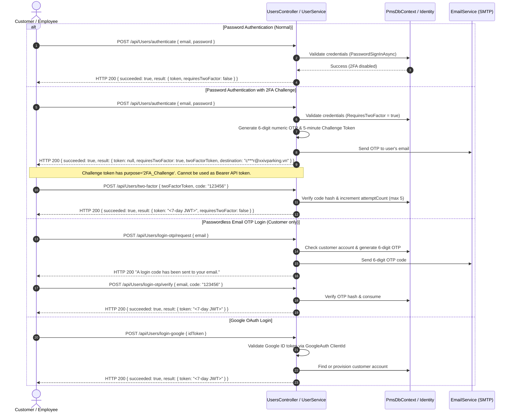
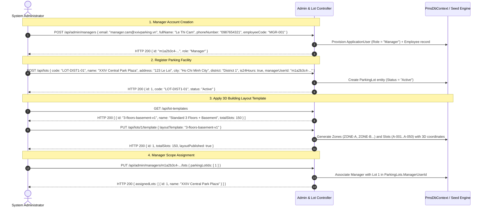
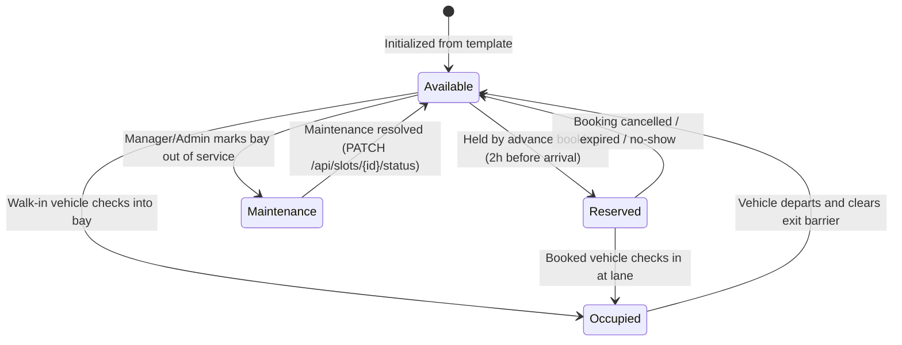
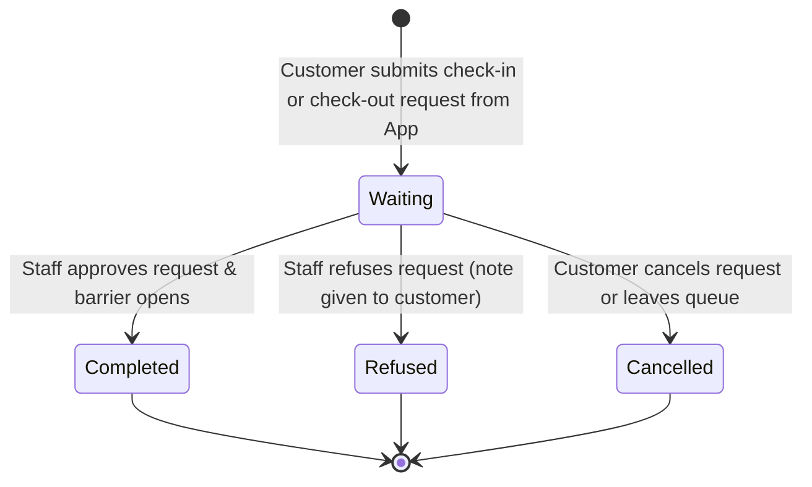
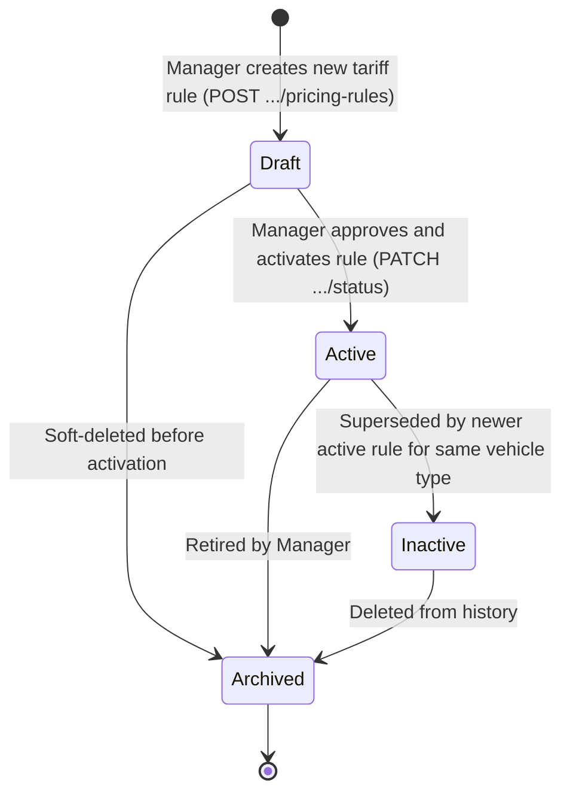

# XXIV Parking Management System (PMS) — Backend API Documentation

---

## Table of Contents

- [1. Document & System Overview](#1-document--system-overview)
  - [1.1 Purpose and Scope](#11-purpose-and-scope)
  - [1.2 Intended Audience](#12-intended-audience)
  - [1.3 Architectural & Technology Baseline](#13-architectural--technology-baseline)
  - [1.4 API Surface Summary](#14-api-surface-summary)
  - [1.5 Environments & Base URLs](#15-environments--base-urls)
- [2. Global API Conventions](#2-global-api-conventions)
  - [2.1 Route Casing and Formatting](#21-route-casing-and-formatting)
  - [2.2 Content Types & Encodings](#22-content-types--encodings)
  - [2.3 Standard Request Headers](#23-standard-request-headers)
  - [2.4 Response Envelope (ApiResult)](#24-response-envelope-apiresult)
  - [2.5 Standard Error Examples by HTTP Status Code](#25-standard-error-examples-by-http-status-code)
  - [2.6 Pagination Contracts](#26-pagination-contracts)
  - [2.7 Date, Time, and Monetary Formatting](#27-date-time-and-monetary-formatting)
  - [2.8 Enum and Status Serialization](#28-enum-and-status-serialization)
  - [2.9 File Upload Constraints](#29-file-upload-constraints)
  - [2.10 Rate Limiting Policies](#210-rate-limiting-policies)
  - [2.11 API Versioning & Deprecation Policy](#211-api-versioning--deprecation-policy)
- [3. Authentication & Authorization](#3-authentication--authorization)
  - [3.1 JWT Bearer Mechanism](#31-jwt-bearer-mechanism)
  - [3.2 Authentication & Login Flows](#32-authentication--login-flows)
  - [3.3 Password Policy & Validation Constraints](#33-password-policy--validation-constraints)
  - [3.4 Role-Based Access Control (RBAC) Matrix](#34-role-based-access-control-rbac-matrix)
  - [3.5 Facility Scope & Lot-Level Authorization](#35-facility-scope--lot-level-authorization)
  - [3.6 Object-Level Authorization (IDOR Protection)](#36-object-level-authorization-idor-protection)
- [4. Typical End-to-End Business Flows](#4-typical-end-to-end-business-flows)
  - [4.1 Flow 1: Complete Customer Lifecycle (Register to Exit)](#41-flow-1-complete-customer-lifecycle-register-to-exit)
  - [4.2 Flow 2: Staff Gate Operations, Turnarounds & Lost Ticket Exceptions](#42-flow-2-staff-gate-operations-turnarounds--lost-ticket-exceptions)
  - [4.3 Flow 3: Facility Manager Tariff Configuration & Sandbox Simulation](#43-flow-3-facility-manager-tariff-configuration--sandbox-simulation)
  - [4.4 Flow 4: System Administrator Provisioning & Facility Setup](#44-flow-4-system-administrator-provisioning--facility-setup)
- [5. Domain Model, Enums & State Machines](#5-domain-model-enums--state-machines)
  - [5.1 Comprehensive Domain Enums & Constants](#51-comprehensive-domain-enums--constants)
  - [5.2 State Machine Lifecycles](#52-state-machine-lifecycles)
- [6. Business Rules & Calculation Engine](#6-business-rules--calculation-engine)
  - [6.1 Parking Fee Calculation Engine (FeeCalculator)](#61-parking-fee-calculation-engine-feecalculator)
  - [6.2 Worked Calculation Examples](#62-worked-calculation-examples)
  - [6.3 Reservation Rules & Refund Policy (BR-01 .. BR-07)](#63-reservation-rules--refund-policy-br-01--br-07)
  - [6.4 Gate Hardware & Enforcement Rules (BR-10 .. BR-20)](#64-gate-hardware--enforcement-rules-br-10--br-20)
  - [6.5 Customer XXIV Wallet Rules](#65-customer-xxiv-wallet-rules)
- [7. Shared Schemas Reference](#7-shared-schemas-reference)
  - [7.1 User & Identity Schemas](#71-user--identity-schemas)
  - [7.2 Parking Lot, Layout & Facility Schemas](#72-parking-lot-layout--facility-schemas)
  - [7.3 Reservation Schemas](#73-reservation-schemas)
  - [7.4 Parking Session Schemas](#74-parking-session-schemas)
  - [7.5 Gate Operations & Results Schemas](#75-gate-operations--results-schemas)
  - [7.6 Pricing & Tariff Schemas](#76-pricing--tariff-schemas)
  - [7.7 Payment & Customer Wallet Schemas](#77-payment--customer-wallet-schemas)
- [8. API Reference](#8-api-reference)
  - [8.1 Module 01: Authentication & User Accounts (26 Endpoints)](#81-module-01-authentication--user-accounts-26-endpoints)
  - [8.2 Module 02: Parking Lots, Layouts, Zones & Slots (22 Endpoints + Aliases)](#82-module-02-parking-lots-layouts-zones--slots-22-endpoints--aliases)
  - [8.3 Module 03: Customer Reservations (8 Endpoints)](#83-module-03-customer-reservations-8-endpoints)
  - [8.4 Module 04: Customer Parking Sessions (7 Endpoints)](#84-module-04-customer-parking-sessions-7-endpoints)
  - [8.5 Module 05: Staff Gate Operations & Gate Requests (27 Endpoints)](#85-module-05-staff-gate-operations--gate-requests-27-endpoints)
  - [8.6 Module 06: Manager Operations & Pricing (23 Endpoints)](#86-module-06-manager-operations--pricing-23-endpoints)
  - [8.7 Module 07: Vehicle Verification & Document Management (9 Endpoints)](#87-module-07-vehicle-verification--document-management-9-endpoints)
  - [8.8 Module 08: Payments & Customer Wallet (11 Endpoints)](#88-module-08-payments--customer-wallet-11-endpoints)
  - [8.9 Module 09: Revenue Reporting (2 Endpoints)](#89-module-09-revenue-reporting-2-endpoints)
  - [8.10 Module 10: Admin User & System Management (8 Endpoints)](#810-module-10-admin-user--system-management-8-endpoints)
  - [8.11 Module 11: Admin Simulation & Testing (2 Endpoints)](#811-module-11-admin-simulation--testing-2-endpoints)
  - [8.12 Module 12: Notifications (5 Endpoints)](#812-module-12-notifications-5-endpoints)
- [9. Real-Time API (SignalR Hubs)](#9-real-time-api-signalr-hubs)
  - [9.1 Connection Architecture & Token Negotiation](#91-connection-architecture--token-negotiation)
  - [9.2 LotHub (/api/hubs/lots)](#92-lothub-apihubslots)
  - [9.3 ParkingOpsHub (/api/hubs/parking-ops)](#93-parkingopshub-apihubsparking-ops)
  - [9.4 VehicleVerificationHub (/api/hubs/vehicle-verifications)](#94-vehicleverificationhub-apihubsvehicle-verifications)
  - [9.5 Connection Resilience & Client Reconnect Policy](#95-connection-resilience--client-reconnect-policy)
- [10. Error Handling, Validation & Rate Limiting](#10-error-handling-validation--rate-limiting)
  - [10.1 FluentValidation Pipeline & Interception Filter](#101-fluentvalidation-pipeline--interception-filter)
  - [10.2 Global Exception Handling Middleware](#102-global-exception-handling-middleware)
  - [10.3 ASP.NET Core Rate Limiting Policies](#103-aspnet-core-rate-limiting-policies)
- [11. Integration Notes (Hardware & Gateways)](#11-integration-notes-hardware--gateways)
  - [11.1 Automated Gate Hardware & ANPR Camera Integration](#111-automated-gate-hardware--anpr-camera-integration)
  - [11.2 Payment Gateway Callback & Reconciliation Notes](#112-payment-gateway-callback--reconciliation-notes)
  - [11.3 Self-Contained Signed Token Signer (ParkingTokenSigner)](#113-self-contained-signed-token-signer-parkingtokensigner)
- [12. Glossary & Domain Terminology](#12-glossary--domain-terminology)
- [13. Maintainer Appendix: Endpoint to Source Location](#13-maintainer-appendix-endpoint-to-source-location)

---
## 1. Document & System Overview

### 1.1 Purpose and Scope
This document provides the definitive, implementation-verified technical specification for the XXIV Parking Management System (PMS) Backend REST API and real-time SignalR Hub services. The single source of truth for all schemas, routes, security rules, and business logic described herein is the ASP.NET Core source code located in `src/PMS.API`, `src/PMS.Application`, `src/PMS.Core`, and `src/PMS.DataAccess`.

This specification governs all frontend client integrations (Web Portal, Customer Mobile Application, Staff Gate Terminal, and Manager Dashboard) and external subsystem interactions (Automated Number Plate Recognition / ANPR edge devices, barrier controllers, and third-party payment gateways).

### 1.2 Intended Audience
- **Frontend Engineers:** Integrating customer booking, parking telemetry, gate operations, and management dashboards.
- **Hardware & IoT Integrators:** Implementing ANPR cameras, loop sensors, barrier gates, and entry/exit kiosks.
- **QA & Test Automation Engineers:** Developing automated integration and end-to-end contract validation suites.
- **Backend Maintainers:** Ensuring continuous adherence to domain business rules, RBAC boundaries, and lifecycle state machines.

### 1.3 Architectural & Technology Baseline
The backend is structured according to Clean Architecture / N-Tier principles:
- **Runtime Framework:** .NET 9.0 (ASP.NET Core Web API)
- **Data Persistence:** Entity Framework Core 9.0 targeting Microsoft SQL Server / LocalDB (with optional PostgreSQL support)
- **Background Job Execution:** Hangfire (minutely deposit expirations, overdue session monitors, and document retention purges)
- **Real-Time Messaging:** ASP.NET Core SignalR (WebSocket / Server-Sent Events transports)
- **Request Validation:** FluentValidation with automatic pipeline filters (`ValidateModelAttribute`)
- **Security:** JSON Web Token (JWT) Bearer Authentication with HMAC-SHA256 signature verification

### 1.4 API Surface Summary
- **Total Controllers:** 22 concrete REST controllers inheriting from `ApiController`
- **Total Canonical HTTP Endpoints:** 150 distinct action operations
- **Route Aliases:** 2 method-level route aliases + 1 class prefix alias (`/api/lots` and `/api/parking-lots`)
- **SignalR Real-Time Hubs:** 3 hubs (`/api/hubs/lots`, `/api/hubs/parking-ops`, `/api/hubs/vehicle-verifications`)

### 1.5 Environments & Base URLs

| Environment | Base URL | Swagger / OpenAPI Spec | Notes |
|:---|:---|:---|:---|
| **Local Development (HTTPS)** | `https://localhost:5001` | `https://localhost:5001/swagger` | Configured in `launchSettings.json` |
| **Local Development (HTTP)** | `http://localhost:5000` | `http://localhost:5000/swagger` | Configured in `launchSettings.json` |
| **IIS Express Development** | `https://localhost:44391` | `https://localhost:44391/swagger` | Port `54180` for HTTP |
| **Staging Environment** | `TBD - needs verification` | `TBD - needs verification` | Managed via CI/CD infrastructure |
| **Production Environment** | `TBD - needs verification` | `TBD - needs verification` | Managed via CI/CD infrastructure |

---

## 2. Global API Conventions

### 2.1 Route Casing and Formatting
- **Base Route Pattern:** All REST endpoints are prefixed with `/api/`.
- **Controller Naming:** Controllers inheriting the base `[Route("api/[controller]")]` attribute without overrides retain PascalCase controller segments (e.g., `/api/Users`, `/api/GateRequests`, `/api/Notifications`). Dedicated operational controllers declare explicit lower-kebab-case prefixes (e.g., `/api/parking-sessions`, `/api/vehicle-verifications`, `/api/wallet`).
- **Path Parameters:** Path parameters in URL templates are documented in clean format without ASP.NET type constraint suffixes:
  - Documentation format: `/api/lots/{id}` or `/api/users/profile/vehicles/{vehicleId}/documents`
  - *Internal ASP.NET route template:* `/api/lots/{id:int}` or `/api/users/profile/vehicles/{vehicleId:guid}/documents` (type constraints are validated by the framework prior to action invocation).

### 2.2 Content Types & Encodings
- **Default Content Type:** `application/json; charset=utf-8` for all request bodies and response envelopes.
- **File Uploads:** `multipart/form-data` for avatar image uploads (`/api/Users/profile/avatar`) and vehicle document uploads (`/api/users/profile/vehicles/{vehicleId}/documents/{documentType}/{side}`).
- **Binary Downloads:** Direct file streams (`image/jpeg`, `image/png`, `application/pdf`) for KYC document preview endpoints with header `Cache-Control: private, no-store`.

### 2.3 Standard Request Headers

| Header | Required | Description | Example |
|:---|:---:|:---|:---|
| `Authorization` | Yes* | Standard Bearer JWT token (*required for all non-public endpoints). | `Bearer eyJhbGciOiJIUzI1NiIsInR5cCI6...` |
| `Content-Type` | Optional | MIME type of request body. Required when sending JSON or multipart payloads. | `application/json` |
| `Accept` | Optional | Expected response MIME type. Default is `application/json`. | `application/json` |
| `X-Forwarded-For` | Optional | Forwarded client IP address used by payment callbacks and rate limiters. | `203.0.113.195` |

### 2.4 Response Envelope (ApiResult)
Every standard REST endpoint wraps its response payload inside the uniform `ApiResult<T>` envelope (`PMS.Application.Models.ApiResult<T>`).

#### Success Response Structure (HTTP 200 OK / 201 Created)
```jsonc
{
  "succeeded": true,
  "result": { ... },
  "errors": []
}
```
- `succeeded` (`boolean`): Always `true` on successful completion.
- `result` (`T`): The typed response model (object, list, primitive, or null).
- `errors` (`array of strings`): Always an empty array `[]` on successful calls.

#### Failure Response Structure (HTTP 4xx / 5xx)
When a request fails due to validation errors, resource conflicts, or domain rule violations, the envelope returns:
```json
{
  "succeeded": false,
  "result": null,
  "errors": [
    "Descriptive English error message explaining the failure reason."
  ]
}
```
- `succeeded` (`boolean`): Always `false`.
- `result`: Always `null`.
- `errors` (`array of strings`): Contains one or more descriptive failure messages.

### 2.5 Standard Error Examples by HTTP Status Code

#### 400 Bad Request (Model Validation Error via `ValidateModelAttribute`)
Returned when request parameters or payload properties fail FluentValidation rules.
```json
{
  "succeeded": false,
  "result": null,
  "errors": [
    "Password must contain at least one upper case letter and one special character",
    "Phone number is not a valid Vietnamese phone number"
  ]
}
```

#### 400 Bad Request (Business Logic Precondition Failed)
Returned when an operation violates business domain preconditions (e.g., attempting to book a bay in the past).
```json
{
  "succeeded": false,
  "result": null,
  "errors": [
    "Arrival time cannot be in the past."
  ]
}
```

#### 401 Unauthorized (Missing or Invalid Token)
Returned by ASP.NET Core Authentication Middleware when the `Authorization` header is missing, malformed, or expired.
```json
{
  "succeeded": false,
  "result": null,
  "errors": [
    "Authentication token is missing, invalid, or expired."
  ]
}
```

#### 403 Forbidden (Insufficient Role or Lot Scope Violation)
Returned when the user has a valid token but lacks the required role or is not assigned to the requested parking lot.
```json
{
  "succeeded": false,
  "result": null,
  "errors": [
    "You are not assigned to this parking lot."
  ]
}
```

#### 404 Not Found (Entity or Resource Does Not Exist / Object Scope Access)
Returned when an entity ID does not exist, or when a customer attempts to query another user's private entity (preventing ID enumeration).
```json
{
  "succeeded": false,
  "result": null,
  "errors": [
    "Payment not found."
  ]
}
```

#### 409 Conflict (State Conflict or Resource Collision)
Returned when an overlapping reservation exists, or an entity state prohibits the transition.
```json
{
  "succeeded": false,
  "result": null,
  "errors": [
    "This bay is already booked for part of that time. Pick another time or bay."
  ]
}
```

#### 422 Unprocessable Entity (Semantic Domain Failure)
Returned when business state validation rejects the request semantics.
```json
{
  "succeeded": false,
  "result": null,
  "errors": [
    "The requested action cannot be processed in the current entity lifecycle state."
  ]
}
```

#### 429 Too Many Requests (Rate Limit Exceeded)
Returned by ASP.NET Core RateLimiter middleware when IP request quota is exhausted.
```json
{
  "succeeded": false,
  "result": null,
  "errors": [
    "Too many requests. Please retry after the cooldown period."
  ]
}
```

#### 500 Internal Server Error (Unhandled Exception)
Caught and formatted by `ExceptionHandlingMiddleware`.
```json
{
  "succeeded": false,
  "result": null,
  "errors": [
    "An unexpected internal error occurred while processing your request."
  ]
}
```

### 2.6 Pagination Contracts
The API does NOT use `pageNumber`/`totalPages`/`hasNextPage`. It implements three distinct, source-verified pagination shapes:

#### Pattern 1: Customer Parking Session History (`ParkingHistoryPageModel`)
Endpoints: `GET /api/parking-sessions/history`
- **Query Parameters (`ParkingHistoryQuery`):**
  - `page` (`integer`, optional, default `1`): 1-based page number.
  - `pageSize` (`integer`, optional, default `10`, range `1..50`): Rows per page.
  - `from` (`string` ISO 8601 UTC, optional): Filter sessions with exit time on or after this timestamp.
  - `to` (`string` ISO 8601 UTC, optional): Filter sessions with exit time before this timestamp.
  - `vehicleId` (`string` UUID, optional): Filter sessions for a specific vehicle.
- **Response Structure:**
```jsonc
{
  "items": [ ... ],
  "page": 1,
  "pageSize": 10,
  "totalCount": 24,
  "totalSpent": 480000.00
}
```

#### Pattern 2: Staff Lot Operations History (`StaffSessionHistoryPageModel`, `StaffPaymentHistoryPageModel`)
Endpoints: `GET /api/staff/lots/{lotId}/sessions/history`, `GET /api/staff/lots/{lotId}/payments`
- **Query Parameters:**
  - `page` (`integer`, optional, default `1`): 1-based page number.
  - `pageSize` (`integer`, optional, default `10`, range `1..50`): Rows per page.
  - Additional query filters: `plate`, `method`.
- **Response Structure:**
```jsonc
{
  "items": [ ... ],
  "page": 1,
  "pageSize": 10,
  "totalCount": 156
}
```

#### Pattern 3: Customer Notification Stream (`NotificationListModel`)
Endpoint: `GET /api/notifications`
- **Query Parameters:**
  - `unreadOnly` (`boolean`, optional, default `false`): Filter unread notifications only.
  - `take` (`integer`, optional, default `30`, max `100`): Maximum items to return.
- **Response Structure:**
```jsonc
{
  "items": [ ... ],
  "unreadCount": 3
}
```

### 2.7 Date, Time, and Monetary Formatting
- **Timestamps:** ISO 8601 extended UTC format with `Z` timezone indicator: `YYYY-MM-DDTHH:mm:ssZ` (e.g., `2026-10-30T08:00:00Z`).
- **Dates Only:** ISO 8601 calendar format `YYYY-MM-DD` (e.g., `2026-10-30`).
- **Times Only:** 24-hour clock `HH:mm:ss` (e.g., `06:00:00`).
- **Monetary Amounts:** All currency values represent Vietnam Dong (VND). Stored and returned as exact decimals with 0 or 2 decimal places (e.g., `30000` or `30000.00`). All parking fee calculations are rounded up to the nearest multiple of `1,000 VND` per BR-22.

### 2.8 Enum and Status Serialization
All domain statuses and enum-like fields are stored and serialized as plain JSON strings (e.g., `"PendingDeposit"`, `"Confirmed"`, `"Active"`, `"Block"`). String constants are case-sensitive and must be submitted matching the exact PascalCase domain definitions.

### 2.9 File Upload Constraints
- **User Avatar Image (`POST /api/Users/profile/avatar`):**
  - Parameter: `file` (`IFormFile`, multipart form field).
  - Permitted Content Types: `image/jpeg`, `image/png`, `image/gif`, `image/webp`. (PDF is strictly rejected).
  - Maximum File Size: **2 MB** (`2,097,152 bytes`).
- **Vehicle Registration & KYC Papers (`POST /api/users/profile/vehicles/{vehicleId}/documents/{documentType}/{side}`):**
  - Parameter: `file` (`IFormFile`, multipart form field).
  - Permitted Content Types: `image/jpeg`, `image/png`, `application/pdf`.
  - Maximum File Size: **10 MB** (`10,485,760 bytes`). Controller requests permit up to 11 MB before cutting the transport stream.

### 2.10 Rate Limiting Policies
Configured in `ApiDependencyInjection.AddPublicRateLimits` using ASP.NET Core Fixed Window Rate Limiter (partitioned by remote IP address; `QueueLimit = 0`):

1. **`public-layout` Policy:**
   - **Limit:** 120 requests per 1 minute window per client IP.
   - **Target Endpoints:**
     - `LayoutsController` (`GET /api/public/lots/{lotId}/layout`, `GET /api/public/lots/{lotId}/layout/status`, `GET /api/public/lots/{lotId}/layout/2d`, `GET /api/lot-templates`).
     - `LotsController` (`GET /api/public/lots`, `GET /api/public/parking-lots`, `GET /api/public/lots/{id}/prices`).
   - **Rejection Behavior:** HTTP 429 Too Many Requests immediately upon exceeding 120 req/min.

2. **`password-reset` Policy:**
   - **Limit:** 5 requests per 15 minute window per client IP.
   - **Target Endpoints:**
     - `POST /api/Users/forgot-password`
     - `POST /api/Users/reset-password`
   - **Rejection Behavior:** HTTP 429 Too Many Requests immediately upon exceeding 5 req/15 min.

### 2.11 API Versioning & Deprecation Policy
The current system exposes version `v1` served under route prefix `/api/`. When breaking schema alterations occur, new major versions will introduce versioned path prefixes (e.g. `/api/v2/`). Deprecated endpoints remain supported with response header `Warning: 299 - "Deprecated Endpoint"` until formal decommission.


## 3. Authentication & Authorization

### 3.1 JWT Bearer Mechanism
The system authenticates API requests via JSON Web Tokens (JWT) adhering to RFC 7519. The token is transmitted in the HTTP `Authorization` header:
```http
Authorization: Bearer <token>
```
For WebSocket SignalR connections (`ParkingOpsHub` and `VehicleVerificationHub`), web browsers cannot set custom headers; the client passes the token as a query parameter:
```text
/api/hubs/parking-ops?access_token=<token>
/api/hubs/vehicle-verifications?access_token=<token>
```

#### Token Characteristics
- **Signature Algorithm:** HMAC-SHA256 (`HS256`) signed with the application master key (`JwtConfiguration:SecretKey`).
- **Token Lifetime:** **7 days** (`DateTime.UtcNow.AddDays(7)`).
- **Stateless Operation:** The JWT is completely stateless. There is no server-side refresh token store, token blacklist, or server-side logout/revocation endpoint.
- **Payload Claims:**
  - `nameid` (`ClaimTypes.NameIdentifier`): Unique string identifier of the user account (`AspNetUsers.Id`).
  - `unique_name` (`ClaimTypes.Name`): Account username.
  - `email` (`ClaimTypes.Email`): Registered email address.
  - `phone` (`ClaimTypes.MobilePhone`): Contact phone number (omitted if null).
  - `role` (`ClaimTypes.Role`): User security role (`"User"`, `"Staff"`, `"Manager"`, or `"Admin"`).

---

### 3.2 Authentication & Login Flows



#### 1. Standard Password Login (`POST /api/Users/authenticate`)
Accepts `LoginUserModel` (`email`, `password`). If 2FA is not required, returns `token: "<jwt>"`, `requiresTwoFactor: false`.

#### 2. Two-Factor Authentication (2FA) Challenge Flow
- **Trigger:** Evaluated when `user.TwoFactorEnabled || signInResult.RequiresTwoFactor`.
- **Challenge Issuance:** Returns HTTP 200 with `token: null`, `requiresTwoFactor: true`, `twoFactorToken: "<challenge_jwt>"`, and masked email `destination: "c***r@xxivparking.vn"`.
- **Challenge Token Properties:** A signed JWT containing claims `sub: userId`, `otp_id`, `purpose: "2FA_Challenge"`, `dest: email`, expiring in **5 minutes**.
- **Challenge Token Security:** If a client attempts to use this challenge token as a Bearer authorization token on standard API endpoints, `JwtBearerEvents.OnTokenValidated` intercepts it and fails authentication with: `"Two-factor challenge token cannot be used as an API access token."`
- **Code Generation & Email Delivery:** A cryptographically random 6-digit numeric OTP (`RandomNumberGenerator.GetInt32(100000, 1000000)`) is hashed with the master key and email salt, saved in `OtpCodes` table, and dispatched via SMTP email.
- **Verification Endpoint (`POST /api/Users/two-factor`):** Accepts `{ "twoFactorToken": "...", "code": "123456" }`. Upon matching, marks the OTP consumed and returns the full 7-day API access token.
- **Security Limits:**
  - **Attempt Limit:** Maximum **5 failed attempts** (`maxAttempts = 5`). Exceeding 5 attempts immediately consumes and revokes the OTP, forcing a fresh challenge.
  - **Expiry:** Exactly **5 minutes** from generation.
  - **Resend Cooldown (`POST /api/Users/two-factor/resend`):** Enforces a **60-second cooldown** between OTP requests (`CreatedAt > DateTime.UtcNow.AddSeconds(-60)`). Requests within 60 seconds are rejected with HTTP 400 `"Please wait X seconds before requesting a new verification code."`
- **2FA Management Notice:** There is NO public or administrative REST endpoint to enable or disable 2FA. `TwoFactorEnabled` is stored on `AspNetUsers` and configured via direct database configuration or seed scripts.

#### 3. Passwordless OTP Login (`POST /api/Users/login-otp/request` & `verify`)
Available exclusively for Customer accounts (`User` role). Internal Staff, Managers, and Admins are prohibited from passwordless login and must authenticate with their primary password.

#### 4. Google OAuth Sign-In (`POST /api/Users/login-google`)
Accepts `{ idToken: "..." }`. Validates the token against Google's token verification API using `GoogleAuth:ClientId`. If the account does not exist, an active customer account is automatically provisioned.

---

### 3.3 Password Policy & Validation Constraints

Configured in `UserValidatorConfiguration.cs` and applied via FluentValidation:

| Field | Minimum | Maximum | Format / Regex Rule | Validation Error Message |
|:---|:---:|:---:|:---|:---|
| **Password** | 6 | 128 | `^(?=.*[A-Z])(?=.*[^A-Za-z0-9]).+$` | *"Password must contain at least one upper case letter and one special character"* |
| **Username** | 1 | 20 | Alphanumeric; must be globally unique | *"Username should have maximum 20 characters"* / *"Username is not available"* |
| **Email** | 1 | 256 | `^[a-zA-Z0-9_%+-]+(?:\.[a-zA-Z0-9_%+-]+)*@...` | *"Email address is not valid"* / *"Email address is already in use"* |
| **Customer Phone** | 10 | 12 | `^(\+84\|84\|0)[35789][0-9]{8}$` | *"Phone number is not a valid Vietnamese phone number"* |
| **Employee Phone** | 10 | 10 | `^0[0-9]{9}$` (BR-28: 10 digits starting with 0) | *"Employee phone number must be exactly 10 digits starting with 0"* |
| **Citizen ID (CCCD)** | 12 | 12 | `^\d{12}$` (Vietnamese Citizen Identity) | *"Citizen ID must have exactly 12 digits"* |

---

### 3.4 Role-Based Access Control (RBAC) Matrix

The table below is rebuilt from the source code `[Authorize]` and `[AllowAnonymous]` attributes across all 22 controllers:

| Functional Area / Resource | Public (Anon) | Customer (`User`) | Gate Staff (`Staff`) | Facility Manager (`Manager`) | System Admin (`Admin`) | Controller Implementation Reference |
|:---|:---:|:---:|:---:|:---:|:---:|:---|
| **Public Lots & Prices** | **✓** | **✓** | **✓** | **✓** | **✓** | `LotsController.GetPublicLotsAsync`, `GetPublicPricesAsync` |
| **Public 3D / 2D Layout & Status** | **✓** | **✓** | **✓** | **✓** | **✓** | `LayoutsController` (`/layout`, `/status`, `/2d`, `/lot-templates`) |
| **User Registration & Login (Password, OTP, Google)** | **✓** | — | — | — | — | `UsersController` (`register`, `authenticate`, `login-otp`, `login-google`) |
| **2FA Verification & Resend** | **✓** | — | — | — | — | `UsersController` (`two-factor`, `two-factor/resend`) |
| **Password Reset (Forgot/Reset)** | **✓** | — | — | — | — | `UsersController` (`forgot-password`, `reset-password`) |
| **Customer Profile & Password Change** | ✗ | **✓** | **✓** | **✓** | **✓** | `UsersController` (`/profile`, `/change-password`, `/check-unique`) |
| **Customer Avatar Upload** | ✗ | **✓** | **✓** | **✓** | **✓** | `UsersController.UploadAvatarAsync` (`/profile/avatar`) |
| **Customer Vehicles (CRUD & Default)** | ✗ | **✓** | **✓** | **✓** | **✓** | `UsersController` (`/profile/vehicles`, `/check-plate`, `/default`) |
| **Vehicle KYC Documents (Upload & Submit)** | ✗ | **✓** | ✗ | ✗ | ✗ | `VehicleDocumentsController` (Owner only) |
| **Customer Wallet (Balance, Top-Up, Withdraw)** | ✗ | **✓** | ✗ | ✗ | ✗ | `WalletController` (`/api/wallet`, `/topup`, `/withdraw`) |
| **Customer Slot Reservations (Create, View, Cancel)** | ✗ | **✓** | ✗ | ✗ | ✗ | `ReservationsController` |
| **Customer Parking Sessions (Current, History, Quote)** | ✗ | **✓** | ✗ | ✗ | ✗ | `ParkingSessionsController` |
| **Customer Gate Requests (CheckIn, CheckOut, Mine)** | ✗ | **✓** | ✗ | ✗ | ✗ | `GateRequestsController` (`mine`, `check-in-request`, `check-out-request`) |
| **Customer Notifications (Bell, Mark Read, Delete)** | ✗ | **✓** | ✗ | ✗ | ✗ | `NotificationsController` |
| **Payment Gateway Callbacks (VNPay/MoMo Return & IPN)** | **✓** | **✓** | **✓** | **✓** | **✓** | `PaymentsController` (`vnpay/return`, `vnpay/ipn`, `momo/return`, `momo/ipn`) |
| **Payment Status Check & Simulation** | ✗ | **✓** | **✓** | **✓** | **✓** | `PaymentsController` (`{id}`, `{id}/check`, `{id}/simulate-success`) |
| **Vehicle Verification Queue & Review** | ✗ | ✗ | **✓** | **✓** | **✓** | `VehicleVerificationsController` |
| **Staff Assigned Lots** | ✗ | ✗ | **✓** | ✗ | ✗ | `StaffController.GetLotsAsync` |
| **Gate Operations (Check-in, Confirm, Checkout, Quote)** | ✗ | ✗ | **✓** | **✓** | **✓** | `StaffGateController` (Subject to lot-scope) |
| **Staff Gate Requests Queue (Approve/Refuse)** | ✗ | ✗ | **✓** | **✓** | **✓** | `GateRequestsController` (Subject to lot-scope) |
| **Manager Assigned Lots & Staff Management** | ✗ | ✗ | ✗ | **✓** | ✗ | `ManagerController` |
| **Manager Operations (Abnormal Close, Lost Ticket Decision)** | ✗ | ✗ | ✗ | **✓** | **✓** | `ManagerOperationsController` (Subject to lot-scope) |
| **Manager Whitelist / Blacklist (Add, Remove)** | ✗ | ✗ | ✗ | **✓** | **✓** | `ManagerOperationsController` (Subject to lot-scope) |
| **Manager Pricing Rules (CRUD & Simulation)** | ✗ | ✗ | ✗ | **✓** | **✓** | `ManagerPricingController` (Subject to lot-scope) |
| **Manager Revenue Reports** | ✗ | ✗ | ✗ | **✓** | ✗ | `ManagerRevenueController` (Scoped to managed lots) |
| **Lot Configuration (Create, Update, Template, Delete)** | ✗ | ✗ | ✗ | ✗ | **✓** | `LotsController` (`POST`, `PUT`, `PUT template`, `DELETE`) |
| **Lot Operational Status (Open, Close, Maintenance)** | ✗ | ✗ | ✗ | **✓** | **✓** | `LotsController.UpdateStatusAsync` (`PATCH /status`) |
| **Zone & Slot Configuration Update** | ✗ | ✗ | ✗ | ✗ | **✓** | `ZonesController.UpdateAsync`, `SlotsController.UpdateAsync` |
| **Slot Maintenance Status Update** | ✗ | ✗ | ✗ | **✓** | **✓** | `SlotsController.UpdateStatusAsync` (`PATCH /status`) |
| **Admin Employee & Manager Provisioning** | ✗ | ✗ | ✗ | ✗ | **✓** | `AdminController` (`managers`, `managers/{id}/lots`, `users/{id}/status`) |
| **Admin System Revenue Reports** | ✗ | ✗ | ✗ | ✗ | **✓** | `AdminRevenueController` (System-wide metrics) |
| **Admin Parking Simulation Sandbox** | ✗ | ✗ | ✗ | ✗ | **✓** | `AdminSimulationController` (System-wide demo control) |

---

### 3.5 Facility Scope & Lot-Level Authorization

Beyond global role validation, operations on specific parking lots are strictly controlled by `LotScopeService.cs`:

```csharp
public async Task<bool> CanOperateAsync(string userId, string role, int lotId)
{
    if (string.IsNullOrEmpty(userId)) return false;

    return role switch
    {
        "Admin" => await pmsContext.ParkingLots.AnyAsync(p => p.Id == lotId && !p.IsDeleted),
        "Manager" => await pmsContext.ParkingLots.AnyAsync(p => p.Id == lotId && !p.IsDeleted && p.ManagerUserId == userId),
        "Staff" => await pmsContext.Employees.AnyAsync(e => e.UserId == userId && e.ParkingLotId == lotId && e.Status != "Terminated"),
        _ => false
    };
}
```

1. **System Administrator (`Admin`):** Has authority over every active, non-deleted parking lot in the system.
2. **Facility Manager (`Manager`):** May only query or modify lots where `ParkingLots.ManagerUserId == userId`. Attempting to access another manager's lot throws HTTP 403 Forbidden (`ForbiddenException("You do not manage this parking lot.")`).
3. **Gate Staff (`Staff`):** May only perform gate operations on the lot currently assigned in `Employees.ParkingLotId` with status active (`Status != "Terminated"`).
4. **Customer (`User`):** Facility scope checks always evaluate to `false`.

---

### 3.6 Object-Level Authorization (IDOR Protection)

To prevent Insecure Direct Object References (IDOR), service layers enforce strict entity ownership checks:
- **Payments (`PaymentService.EnsureCanSeeAsync`):** A caller can only view a payment if:
  1. `payment.CustomerUserId == userId` (the paying customer), OR
  2. `lotScope.CanOperateAsync(userId, role, payment.ParkingLotId)` evaluates to `true`.
  *If neither condition is met, the service throws `NotFoundException("Payment not found.")` (HTTP 404)* rather than 403, preventing ID enumeration.
- **Vehicle Documents (`VehicleDocumentService.OpenFileAsync`):** Only the user who registered the vehicle (`vehicle.CustomerId == user.CustomerId`) can view, upload, or submit KYC documents. Attempting to access another user's document returns HTTP 404.
- **Reservations & Sessions (`ReservationService.OwnAsync`, `GateService.GetMySessionsAsync`):** Scoped strictly to the authenticated `ClaimTypes.NameIdentifier`.
- **Wallet Operations (`WalletController`):** Balance telemetry, top-ups, and withdrawals operate exclusively on the wallet matching the authenticated caller's User ID.


## 4. Typical End-to-End Business Flows

All flows below use an illustrative sample dataset (values are representative examples for integration demonstration and do not reflect committed database seed records):
- **Parking Lot:** ID `1` (`"LOT-DIST1-01"`, `"XXIV Central Park Plaza"`)
- **Bay / Slot:** Code `"A-012"` (ID `1001`, Zone `"ZONE-A"`)
- **Vehicle:** Plate `"59A-123.45"`, Type `"CAR_4"` (ID `1`), Brand `"Toyota Camry"`
- **Customer User:** ID `"c8e4f1a0-5b23-4c91-8d3f-7e9b2c011234"` (`"Nguyen Van An"`)
- **Staff User:** ID `"e2b1c3d4-0001-4000-8000-000000000001"` (`"Tran Van Binh"`)

---

### 4.1 Flow 1: Complete Customer Lifecycle (Register to Exit)

```mermaid
sequenceDiagram
    autonumber
    actor Customer as Customer (App)
    participant API as Backend REST API
    participant GW as Payment Gateway (VNPay/MoMo)
    participant SignalR as ParkingOpsHub / LotHub
    actor Staff as Gate Staff / Lane ANPR

    Note over Customer,API: 1. Registration & Fleet Setup
    Customer->>API: POST /api/Users/register (Create account)
    Customer->>API: POST /api/Users/authenticate (Login -> Bearer JWT)
    Customer->>API: POST /api/Users/profile/vehicles { plate: "59A-123.45", typeId: 1 }
    Customer->>API: POST /api/users/profile/vehicles/{id}/documents/RegistrationCertificate/Front (Upload paper)
    Customer->>API: POST /api/users/profile/vehicles/{id}/documents/CitizenId/Front (Upload CCCD)
    Customer->>API: POST /api/users/profile/vehicles/{id}/documents/submit (Submit KYC)
    Staff->>API: POST /api/vehicle-verifications/{verId}/review { approve: true }
    SignalR-->>Customer: Event "VerificationChanged" (Status = "Approved")

    Note over Customer,GW: 2. Wallet Top-Up
    Customer->>API: POST /api/wallet/topup { amount: 200000, provider: "VNPay" }
    API-->>Customer: HTTP 200 { payUrl: "https://sandbox.vnpayment.vn/..." }
    Customer->>GW: Complete payment on gateway portal
    GW->>API: GET /api/payments/vnpay/return or IPN (Signed callback)
    API->>API: Credit Wallet Balance (+200,000 VND)
    SignalR-->>Customer: Event "PaymentChanged" (Status = "Succeeded")

    Note over Customer,API: 3. Bay Reservation & Deposit
    Customer->>API: POST /api/reservations { lotId: 1, slotId: 1001, vehicleId, startTime: "2026-10-30T08:00:00Z", payDeposit: true }
    API-->>Customer: HTTP 201 Created { id: 5001, status: "PendingDeposit", depositAmount: 30000, depositDueAt: "+10m" }
    Customer->>API: POST /api/reservations/5001/payments { method: "Wallet" }
    API->>API: Deduct 30,000 VND from Wallet; Status -> "Confirmed"
    SignalR-->>Customer: Event "ReservationChanged" (Status = "Confirmed")
    Customer->>API: GET /api/reservations/5001/qr
    API-->>Customer: HTTP 200 { qrPayload: "rsv.<payload>.<sig>", validFrom: "07:45:00Z", validUntil: "08:30:00Z" }

    Note over Customer,Staff: 4. Check-In & Entry Confirmation
    Customer->>Staff: Vehicle 59A-123.45 arrives at Entry Lane 1
    Staff->>API: POST /api/staff/lots/1/check-in { plateNumber: "59A-123.45", reservationCode: "RSV-20261030-001" }
    API->>API: Create Session 9001 (Status = "PendingEntry"); Barrier opens
    API-->>Staff: HTTP 200 { barrierOpen: true, session: { id: 9001, status: "PendingEntry" } }
    Staff->>API: POST /api/staff/sessions/9001/entry-confirm (Loop sensor triggered)
    API->>API: Status -> "Active", Slot 1001 -> "Occupied"
    SignalR-->>Customer: Event "SessionChanged" / "SlotStatusChanged"

    Note over Customer,API: 5. Running Session & In-App Prepayment
    Customer->>API: GET /api/parking-sessions/current
    API-->>Customer: HTTP 200 { session: { id: 9001 }, elapsedMinutes: 120, feeSoFar: 40000, depositApplied: 30000, amountDue: 10000 }
    Customer->>API: POST /api/parking-sessions/9001/payments { method: "Wallet", amount: 10000 }
    API->>API: Settle fee; Status -> "Paid"; Issue Exit Window (+15 mins)
    API-->>Customer: HTTP 200 { exitPass: { token: "exit.<payload>.<sig>", validUntil: "10:15:00Z", prepaid: true } }

    Note over Customer,Staff: 6. Exit Barrier Passage
    Customer->>Staff: Present Exit Pass / ANPR scans plate 59A-123.45 (within 15m window)
    Staff->>API: POST /api/staff/sessions/9001/check-out { exitGateId: 2, plateNumber: "59A-123.45" }
    API->>API: Verify exit window valid; AmountDue = 0; Status -> "Completed"; Slot -> "Available"
    API-->>Staff: HTTP 200 { barrierOpen: true, amountDue: 0 }
    Staff-->>Customer: Barrier opens; vehicle departs lot
    Customer->>API: GET /api/parking-sessions/9001/receipt (View e-receipt)
```

---

### 4.2 Flow 2: Staff Gate Operations, Turnarounds & Lost Ticket Exceptions

```mermaid
sequenceDiagram
    autonumber
    actor Driver as Driver (Guest / Customer)
    actor Staff as Gate Staff (Terminal)
    participant ANPR as ANPR Camera / Sensor
    participant API as Backend Staff Gate API
    actor Manager as Facility Manager

    rect rgb(240, 248, 255)
    Note over Driver,API: Entry Lane Scenario A: Normal Guest Entry with Ticket
    ANPR->>Staff: Capture plate "59A-123.45" (Confidence 0.92 >= 0.85)
    Staff->>API: POST /api/staff/lots/1/check-in { plateNumber: "59A-123.45", gateId: 1 }
    API-->>Staff: HTTP 200 { barrierOpen: true, ticket: "tkt.<payload>.<sig>", session: { id: 9002, status: "PendingEntry" } }
    Staff-->>Driver: Print QR Ticket & Barrier opens
    ANPR->>Staff: Ground Loop Sensor triggered (Vehicle crossed barrier)
    Staff->>API: POST /api/staff/sessions/9002/entry-confirm
    API-->>Staff: HTTP 200 { status: "Active" }
    end

    rect rgb(255, 245, 238)
    Note over Driver,API: Entry Lane Scenario B: Turnaround Cancellation (BR-10 / 2-Min Timeout)
    Staff->>API: POST /api/staff/lots/1/check-in { plateNumber: "59A-999.99" }
    API-->>Staff: HTTP 200 { barrierOpen: true, session: { id: 9003, status: "PendingEntry" } }
    Note over Driver,Staff: Driver reverses away; sensor never triggers within 2 minutes
    Staff->>API: POST /api/staff/sessions/9003/entry-cancel
    API-->>Staff: HTTP 200 { status: "Cancelled" }
    end

    rect rgb(255, 250, 240)
    Note over Driver,Manager: Exit Lane Scenario C: Lost Ticket Resolution (BR-13 & BR-14)
    Driver->>Staff: Reports lost entry ticket at Exit Lane
    Staff->>API: POST /api/staff/sessions/9002/lost-ticket { plateNumber: "59A-123.45", reason: "Lost paper ticket" }
    API-->>Staff: HTTP 200 { status: "LostTicketPending" }
    alt Conditional Staff Approval on Spot (BR-13)
        Staff->>API: POST /api/staff/sessions/9002/quote { isLostTicket: true }
        API-->>Staff: HTTP 200 { fee: 40000, lostTicketFee: 100000, totalDue: 140000 }
        Staff->>API: POST /api/staff/sessions/9002/payments/cash { amount: 140000 }
        Staff->>API: POST /api/staff/sessions/9002/check-out { plateNumber: "59A-123.45" }
        API-->>Staff: HTTP 200 { barrierOpen: true }
    else Manager Formal Review Required (BR-14)
        Manager->>API: POST /api/manager/sessions/9002/lost-ticket/approve { reason: "Verified driver identity" }
        API-->>Manager: HTTP 200 { status: "PendingPayment" }
        Staff->>API: POST /api/staff/sessions/9002/payments/cash { amount: 140000 }
        Staff->>API: POST /api/staff/sessions/9002/check-out { plateNumber: "59A-123.45" }
    end
    end
```

---

### 4.3 Flow 3: Facility Manager Tariff Configuration & Sandbox Simulation

```mermaid
sequenceDiagram
    autonumber
    actor Manager as Facility Manager
    participant API as Manager Pricing API
    participant Engine as FeeCalculator Engine
    participant DB as PmsDbContext

    Note over Manager,DB: 1. Draft Tariff Creation
    Manager->>API: POST /api/manager/lots/1/pricing-rules
    Note over Manager,API: Payload: { code: "PRC-CAR-2026", chargeModel: "Block", entryFee: 0, blockMinutes: 60, blockPrice: 20000, maxDailyFee: 150000, lostTicketFee: 100000, status: "Draft" }
    API->>DB: Persist PricingRule (VersionNo = 1, Status = "Draft")
    API-->>Manager: HTTP 200 { id: 201, status: "Draft", versionNo: 1 }

    Note over Manager,Engine: 2. Sandbox Pricing Simulation
    Manager->>API: POST /api/manager/lots/1/pricing-rules/simulate
    Note over Manager,API: Payload: { vehicleTypeId: 1, ruleId: 201, entryTime: "2026-10-30T08:00:00Z", exitTime: "2026-10-30T11:15:00Z" }
    API->>Engine: FeeCalculator.Calculate(tariff, entry, exit, timeZone)
    Engine-->>API: 195 mins -> 4 blocks -> GrossFee: 80,000 VND
    API-->>Manager: HTTP 200 { durationMinutes: 195, grossFee: 80000, amountDue: 80000, days: [...] }

    Note over Manager,DB: 3. Tariff Activation & Predecessor Deactivation
    Manager->>API: PATCH /api/manager/lots/1/pricing-rules/201/status { status: "Active", reason: "Approved for Q4 2026" }
    API->>DB: Archive / Inactivate previous Active rule for CAR_4; Set Rule 201 -> "Active"
    API-->>Manager: HTTP 200 { id: 201, status: "Active", approvedBy: "Le Thi Cam" }
```

---

### 4.4 Flow 4: System Administrator Provisioning & Facility Setup




## 5. Domain Model, Enums & State Machines

### 5.1 Comprehensive Domain Enums & Constants

All domain status values serialize as exact JSON strings. The tables below document the source-verified constants defined in `PMS.Application.Models.Operations` and `PMS.Application.Models.Pricing`:

#### 1. Reservation & Booking Enums

| Constant Set | Allowed Values | Domain Class | Meaning & Integration Semantics |
|:---|:---|:---|:---|
| **`ReservationStatus`** | `PendingDeposit` | `ParkingStatuses` | Bay held; waiting for customer to pay deposit within 10-minute window (`DepositMinutes = 10`). |
| | `Confirmed` | `ParkingStatuses` | Deposit paid; QR code issued (`rsv.<token>.<sig>`); bay held from `HoldAheadMinutes` before arrival. |
| | `CheckedIn` | `ParkingStatuses` | Vehicle entered the lot using this reservation; bay transitions to `Occupied`. |
| | `Completed` | `ParkingStatuses` | Vehicle departed; deposit deducted from total parking fee; session completed. |
| | `Cancelled` | `ParkingStatuses` | Cancelled by customer >= 30m before arrival (100% deposit refund) or < 30m (0% refund). |
| | `LotCancelled` | `ParkingStatuses` | Cancelled by lot manager due to maintenance/emergency (100% refund, FR-RSV-09). |
| | `Expired` | `ParkingStatuses` | 10-minute deposit deadline expired without payment; bay released immediately. |
| | `NoShow` | `ParkingStatuses` | Driver did not arrive within hold window (15m without deposit / 30m with deposit); deposit forfeited. |
| **`BookingMode`** | `Scheduled` | `ParkingStatuses` | Arrival and departure times both specified; bay reserved for that exact duration (30m to 24h). |
| | `PayAsYouGo` | `ParkingStatuses` | Arrival specified; departure open-ended; parking fee accumulates until vehicle leaves. |

#### 2. Parking Session & Bay Enums

| Constant Set | Allowed Values | Domain Class | Meaning & Integration Semantics |
|:---|:---|:---|:---|
| **`SessionStatus`** | `PendingEntry` | `ParkingStatuses` | Barrier opened at entry lane; waiting for ground loop sensor confirmation (timeout 2 min). |
| | `Active` | `ParkingStatuses` | Vehicle entered lot and confirmed by sensor; actively parked and accumulating fees. |
| | `LostTicketPending` | `ParkingStatuses` | Lost ticket reported at exit lane; awaiting conditional or manager approval. |
| | `PendingPayment` | `ParkingStatuses` | Fee requested at exit lane, kiosk, or app; waiting for cash or gateway confirmation. |
| | `Paid` | `ParkingStatuses` | Total parking fee paid (or 0 VND); 15-minute Exit Window activated. |
| | `Completed` | `ParkingStatuses` | Vehicle crossed exit barrier; session closed; bay freed. |
| | `AbnormalClosed` | `ParkingStatuses` | Ghost session closed manually by Manager (fee waived/cleared, FR-OPS-12). |
| | `EmergencyExit` | `ParkingStatuses` | Emergency barrier override opened exit without fee collection. |
| | `Cancelled` | `ParkingStatuses` | Vehicle turned around before ground loop sensor; session invalidated with zero charge. |
| **`SessionType`** | `WalkIn` | `ParkingStatuses` | Transient visitor entry without advance booking; paper QR ticket issued. |
| | `Reservation` | `ParkingStatuses` | Entry matched to a confirmed advance slot reservation. |
| | `Whitelist` | `ParkingStatuses` | Registered VIP/staff plate with automatic 0 VND entry and exit. |
| **`SlotStatus`** | `Available` | `ParkingStatuses` | Bay is empty, active, and available for booking or walk-in parking. |
| | `Reserved` | `ParkingStatuses` | Bay held for an upcoming confirmed reservation (locked 2h before arrival). |
| | `Occupied` | `ParkingStatuses` | Vehicle is physically parked in the bay. |
| | `Maintenance` | `ParkingStatuses` | Bay taken out of service by Manager or Admin for repairs/maintenance. |
| **`LotStatus`** | `Active` | `ParkingStatuses` | Facility fully operational; accept bookings and gate traffic. |
| | `Maintenance` | `ParkingStatuses` | Entire facility under maintenance; reservations blocked. |
| | `TemporarilyClosed` | `ParkingStatuses` | Facility temporarily closed (e.g. overnight or holiday); gates locked. |
| | `Inactive` | `ParkingStatuses` | Facility decommissioned. |

#### 3. Pricing & Tariff Enums

| Constant Set | Allowed Values | Domain Class | Meaning & Integration Semantics |
|:---|:---|:---|:---|
| **`ChargeModel`** | `Block` | `PricingRuleModels` | Fixed block-rate pricing (e.g., 20,000 VND per 60-minute block). |
| | `Hourly` | `FeeCalculator` | Equivalent to Block model with `BlockMinutes = 60`. |
| | `PerEntry` | `FeeCalculator` | Flat single entry charge assessed once per calendar day. |
| | `DayNight` | `FeeCalculator` | Differentiated rates based on whether block starts in Day or Night window. |
| **`PricingRuleStatus`**| `Draft` | `PricingRuleModels` | Initial configuration; inactive and editable; can be simulated. |
| | `Active` | `PricingRuleModels` | Currently enforced pricing rule for the lot and vehicle type. |
| | `Inactive` | `PricingRuleModels` | Superseded by a newer active rule; retained for audit history. |
| | `Archived` | `PricingRuleModels` | Soft-deleted / retired rule. |

#### 4. Gate Requests & Hardware Enums

| Constant Set | Allowed Values | Domain Class | Meaning & Integration Semantics |
|:---|:---|:---|:---|
| **`GateRequestKind`** | `CheckIn` | `GateRequestModels` | Customer requests entry barrier open for confirmed reservation. |
| | `CheckOut` | `GateRequestModels` | Customer requests exit barrier open for active/prepaid session. |
| **`GateRequestStatus`**| `Waiting` | `GateRequestModels`| Queued for Staff action at gate terminal lane. |
| | `Completed` | `GateRequestModels`| Barrier opened; gate operation completed. |
| | `Refused` | `GateRequestModels`| Staff refused request (reason supplied in `Note`). |
| | `Cancelled` | `GateRequestModels`| Withdrawn by customer or invalidated by upstream session state. |
| **`PlateListType`** | `Whitelist` | `ParkingStatuses`| Free entry/exit authorized plates (staff, VIP, municipal). |
| | `Blacklist` | `ParkingStatuses`| Stolen/flagged vehicles; gate blocks entry and triggers alert. |
| **`ViolationType`** | `LostTicket` | `ParkingStatuses`| Driver cannot present valid entry ticket or QR code. |
| | `Abandoned` | `ParkingStatuses`| Vehicle parked continuously past abandoned threshold (7 days). |
| **`LostTicketCaseStatus`** | `Pending` | `ParkingStatuses`| Awaiting review. |
| | `Approved` | `ParkingStatuses`| Fine and parking fee cleared for payment. |
| | `Rejected` | `ParkingStatuses`| Case rejected; vehicle remains detained. |

#### 5. Payments & KYC Verification Enums

| Constant Set | Allowed Values | Domain Class | Meaning & Integration Semantics |
|:---|:---|:---|:---|
| **`PaymentStatus`** | `Pending` | `ParkingStatuses` | Gateway payment link generated; waiting for customer checkout. |
| | `Succeeded` | `ParkingStatuses` | Payment verified via cryptographic callback or IPN. |
| | `Failed` | `ParkingStatuses` | Payment rejected or abandoned at gateway. |
| | `Expired` | `ParkingStatuses`| Payment link expired (15-minute link validity). |
| | `RefundPending` | `ParkingStatuses`| Refund initiated; awaiting gateway settlement. |
| | `Refunded` | `ParkingStatuses`| Deposit or fee successfully returned to customer. |
| **`PaymentPurpose`**| `Deposit` | `ParkingStatuses`| Reservation deposit hold. |
| | `ParkingFee` | `ParkingStatuses`| Settling active parking stay. |
| | `Refund` | `ParkingStatuses`| Return of overpaid deposit or cancelled reservation. |
| | `WalletTopUp` | `ParkingStatuses`| Crediting XXIV customer wallet. |
| **`PaymentMethod`** | `Cash` | `ParkingStatuses`| Cash paid at lane or staff counter. |
| | `Online` | `ParkingStatuses`| Third-party gateway payment (VNPay / MoMo). |
| | `Wallet` | `ParkingStatuses`| XXIV internal stored-value customer wallet. |
| **`PaymentChannel`**| `App` | `ParkingStatuses`| Initiated in customer mobile app (activates Exit Window). |
| | `Kiosk` | `ParkingStatuses`| Paid at counter or standalone payment machine (activates Exit Window). |
| | `Lane` | `ParkingStatuses`| Paid directly at exit barrier lane (barrier opens immediately; no Exit Window). |
| **`VehicleVerificationStatus`** | `Draft` | `VehicleDocumentModels` | Files uploaded; not yet submitted for review. |
| | `NeedsReview` | `VehicleDocumentModels` | Queued in staff verification terminal for manual eye check. |
| | `Approved` | `VehicleDocumentModels` | Vehicle verified; plate authorized for booking and ANPR recognition. |
| | `Rejected` | `VehicleDocumentModels` | Rejected by staff; customer notified with reason; vehicle delisted. |
| | *Legacy OCR* | `Pending`, `Processing`, `AutoVerified` | Deprecated automated OCR states preserved for historical records. |
| **`VehicleDocumentKinds`** | `RegistrationCertificate` | `VehicleDocumentModels` | Vehicle registration paper (cà vẹt xe). |
| | `CitizenId` | `VehicleDocumentModels` | Owner Citizen Identity Card (CCCD). |
| | `Front` / `Back` | `VehicleDocumentModels` | Document side (system requires `Front` for both papers). |

---

### 5.2 State Machine Lifecycles

#### 1. Reservation State Machine (`ParkingStateMachines.ReservationMoves`)
Enforced strictly by `ParkingStateMachines.EnsureReservation(from, to)`:

```mermaid
stateDiagram-v2
    [*] --> PendingDeposit : Customer creates booking (POST /api/reservations)
    PendingDeposit --> Confirmed : Deposit paid within 10m (POST /payments)
    PendingDeposit --> Expired : 10m payment window elapsed

    Confirmed --> Confirmed : Customer modifies arrival / bay (PUT /api/reservations/{id})
    Confirmed --> CheckedIn : Vehicle checked in at lane (POST /api/staff/lots/{id}/check-in)
    Confirmed --> Cancelled : Customer cancels >= 30m before arrival (100% refund)
    Confirmed --> Cancelled : Customer cancels < 30m before arrival (0% refund)
    Confirmed --> LotCancelled : Facility Manager cancels (100% refund, FR-RSV-09)
    Confirmed --> NoShow : Driver fails to arrive before hold ends (+30m with deposit)

    CheckedIn --> Completed : Vehicle exits lot; deposit credited to session fee

    Expired --> [*]
    Cancelled --> [*]
    LotCancelled --> [*]
    NoShow --> [*]
    Completed --> [*]
```



#### 2. Parking Session State Machine (`ParkingStateMachines.SessionMoves`)
Enforced strictly by `ParkingStateMachines.EnsureSession(from, to)`:

```mermaid
stateDiagram-v2
    [*] --> PendingEntry : Barrier opens at entry (POST /api/staff/lots/{id}/check-in)
    PendingEntry --> Active : Ground loop sensor triggered (POST /sessions/{id}/entry-confirm)
    PendingEntry --> Cancelled : Vehicle turns around / reverses away (POST /sessions/{id}/entry-cancel)

    Active --> PendingPayment : Quote fee requested at app / kiosk / exit lane
    Active --> LostTicketPending : Driver reports lost ticket / card
    Active --> AbnormalClosed : Manager closes ghost session (fee waived)
    Active --> EmergencyExit : Emergency gate override triggered

    LostTicketPending --> Active : Staff/Manager rejects lost ticket case
    LostTicketPending --> PendingPayment : Lost ticket case approved with fine

    PendingPayment --> Paid : Fee paid via Wallet / VNPay / MoMo / Cash
    PendingPayment --> Active : Payment cancelled or dynamic QR timed out

    Paid --> Completed : Vehicle passes exit barrier within 15m Exit Window
    Paid --> PendingPayment : Exit Window exceeded; late fee assessed (BR-10)

    EmergencyExit --> Completed : Manager waives or bills remaining fee

    Cancelled --> [*]
    AbnormalClosed --> [*]
    Completed --> [*]
```

#### 3. Parking Slot State Machine (`ParkingStateMachines.SlotMoves`)
Governs slot occupancy and 3D visual telemetry:



#### 4. Gate Request State Machine (`GateRequestsController`)


#### 5. Vehicle KYC Verification Lifecycle (`VehicleDocumentModels`)
```mermaid
stateDiagram-v2
    [*] --> Draft : Customer uploads papers (Registration & Citizen ID)
    Draft --> NeedsReview : Customer submits check for review (POST .../documents/submit)
    NeedsReview --> Approved : Staff verifies papers against vehicle and account
    NeedsReview --> Rejected : Staff rejects with explanation note

    Approved --> [*] : Plate active for booking & ANPR recognition
    Rejected --> [*] : Vehicle removed from fleet; customer may re-apply
```

#### 6. Pricing Rule Lifecycle (`PricingRuleModels`)


#### 7. Payment Transaction Lifecycle (`PaymentsController` & `IPaymentGateway`)

```mermaid
stateDiagram-v2
    [*] --> Pending : Checkout initiated; gateway payUrl generated
    Pending --> Succeeded : Gateway callback / IPN verified with valid HMAC signature
    Pending --> Failed : Customer cancels on gateway or transaction declined
    Pending --> Expired : 15-minute payment link validity expires

    Succeeded --> RefundPending : Customer cancels eligible booking / Manager initiates refund
    RefundPending --> Refunded : Gateway confirms refund transaction

    Failed --> [*]
    Expired --> [*]
    Refunded --> [*]
```



## 6. Business Rules & Calculation Engine

### 6.1 Parking Fee Calculation Engine (`FeeCalculator`)

The fee engine (`PMS.Application.Helpers.Parking.FeeCalculator`) evaluates parking fees as pure mathematical functions governed by SRS section 5, BR-09, BR-10, and BR-22.

#### 1. Core Mathematical Rules
- **Rounding Step (`RoundingStep = 1000m`):** All fees are rounded UP to the nearest multiple of `1,000 VND`:
  $$\text{RoundUp}(A) = \left\lceil \frac{A}{1000} \right\rceil \times 1000$$
- **Duration Calculation:** Stay duration in minutes is measured from entry UTC to exit UTC:
  $$\text{Duration} = \left\lceil \frac{(\text{ExitUtc} - \text{EntryUtc})\text{.TotalSeconds}}{60} \right\rceil$$
- **No Free Period (Team Amendment to BR-09 / BR-22):** The first pricing block (e.g., 60 minutes) is owed immediately upon entry. A stay of 1 minute incurs the full first block price. `Tariff.GraceMinutes` is preserved in the schema for future policy extensions but is not deducted during runtime fee calculation.
- **Midnight Day Splitting:** Days are split at local midnight (`00:00:00`) in the parking facility's configured time zone (default `SE Asia Standard Time`, GMT+7). Blocks are priced independently per calendar day.
- **Daily Cap Enforcement (`MaxDailyFee`):** Each calendar day's accumulated block charges are capped by `MaxDailyFee`:
  $$\text{DayAmount} = \min(\text{AccumulatedBlockFees}, \text{MaxDailyFee})$$
- **Entry Fee:** If `ChargeModel != "PerEntry"`, `Tariff.EntryFee` is added once per entire session.

#### 2. Pricing Models (`Tariff.ChargeModel`)
1. **`Block` (Default / `Hourly`):**
   - First calendar day may apply an optional `FirstBlockMinutes` and `FirstBlockPrice`.
   - Remaining time is segmented into chunks of `BlockMinutes` (default 60), each charged at `BlockPrice`.
2. **`DayNight`:**
   - Evaluates the local start time of each block against `[DayStart, NightStart)`:
     - Block starts within day hours $\rightarrow$ charged at `DayPrice`.
     - Block starts within night hours $\rightarrow$ charged at `NightPrice`.
3. **`PerEntry`:**
   - Single flat `EntryFee` charged once per calendar day regardless of duration.

#### 3. Settlement at Exit (`FeeCalculator.Settle`)
Calculates the remaining balance or refund when the vehicle clears the gate:
$$\text{Gross} = \text{Fee} + \text{LostTicketFee} + (\text{ExitWindowMissed} \times \text{ExitWindowLateFee})$$
$$\text{Credit} = \text{Deposit} + \text{AlreadyPaid}$$
$$\text{AmountDue} = \max(0, \text{Gross} - \text{Credit})$$
$$\text{DepositUsed} = \min(\text{Deposit}, \max(0, \text{Gross} - \text{AlreadyPaid}))$$
$$\text{DepositRefund} = \text{Deposit} - \text{DepositUsed}$$
*Note: Any overpayment arising from the reservation deposit is refunded (`DepositRefund`). Prior cash or online payments are not refunded at exit.*

---

### 6.2 Worked Calculation Examples

#### Worked Example 1: Block Model with First Block, Overnight Split & Daily Cap
- **Vehicle Type:** `CAR_4` (4-seat passenger car)
- **Facility Timezone:** `SE Asia Standard Time` (GMT+7)
- **Active Tariff Configuration:**
  - `ChargeModel`: `"Block"`
  - `EntryFee`: `0 VND`
  - `FirstBlockMinutes`: `60 min` @ `15,000 VND`
  - `BlockMinutes`: `60 min` @ `20,000 VND`
  - `MaxDailyFee`: `150,000 VND`
  - `LostTicketFee`: `100,000 VND`
- **Session Timestamps:**
  - Entry: `2026-10-30T13:00:00Z` (Local: `20:00:00`, Oct 30, 2026)
  - Exit: `2026-10-31T03:30:00Z` (Local: `10:30:00`, Oct 31, 2026)
  - Total Duration: 14.5 hours (870 minutes)
  - Reservation Deposit Paid: `30,000 VND`

**Step-by-Step Calculation:**
1. **Day 1 (Oct 30, 20:00 to 24:00 — 4 hours / 240 mins):**
   - Block 1 (First Block): 60 mins $\rightarrow$ `15,000 VND`
   - Remaining time: 180 mins $\rightarrow$ $\lceil 180 / 60 \rceil = 3$ blocks
   - Blocks 2–4: $3 \times 20,000 = 60,000\text{ VND}$
   - Day 1 Total: $15,000 + 60,000 = 75,000\text{ VND}$. (Below daily cap of 150,000; not capped).
2. **Day 2 (Oct 31, 00:00 to 10:30 — 10.5 hours / 630 mins):**
   - First block rule applies only to the first day of the stay.
   - Total blocks: $\lceil 630 / 60 \rceil = 11$ blocks.
   - Uncapped fee: $11 \times 20,000 = 220,000\text{ VND}$.
   - Daily Cap Applied: $220,000 > 150,000 \rightarrow$ Day 2 fee is capped at `150,000 VND`.
3. **Gross Parking Fee:**
   $$\text{Total Fee} = 75,000 + 150,000 = 225,000\text{ VND}$$
4. **Exit Settlement:**
   - Gross: `225,000 VND`
   - Deposit Paid: `30,000 VND`
   - Prior Payments: `0 VND`
   - Amount Due: $225,000 - 30,000 = \mathbf{195,000\text{ VND}}$
   - Deposit Refund: $\mathbf{0\text{ VND}}$

---

#### Worked Example 2: DayNight Model with Missed Exit Window
- **Vehicle Type:** `CAR_4`
- **Active Tariff Configuration:**
  - `ChargeModel`: `"DayNight"`
  - `DayStart`: `06:00:00`, `NightStart`: `18:00:00`
  - `DayPrice`: `20,000 VND` / 60 min block
  - `NightPrice`: `30,000 VND` / 60 min block
  - `MaxDailyFee`: null (no cap)
- **Session Timestamps:**
  - Entry: `2026-10-30T09:30:00Z` (Local: `16:30:00`, Oct 30, 2026)
  - Prepayment / Quote: `2026-10-30T13:15:00Z` (Local: `20:15:00`, Oct 30, 2026)
  - Total Duration: 3 hours 45 mins (225 minutes)
  - Walk-in Guest (No advance reservation; Deposit = `0 VND`)

**Step-by-Step Calculation:**
1. **Block Breakdown:**
   - Block 1 (16:30–17:30): Starts at 16:30 (Day) $\rightarrow$ `20,000 VND`
   - Block 2 (17:30–18:30): Starts at 17:30 (Day) $\rightarrow$ `20,000 VND`
   - Block 3 (18:30–19:30): Starts at 18:30 (Night) $\rightarrow$ `30,000 VND`
   - Block 4 (19:30–20:30): Starts at 19:30 (Night) $\rightarrow$ `30,000 VND`
   - Total Gross Fee: $20,000 + 20,000 + 30,000 + 30,000 = \mathbf{100,000\text{ VND}}$
2. **In-App Prepayment & Exit Window Activation:**
   - At 20:15 local time (13:15:00Z), driver quotes and prepays `100,000 VND` via App with XXIV Wallet.
   - Session status changes to `Paid`.
   - Exit Window granted: **15 minutes** (`ValidUntil = 20:30:00` local / `13:30:00Z`).
3. **Exit Barrier Late Departure (Missed Exit Window):**
   - Vehicle encounters traffic inside the lot and reaches the exit barrier at `20:42:00` local (`13:42:00Z`, 12 minutes after the Exit Window expired).
   - Gate system detects `ExitWindowMissed = true`.
   - Assessment: `ExitWindowLateFee = 10,000 VND` (BR-10).
4. **Final Barrier Settlement:**
   - Gross Fee: `100,000 VND`
   - Late Surcharge: `10,000 VND`
   - Total Gross: `110,000 VND`
   - Already Paid: `100,000 VND`
   - Amount Due at Barrier: $\mathbf{10,000\text{ VND}}$ (Driver pays 10,000 VND cash or dynamic QR at lane before barrier opens).

---

### 6.3 Reservation Rules & Refund Policy (BR-01 .. BR-07)

Configured in `ParkingOptions.Reservations`:

| Rule Code | Policy Parameter | Value | Business Enforcement |
|:---|:---|:---:|:---|
| **BR-01** | Max Advance Booking | **30 days** (`MaxLeadDays`) | Bookings can only be scheduled up to 30 days ahead; past dates are rejected. |
| **BR-01** | Permitted Vehicle Types | `["CAR_4", "CAR_7"]` | Only passenger cars may reserve slots; two-wheelers are transient walk-ins only. |
| **BR-02** | Early Arrival Window | **15 minutes** (`EarlyArrivalMinutes`) | Check-in opens 15 minutes before scheduled arrival time. |
| **BR-02** | Hold Duration (No Deposit) | **15 minutes** (`HoldMinutes`) | If booking has no deposit, bay is held 15 mins after arrival before `NoShow`. |
| **BR-02** | Hold Duration (With Deposit)| **30 minutes** (`DepositHoldMinutes`) | With paid deposit, bay is held 30 mins after arrival before `NoShow`. |
| **BR-03** | Deposit Residual Refund | Automatic | If total parking fee is less than deposit, remaining balance is refunded to customer. |
| **BR-04** | Cancellation / Edit Deadline| **30 minutes** (`CancelRefundMinutes`) | Full 100% deposit refund if cancelled $\ge$ 30 mins before arrival. 0% refund and edits locked if $<$ 30 mins. |
| **BR-05** | No-Show Forfeiture | Automatic | If vehicle fails to check in before hold window ends, status becomes `NoShow` and deposit is kept by facility. |
| **BR-06** | Deposit Payment Deadline | **10 minutes** (`DepositMinutes`) | Customer has 10 minutes to pay deposit after creating booking, else status becomes `Expired`. |
| **BR-06** | Standard Deposit Amount | **30,000 VND** (`DefaultDeposit`) | Flat deposit assessed per passenger car booking. |
| **BR-07** | Concurrency Limits | **2** / Account, **1** / Vehicle | Max 2 active bookings per user; max 1 active booking per license plate. |
| **FR-RSV-09**| Lot-Side Cancellation | 100% Refund | If Facility Manager cancels booking (maintenance/emergency), customer receives 100% deposit refund regardless of time. |

---

### 6.4 Gate Hardware & Enforcement Rules (BR-10 .. BR-20)

Configured in `ParkingOptions.Gate`:

| Rule Code | Rule Name | Value | Operational Behavior |
|:---|:---|:---:|:---|
| **BR-10** | Exit Window Duration | **15 minutes** (`ExitWindowMinutes`) | Period granted after prepayment to drive through the exit barrier without additional charge. |
| **BR-10** | Exit Window Late Fee | **10,000 VND** (`ExitWindowLateFee`) | Fixed charge added to session if vehicle departs after Exit Window expires. |
| **BR-11** | Dynamic QR Callback Timeout| **60 seconds** (`PendingPaymentCallbackSeconds`)| Staff must wait 60s for gateway callback before switching to cash. |
| **BR-18** | ANPR Confidence Threshold | **0.85** (85%) | Below 0.85 confidence, Staff must manually verify the license plate camera feed. |
| **BR-19** | Entry Turnaround Timeout | **2 minutes** (`EntryConfirmTimeoutMinutes`)| If ground loop sensor does not trigger within 2 mins of barrier open, session cancels. |
| **BR-20** | Overdue Stay Flag | **24 hours** (`OverdueHours`) | Sessions exceeding 24 hours trigger staff ops alert. |
| **BR-20** | Abandoned Vehicle Flag | **7 days** (`AbandonedDays`) | Sessions exceeding 7 days marked `Abandoned`; management action initiated. |

---

### 6.5 Customer XXIV Wallet Rules

Configured in `ParkingOptions.Wallet`:

| Rule Parameter | Configured Value | Operational Behavior |
|:---|:---:|:---|
| **Minimum Top-Up** | **10,000 VND** (`MinTopUp`) | Smallest online top-up accepted via VNPay or MoMo. |
| **Daily Top-Up Limit** | **10,000,000 VND** (`DailyTopUpLimit`) | Cumulative maximum a customer can top up online in one calendar day (Vietnam time). Both succeeded and pending top-up transactions count against this limit to prevent concurrent over-limit exploits. |
| **Withdrawal Eligibility** | Full Available Balance | Customers may withdraw unencumbered wallet funds to a verified bank account or MoMo phone number. |


## 7. Shared Schemas Reference

To eliminate redundancy across individual endpoint specifications, all shared domain request and response data transfer objects (DTOs) are defined once in this section. Individual endpoint specifications reference these schemas by name.

All examples use an illustrative sample dataset (values are representative examples for integration demonstration and do not reflect committed database seed records):
- Lot: `1` (`"LOT-DIST1-01"`, `"XXIV Central Park Plaza"`)
- Bay: `"A-012"` (ID `1001`, Zone `"ZONE-A"`)
- Vehicle: Plate `"59A-123.45"`, Type `"CAR_4"` (ID `1`), Brand `"Toyota Camry"`
- Customer: `"c8e4f1a0-5b23-4c91-8d3f-7e9b2c011234"` (`"Nguyen Van An"`)
- Staff: `"e2b1c3d4-0001-4000-8000-000000000001"` (`"Tran Van Binh"`)

---

### 7.1 User & Identity Schemas

#### `UserProfileResponseModel`
Full customer or employee profile representation.

| Field | Type | Nullable | Description | Sample Value |
|:---|:---|:---:|:---|:---|
| `id` | `string` (UUID) | No | Unique account identifier (`AspNetUsers.Id`). | `"c8e4f1a0-5b23-4c91-8d3f-7e9b2c011234"` |
| `userName` | `string` | No | Unique account username. | `"nguyenvanan"` |
| `fullName` | `string` | Yes | User display name. | `"Nguyen Van An"` |
| `email` | `string` | No | Verified account email address. | `"customer@xxivparking.vn"` |
| `phoneNumber`| `string` | Yes | Contact phone number. | `"0901234567"` |
| `avatarUrl` | `string` | Yes | Publicly accessible URL of user profile picture. | `"/uploads/avatars/user_1730278800000.jpg"` |
| `citizenId` | `string` | Yes | Verified 12-digit Citizen Identity Card number (CCCD). | `"079090001234"` |
| `role` | `string` | No | Security role: `"User"`, `"Staff"`, `"Manager"`, or `"Admin"`. | `"User"` |
| `isActive` | `boolean` | No | Whether the account is active. | `true` |
| `createdAt` | `string` (ISO 8601 UTC) | No | Account registration timestamp. | `"2026-10-15T03:30:00Z"` |

```json
{
  "id": "c8e4f1a0-5b23-4c91-8d3f-7e9b2c011234",
  "userName": "nguyenvanan",
  "fullName": "Nguyen Van An",
  "email": "customer@xxivparking.vn",
  "phoneNumber": "0901234567",
  "avatarUrl": "/uploads/avatars/c8e4f1a0_1730278800000.jpg",
  "citizenId": "079090001234",
  "role": "User",
  "isActive": true,
  "createdAt": "2026-10-15T03:30:00Z"
}
```

---

#### `VehicleResponseModel`
A customer's registered vehicle in their personal fleet.

| Field | Type | Nullable | Description | Sample Value |
|:---|:---|:---:|:---|:---|
| `id` | `string` (UUID) | No | Unique vehicle identifier. | `"d3b07384-d113-494a-9c98-bf3a94827011"` |
| `licensePlate` | `string` | No | Standardized Vietnamese license plate number. | `"59A-123.45"` |
| `brand` | `string` | Yes | Manufacturer brand name. | `"Toyota"` |
| `model` | `string` | Yes | Vehicle model designation. | `"Camry"` |
| `color` | `string` | Yes | Exterior vehicle color. | `"White"` |
| `vehicleTypeId` | `integer` | No | Identifier of the vehicle category. | `1` |
| `vehicleTypeCode`| `string` | No | Standard code (`"CAR_4"`, `"CAR_7"`, `"MOTORBIKE"`). | `"CAR_4"` |
| `vehicleTypeName`| `string` | No | Human-readable vehicle type name. | `"4-Seat Car"` |
| `isDefault` | `boolean` | No | Whether this is the customer's primary vehicle. | `true` |
| `verificationStatus`| `string` | No | KYC status: `"Draft"`, `"NeedsReview"`, `"Approved"`, `"Rejected"`. | `"Approved"` |
| `isActive` | `boolean` | No | Whether the vehicle is active in the fleet. | `true` |
| `createdAt` | `string` (ISO 8601 UTC) | No | Registration timestamp. | `"2026-10-16T08:00:00Z"` |

```json
{
  "id": "d3b07384-d113-494a-9c98-bf3a94827011",
  "licensePlate": "59A-123.45",
  "brand": "Toyota",
  "model": "Camry",
  "color": "White",
  "vehicleTypeId": 1,
  "vehicleTypeCode": "CAR_4",
  "vehicleTypeName": "4-Seat Car",
  "isDefault": true,
  "verificationStatus": "Approved",
  "isActive": true,
  "createdAt": "2026-10-16T08:00:00Z"
}
```

---

### 7.2 Parking Lot, Layout & Facility Schemas

#### `ParkingLotResponseModel`
Full configuration representation of a parking facility.

| Field | Type | Nullable | Description | Sample Value |
|:---|:---|:---:|:---|:---|
| `id` | `integer` | No | Facility identifier. | `1` |
| `code` | `string` | No | Unique facility code. | `"LOT-DIST1-01"` |
| `name` | `string` | No | Public facility name. | `"XXIV Central Park Plaza"` |
| `address` | `string` | Yes | Street address. | `"123 Le Loi, Ben Nghe"` |
| `city` | `string` | Yes | Municipality / City. | `"Ho Chi Minh City"` |
| `district` | `string` | Yes | Urban district. | `"District 1"` |
| `openTime` | `string` (`HH:mm:ss`) | Yes | Daily opening time (null if 24 hours). | `"06:00:00"` |
| `closeTime`| `string` (`HH:mm:ss`) | Yes | Daily closing time (null if 24 hours). | `"23:00:00"` |
| `is24Hours` | `boolean` | No | True if open 24/7 continuously. | `true` |
| `layoutTemplate`| `string` | Yes | Building 3D model template key. | `"3-floors-basement-v1"` |
| `imageUrl` | `string` | Yes | Promotional cover image URL. | `"/images/lots/lot-1.jpg"` |
| `description` | `string` | Yes | Public facility overview notes. | `"Modern subterranean facility with automated barriers."` |
| `phone` | `string` | Yes | Facility hotline phone number. | `"02838123456"` |
| `managerUserId`| `string` (UUID) | Yes | Account ID of assigned Facility Manager. | `"m1a2b3c4-0001-4000-8000-000000000001"` |
| `timeZoneId` | `string` | No | Time zone identifier for calendar day calculations. | `"SE Asia Standard Time"` |
| `status` | `string` | No | Operational status (`"Active"`, `"Maintenance"`, `"TemporarilyClosed"`). | `"Active"` |
| `totalSlots`| `integer` | No | Total bay count across all zones. | `150` |
| `availableSlots`| `integer` | No | Currently vacant and non-reserved bays. | `84` |

```json
{
  "id": 1,
  "code": "LOT-DIST1-01",
  "name": "XXIV Central Park Plaza",
  "address": "123 Le Loi, Ben Nghe",
  "city": "Ho Chi Minh City",
  "district": "District 1",
  "openTime": null,
  "closeTime": null,
  "is24Hours": true,
  "layoutTemplate": "3-floors-basement-v1",
  "imageUrl": "/images/lots/lot-1.jpg",
  "description": "Modern subterranean facility with automated barriers.",
  "phone": "02838123456",
  "managerUserId": "m1a2b3c4-0001-4000-8000-000000000001",
  "timeZoneId": "SE Asia Standard Time",
  "status": "Active",
  "totalSlots": 150,
  "availableSlots": 84
}
```

---

#### `ZoneResponseModel`
A zone or floor level inside a parking lot.

| Field | Type | Nullable | Description | Sample Value |
|:---|:---|:---:|:---|:---|
| `id` | `integer` | No | Zone identifier. | `101` |
| `parkingLotId` | `integer` | No | Parent parking facility ID. | `1` |
| `parkingLotCode`| `string` | Yes | Facility code. | `"LOT-DIST1-01"` |
| `parkingLotName`| `string` | Yes | Facility name. | `"XXIV Central Park Plaza"` |
| `code` | `string` | No | Unique zone code within lot. | `"ZONE-A"` |
| `name` | `string` | No | Display name. | `"Zone A - Ground Floor"` |
| `zoneType` | `string` | No | Type of zone (`"Area"`, `"Floor"`). | `"Area"` |
| `floorNo` | `integer` | Yes | Physical building floor number. | `1` |
| `capacity` | `integer` | No | Physical bay capacity of this zone. | `50` |
| `maxReservationSlots`| `integer` | Yes | Maximum bays allocated for advance booking. | `20` |
| `layoutJson` | `string` | Yes | Serialized 3D geometry and polygon data. | `"{ \"bounds\": [0, 0, 40, 25] }"` |
| `isActive` | `boolean` | No | Whether the zone is active. | `true` |
| `totalSlots` | `integer` | No | Count of generated slots in this zone. | `50` |

```json
{
  "id": 101,
  "parkingLotId": 1,
  "parkingLotCode": "LOT-DIST1-01",
  "parkingLotName": "XXIV Central Park Plaza",
  "code": "ZONE-A",
  "name": "Zone A - Ground Floor",
  "zoneType": "Area",
  "floorNo": 1,
  "capacity": 50,
  "maxReservationSlots": 20,
  "layoutJson": "{\"bounds\": [0, 0, 40, 25]}",
  "isActive": true,
  "totalSlots": 50
}
```

---

#### `SlotResponseModel`
An individual vehicle parking bay.

| Field | Type | Nullable | Description | Sample Value |
|:---|:---|:---:|:---|:---|
| `id` | `integer` | No | Unique bay identifier. | `1001` |
| `zoneId` | `integer` | No | Identifier of parent zone. | `101` |
| `zoneCode` | `string` | Yes | Parent zone code. | `"ZONE-A"` |
| `zoneName` | `string` | Yes | Parent zone name. | `"Zone A - Ground Floor"` |
| `parkingLotId` | `integer` | No | Parent lot identifier. | `1` |
| `vehicleTypeId` | `integer` | No | Target vehicle category ID. | `1` |
| `vehicleTypeCode`| `string` | Yes | Target vehicle category code (`"CAR_4"`). | `"CAR_4"` |
| `code` | `string` | No | Unique bay code (e.g. `"A-012"`). | `"A-012"` |
| `status` | `string` | No | Lifecycle status: `"Available"`, `"Reserved"`, `"Occupied"`, `"Maintenance"`. | `"Available"` |
| `dedicatedVehicleId`| `string` (UUID)| Yes | Assigned VIP/whitelist vehicle, if dedicated. | `null` |
| `dedicatedNote`| `string` | Yes | Operational notes on dedicated assignment. | `null` |
| `isActive` | `boolean` | No | Whether the slot is active in the building. | `true` |
| `createdAt` | `string` (ISO 8601 UTC) | No | Slot creation timestamp. | `"2026-10-15T05:00:00Z"` |

```json
{
  "id": 1001,
  "zoneId": 101,
  "zoneCode": "ZONE-A",
  "zoneName": "Zone A - Ground Floor",
  "parkingLotId": 1,
  "vehicleTypeId": 1,
  "vehicleTypeCode": "CAR_4",
  "code": "A-012",
  "status": "Available",
  "dedicatedVehicleId": null,
  "dedicatedNote": null,
  "isActive": true,
  "createdAt": "2026-10-15T05:00:00Z"
}
```

---

### 7.3 Reservation Schemas

#### `ReservationResponseModel`
Detailed representation of an advance slot reservation.

| Field | Type | Nullable | Description | Sample Value |
|:---|:---|:---:|:---|:---|
| `id` | `integer` (int64)| No | Unique reservation ID. | `5001` |
| `code` | `string` | No | Human-readable reservation code. | `"RSV-20261030-001"` |
| `status` | `string` | No | Lifecycle status (`"PendingDeposit"`, `"Confirmed"`, `"CheckedIn"`, etc.). | `"Confirmed"` |
| `vehicleLabel` | `string` | Yes | Vehicle description (`"Toyota Camry"`). | `"Toyota Camry"` |
| `arrivalTime` | `string` (ISO 8601 UTC) | No | Scheduled arrival timestamp. | `"2026-10-30T08:00:00Z"` |
| `bookingMode` | `string` | No | Booking termination model: `"Scheduled"` or `"PayAsYouGo"`. | `"PayAsYouGo"` |
| `departureTime`| `string` (ISO 8601 UTC) | Yes | Planned departure (null for `"PayAsYouGo"`). | `null` |
| `isSlotHeld` | `boolean` | No | True if bay is currently locked in `Reserved` state. | `true` |
| `checkInFrom` | `string` (ISO 8601 UTC) | No | Early arrival window opening (`StartTime - 15m`). | `"2026-10-30T07:45:00Z"` |
| `checkInUntil` | `string` (ISO 8601 UTC) | No | Hold deadline (`StartTime + 30m` with deposit). | `"2026-10-30T08:30:00Z"` |
| `depositAmount`| `decimal` | No | Deposit owed or paid. | `30000.00` |
| `hasDeposit` | `boolean` | No | True if deposit was paid. | `true` |
| `holdMinutes` | `integer` | No | Hold duration in minutes (`30`). | `30` |
| `holdSeconds` | `integer` | No | Hold duration in seconds (`1800`). | `1800` |
| `depositDueAt` | `string` (ISO 8601 UTC) | Yes | 10-minute deadline to pay deposit. | `"2026-10-30T07:40:00Z"` |
| `refundIfCancelledNow`| `decimal` | No | Refund amount if cancelled right now (BR-04). | `30000.00` |
| `canModify` | `boolean` | No | True if booking can be rescheduled ($\ge 30$m before arrival). | `true` |
| `canCancel` | `boolean` | No | True if booking can be cancelled. | `true` |
| `qrCodeUrl` | `string` | Yes | Link to fetch signed check-in QR code. | `"/api/reservations/5001/qr"` |
| `pendingPayment`| `PaymentResponseModel` | Yes | Active pending gateway link, if unconfirmed. | `null` |

```json
{
  "id": 5001,
  "code": "RSV-20261030-001",
  "status": "Confirmed",
  "vehicleLabel": "Toyota Camry",
  "arrivalTime": "2026-10-30T08:00:00Z",
  "bookingMode": "PayAsYouGo",
  "departureTime": null,
  "isSlotHeld": true,
  "checkInFrom": "2026-10-30T07:45:00Z",
  "checkInUntil": "2026-10-30T08:30:00Z",
  "depositAmount": 30000.00,
  "hasDeposit": true,
  "holdMinutes": 30,
  "holdSeconds": 1800,
  "depositDueAt": null,
  "refundIfCancelledNow": 30000.00,
  "canModify": true,
  "canCancel": true,
  "qrCodeUrl": "/api/reservations/5001/qr",
  "pendingPayment": null
}
```

---

### 7.4 Parking Session Schemas

#### `SessionResponseModel`
Canonical entity representation of a parking stay across Staff and Customer APIs.

| Field | Type | Nullable | Description | Sample Value |
|:---|:---|:---:|:---|:---|
| `id` | `integer` (int64)| No | Unique parking session ID. | `9001` |
| `code` | `string` | No | Standard session code. | `"SES-20261030-001"` |
| `parkingLotId` | `integer` | No | Facility ID where vehicle is parked. | `1` |
| `status` | `string` | No | Lifecycle state (`"Active"`, `"Paid"`, `"Completed"`, etc.). | `"Active"` |
| `sessionType` | `string` | No | Origin type: `"Reservation"`, `"WalkIn"`, `"Whitelist"`. | `"Reservation"` |
| `plateNumber` | `string` | Yes | License plate detected or provided. | `"59A-123.45"` |
| `hasPlate` | `boolean` | No | True if plate was verified by camera or staff. | `true` |
| `vehicleTypeId` | `integer` | Yes | Category ID of parked vehicle. | `1` |
| `vehicleTypeName`| `string` | Yes | Category name (`"4-Seat Car"`). | `"4-Seat Car"` |
| `entryTime` | `string` (ISO 8601 UTC) | No | Timestamp vehicle passed entry barrier. | `"2026-10-30T08:00:00Z"` |
| `entryConfirmedAt`| `string` (ISO 8601 UTC)| Yes | Timestamp loop sensor confirmed passage. | `"2026-10-30T08:00:15Z"` |
| `entryGateId` | `integer` | No | Entry barrier lane ID. | `1` |
| `zoneId` | `integer` | Yes | Zone ID of parked bay. | `101` |
| `zoneName` | `string` | Yes | Zone name. | `"Zone A - Ground Floor"` |
| `slotId` | `integer` | Yes | Bay ID. | `1001` |
| `slotCode` | `string` | Yes | Bay code. | `"A-012"` |
| `reservationId`| `integer` (int64)| Yes | Associated booking ID, if any. | `5001` |
| `reservationCode`| `string` | Yes | Associated booking code. | `"RSV-20261030-001"` |
| `isCustomerAccount`| `boolean`| No | True if linked to an authenticated customer. | `true` |
| `paidAmount` | `decimal` | No | Accumulated payments settled against this stay. | `0.00` |
| `finalFee` | `decimal` | No | Gross calculated fee after discounts. | `0.00` |
| `exitWindowEndsAt`| `string` (ISO 8601 UTC)| Yes | Deadline of Exit Window after prepayment. | `null` |
| `exitTime` | `string` (ISO 8601 UTC) | Yes | Departure timestamp (set on exit). | `null` |
| `isManualEntry` | `boolean` | No | True if Staff manually overrode plate camera. | `false` |
| `noPlateReason` | `string` | Yes | Reason given if vehicle entered without plate. | `null` |

```json
{
  "id": 9001,
  "code": "SES-20261030-001",
  "parkingLotId": 1,
  "status": "Active",
  "sessionType": "Reservation",
  "plateNumber": "59A-123.45",
  "hasPlate": true,
  "vehicleTypeId": 1,
  "vehicleTypeName": "4-Seat Car",
  "entryTime": "2026-10-30T08:00:00Z",
  "entryConfirmedAt": "2026-10-30T08:00:15Z",
  "entryGateId": 1,
  "zoneId": 101,
  "zoneName": "Zone A - Ground Floor",
  "slotId": 1001,
  "slotCode": "A-012",
  "reservationId": 5001,
  "reservationCode": "RSV-20261030-001",
  "isCustomerAccount": true,
  "paidAmount": 0.00,
  "finalFee": 0.00,
  "exitWindowEndsAt": null,
  "exitTime": null,
  "isManualEntry": false,
  "noPlateReason": null
}
```

---

#### `CurrentSessionModel`
Active parking telemetry card returned by `GET /api/parking-sessions/current`. Wraps `SessionResponseModel` inside property `session`.

| Field | Type | Nullable | Description | Sample Value |
|:---|:---|:---:|:---|:---|
| `session` | `SessionResponseModel` | No | Complete base session entity. | *(See schema above)* |
| `lotName` | `string` | Yes | Facility name. | `"XXIV Central Park Plaza"` |
| `lotAddress` | `string` | Yes | Facility street address. | `"123 Le Loi, Ben Nghe"` |
| `lotDistrict`| `string` | Yes | Facility district. | `"District 1"` |
| `entryGateName`| `string` | Yes | Entry lane description. | `"Entry Lane 1"` |
| `entryMethod` | `string` | Yes | Entry mechanism: `"Plate"`, `"Reservation"`, `"Manual"`. | `"Reservation"` |
| `vehicleLabel`| `string` | Yes | Vehicle description. | `"Toyota Camry"` |
| `bookingMode` | `string` | Yes | `"Scheduled"` or `"PayAsYouGo"`. | `"PayAsYouGo"` |
| `plannedDeparture`| `string` (ISO 8601 UTC)| Yes | Departure time if scheduled. | `null` |
| `elapsedMinutes`| `integer` | No | Running stay duration in minutes. | `120` |
| `feeSoFar` | `decimal` | No | Gross accumulated parking fee so far. | `40000.00` |
| `depositApplied`| `decimal` | No | Reservation deposit credited toward fee. | `30000.00` |
| `alreadyPaid` | `decimal` | No | Previous partial payments made on this session. | `0.00` |
| `amountDue` | `decimal` | No | Balance required to prepay right now. | `10000.00` |
| `tariff` | `CurrentTariffModel` | Yes | Active tariff rate card applied to session. | *(Nested object)* |
| `pendingPayment`| `PaymentResponseModel` | Yes | Open gateway payment transaction, if any. | `null` |
| `exitPass` | `ExitPassModel` | Yes | Signed exit QR token (available from check-in). | *(Nested object)* |

```jsonc
{
  "session": {
    "id": 9001,
    "code": "SES-20261030-001",
    "parkingLotId": 1,
    "status": "Active",
    "sessionType": "Reservation",
    "plateNumber": "59A-123.45",
    "hasPlate": true,
    "entryTime": "2026-10-30T08:00:00Z"
  },
  "lotName": "XXIV Central Park Plaza",
  "lotAddress": "123 Le Loi, Ben Nghe",
  "lotDistrict": "District 1",
  "entryGateName": "Entry Lane 1",
  "entryMethod": "Reservation",
  "vehicleLabel": "Toyota Camry",
  "bookingMode": "PayAsYouGo",
  "plannedDeparture": null,
  "elapsedMinutes": 120,
  "feeSoFar": 40000.00,
  "depositApplied": 30000.00,
  "alreadyPaid": 0.00,
  "amountDue": 10000.00,
  "tariff": {
    "graceMinutes": 0,
    "blockMinutes": 60,
    "blockPrice": 20000.00,
    "maxDailyFee": 150000.00
  },
  "pendingPayment": null,
  "exitPass": {
    "sessionId": 9001,
    "sessionCode": "SES-20261030-001",
    "token": "exit.eyJsb3QiOjEsInNlcyI6OTAwMX0.k48J...",
    "prepaid": false,
    "validUntil": null,
    "amountDue": 10000.00
  }
}
```

---

### 7.5 Gate Operations & Results Schemas

#### `CheckInResultModel`
Outcome returned by `POST /api/staff/lots/{lotId}/check-in`.

| Field | Type | Nullable | Description | Sample Value |
|:---|:---|:---:|:---|:---|
| `created` | `boolean` | No | True if barrier opened and session was created. | `true` |
| `session` | `SessionResponseModel` | Yes | The created session in `PendingEntry` state. | *(See schema above)* |
| `ticket` | `string` | Yes | Signed guest QR token (`tkt.<payload>.<sig>`). | `null` *(for reservation)* |
| `alerts` | `array of GateAlertModel` | No | Blocking or informational alerts detected at gate. | `[]` |
| `failureReason`| `string` | Yes | Explanation if barrier opening was blocked. | `null` |

```json
{
  "created": true,
  "session": {
    "id": 9001,
    "code": "SES-20261030-001",
    "status": "PendingEntry",
    "plateNumber": "59A-123.45"
  },
  "ticket": null,
  "alerts": [],
  "failureReason": null
}
```

---

#### `CheckoutResultModel`
Outcome returned by `POST /api/staff/sessions/{id}/check-out`.

| Field | Type | Nullable | Description | Sample Value |
|:---|:---|:---:|:---|:---|
| `barrierOpen` | `boolean` | No | True if exit barrier opened. | `true` |
| `amountDue` | `decimal` | No | Outstanding fee that had to be settled. | `0.00` |
| `changeDue` | `decimal` | No | Cash change due to customer, if overpaid. | `0.00` |
| `paid` | `boolean` | No | True if all charges are settled. | `true` |
| `alerts` | `array of GateAlertModel` | No | Warnings evaluated during checkout. | `[]` |
| `failureReason`| `string` | Yes | Reason if departure was refused. | `null` |
| `receiptNumber`| `string` | Yes | Electronic receipt number. | `"INV-20261030-001"` |

```json
{
  "barrierOpen": true,
  "amountDue": 0.00,
  "changeDue": 0.00,
  "paid": true,
  "alerts": [],
  "failureReason": null,
  "receiptNumber": "INV-20261030-001"
}
```

---

### 7.6 Pricing & Tariff Schemas

#### `PricingRuleModel`
Detailed DTO for parking tariff configurations.

| Field | Type | Nullable | Description | Sample Value |
|:---|:---|:---:|:---|:---|
| `id` | `integer` | No | Unique pricing rule ID. | `201` |
| `code` | `string` | No | Tariff rule code. | `"PRC-CAR-2026"` |
| `name` | `string` | No | Descriptive rule name. | `"Standard 4-Seat Car Tariff"` |
| `parkingLotId` | `integer` | Yes | Assigned facility ID (null if system default). | `1` |
| `zoneId` | `integer` | Yes | Assigned zone ID (null for entire lot). | `null` |
| `vehicleTypeId` | `integer` | No | Target vehicle category ID. | `1` |
| `vehicleTypeCode`| `string` | Yes | Category code (`"CAR_4"`). | `"CAR_4"` |
| `vehicleTypeName`| `string` | Yes | Category name (`"4-Seat Car"`). | `"4-Seat Car"` |
| `chargeModel` | `string` | No | `"Block"`, `"Hourly"`, `"PerEntry"`, `"DayNight"`. | `"Block"` |
| `entryFee` | `decimal` | No | Surcharge assessed upon entry. | `0.00` |
| `firstBlockMinutes`| `integer`| Yes | Length of initial pricing block in minutes. | `60` |
| `firstBlockPrice`| `decimal` | Yes | Price for initial pricing block. | `15000.00` |
| `blockMinutes` | `integer` | Yes | Standard pricing block length (default 60). | `60` |
| `blockPrice` | `decimal` | Yes | Rate per standard block. | `20000.00` |
| `dayStartTime` | `string` (`HH:mm:ss`) | Yes | Opening time for day tariff (`DayNight` model). | `null` |
| `nightStartTime`| `string` (`HH:mm:ss`)| Yes | Opening time for night tariff (`DayNight` model).| `null` |
| `dayPrice` | `decimal` | Yes | Block rate during day hours. | `null` |
| `nightPrice` | `decimal` | Yes | Block rate during night hours. | `null` |
| `maxDailyFee` | `decimal` | Yes | Maximum charge per calendar day. | `150000.00` |
| `graceMinutes` | `integer` | No | Schema field (0 under team policy). | `0` |
| `overnightSurcharge`| `decimal`| No | Overnight stay fee. | `0.00` |
| `lostTicketFee`| `decimal` | No | Standard fine for lost ticket cases. | `100000.00` |
| `noShowFee` | `decimal` | No | Deposit penalty for no-shows. | `30000.00` |
| `currency` | `string` | No | Currency code (always `"VND"`). | `"VND"` |
| `priority` | `integer` | No | Rule priority for conflict resolution. | `10` |
| `effectiveFrom`| `string` (ISO 8601 UTC) | No | Date rule becomes active. | `"2026-10-01T00:00:00Z"` |
| `effectiveTo` | `string` (ISO 8601 UTC) | Yes | Optional rule retirement date. | `null` |
| `status` | `string` | No | Lifecycle: `"Draft"`, `"Active"`, `"Inactive"`, `"Archived"`. | `"Active"` |
| `versionNo` | `integer` | No | Incremental version number. | `1` |

```json
{
  "id": 201,
  "code": "PRC-CAR-2026",
  "name": "Standard 4-Seat Car Tariff",
  "parkingLotId": 1,
  "zoneId": null,
  "vehicleTypeId": 1,
  "vehicleTypeCode": "CAR_4",
  "vehicleTypeName": "4-Seat Car",
  "chargeModel": "Block",
  "entryFee": 0.00,
  "firstBlockMinutes": 60,
  "firstBlockPrice": 15000.00,
  "blockMinutes": 60,
  "blockPrice": 20000.00,
  "dayStartTime": null,
  "nightStartTime": null,
  "dayPrice": null,
  "nightPrice": null,
  "maxDailyFee": 150000.00,
  "graceMinutes": 0,
  "overnightSurcharge": 0.00,
  "lostTicketFee": 100000.00,
  "noShowFee": 30000.00,
  "currency": "VND",
  "priority": 10,
  "effectiveFrom": "2026-10-01T00:00:00Z",
  "effectiveTo": null,
  "status": "Active",
  "versionNo": 1
}
```

---

### 7.7 Payment & Customer Wallet Schemas

#### `PaymentResponseModel`
Representation of a financial transaction.

| Field | Type | Nullable | Description | Sample Value |
|:---|:---|:---:|:---|:---|
| `id` | `integer` (int64)| No | Unique payment record ID. | `7001` |
| `code` | `string` | No | Transaction code (`"PM-..."`). | `"PM-20261030-001"` |
| `provider` | `string` | Yes | Gateway provider (`"VNPay"`, `"MoMo"`, or `null`). | `"VNPay"` |
| `method` | `string` | No | Payment method: `"Online"`, `"Wallet"`, `"Cash"`. | `"Online"` |
| `purpose` | `string` | No | Purpose: `"Deposit"`, `"ParkingFee"`, `"WalletTopUp"`, `"Refund"`. | `"Deposit"` |
| `channel` | `string` | No | Initiation channel: `"App"`, `"Kiosk"`, `"Lane"`. | `"App"` |
| `amount` | `decimal` | No | Transaction amount in VND. | `30000.00` |
| `status` | `string` | No | Status: `"Pending"`, `"Succeeded"`, `"Failed"`, `"Expired"`, `"Refunded"`. | `"Succeeded"` |
| `payUrl` | `string` | Yes | Redirect gateway checkout URL. | `"https://sandbox.vnpayment.vn/paymentv2/vpcpay.html?..."` |
| `reservationId`| `integer` (int64)| Yes | Associated reservation ID. | `5001` |
| `sessionId` | `integer` (int64)| Yes | Associated parking session ID. | `null` |
| `createdAt` | `string` (ISO 8601 UTC) | No | Initiation timestamp. | `"2026-10-30T07:35:00Z"` |
| `paidAt` | `string` (ISO 8601 UTC) | Yes | Gateway settlement timestamp. | `"2026-10-30T07:37:12Z"` |
| `expiresAt` | `string` (ISO 8601 UTC) | Yes | Payment link expiration (15 mins). | `"2026-10-30T07:50:00Z"` |

```jsonc
{
  "id": 7001,
  "code": "PM-20261030-001",
  "provider": "VNPay",
  "method": "Online",
  "purpose": "Deposit",
  "channel": "App",
  "amount": 30000.00,
  "status": "Succeeded",
  "payUrl": "https://sandbox.vnpayment.vn/paymentv2/vpcpay.html?vnp_Amount=3000000&...",
  "reservationId": 5001,
  "sessionId": null,
  "createdAt": "2026-10-30T07:35:00Z",
  "paidAt": "2026-10-30T07:37:12Z",
  "expiresAt": "2026-10-30T07:50:00Z"
}
```

---

#### `WalletResponseModel`
Customer XXIV Stored-Value Wallet balance telemetry.

| Field | Type | Nullable | Description | Sample Value |
|:---|:---|:---:|:---|:---|
| `balance` | `decimal` | No | Stored value balance in VND. | `250000.00` |
| `pendingHold` | `decimal` | No | Balance reserved for exit hold guarantees. | `0.00` |
| `availableBalance`| `decimal` | No | Unencumbered balance available for spend or withdrawal. | `250000.00` |
| `recentTransactions`| `array of PaymentResponseModel`| No| Recent transactions on this wallet. | `[ ... ]` |

```json
{
  "balance": 250000.00,
  "pendingHold": 0.00,
  "availableBalance": 250000.00,
  "recentTransactions": [
    {
      "id": 7001,
      "code": "PM-20261030-001",
      "provider": "VNPay",
      "method": "Online",
      "purpose": "WalletTopUp",
      "amount": 200000.00,
      "status": "Succeeded",
      "paidAt": "2026-10-30T07:15:00Z"
    }
  ]
}
```


## 8. API Reference

---

### 8.1 Module 01: Authentication & User Accounts (26 Endpoints)

#### 8.1.1 `GET /api/Users`
- **Summary:** Retrieves all user accounts in the system with optional role and status filters.
- **Authorization:** `[Authorize(Roles = "Admin")]`.
- **Path Parameters:** None.
- **Query Parameters:**

| Parameter | Type | Required | Default | Allowed Values | Description |
|:---|:---|:---:|:---:|:---|:---|
| `role` | `string` | No | null | `"User"`, `"Staff"`, `"Manager"`, `"Admin"` | Filter by security role. |
| `isActive` | `boolean` | No | null | `true`, `false` | Filter by active account state. |
| `searchTerm`| `string` | No | null | Any string | Matches username, email, full name, or phone. |

- **Request Body:** None (`Content-Length: 0`).
- **Response Schema:** `ApiResult<IEnumerable<UserResponseModel>>`
```json
{
  "succeeded": true,
  "result": [
    {
      "id": "c8e4f1a0-5b23-4c91-8d3f-7e9b2c011234",
      "userName": "nguyenvanan",
      "fullName": "Nguyen Van An",
      "email": "customer@xxivparking.vn",
      "phoneNumber": "0901234567",
      "role": "User",
      "isActive": true
    }
  ],
  "errors": []
}
```
- **Errors:** None endpoint-specific.
- **Notes:** Admin account management table endpoint.

---

#### 8.1.2 `GET /api/Users/{id}`
- **Summary:** Retrieves detailed user account information by ID.
- **Authorization:** `[Authorize(Roles = "Admin")]`.
- **Path Parameters:**

| Parameter | Type | Required | Description |
|:---|:---|:---:|:---|
| `id` | `string` (UUID) | Yes | Target user account identifier (`AspNetUsers.Id`). |

- **Query Parameters:** None.
- **Request Body:** None.
- **Response Schema:** `ApiResult<UserResponseModel>`
```json
{
  "succeeded": true,
  "result": {
    "id": "c8e4f1a0-5b23-4c91-8d3f-7e9b2c011234",
    "userName": "nguyenvanan",
    "fullName": "Nguyen Van An",
    "email": "customer@xxivparking.vn",
    "phoneNumber": "0901234567",
    "role": "User",
    "isActive": true
  },
  "errors": []
}
```
- **Errors:**
  - `404 Not Found`: User account does not exist.

---

#### 8.1.3 `POST /api/Users/internal`
- **Summary:** Creates an internal employee account (`Staff` or `Manager`).
- **Authorization:** `[Authorize(Roles = "Admin")]`.
- **Path Parameters:** None.
- **Query Parameters:** None.
- **Request Body:** `CreateInternalUserModel`

| Field | Type | Required | Description |
|:---|:---|:---:|:---|
| `userName` | `string` | Yes | Unique employee username (max 20 chars). |
| `email` | `string` | Yes | Company email address. |
| `password` | `string` | Yes | Initial password conforming to password policy. |
| `fullName` | `string` | No | Employee full name. |
| `phoneNumber` | `string` | Yes | Employee 10-digit phone starting with 0 (`EmployeePhoneNumberRegex`). |
| `role` | `string` | Yes | `"Staff"` or `"Manager"`. |

```json
{
  "userName": "staff.binh",
  "email": "staff.binh@xxivparking.vn",
  "password": "Password123!",
  "fullName": "Tran Van Binh",
  "phoneNumber": "0912345678",
  "role": "Staff"
}
```
- **Response Schema:** `ApiResult<CreateUserResponseModel>`
```json
{
  "succeeded": true,
  "result": {
    "id": "e2b1c3d4-0001-4000-8000-000000000001"
  },
  "errors": []
}
```
- **Errors:**
  - `400 Bad Request`: Validation failure (phone format, weak password, duplicate email/username).

---

#### 8.1.4 `PATCH /api/Users/{id}/status`
- **Summary:** Updates the active status of any user account.
- **Authorization:** `[Authorize(Roles = "Admin")]`.
- **Path Parameters:**

| Parameter | Type | Required | Description |
|:---|:---|:---:|:---|
| `id` | `string` (UUID) | Yes | Target user account identifier. |

- **Query Parameters:** None.
- **Request Body:** `UpdateUserStatusModel`

| Field | Type | Required | Description |
|:---|:---|:---:|:---|
| `isActive` | `boolean` | Yes | Target active state (`true` to enable, `false` to disable). |

```json
{
  "isActive": false
}
```
- **Response Schema:** `ApiResult<bool>`
```json
{
  "succeeded": true,
  "result": true,
  "errors": []
}
```
- **Errors:**
  - `400 Bad Request`: Admin attempting to deactivate their own account.
  - `404 Not Found`: Target user does not exist.

---

#### 8.1.5 `POST /api/Users/register`
- **Summary:** Registers a new customer account with vehicle and identity profile.
- **Authorization:** `[AllowAnonymous]`.
- **Path Parameters:** None.
- **Query Parameters:** None.
- **Request Body:** `CreateUserModel`

| Field | Type | Required | Validation Constraints | Sample Value |
|:---|:---|:---:|:---|:---|
| `userName` | `string` | Yes | Max 20 chars; unique | `"nguyenvanan"` |
| `fullName` | `string` | No | Max 200 chars | `"Nguyen Van An"` |
| `email` | `string` | Yes | Valid email; unique | `"customer@xxivparking.vn"` |
| `password` | `string` | Yes | 6..128 chars; 1 uppercase, 1 special char | `"SecurePass123!"` |
| `phoneNumber`| `string` | Yes | Vietnamese phone regex | `"0901234567"` |
| `citizenId` | `string` | Yes | Exactly 12 digits | `"079090001234"` |

```json
{
  "userName": "nguyenvanan",
  "fullName": "Nguyen Van An",
  "email": "customer@xxivparking.vn",
  "password": "SecurePass123!",
  "phoneNumber": "0901234567",
  "citizenId": "079090001234"
}
```
- **Response Schema:** `ApiResult<CreateUserResponseModel>`
```json
{
  "succeeded": true,
  "result": {
    "id": "c8e4f1a0-5b23-4c91-8d3f-7e9b2c011234"
  },
  "errors": []
}
```
- **Errors:**
  - `400 Bad Request`: Validation failure (duplicate email, duplicate username, citizen ID format).

---

#### 8.1.6 `POST /api/Users/authenticate`
- **Summary:** Authenticates via email and password; issues JWT or 2FA challenge.
- **Authorization:** `[AllowAnonymous]`.
- **Path Parameters:** None.
- **Query Parameters:** None.
- **Request Body:** `LoginUserModel`

| Field | Type | Required | Description | Sample Value |
|:---|:---|:---:|:---|:---|
| `email` | `string` | Yes | Registered account email. | `"customer@xxivparking.vn"` |
| `password` | `string` | Yes | Account password. | `"SecurePass123!"` |

```json
{
  "email": "customer@xxivparking.vn",
  "password": "SecurePass123!"
}
```
- **Response Schema:** `ApiResult<LoginResponseModel>`
```jsonc
{
  "succeeded": true,
  "result": {
    "userId": "c8e4f1a0-5b23-4c91-8d3f-7e9b2c011234",
    "username": "nguyenvanan",
    "email": "customer@xxivparking.vn",
    "phoneNumber": "0901234567",
    "role": "User",
    "token": "eyJhbGciOiJIUzI1NiIsInR5cCI6IkpXVCJ9...",
    "requiresTwoFactor": false,
    "twoFactorToken": null,
    "destination": null
  },
  "errors": []
}
```
- **Errors:**
  - `400 Bad Request`: Incorrect email or password (`"Email or password is incorrect"`).

---

#### 8.1.7 `POST /api/Users/two-factor`
- **Summary:** Verifies a 6-digit numeric email OTP against an active 2FA challenge token.
- **Authorization:** `[AllowAnonymous]`.
- **Path Parameters:** None.
- **Query Parameters:** None.
- **Request Body:** `TwoFactorLoginModel`

| Field | Type | Required | Description | Sample Value |
|:---|:---|:---:|:---|:---|
| `twoFactorToken`| `string` | Yes* | 5-minute challenge token issued by `/authenticate` (*or `email`). | `"eyJhbGciOiJIUzI1NiIsInR5cCI6IkpXVCJ9..."` |
| `code` | `string` | Yes | 6-digit numeric verification code. | `"123456"` |

```jsonc
{
  "twoFactorToken": "eyJhbGciOiJIUzI1NiIsInR5cCI6IkpXVCJ9...",
  "code": "123456"
}
```
- **Response Schema:** `ApiResult<LoginResponseModel>`
```jsonc
{
  "succeeded": true,
  "result": {
    "userId": "c8e4f1a0-5b23-4c91-8d3f-7e9b2c011234",
    "username": "nguyenvanan",
    "email": "customer@xxivparking.vn",
    "role": "User",
    "token": "eyJhbGciOiJIUzI1NiIsInR5cCI6IkpXVCJ9...",
    "requiresTwoFactor": false,
    "twoFactorToken": null,
    "destination": null
  },
  "errors": []
}
```
- **Errors:**
  - `400 Bad Request`: Invalid/expired challenge token, invalid code, or exceeded maximum attempts (5 attempts).

---

#### 8.1.8 `POST /api/Users/two-factor/resend`
- **Summary:** Resends a fresh 6-digit 2FA email OTP subject to a 60-second cooldown.
- **Authorization:** `[AllowAnonymous]`.
- **Path Parameters:** None.
- **Query Parameters:** None.
- **Request Body:** `ResendTwoFactorModel`

| Field | Type | Required | Description | Sample Value |
|:---|:---|:---:|:---|:---|
| `twoFactorToken`| `string` | No | Previous active challenge token. | `"eyJhbGciOiJIUzI1NiIsInR5cCI6IkpXVCJ9..."` |
| `email` | `string` | No | Registered account email. | `"customer@xxivparking.vn"` |

```jsonc
{
  "twoFactorToken": "eyJhbGciOiJIUzI1NiIsInR5cCI6IkpXVCJ9..."
}
```
- **Response Schema:** `ApiResult<ResendTwoFactorResponseModel>`
```jsonc
{
  "succeeded": true,
  "result": {
    "succeeded": true,
    "twoFactorToken": "eyJhbGciOiJIUzI1NiIsInR5cCI6IkpXVCJ9...",
    "destination": "c***r@xxivparking.vn",
    "message": "A new verification code has been sent to your email."
  },
  "errors": []
}
```
- **Errors:**
  - `400 Bad Request`: Requested within 60 seconds of previous OTP (`"Please wait X seconds..."`).

---

#### 8.1.9 `POST /api/Users/login-otp/request`
- **Summary:** Requests a passwordless 6-digit numeric login code sent via email (Customer accounts only).
- **Authorization:** `[AllowAnonymous]`.
- **Path Parameters:** None.
- **Query Parameters:** None.
- **Request Body:** `RequestLoginOtpModel`

| Field | Type | Required | Description | Sample Value |
|:---|:---|:---:|:---|:---|
| `email` | `string` | Yes | Registered customer email. | `"customer@xxivparking.vn"` |

```json
{
  "email": "customer@xxivparking.vn"
}
```
- **Response Schema:** `ApiResult<string>`
```json
{
  "succeeded": true,
  "result": "A login code has been sent to your email.",
  "errors": []
}
```
- **Errors:** None (returns identical success message even if email is unregistered to prevent enumeration).

---

#### 8.1.10 `POST /api/Users/login-otp/verify`
- **Summary:** Authenticates a customer using an email OTP.
- **Authorization:** `[AllowAnonymous]`.
- **Path Parameters:** None.
- **Query Parameters:** None.
- **Request Body:** `VerifyLoginOtpModel`

| Field | Type | Required | Description | Sample Value |
|:---|:---|:---:|:---|:---|
| `email` | `string` | Yes | Customer email. | `"customer@xxivparking.vn"` |
| `code` | `string` | Yes | 6-digit numeric OTP. | `"123456"` |

```json
{
  "email": "customer@xxivparking.vn",
  "code": "123456"
}
```
- **Response Schema:** `ApiResult<LoginResponseModel>`
```jsonc
{
  "succeeded": true,
  "result": {
    "userId": "c8e4f1a0-5b23-4c91-8d3f-7e9b2c011234",
    "username": "nguyenvanan",
    "email": "customer@xxivparking.vn",
    "role": "User",
    "token": "eyJhbGciOiJIUzI1NiIsInR5cCI6IkpXVCJ9..."
  },
  "errors": []
}
```
- **Errors:**
  - `400 Bad Request`: Invalid or expired OTP code.

---

#### 8.1.11 `POST /api/Users/forgot-password`
- **Summary:** Requests a password reset link sent to the user's email.
- **Authorization:** `[AllowAnonymous]`.
- **Rate Limit:** Policy `password-reset` (5 req / 15 min per IP).
- **Request Body:** `ForgotPasswordModel` (`email: string`)
```json
{
  "email": "customer@xxivparking.vn"
}
```
- **Response Schema:** `ApiResult<string>`
```json
{
  "succeeded": true,
  "result": "If an account uses this email, we have sent a link to reset the password. Please check your inbox.",
  "errors": []
}
```
- **Errors:**
  - `429 Too Many Requests`: Rate limit quota exceeded.

---

#### 8.1.12 `POST /api/Users/reset-password`
- **Summary:** Resets account password using a reset token received by email.
- **Authorization:** `[AllowAnonymous]`.
- **Rate Limit:** Policy `password-reset` (5 req / 15 min per IP).
- **Request Body:** `ResetPasswordModel` (`email: string`, `token: string`, `newPassword: string`)
```jsonc
{
  "email": "customer@xxivparking.vn",
  "token": "CfDJ8N7sV9...",
  "newPassword": "NewSecurePass123!"
}
```
- **Response Schema:** `ApiResult<string>`
```json
{
  "succeeded": true,
  "result": "Your password has been reset. You can now sign in with it.",
  "errors": []
}
```
- **Errors:**
  - `400 Bad Request`: Password fails policy or reset token is invalid/expired.

---

#### 8.1.13 `POST /api/Users/login-google`
- **Summary:** Authenticates or auto-provisions a customer account via Google OAuth ID token.
- **Authorization:** `[AllowAnonymous]`.
- **Request Body:** `GoogleLoginModel` (`idToken: string`)
```jsonc
{
  "idToken": "eyJhbGciOiJSUzI1NiIsImtpZCI6Ij..."
}
```
- **Response Schema:** `ApiResult<LoginResponseModel>`
```jsonc
{
  "succeeded": true,
  "result": {
    "userId": "c8e4f1a0-5b23-4c91-8d3f-7e9b2c011234",
    "username": "customer.google",
    "email": "customer@gmail.com",
    "role": "User",
    "token": "eyJhbGciOiJIUzI1NiIsInR5cCI6IkpXVCJ9..."
  },
  "errors": []
}
```
- **Errors:**
  - `400 Bad Request`: Invalid or tampered Google token.

---

#### 8.1.14 `GET /api/Users/profile`
- **Summary:** Retrieves the signed-in user's own profile.
- **Authorization:** `[Authorize]`.
- **Response Schema:** `ApiResult<UserProfileResponseModel>` (See Section 7.1)
- **Errors:**
  - `401 Unauthorized`: Token missing or invalid.

---

#### 8.1.15 `PUT /api/Users/profile`
- **Summary:** Updates the signed-in user's profile details.
- **Authorization:** `[Authorize]`.
- **Request Body:** `UpdateUserProfileModel`

| Field | Type | Required | Description | Sample Value |
|:---|:---|:---:|:---|:---|
| `fullName` | `string` | No | Display full name. | `"Nguyen Van An"` |
| `email` | `string` | Yes | Account email address. | `"customer@xxivparking.vn"` |
| `phoneNumber`| `string` | Yes | Contact phone number. | `"0901234567"` |
| `avatarUrl` | `string` | No | Profile photo path. | `"/uploads/avatars/avatar.jpg"` |
| `citizenId` | `string` | No | 12-digit Citizen ID (CCCD). | `"079090001234"` |

*Note: Address is NOT a valid field in `UpdateUserProfileModel`.*
```json
{
  "fullName": "Nguyen Van An",
  "email": "customer@xxivparking.vn",
  "phoneNumber": "0901234567",
  "avatarUrl": "/uploads/avatars/avatar.jpg",
  "citizenId": "079090001234"
}
```
- **Response Schema:** `ApiResult<UserProfileResponseModel>`
- **Errors:**
  - `400 Bad Request`: Phone or citizen ID format invalid, or already registered to another user.

---

#### 8.1.16 `GET /api/Users/profile/check-unique`
- **Summary:** Pre-validates phone number and Citizen ID uniqueness for profile updates.
- **Authorization:** `[Authorize]`.
- **Query Parameters:** `phone` (`string`, optional), `citizenId` (`string`, optional).
- **Response Schema:** `ApiResult<ProfileFieldAvailabilityModel>`
```json
{
  "succeeded": true,
  "result": {
    "phoneAvailable": true,
    "citizenIdAvailable": true
  },
  "errors": []
}
```

---

#### 8.1.17 `POST /api/Users/profile/avatar`
- **Summary:** Uploads a user profile avatar image.
- **Authorization:** `[Authorize]`.
- **Content-Type:** `multipart/form-data`.
- **File Constraints:** Accepted MIME types: `image/jpeg`, `image/png`, `image/gif`, `image/webp`. Max file size: **2 MB**. (PDF is rejected).
- **Form Parameters:** `file` (`IFormFile`, binary file stream).
- **Response Schema:** `ApiResult<UserProfileResponseModel>`
```json
{
  "succeeded": true,
  "result": {
    "id": "c8e4f1a0-5b23-4c91-8d3f-7e9b2c011234",
    "avatarUrl": "/uploads/avatars/c8e4f1a0_1730278800000.jpg"
  },
  "errors": []
}
```
- **Errors:**
  - `400 Bad Request`: File missing, exceeds 2 MB, or unsupported image format.

---

#### 8.1.18 `GET /api/Users/profile/vehicles`
- **Summary:** Lists all vehicles registered in the caller's fleet.
- **Authorization:** `[Authorize]`.
- **Response Schema:** `ApiResult<List<VehicleResponseModel>>` (See Section 7.1)

---

#### 8.1.19 `GET /api/Users/profile/vehicles/check-plate`
- **Summary:** Checks whether a license plate is available to register.
- **Authorization:** `[Authorize]`.
- **Query Parameters:** `plate` (`string`, required), `excludeVehicleId` (`string` UUID, optional).
- **Response Schema:** `ApiResult<PlateAvailabilityResponseModel>`
```json
{
  "succeeded": true,
  "result": {
    "plate": "59A-123.45",
    "isAvailable": true,
    "message": "Plate is available."
  },
  "errors": []
}
```

---

#### 8.1.20 `POST /api/Users/profile/vehicles`
- **Summary:** Registers a new vehicle into the customer's fleet.
- **Authorization:** `[Authorize]`.
- **Request Body:** `CreateVehicleModel`

| Field | Type | Required | Description | Sample Value |
|:---|:---|:---:|:---|:---|
| `licensePlate` | `string` | Yes | License plate number. | `"59A-123.45"` |
| `vehicleTypeId` | `integer` | Yes | Category ID (`1` for CAR_4). | `1` |
| `brand` | `string` | No | Brand name. | `"Toyota"` |
| `model` | `string` | No | Model name. | `"Camry"` |
| `color` | `string` | No | Color description. | `"White"` |
| `ownerCitizenId`| `string` | No | Citizen ID of registered owner. | `"079090001234"` |

```json
{
  "licensePlate": "59A-123.45",
  "vehicleTypeId": 1,
  "brand": "Toyota",
  "model": "Camry",
  "color": "White",
  "ownerCitizenId": "079090001234"
}
```
- **Response Schema:** `ApiResult<VehicleResponseModel>`
- **Errors:**
  - `409 Conflict`: License plate already registered by another user.

---

#### 8.1.21 `PUT /api/Users/profile/vehicles/{vehicleId}`
- **Summary:** Updates vehicle brand, model, or color.
- **Authorization:** `[Authorize]`.
- **Path Parameters:** `vehicleId` (`string` UUID, required).
- **Request Body:** `UpdateVehicleModel` (`brand`, `model`, `color`, `ownerCitizenId`).
- **Response Schema:** `ApiResult<VehicleResponseModel>`
- **Errors:**
  - `404 Not Found`: Vehicle does not exist or belongs to another user.

---

#### 8.1.22 `DELETE /api/Users/profile/vehicles/{vehicleId}`
- **Summary:** Removes a vehicle from the customer's fleet.
- **Authorization:** `[Authorize]`.
- **Path Parameters:** `vehicleId` (`string` UUID, required).
- **Response Schema:** `ApiResult<bool>`
- **Errors:**
  - `400 Bad Request`: Cannot delete vehicle with an active parking session or booking.
  - `404 Not Found`: Vehicle not found.

---

#### 8.1.23 `PATCH /api/Users/profile/vehicles/{vehicleId}/default`
- **Summary:** Designates a vehicle as the customer's default for quick booking.
- **Authorization:** `[Authorize]`.
- **Path Parameters:** `vehicleId` (`string` UUID, required).
- **Response Schema:** `ApiResult<VehicleResponseModel>`

---

#### 8.1.24 `GET /api/Users/profile/vehicle-types`
- **Summary:** Returns the system vehicle type catalogue (`CAR_4`, `CAR_7`, `MOTORBIKE`).
- **Authorization:** `[Authorize]`.
- **Response Schema:** `ApiResult<List<VehicleTypeResponseModel>>`
```json
{
  "succeeded": true,
  "result": [
    {
      "id": 1,
      "code": "CAR_4",
      "name": "4-Seat Car",
      "description": "Standard sedan or compact car",
      "sortOrder": 1
    },
    {
      "id": 2,
      "code": "CAR_7",
      "name": "7-Seat Car",
      "description": "SUV or MPV passenger vehicle",
      "sortOrder": 2
    },
    {
      "id": 3,
      "code": "MOTORBIKE",
      "name": "Motorbike",
      "description": "Two-wheeled motorcycle or scooter",
      "sortOrder": 3
    }
  ],
  "errors": []
}
```

---

#### 8.1.25 `PUT /api/Users/profile/change-password`
- **Summary:** Changes the signed-in user's password.
- **Authorization:** `[Authorize]`.
- **Request Body:** `ChangePasswordModel` (`currentPassword: string`, `newPassword: string`)
```json
{
  "currentPassword": "SecurePass123!",
  "newPassword": "UpdatedPassword456!"
}
```
- **Response Schema:** `ApiResult<bool>`
- **Errors:**
  - `400 Bad Request`: Current password incorrect or new password violates policy.

---

#### 8.1.26 `GET /api/Users/{id}/profile`
- **Summary:** Admin endpoint to inspect another user's profile.
- **Authorization:** `[Authorize(Roles = "Admin")]`.
- **Path Parameters:** `id` (`string` UUID, required).
- **Response Schema:** `ApiResult<UserProfileResponseModel>`
- **Errors:**
  - `404 Not Found`: Target user account not found.

---

### 8.2 Module 02: Parking Lots, Layouts, Zones & Slots (22 Endpoints + Aliases)

#### 8.2.1 `GET /api/lots` (Alias: `/api/parking-lots`)
- **Summary:** Lists parking lots for management dashboards with status and search filters.
- **Authorization:** `[Authorize(Roles = "Admin,Manager")]`.
- **Query Parameters:** `searchTerm` (`string`, optional), `status` (`string`, optional), `includeDeleted` (`boolean`, default `false`).
- **Response Schema:** `ApiResult<IEnumerable<ParkingLotResponseModel>>` (See Section 7.2)

---

#### 8.2.2 `GET /api/public/lots` (Alias: `/api/public/parking-lots`)
- **Summary:** Public directory of parking lots with vacancy telemetry for customer apps.
- **Authorization:** `[AllowAnonymous]`.
- **Rate Limit:** Policy `public-layout` (120 req / min per IP).
- **Query Parameters:** `searchTerm` (`string`, optional).
- **Response Schema:** `ApiResult<IEnumerable<PublicParkingLotResponseModel>>`
```json
{
  "succeeded": true,
  "result": [
    {
      "id": 1,
      "code": "LOT-DIST1-01",
      "name": "XXIV Central Park Plaza",
      "address": "123 Le Loi, Ben Nghe",
      "city": "Ho Chi Minh City",
      "district": "District 1",
      "is24Hours": true,
      "imageUrl": "/images/lots/lot-1.jpg",
      "totalSlots": 150,
      "availableSlots": 84
    }
  ],
  "errors": []
}
```

---

#### 8.2.3 `GET /api/public/lots/{id}/prices`
- **Summary:** Returns public price lists for each vehicle category at a facility.
- **Authorization:** `[AllowAnonymous]`.
- **Rate Limit:** Policy `public-layout` (120 req / min per IP).
- **Path Parameters:** `id` (`integer`, required): Lot identifier.
- **Response Schema:** `ApiResult<IReadOnlyList<PublicLotPriceModel>>`
```json
{
  "succeeded": true,
  "result": [
    {
      "vehicleTypeId": 1,
      "vehicleTypeCode": "CAR_4",
      "vehicleTypeName": "4-Seat Car",
      "chargeModel": "Block",
      "graceMinutes": 0,
      "firstBlockMinutes": 60,
      "firstBlockPrice": 15000.00,
      "blockMinutes": 60,
      "blockPrice": 20000.00,
      "maxDailyFee": 150000.00
    }
  ],
  "errors": []
}
```

---

#### 8.2.4 `GET /api/lots/{id}` (Alias: `/api/parking-lots/{id}`)
- **Summary:** Retrieves full details of a specific parking facility.
- **Authorization:** `[Authorize(Roles = "Admin,Manager")]`.
- **Path Parameters:** `id` (`integer`, required).
- **Response Schema:** `ApiResult<ParkingLotResponseModel>`
- **Errors:**
  - `404 Not Found`: Lot not found.

---

#### 8.2.5 `POST /api/lots` (Alias: `/api/parking-lots`)
- **Summary:** Registers a new parking facility in the system.
- **Authorization:** `[Authorize(Roles = "Admin")]`.
- **Request Body:** `CreateParkingLotModel`

| Field | Type | Required | Description | Sample Value |
|:---|:---|:---:|:---|:---|
| `code` | `string` | Yes | Facility code. | `"LOT-DIST1-01"` |
| `name` | `string` | Yes | Facility name. | `"XXIV Central Park Plaza"` |
| `address` | `string` | Yes | Street address. | `"123 Le Loi, Ben Nghe"` |
| `city` | `string` | Yes | City name. | `"Ho Chi Minh City"` |
| `district` | `string` | Yes | District name. | `"District 1"` |
| `is24Hours` | `boolean` | No | Default `true`. | `true` |
| `layoutTemplate`| `string` | No | 3D building template key. | `"3-floors-basement-v1"` |
| `managerUserId` | `string` | No | Assigned manager user ID. | `"m1a2b3c4-0001-4000-8000-000000000001"` |

```json
{
  "code": "LOT-DIST1-01",
  "name": "XXIV Central Park Plaza",
  "address": "123 Le Loi, Ben Nghe",
  "city": "Ho Chi Minh City",
  "district": "District 1",
  "is24Hours": true,
  "layoutTemplate": "3-floors-basement-v1",
  "managerUserId": "m1a2b3c4-0001-4000-8000-000000000001"
}
```
- **Response Schema:** `ApiResult<ParkingLotResponseModel>`
- **Errors:**
  - `400 Bad Request`: Duplicate code or missing required address fields.

---

#### 8.2.6 `PUT /api/lots/{id}` (Alias: `/api/parking-lots/{id}`)
- **Summary:** Updates facility metadata (name, address, hours, manager).
- **Authorization:** `[Authorize(Roles = "Admin")]`.
- **Path Parameters:** `id` (`integer`, required).
- **Request Body:** `UpdateParkingLotModel` (`name`, `address`, `city`, `district`, `is24Hours`, `managerUserId`).
- **Response Schema:** `ApiResult<ParkingLotResponseModel>`

---

#### 8.2.7 `PUT /api/lots/{id}/template` (Alias: `/api/parking-lots/{id}/template`)
- **Summary:** Generates zones and slots from a predefined 3D building model template for a lot with no zones.
- **Authorization:** `[Authorize(Roles = "Admin")]`.
- **Path Parameters:** `id` (`integer`, required).
- **Request Body:** `ApplyLotTemplateModel` (`layoutTemplate: string`)
```json
{
  "layoutTemplate": "3-floors-basement-v1"
}
```
- **Response Schema:** `ApiResult<ParkingLotResponseModel>`
- **Errors:**
  - `400 Bad Request`: Lot already has configured zones.

---

#### 8.2.8 `PATCH /api/lots/{id}/status` (Alias: `/api/parking-lots/{id}/status`)
- **Summary:** Sets facility operational status (`Active`, `Maintenance`, `TemporarilyClosed`).
- **Authorization:** `[Authorize(Roles = "Admin,Manager")]`. Scope check: Managers may only update their assigned lot.
- **Path Parameters:** `id` (`integer`, required).
- **Request Body:** `UpdateParkingLotStatusModel` (`status: string`, `reason: string`)
```json
{
  "status": "Maintenance",
  "reason": "Scheduled barrier maintenance"
}
```
- **Response Schema:** `ApiResult<bool>`
- **Related Events:** Emits `LotStatusChanged` on `LotHub`.

---

#### 8.2.9 `DELETE /api/lots/{id}` (Alias: `/api/parking-lots/{id}`)
- **Summary:** Soft-deletes a parking facility.
- **Authorization:** `[Authorize(Roles = "Admin")]`.
- **Path Parameters:** `id` (`integer`, required).
- **Response Schema:** `ApiResult<bool>`
- **Errors:**
  - `400 Bad Request`: Cannot delete lot with active sessions or reservations.

---

#### 8.2.10 `GET /api/lot-templates`
- **Summary:** Returns available 3D parking building models an Admin can apply when configuring a facility.
- **Authorization:** `[AllowAnonymous]`.
- **Rate Limit:** Policy `public-layout`.
- **Response Schema:** `ApiResult<IReadOnlyList<LotTemplateResponseModel>>`
```json
{
  "succeeded": true,
  "result": [
    {
      "id": "3-floors-basement-v1",
      "name": "Standard 3 Floors + Basement",
      "description": "Multi-level garage with underground basement and automated lanes.",
      "totalSlots": 150,
      "floors": 4
    }
  ],
  "errors": []
}
```

---

#### 8.2.11 `GET /api/public/lots/{lotId}/layout`
- **Summary:** Fetches published 3D geometric layout data for WebGL rendering (floors, zones, bays).
- **Authorization:** `[AllowAnonymous]`.
- **Rate Limit:** Policy `public-layout`.
- **Path Parameters:** `lotId` (`integer`, required).
- **Response Schema:** `ApiResult<LayoutResponseModel>`
- **Notes:** Static geometry. Cached client-side by layout version.

---

#### 8.2.12 `GET /api/public/lots/{lotId}/layout/status`
- **Summary:** Live bay availability and occupancy telemetry for coloring 3D visual models.
- **Authorization:** `[AllowAnonymous]`.
- **Rate Limit:** Policy `public-layout`.
- **Path Parameters:** `lotId` (`integer`, required).
- **Response Schema:** `ApiResult<LayoutStatusResponseModel>`
```json
{
  "succeeded": true,
  "result": {
    "lotId": 1,
    "status": "Active",
    "totalSlots": 150,
    "availableSlots": 84,
    "occupiedSlots": 60,
    "reservedSlots": 6,
    "slots": [
      {
        "slotId": 1001,
        "code": "A-012",
        "status": "Available"
      }
    ]
  },
  "errors": []
}
```

---

#### 8.2.13 `GET /api/public/lots/{lotId}/layout/2d`
- **Summary:** 2D schematic fallback representation when WebGL 2 is unavailable or slow.
- **Authorization:** `[AllowAnonymous]`.
- **Rate Limit:** Policy `public-layout`.
- **Path Parameters:** `lotId` (`integer`, required).
- **Query Parameters:** `detail` (`string`, optional, default `"slots"`, allowed: `"slots"`, `"zones"`).
- **Response Schema:** `ApiResult<Layout2DResponseModel>`

---

#### 8.2.14 `GET /api/zones`
- **Summary:** Lists parking zones across facilities.
- **Authorization:** `[Authorize(Roles = "Admin,Manager")]`.
- **Query Parameters:** `lotId` (`integer`, optional).
- **Response Schema:** `ApiResult<IEnumerable<ZoneResponseModel>>` (See Section 7.2)

---

#### 8.2.15 `GET /api/lots/{lotId}/zones` (Alias: `/api/parking-lots/{lotId}/zones`)
- **Summary:** Retrieves all zones configured in a specific parking facility.
- **Authorization:** `[Authorize(Roles = "Admin,Manager")]`.
- **Path Parameters:** `lotId` (`integer`, required).
- **Response Schema:** `ApiResult<IEnumerable<ZoneResponseModel>>`

---

#### 8.2.16 `GET /api/zones/{id}`
- **Summary:** Retrieves details of a single zone by ID.
- **Authorization:** `[Authorize(Roles = "Admin,Manager")]`.
- **Path Parameters:** `id` (`integer`, required).
- **Response Schema:** `ApiResult<ZoneResponseModel>`

---

#### 8.2.17 `PUT /api/zones/{id}`
- **Summary:** Updates zone attributes (name, max reservation slots, active state).
- **Authorization:** `[Authorize(Roles = "Admin")]`.
- **Path Parameters:** `id` (`integer`, required).
- **Request Body:** `UpdateZoneModel`

| Field | Type | Required | Description | Sample Value |
|:---|:---|:---:|:---|:---|
| `name` | `string` | No | Zone display name. | `"Zone A - Ground Floor"` |
| `zoneType` | `string` | No | Type (`"Area"`, `"Floor"`). | `"Area"` |
| `floorNo` | `integer`| No | Floor number. | `1` |
| `capacity` | `integer`| No | Total bay capacity. | `50` |
| `maxReservationSlots`| `integer`| No | Reservation share limit (*not a percentage*). | `20` |
| `isActive` | `boolean`| No | Active state. | `true` |

```json
{
  "name": "Zone A - Ground Floor",
  "zoneType": "Area",
  "floorNo": 1,
  "capacity": 50,
  "maxReservationSlots": 20,
  "isActive": true
}
```
- **Response Schema:** `ApiResult<ZoneResponseModel>`
- **Notes:** Zones are generated from building templates; creation and deletion endpoints do not exist.

---

#### 8.2.18 `GET /api/slots`
- **Summary:** Lists individual bays with filtering by zone, vehicle type, and status.
- **Authorization:** `[Authorize(Roles = "Admin,Manager")]`.
- **Query Parameters:** `zoneId` (`integer`), `vehicleTypeId` (`integer`), `status` (`string`), `isActive` (`boolean`).
- **Response Schema:** `ApiResult<IEnumerable<SlotResponseModel>>` (See Section 7.2)

---

#### 8.2.19 `GET /api/zones/{zoneId}/slots`
- **Summary:** Retrieves all bays located within a specific zone.
- **Authorization:** `[Authorize(Roles = "Admin,Manager")]`.
- **Path Parameters:** `zoneId` (`integer`, required).
- **Response Schema:** `ApiResult<IEnumerable<SlotResponseModel>>`

---

#### 8.2.20 `GET /api/slots/{id}`
- **Summary:** Retrieves details of a single bay by ID.
- **Authorization:** `[Authorize(Roles = "Admin,Manager")]`.
- **Path Parameters:** `id` (`integer`, required).
- **Response Schema:** `ApiResult<SlotResponseModel>`

---

#### 8.2.21 `PUT /api/slots/{id}`
- **Summary:** Modifies bay configuration (code, vehicle type, dedicated vehicle assignment).
- **Authorization:** `[Authorize(Roles = "Admin")]`.
- **Path Parameters:** `id` (`integer`, required).
- **Request Body:** `UpdateSlotModel` (`code`, `vehicleTypeId`, `dedicatedVehicleId`, `dedicatedNote`, `isActive`).
- **Response Schema:** `ApiResult<SlotResponseModel>`
- **Notes:** Bays have no "sensor bindings" in code. Creation/deletion is managed via templates.

---

#### 8.2.22 `PATCH /api/slots/{id}/status`
- **Summary:** Updates operational status of a bay (taking in or out of maintenance).
- **Authorization:** `[Authorize(Roles = "Admin,Manager")]`.
- **Path Parameters:** `id` (`integer`, required).
- **Request Body:** `UpdateSlotStatusModel` (`status: string` — `"Available"` or `"Maintenance"`).
```json
{
  "status": "Maintenance"
}
```
- **Response Schema:** `ApiResult<bool>`
- **Related Events:** Emits `SlotStatusChanged` on `LotHub`.

---

### 8.3 Module 03: Customer Reservations (8 Endpoints)

#### 8.3.1 `POST /api/reservations`
- **Summary:** Creates an advance bay reservation for scheduled or pay-as-you-go parking.
- **Authorization:** `[Authorize(Roles = "User")]`.
- **Request Body:** `CreateReservationModel`

| Field | Type | Required | Description | Sample Value |
|:---|:---|:---:|:---|:---|
| `parkingLotId` | `integer` | Yes | Target parking facility ID. | `1` |
| `slotId` | `integer` | Yes | Target parking bay ID. | `1001` |
| `vehicleId` | `string` (UUID) | Yes | Customer's registered vehicle ID. | `"d3b07384-d113-494a-9c98-bf3a94827011"` |
| `startTime` | `string` (ISO 8601 UTC) | Yes | Planned arrival timestamp (not in past). | `"2026-10-30T08:00:00Z"` |
| `departureTime`| `string` (ISO 8601 UTC) | No | Required if `"Scheduled"`; null if `"PayAsYouGo"`. | `null` |
| `bookingMode` | `string` | No | `"PayAsYouGo"` (default) or `"Scheduled"`. | `"PayAsYouGo"` |
| `payDeposit` | `boolean` | No | Default `true`. | `true` |

```json
{
  "parkingLotId": 1,
  "slotId": 1001,
  "vehicleId": "d3b07384-d113-494a-9c98-bf3a94827011",
  "startTime": "2026-10-30T08:00:00Z",
  "departureTime": null,
  "bookingMode": "PayAsYouGo",
  "payDeposit": true
}
```
- **Response Status:** **HTTP 201 Created**.
- **Response Schema:** `ApiResult<ReservationResponseModel>` (See Section 7.3)
- **Errors:**
  - `400 Bad Request`: Arrival in the past; departure before arrival; unapproved vehicle.
  - `409 Conflict`: Overlapping booking on same bay; account exceeds 2 active bookings (BR-07).

---

#### 8.3.2 `GET /api/reservations/mine`
- **Summary:** Lists the authenticated customer's reservations.
- **Authorization:** `[Authorize(Roles = "User")]`.
- **Query Parameters:** `activeOnly` (`boolean`, default `false`).
- **Response Schema:** `ApiResult<IReadOnlyList<ReservationResponseModel>>`

---

#### 8.3.3 `GET /api/reservations/upcoming`
- **Summary:** Returns the next upcoming active reservation for dashboard cards.
- **Authorization:** `[Authorize(Roles = "User")]`.
- **Response Schema:** `ApiResult<ReservationResponseModel>` (Result is `null` if none exist).

---

#### 8.3.4 `GET /api/reservations/{id}`
- **Summary:** Retrieves details of a specific reservation owned by the caller.
- **Authorization:** `[Authorize(Roles = "User")]`. Ownership check: Caller must own booking.
- **Path Parameters:** `id` (`integer` int64, required).
- **Response Schema:** `ApiResult<ReservationResponseModel>`
- **Errors:**
  - `404 Not Found`: Booking not found or owned by another user.

---

#### 8.3.5 `PUT /api/reservations/{id}`
- **Summary:** Modifies arrival time, departure time, or bay before the change deadline ($\ge 30$ mins before arrival).
- **Authorization:** `[Authorize(Roles = "User")]`.
- **Path Parameters:** `id` (`integer` int64, required).
- **Request Body:** `UpdateReservationModel` (`startTime`, `departureTime`, `slotId`, `bookingMode`).
- **Response Schema:** `ApiResult<ReservationResponseModel>`
- **Errors:**
  - `400 Bad Request`: Deadline passed ($< 30$m before arrival).
  - `409 Conflict`: New bay or window has conflicting bookings.

---

#### 8.3.6 `POST /api/reservations/{id}/cancel`
- **Summary:** Cancels a reservation. Full deposit refund if $\ge 30$m before arrival; 0% refund if $< 30$m.
- **Authorization:** `[Authorize(Roles = "User")]`.
- **Path Parameters:** `id` (`integer` int64, required).
- **Request Body:** `CancelReservationModel` (`reason: string`, optional).
```json
{
  "reason": "Change of travel plans"
}
```
- **Response Schema:** `ApiResult<ReservationResponseModel>` (Shows `status: "Cancelled"`).
- **Related Events:** Emits `ReservationChanged` on `ParkingOpsHub`.

---

#### 8.3.7 `GET /api/reservations/{id}/qr`
- **Summary:** Returns the signed check-in QR code token for a confirmed reservation.
- **Authorization:** `[Authorize(Roles = "User")]`.
- **Path Parameters:** `id` (`integer` int64, required).
- **Response Schema:** `ApiResult<ReservationQrModel>`
```jsonc
{
  "succeeded": true,
  "result": {
    "reservationId": 5001,
    "code": "RSV-20261030-001",
    "validFrom": "2026-10-30T07:45:00Z",
    "validUntil": "2026-10-30T08:30:00Z",
    "qrPayload": "rsv.eyJpZCI6IjUwMDEiLCJjb2RlIjoiUlNWLTIwMjYxMDMwLTAwMSIsImZyb20iOiIyMDI2LTEwLTMwVDA3OjQ1OjAwWiIsInVudGlsIjoiMjAyNi0xMC0zMFQwODozMDowMFoiLCJsb3QiOjF9.e89f..."
  },
  "errors": []
}
```
- **Errors:**
  - `400 Bad Request`: Deposit not paid; booking not `Confirmed`.

---

#### 8.3.8 `POST /api/reservations/{id}/payments`
- **Summary:** Initiates deposit payment for a booking using XXIV Wallet or third-party gateways.
- **Authorization:** `[Authorize(Roles = "User")]`.
- **Path Parameters:** `id` (`integer` int64, required).
- **Request Body:** `CreatePaymentModel`

| Field | Type | Required | Description | Sample Value |
|:---|:---|:---:|:---|:---|
| `method` | `string` | Yes | `"Wallet"` or `"Online"`. | `"Wallet"` |
| `provider` | `string` | No | `"VNPay"` or `"MoMo"` (required if `"Online"`). | `null` |
| `returnUrl`| `string` | No | Client return URL override. | `null` |

```json
{
  "method": "Wallet",
  "provider": null
}
```
- **Response Schema:** `ApiResult<PaymentResponseModel>` (See Section 7.7)
- **Side Effects:** Wallet balance deducted; status changes to `Confirmed`; QR becomes available.

---

### 8.4 Module 04: Customer Parking Sessions (7 Endpoints)

#### 8.4.1 `GET /api/parking-sessions/mine`
- **Summary:** Lists all historical and active sessions of the authenticated customer.
- **Authorization:** `[Authorize(Roles = "User")]`.
- **Response Schema:** `ApiResult<IReadOnlyList<SessionResponseModel>>` (See Section 7.4)

---

#### 8.4.2 `GET /api/parking-sessions/history`
- **Summary:** Returns paginated finished parking stays with total expenditure telemetry.
- **Authorization:** `[Authorize(Roles = "User")]`.
- **Query Parameters (`ParkingHistoryQuery`):**

| Parameter | Type | Required | Default | Description |
|:---|:---|:---:|:---:|:---|
| `page` | `integer` | No | `1` | 1-based page number. |
| `pageSize` | `integer` | No | `10` | Rows per page (1..50). |
| `from` | `string` (ISO 8601 UTC)| No | null | Departure date filter start. |
| `to` | `string` (ISO 8601 UTC)| No | null | Departure date filter end. |
| `vehicleId`| `string` (UUID) | No | null | Filter stays for a specific vehicle. |

- **Response Schema:** `ApiResult<ParkingHistoryPageModel>`
```json
{
  "succeeded": true,
  "result": {
    "items": [
      {
        "sessionId": 9001,
        "sessionCode": "SES-20261030-001",
        "status": "Completed",
        "sessionType": "Reservation",
        "entryTime": "2026-10-30T08:00:00Z",
        "exitTime": "2026-10-30T10:00:00Z",
        "durationMinutes": 120,
        "parkingLotId": 1,
        "lotName": "XXIV Central Park Plaza",
        "lotDistrict": "District 1",
        "lotAddress": "123 Le Loi, Ben Nghe",
        "zoneName": "Zone A - Ground Floor",
        "slotCode": "A-012",
        "vehicleId": "d3b07384-d113-494a-9c98-bf3a94827011",
        "plateNumber": "59A-123.45",
        "vehicleTypeName": "4-Seat Car",
        "reservationCode": "RSV-20261030-001",
        "finalFee": 40000.00,
        "depositApplied": 30000.00,
        "paidAmount": 10000.00,
        "receiptNumber": "INV-20261030-001"
      }
    ],
    "page": 1,
    "pageSize": 10,
    "totalCount": 1,
    "totalSpent": 40000.00
  },
  "errors": []
}
```

---

#### 8.4.3 `GET /api/parking-sessions/{id}/receipt`
- **Summary:** Returns full electronic receipt of a finished session including payments.
- **Authorization:** `[Authorize(Roles = "User")]`. Ownership checked.
- **Path Parameters:** `id` (`integer` int64, required).
- **Response Schema:** `ApiResult<ParkingReceiptModel>`

---

#### 8.4.4 `GET /api/parking-sessions/current`
- **Summary:** Returns active parking session cards of the customer inside facilities right now.
- **Authorization:** `[Authorize(Roles = "User")]`.
- **Response Schema:** `ApiResult<IReadOnlyList<CurrentSessionModel>>` (See Section 7.4)

---

#### 8.4.5 `GET /api/parking-sessions/{id}/exit-pass`
- **Summary:** Returns the signed Exit Pass QR token for presenting at the exit lane.
- **Authorization:** `[Authorize(Roles = "User")]`. Ownership checked.
- **Path Parameters:** `id` (`integer` int64, required).
- **Response Schema:** `ApiResult<ExitPassModel>`
```jsonc
{
  "succeeded": true,
  "result": {
    "sessionId": 9001,
    "sessionCode": "SES-20261030-001",
    "token": "exit.eyJsb3QiOjEsInNlcyI6OTAwMSwidmFsaWQiOiIyMDI2LTEwLTMwVDEwOjMwOjAwWiJ9.f92a...",
    "prepaid": true,
    "validUntil": "2026-10-30T10:30:00Z",
    "amountDue": 0.00
  },
  "errors": []
}
```

---

#### 8.4.6 `GET /api/parking-sessions/{id}/quote`
- **Summary:** Calculates real-time running fee and remaining balance without modifying state.
- **Authorization:** `[Authorize(Roles = "User")]`. Ownership checked.
- **Path Parameters:** `id` (`integer` int64, required).
- **Response Schema:** `ApiResult<CheckoutQuoteModel>`
```json
{
  "succeeded": true,
  "result": {
    "sessionId": 9001,
    "durationMinutes": 120,
    "grossFee": 40000.00,
    "lostTicketFee": 0.00,
    "exitWindowLateFee": 0.00,
    "depositApplied": 30000.00,
    "alreadyPaid": 0.00,
    "amountDue": 10000.00,
    "days": [
      {
        "date": "2026-10-30",
        "minutes": 120,
        "blocks": 2,
        "amount": 40000.00,
        "capped": false
      }
    ]
  },
  "errors": []
}
```

---

#### 8.4.7 `POST /api/parking-sessions/{id}/payments`
- **Summary:** Prepays parking fee in app via Wallet, VNPay or MoMo, granting a 15-minute Exit Window.
- **Authorization:** `[Authorize(Roles = "User")]`. Ownership checked.
- **Path Parameters:** `id` (`integer` int64, required).
- **Request Body:** `CreatePaymentModel` (`method: "Wallet" | "Online"`, `provider: "VNPay" | "MoMo"`).
```json
{
  "method": "Wallet",
  "provider": null
}
```
- **Response Schema:** `ApiResult<PaymentResponseModel>` (See Section 7.7)
- **Side Effects:** Session status transitions to `Paid`; Exit Window activated.


### 8.5 Module 05: Staff Gate Operations & Gate Requests (27 Endpoints)

#### 8.5.1 `POST /api/reservations/{reservationId}/check-in-request`
- **Summary:** Customer app submits an entry request for a confirmed reservation upon arriving at the facility.
- **Authorization:** `[Authorize(Roles = "User")]`. Ownership checked.
- **Path Parameters:** `reservationId` (`integer` int64, required).
- **Query Parameters:** None.
- **Request Body:** None (empty body, `Content-Length: 0`).
- **Response Schema:** `ApiResult<GateRequestModel>`
```json
{
  "succeeded": true,
  "result": {
    "id": 3001,
    "kind": "CheckIn",
    "status": "Waiting",
    "parkingLotId": 1,
    "lotName": "XXIV Central Park Plaza",
    "plateNumber": "59A-123.45",
    "vehicleLabel": "Toyota Camry",
    "customerName": "Nguyen Van An",
    "customerPhone": "0901234567",
    "reservationId": 5001,
    "reservationCode": "RSV-20261030-001",
    "reservationStatus": "Confirmed",
    "slotCode": "A-012",
    "createdAt": "2026-10-30T07:55:00Z"
  },
  "errors": []
}
```
- **Related Events:** Emits `GateRequestChanged` on `ParkingOpsHub` to `ops-lot-1` and customer connection.

---

#### 8.5.2 `POST /api/parking-sessions/{sessionId}/check-out-request`
- **Summary:** Customer app submits an exit request to leave the parking facility.
- **Authorization:** `[Authorize(Roles = "User")]`. Ownership checked.
- **Path Parameters:** `sessionId` (`integer` int64, required).
- **Request Body:** None (empty body, `Content-Length: 0`).
- **Response Schema:** `ApiResult<GateRequestModel>`
```json
{
  "succeeded": true,
  "result": {
    "id": 3002,
    "kind": "CheckOut",
    "status": "Waiting",
    "parkingLotId": 1,
    "lotName": "XXIV Central Park Plaza",
    "plateNumber": "59A-123.45",
    "sessionId": 9001,
    "sessionCode": "SES-20261030-001",
    "paidAmount": 40000.00,
    "createdAt": "2026-10-30T10:00:00Z"
  },
  "errors": []
}
```

---

#### 8.5.3 `GET /api/gate-requests/mine`
- **Summary:** Retrieves the customer's gate requests submitted in the last 12 hours (newest first).
- **Authorization:** `[Authorize(Roles = "User")]`.
- **Response Schema:** `ApiResult<IReadOnlyList<GateRequestModel>>`
```json
{
  "succeeded": true,
  "result": [
    {
      "id": 3001,
      "kind": "CheckIn",
      "status": "Completed",
      "parkingLotId": 1,
      "plateNumber": "59A-123.45",
      "reservationCode": "RSV-20261030-001"
    }
  ],
  "errors": []
}
```

---

#### 8.5.4 `POST /api/gate-requests/{requestId}/cancel`
- **Summary:** Customer withdraws a waiting gate request.
- **Authorization:** `[Authorize(Roles = "User")]`. Ownership checked.
- **Path Parameters:** `requestId` (`integer` int64, required).
- **Request Body:** None (empty body, `Content-Length: 0`).
- **Response Schema:** `ApiResult<GateRequestModel>` (Status transitions to `"Cancelled"`).

---

#### 8.5.5 `GET /api/staff/lots/{lotId}/gate-requests`
- **Summary:** Staff queue of waiting gate requests at the facility (`kind` = CheckIn or CheckOut).
- **Authorization:** `[Authorize(Roles = "Staff,Manager,Admin")]`. Lot-scope enforced.
- **Path Parameters:** `lotId` (`integer`, required).
- **Query Parameters:** `kind` (`string`, optional, `"CheckIn"` or `"CheckOut"`).
- **Response Schema:** `ApiResult<IReadOnlyList<GateRequestModel>>`

---

#### 8.5.6 `POST /api/staff/gate-requests/{requestId}/approve`
- **Summary:** Staff opens barrier for a queued customer gate request (executing check-in or checkout).
- **Authorization:** `[Authorize(Roles = "Staff,Manager,Admin")]`. Lot-scope enforced.
- **Path Parameters:** `requestId` (`integer` int64, required).
- **Request Body:** `ApproveGateRequestModel`

| Field | Type | Required | Description | Sample Value |
|:---|:---|:---:|:---|:---|
| `gateId` | `integer` | No | Gate lane ID. | `1` |
| `plateConfirmed` | `boolean` | No | Staff confirmed camera plate matches vehicle. | `true` |
| `allowWhenFull` | `boolean` | No | Override entry if zone is full (BR-19). | `false` |
| `allowPlateMismatch`| `boolean` | No | Allow departure on plate variance. | `false` |
| `overrideReason` | `string` | No | Required if any override flag is true. | `null` |

```json
{
  "gateId": 1,
  "plateConfirmed": true,
  "allowWhenFull": false,
  "allowPlateMismatch": false,
  "overrideReason": null
}
```
- **Response Schema:** `ApiResult<GateRequestDecisionModel>`
```json
{
  "succeeded": true,
  "result": {
    "request": {
      "id": 3001,
      "status": "Completed"
    },
    "barrierOpen": true,
    "checkIn": {
      "created": true,
      "session": {
        "id": 9001,
        "status": "PendingEntry"
      }
    },
    "checkOut": null,
    "alerts": []
  },
  "errors": []
}
```

---

#### 8.5.7 `POST /api/staff/gate-requests/{requestId}/refuse`
- **Summary:** Staff refuses a customer gate request with an explanation reason.
- **Authorization:** `[Authorize(Roles = "Staff,Manager,Admin")]`. Lot-scope enforced.
- **Path Parameters:** `requestId` (`integer` int64, required).
- **Request Body:** `RefuseGateRequestModel` (`reason: string`, required).
```json
{
  "reason": "Vehicle arrived before check-in window opened."
}
```
- **Response Schema:** `ApiResult<GateRequestModel>` (Status transitions to `"Refused"`).

---

#### 8.5.8 `GET /api/staff/lots`
- **Summary:** Returns the parking facility assigned to the signed-in Staff member.
- **Authorization:** `[Authorize(Roles = "Staff")]`.
- **Response Schema:** `ApiResult<IEnumerable<AssignedParkingLotModel>>`
```json
{
  "succeeded": true,
  "result": [
    {
      "parkingLotId": 1,
      "parkingLotCode": "LOT-DIST1-01",
      "parkingLotName": "XXIV Central Park Plaza",
      "assignedAt": "2026-10-16T08:00:00Z"
    }
  ],
  "errors": []
}
```

---

#### 8.5.9 `GET /api/staff/lots/{lotId}/gates`
- **Summary:** Lists physical gate barrier lanes configured for the facility.
- **Authorization:** `[Authorize(Roles = "Staff,Manager,Admin")]`. Lot-scope enforced.
- **Path Parameters:** `lotId` (`integer`, required).
- **Response Schema:** `ApiResult<IReadOnlyList<GateResponseModel>>`

---

#### 8.5.10 `GET /api/staff/lots/{lotId}/zone-counters`
- **Summary:** Live Zone Counters tracking available and occupied bays (FR-LOT-03).
- **Authorization:** `[Authorize(Roles = "Staff,Manager,Admin")]`. Lot-scope enforced.
- **Path Parameters:** `lotId` (`integer`, required).
- **Response Schema:** `ApiResult<IReadOnlyList<ZoneCounterModel>>`
```json
{
  "succeeded": true,
  "result": [
    {
      "zoneId": 101,
      "zoneCode": "ZONE-A",
      "zoneName": "Zone A - Ground Floor",
      "totalCapacity": 50,
      "occupiedSpaces": 28,
      "availableSpaces": 22
    }
  ],
  "errors": []
}
```

---

#### 8.5.11 `GET /api/staff/lots/{lotId}/sessions`
- **Summary:** Live open sessions inside the facility with optional status and plate filters.
- **Authorization:** `[Authorize(Roles = "Staff,Manager,Admin")]`. Lot-scope enforced.
- **Path Parameters:** `lotId` (`integer`, required).
- **Query Parameters:** `status` (`string`, optional), `plate` (`string`, optional).
- **Response Schema:** `ApiResult<IReadOnlyList<SessionResponseModel>>` (See Section 7.4)

---

#### 8.5.12 `GET /api/staff/lots/{lotId}/sessions/history`
- **Summary:** Paginated parking session history for the facility, newest first.
- **Authorization:** `[Authorize(Roles = "Staff,Manager,Admin")]`. Lot-scope enforced.
- **Path Parameters:** `lotId` (`integer`, required).
- **Query Parameters:** `plate` (`string`), `page` (`integer`, default `1`), `pageSize` (`integer`, default `10`).
- **Response Schema:** `ApiResult<StaffSessionHistoryPageModel>`
```json
{
  "succeeded": true,
  "result": {
    "items": [
      {
        "id": 9001,
        "code": "SES-20261030-001",
        "status": "Completed",
        "plateNumber": "59A-123.45",
        "entryTime": "2026-10-30T08:00:00Z",
        "exitTime": "2026-10-30T10:00:00Z"
      }
    ],
    "page": 1,
    "pageSize": 10,
    "totalCount": 142
  },
  "errors": []
}
```

---

#### 8.5.13 `GET /api/staff/lots/{lotId}/payments`
- **Summary:** Paginated payments taken at the facility (cash, lane, and app settlements).
- **Authorization:** `[Authorize(Roles = "Staff,Manager,Admin")]`. Lot-scope enforced.
- **Path Parameters:** `lotId` (`integer`, required).
- **Query Parameters:** `method` (`string`, e.g. `"Cash"`), `plate` (`string`), `page` (`integer`), `pageSize` (`integer`).
- **Response Schema:** `ApiResult<StaffPaymentHistoryPageModel>`
```json
{
  "succeeded": true,
  "result": {
    "items": [
      {
        "id": 7001,
        "code": "PM-20261030-001",
        "paidAt": "2026-10-30T10:00:00Z",
        "sessionId": 9001,
        "sessionCode": "SES-20261030-001",
        "plateNumber": "59A-123.45",
        "method": "Cash",
        "channel": "Lane",
        "amount": 40000.00,
        "status": "Succeeded",
        "collectedByName": "Tran Van Binh"
      }
    ],
    "page": 1,
    "pageSize": 10,
    "totalCount": 89
  },
  "errors": []
}
```

---

#### 8.5.14 `GET /api/staff/lots/{lotId}/sessions/lookup`
- **Summary:** Exit lane lookup finding active session by plate, QR ticket, or session code.
- **Authorization:** `[Authorize(Roles = "Staff,Manager,Admin")]`. Lot-scope enforced.
- **Path Parameters:** `lotId` (`integer`, required).
- **Query Parameters:** `plate` (`string`), `ticket` (`string`), `code` (`string`).
- **Response Schema:** `ApiResult<SessionResponseModel>`
- **Errors:**
  - `404 Not Found`: No open session matches lookup identifiers.

---

#### 8.5.15 `GET /api/staff/lots/{lotId}/reservations`
- **Summary:** Today's and upcoming advance bookings for the facility.
- **Authorization:** `[Authorize(Roles = "Staff,Manager,Admin")]`. Lot-scope enforced.
- **Path Parameters:** `lotId` (`integer`, required).
- **Query Parameters:** `status` (`string`), `from` (`string` ISO 8601), `to` (`string` ISO 8601).
- **Response Schema:** `ApiResult<IReadOnlyList<ReservationResponseModel>>`

---

#### 8.5.16 `GET /api/staff/lots/{lotId}/reservations/lookup`
- **Summary:** Entry lane lookup to identify booking behind a scanned QR code, typed code, or plate.
- **Authorization:** `[Authorize(Roles = "Staff,Manager,Admin")]`. Lot-scope enforced.
- **Path Parameters:** `lotId` (`integer`, required).
- **Query Parameters:** `code` (`string`), `qr` (`string`), `plate` (`string`).
- **Response Schema:** `ApiResult<GateReservationLookupModel>`
```json
{
  "succeeded": true,
  "result": {
    "reservationId": 5001,
    "code": "RSV-20261030-001",
    "customerName": "Nguyen Van An",
    "customerPhone": "0901234567",
    "plateNumber": "59A-123.45",
    "slotCode": "A-012",
    "checkInFrom": "2026-10-30T07:45:00Z",
    "checkInUntil": "2026-10-30T08:30:00Z",
    "status": "Confirmed"
  },
  "errors": []
}
```

---

#### 8.5.17 `GET /api/staff/lots/{lotId}/plate-lists`
- **Summary:** Read-only view of Whitelist and Blacklist plates in force for the facility.
- **Authorization:** `[Authorize(Roles = "Staff,Manager,Admin")]`. Lot-scope enforced.
- **Path Parameters:** `lotId` (`integer`, required).
- **Query Parameters:** `listType` (`string`, optional: `"Whitelist"` or `"Blacklist"`).
- **Response Schema:** `ApiResult<IReadOnlyList<PlateListEntryModel>>`

---

#### 8.5.18 `POST /api/staff/lots/{lotId}/check-in`
- **Summary:** Core gate check-in endpoint (FR-OPS-01). Evaluates ANPR plate confidence, booking QR, whitelist; opens entry barrier.
- **Authorization:** `[Authorize(Roles = "Staff,Manager,Admin")]`. Lot-scope enforced.
- **Path Parameters:** `lotId` (`integer`, required).
- **Request Body:** `CheckInModel`

| Field | Type | Required | Description | Sample Value |
|:---|:---|:---:|:---|:---|
| `gateId` | `integer` | No | Entry lane identifier. | `1` |
| `plateNumber` | `string` | Yes | Captured or typed plate number. | `"59A-123.45"` |
| `reservationCode`| `string` | No | Associated advance booking code. | `"RSV-20261030-001"` |
| `reservationQr` | `string` | No | Scanned raw QR token payload. | `null` |
| `vehicleTypeId` | `integer` | No | Detected vehicle category. | `1` |
| `isManualEntry` | `boolean` | No | Staff manually entered plate. | `false` |
| `noPlateReason` | `string` | No | Reason if unplated vehicle. | `null` |

```json
{
  "gateId": 1,
  "plateNumber": "59A-123.45",
  "reservationCode": "RSV-20261030-001",
  "reservationQr": null,
  "vehicleTypeId": 1,
  "isManualEntry": false
}
```
- **Response Schema:** `ApiResult<CheckInResultModel>` (See Section 7.5)
- **Side Effects:** Creates session in `PendingEntry` status; opens barrier; sends `SessionChanged` over SignalR.

---

#### 8.5.19 `GET /api/staff/sessions/{id}`
- **Summary:** Retrieves details of a specific parking session.
- **Authorization:** `[Authorize(Roles = "Staff,Manager,Admin")]`.
- **Path Parameters:** `id` (`integer` int64, required).
- **Response Schema:** `ApiResult<SessionResponseModel>`

---

#### 8.5.20 `POST /api/staff/sessions/{id}/entry-confirm`
- **Summary:** Ground loop sensor confirmation that vehicle passed entry barrier; moves session to `Active`.
- **Authorization:** `[Authorize(Roles = "Staff,Manager,Admin")]`.
- **Path Parameters:** `id` (`integer` int64, required).
- **Request Body:** None (empty body, `Content-Length: 0`).
- **Response Schema:** `ApiResult<SessionResponseModel>` (Status is now `"Active"`).
- **Errors:**
  - `400 Bad Request`: Session not in `PendingEntry` state.

---

#### 8.5.21 `POST /api/staff/sessions/{id}/entry-cancel`
- **Summary:** Cancels session if vehicle turned around / reversed away before the ground loop sensor.
- **Authorization:** `[Authorize(Roles = "Staff,Manager,Admin")]`.
- **Path Parameters:** `id` (`integer` int64, required).
- **Request Body:** None (empty body, `Content-Length: 0`).
- **Response Schema:** `ApiResult<SessionResponseModel>` (Status is now `"Cancelled"`).

---

#### 8.5.22 `POST /api/staff/sessions/{id}/quote`
- **Summary:** Calculates exit fee for a session at the lane or counter (evaluating Exit Window and deposit).
- **Authorization:** `[Authorize(Roles = "Staff,Manager,Admin")]`.
- **Path Parameters:** `id` (`integer` int64, required).
- **Request Body:** `CheckoutQuoteRequestModel` (`isLostTicket: boolean`).
```json
{
  "isLostTicket": false
}
```
- **Response Schema:** `ApiResult<CheckoutQuoteModel>` (See Section 7.4)

---

#### 8.5.23 `POST /api/staff/sessions/{id}/cancel-payment`
- **Summary:** Cancels an open fee payment request, returning session to `Active` (e.g. customer drives back).
- **Authorization:** `[Authorize(Roles = "Staff,Manager,Admin")]`.
- **Path Parameters:** `id` (`integer` int64, required).
- **Request Body:** None (empty body, `Content-Length: 0`).
- **Response Schema:** `ApiResult<SessionResponseModel>`

---

#### 8.5.24 `POST /api/staff/sessions/{id}/payments/cash`
- **Summary:** Staff records a cash payment taken at the counter or exit lane.
- **Authorization:** `[Authorize(Roles = "Staff,Manager,Admin")]`.
- **Path Parameters:** `id` (`integer` int64, required).
- **Request Body:** `CashPaymentModel` (`amount: decimal`, `channel: "Lane" | "Kiosk"`).
```json
{
  "amount": 40000.00,
  "channel": "Lane"
}
```
- **Response Schema:** `ApiResult<PaymentResponseModel>` (See Section 7.7)

---

#### 8.5.25 `POST /api/staff/sessions/{id}/payments/online`
- **Summary:** Generates dynamic QR (VNPay / MoMo) at the exit lane for guest checkout.
- **Authorization:** `[Authorize(Roles = "Staff,Manager,Admin")]`.
- **Path Parameters:** `id` (`integer` int64, required).
- **Request Body:** `LanePaymentModel` (`provider: "VNPay" | "MoMo"`).
```json
{
  "provider": "VNPay"
}
```
- **Response Schema:** `ApiResult<PaymentResponseModel>` (Includes `payUrl` to display on lane QR screen).

---

#### 8.5.26 `POST /api/staff/sessions/{id}/check-out`
- **Summary:** Vehicle passes exit barrier. Validates payment status or 0 VND balance, opens barrier, completes session.
- **Authorization:** `[Authorize(Roles = "Staff,Manager,Admin")]`.
- **Path Parameters:** `id` (`integer` int64, required).
- **Request Body:** `CheckoutModel`

| Field | Type | Required | Description | Sample Value |
|:---|:---|:---:|:---|:---|
| `exitGateId` | `integer` | No | Exit lane identifier. | `2` |
| `plateNumber`| `string` | Yes | Exit camera captured plate. | `"59A-123.45"` |

```json
{
  "exitGateId": 2,
  "plateNumber": "59A-123.45"
}
```
- **Response Schema:** `ApiResult<CheckoutResultModel>` (See Section 7.5)
- **Side Effects:** Session status transitions to `Completed`; slot returns to `Available`; zone counters decrement.

---

#### 8.5.27 `POST /api/staff/sessions/{id}/lost-ticket`
- **Summary:** Staff reports a lost ticket or access card; session moves to `LostTicketPending` (FR-OPS-05).
- **Authorization:** `[Authorize(Roles = "Staff,Manager,Admin")]`.
- **Path Parameters:** `id` (`integer` int64, required).
- **Request Body:** `LostTicketModel` (`plateNumber: string`, `reason: string`).
```json
{
  "plateNumber": "59A-123.45",
  "reason": "Customer lost paper entry ticket"
}
```
- **Response Schema:** `ApiResult<SessionResponseModel>` (Status becomes `"LostTicketPending"`).

---

### 8.6 Module 06: Manager Operations & Pricing (23 Endpoints)

#### 8.6.1 `GET /api/manager/lots`
- **Summary:** Lists all parking facilities managed by the signed-in Manager.
- **Authorization:** `[Authorize(Roles = "Manager")]`.
- **Response Schema:** `ApiResult<IEnumerable<AssignedParkingLotModel>>`

---

#### 8.6.2 `GET /api/manager/staff`
- **Summary:** Lists Staff members working at the Manager's facilities.
- **Authorization:** `[Authorize(Roles = "Manager")]`.
- **Query Parameters:** `parkingLotId` (`integer`), `isActive` (`boolean`), `searchTerm` (`string`).
- **Response Schema:** `ApiResult<IEnumerable<EmployeeAccountResponseModel>>`

---

#### 8.6.3 `GET /api/manager/staff/{id}`
- **Summary:** Retrieves details of a specific Staff member under the Manager.
- **Authorization:** `[Authorize(Roles = "Manager")]`.
- **Path Parameters:** `id` (`string` UUID, required).
- **Response Schema:** `ApiResult<EmployeeAccountResponseModel>`

---

#### 8.6.4 `POST /api/manager/staff`
- **Summary:** Manager provisions a new Staff employee account for their facility.
- **Authorization:** `[Authorize(Roles = "Manager")]`.
- **Request Body:** `CreateStaffAccountModel` (`email`, `fullName`, `phoneNumber`, `password`, `parkingLotId`).
- **Response Schema:** `ApiResult<EmployeeAccountResponseModel>`

---

#### 8.6.5 `PUT /api/manager/staff/{id}`
- **Summary:** Updates employee profile details.
- **Authorization:** `[Authorize(Roles = "Manager")]`.
- **Path Parameters:** `id` (`string` UUID, required).
- **Request Body:** `UpdateEmployeeAccountModel` (`fullName`, `phoneNumber`, `isActive`).
- **Response Schema:** `ApiResult<EmployeeAccountResponseModel>`

---

#### 8.6.6 `PUT /api/manager/staff/{id}/lot`
- **Summary:** Reassigns a Staff member to another facility within the Manager's scope.
- **Authorization:** `[Authorize(Roles = "Manager")]`.
- **Path Parameters:** `id` (`string` UUID, required).
- **Request Body:** `AssignStaffParkingLotModel` (`parkingLotId: integer`).
- **Response Schema:** `ApiResult<EmployeeAccountResponseModel>`

---

#### 8.6.7 `PATCH /api/manager/staff/{id}/status`
- **Summary:** Activates or suspends a Staff member's account.
- **Authorization:** `[Authorize(Roles = "Manager")]`.
- **Path Parameters:** `id` (`string` UUID, required).
- **Request Body:** `UpdateUserStatusModel` (`isActive: boolean`).
- **Response Schema:** `ApiResult<EmployeeAccountResponseModel>`

---

#### 8.6.8 `DELETE /api/manager/staff/{id}`
- **Summary:** Soft-deletes a Staff account (BR-21), marking employee `Terminated`.
- **Authorization:** `[Authorize(Roles = "Manager")]`.
- **Path Parameters:** `id` (`string` UUID, required).
- **Response Schema:** `ApiResult<bool>`

---

#### 8.6.9 `GET /api/manager/lots/{lotId}/reservations`
- **Summary:** Manager overview of reservations at a facility.
- **Authorization:** `[Authorize(Roles = "Manager,Admin")]`. Lot-scope checked.
- **Path Parameters:** `lotId` (`integer`, required).
- **Response Schema:** `ApiResult<IReadOnlyList<ReservationResponseModel>>`

---

#### 8.6.10 `POST /api/manager/reservations/{id}/cancel`
- **Summary:** Facility-side cancellation of a reservation with 100% deposit refund (FR-RSV-09).
- **Authorization:** `[Authorize(Roles = "Manager,Admin")]`.
- **Path Parameters:** `id` (`integer` int64, required).
- **Request Body:** `CancelReservationModel` (`reason: string`).
- **Response Schema:** `ApiResult<ReservationResponseModel>` (Status becomes `"LotCancelled"`).

---

#### 8.6.11 `POST /api/manager/sessions/{id}/abnormal-close`
- **Summary:** Closes a ghost session (vehicle recorded as parked that left unnoticed); waives fee (FR-OPS-12).
- **Authorization:** `[Authorize(Roles = "Manager,Admin")]`.
- **Path Parameters:** `id` (`integer` int64, required).
- **Request Body:** `SessionDecisionModel` (`reason: string`).
- **Response Schema:** `ApiResult<SessionResponseModel>` (Status becomes `"AbnormalClosed"`).

---

#### 8.6.12 `POST /api/manager/sessions/{id}/lost-ticket/approve`
- **Summary:** Formally approves a lost ticket case (BR-14); assesses lost ticket fee and moves session to `PendingPayment`.
- **Authorization:** `[Authorize(Roles = "Manager,Admin")]`.
- **Path Parameters:** `id` (`integer` int64, required).
- **Request Body:** `SessionDecisionModel` (`reason: string`).
- **Response Schema:** `ApiResult<SessionResponseModel>`

---

#### 8.6.13 `POST /api/manager/sessions/{id}/lost-ticket/reject`
- **Summary:** Rejects lost ticket claim; vehicle remains detained in `Active` status until verified.
- **Authorization:** `[Authorize(Roles = "Manager,Admin")]`.
- **Path Parameters:** `id` (`integer` int64, required).
- **Request Body:** `SessionDecisionModel` (`reason: string`).
- **Response Schema:** `ApiResult<SessionResponseModel>`

---

#### 8.6.14 `GET /api/manager/lots/{lotId}/plate-lists`
- **Summary:** Lists Whitelist and Blacklist entries configured for the facility.
- **Authorization:** `[Authorize(Roles = "Manager,Admin")]`. Lot-scope checked.
- **Path Parameters:** `lotId` (`integer`, required).
- **Query Parameters:** `listType` (`string`, optional).
- **Response Schema:** `ApiResult<IReadOnlyList<PlateListEntryModel>>`

---

#### 8.6.15 `POST /api/manager/lots/{lotId}/plate-lists`
- **Summary:** Adds a license plate to the Whitelist or Blacklist (FR-OPS-07).
- **Authorization:** `[Authorize(Roles = "Manager,Admin")]`. Lot-scope checked.
- **Path Parameters:** `lotId` (`integer`, required).
- **Request Body:** `CreatePlateListEntryModel` (`plateNumber`, `listType`, `reason`, `expiresAt`).
```json
{
  "plateNumber": "59A-123.45",
  "listType": "Whitelist",
  "reason": "Facility management maintenance vehicle",
  "expiresAt": "2026-12-31T23:59:59Z"
}
```
- **Response Schema:** `ApiResult<PlateListEntryModel>`

---

#### 8.6.16 `DELETE /api/manager/lots/{lotId}/plate-lists/{id}`
- **Summary:** Deactivates a Whitelist or Blacklist entry.
- **Authorization:** `[Authorize(Roles = "Manager,Admin")]`. Lot-scope checked.
- **Path Parameters:** `lotId` (`integer`, required), `id` (`integer`, required).
- **Response Schema:** `ApiResult<bool>`

---

#### 8.6.17 `GET /api/manager/lots/{lotId}/pricing-rules`
- **Summary:** Lists all tariff pricing rules configured for a facility, with optional status filter.
- **Authorization:** `[Authorize(Roles = "Manager,Admin")]`. Lot-scope checked.
- **Path Parameters:** `lotId` (`integer`, required).
- **Query Parameters:** `status` (`string`, optional: `"Draft"`, `"Active"`, `"Inactive"`).
- **Response Schema:** `ApiResult<IReadOnlyList<PricingRuleModel>>` (See Section 7.6)

---

#### 8.6.18 `GET /api/manager/lots/{lotId}/pricing-rules/{id}`
- **Summary:** Retrieves details of a specific pricing rule.
- **Authorization:** `[Authorize(Roles = "Manager,Admin")]`.
- **Path Parameters:** `lotId` (`integer`, required), `id` (`integer`, required).
- **Response Schema:** `ApiResult<PricingRuleModel>`

---

#### 8.6.19 `POST /api/manager/lots/{lotId}/pricing-rules`
- **Summary:** Creates a new pricing rule in `Draft` status for a facility.
- **Authorization:** `[Authorize(Roles = "Manager,Admin")]`. Lot-scope checked.
- **Path Parameters:** `lotId` (`integer`, required).
- **Request Body:** `CreatePricingRuleModel` (See Section 7.6)
```json
{
  "code": "PRC-CAR-2026",
  "name": "Standard 4-Seat Car Tariff",
  "vehicleTypeId": 1,
  "chargeModel": "Block",
  "entryFee": 0.00,
  "firstBlockMinutes": 60,
  "firstBlockPrice": 15000.00,
  "blockMinutes": 60,
  "blockPrice": 20000.00,
  "maxDailyFee": 150000.00,
  "lostTicketFee": 100000.00,
  "noShowFee": 30000.00,
  "status": "Draft"
}
```
- **Response Schema:** `ApiResult<PricingRuleModel>`

---

#### 8.6.20 `PUT /api/manager/lots/{lotId}/pricing-rules/{id}`
- **Summary:** Updates configuration parameters of an existing pricing rule.
- **Authorization:** `[Authorize(Roles = "Manager,Admin")]`.
- **Path Parameters:** `lotId` (`integer`, required), `id` (`integer`, required).
- **Request Body:** `UpdatePricingRuleModel` (fields matching `CreatePricingRuleModel` plus `reason: string`).
- **Response Schema:** `ApiResult<PricingRuleModel>`

---

#### 8.6.21 `PATCH /api/manager/lots/{lotId}/pricing-rules/{id}/status`
- **Summary:** Changes lifecycle status of a rule (e.g. `Draft` -> `Active`, deactivating previous rule).
- **Authorization:** `[Authorize(Roles = "Manager,Admin")]`.
- **Path Parameters:** `lotId` (`integer`, required), `id` (`integer`, required).
- **Request Body:** `SetPricingRuleStatusModel` (`status: "Active" | "Inactive" | "Archived"`, `reason: string`).
```json
{
  "status": "Active",
  "reason": "Manager approval for Q4 rates"
}
```
- **Response Schema:** `ApiResult<PricingRuleModel>`

---

#### 8.6.22 `DELETE /api/manager/lots/{lotId}/pricing-rules/{id}`
- **Summary:** Archives / soft-deletes a pricing rule.
- **Authorization:** `[Authorize(Roles = "Manager,Admin")]`.
- **Path Parameters:** `lotId` (`integer`, required), `id` (`integer`, required).
- **Response Schema:** `ApiResult<bool>`

---

#### 8.6.23 `POST /api/manager/lots/{lotId}/pricing-rules/simulate`
- **Summary:** Pricing calculation sandbox calculating fee breakdowns without saving changes.
- **Authorization:** `[Authorize(Roles = "Manager,Admin")]`.
- **Path Parameters:** `lotId` (`integer`, required).
- **Request Body:** `PricingSimulationRequestModel` (`vehicleTypeId`, `ruleId`, `entryTime`, `exitTime`, `depositAmount`, `isLostTicket`).
```json
{
  "vehicleTypeId": 1,
  "ruleId": 201,
  "entryTime": "2026-10-30T08:00:00Z",
  "exitTime": "2026-10-30T11:15:00Z",
  "depositAmount": 30000.00,
  "isLostTicket": false
}
```
- **Response Schema:** `ApiResult<PricingSimulationResultModel>` (See Section 6.2 for calculation breakdown).

---

### 8.7 Module 07: Vehicle Verification & Document Management (9 Endpoints)

#### 8.7.1 `GET /api/users/profile/rejected-vehicles`
- **Summary:** Lists vehicle registrations rejected by Staff within the last 30 days with the rejection note.
- **Authorization:** `[Authorize]`.
- **Response Schema:** `ApiResult<List<RejectedVehicleModel>>`
```json
{
  "succeeded": true,
  "result": [
    {
      "verificationId": "v1e2r3i4-0001-4000-8000-000000000001",
      "vehicleId": "d3b07384-d113-494a-9c98-bf3a94827011",
      "licensePlate": "59A-123.45",
      "brand": "Toyota",
      "model": "Camry",
      "reviewNote": "Photo of registration certificate is blurry. Please upload clear copy.",
      "decidedAt": "2026-10-20T04:15:00Z"
    }
  ],
  "errors": []
}
```

---

#### 8.7.2 `GET /api/users/profile/vehicles/{vehicleId}/documents`
- **Summary:** Retrieves the latest KYC paper check for the vehicle owned by the customer.
- **Authorization:** `[Authorize]`. Ownership checked.
- **Path Parameters:** `vehicleId` (`string` UUID, required).
- **Response Schema:** `ApiResult<VehicleVerificationModel>`

---

#### 8.7.3 `POST /api/users/profile/vehicles/{vehicleId}/documents/{documentType}/{side}`
- **Summary:** Uploads or replaces one vehicle paper photo (`RegistrationCertificate/Front` or `CitizenId/Front`).
- **Authorization:** `[Authorize]`. Ownership checked.
- **Content-Type:** `multipart/form-data`.
- **File Constraints:** MIME types: `image/jpeg`, `image/png`, `application/pdf`. Max file size: **10 MB** (request cut at 11 MB).
- **Path Parameters:**
  - `vehicleId` (`string` UUID, required).
  - `documentType` (`string`, required): `"RegistrationCertificate"` or `"CitizenId"`.
  - `side` (`string`, required): `"Front"` (or `"Back"`).
- **Form Parameters:** `file` (`IFormFile`, binary file stream).
- **Response Schema:** `ApiResult<VehicleVerificationModel>`
- **Errors:**
  - `400 Bad Request`: File missing, exceeds 10 MB, or unsupported MIME format.

---

#### 8.7.4 `POST /api/users/profile/vehicles/{vehicleId}/documents/submit`
- **Summary:** Submits uploaded papers into the Staff review queue; status changes to `NeedsReview`.
- **Authorization:** `[Authorize]`. Ownership checked.
- **Path Parameters:** `vehicleId` (`string` UUID, required).
- **Request Body:** None (empty body, `Content-Length: 0`).
- **Response Schema:** `ApiResult<VehicleVerificationModel>`
- **Errors:**
  - `400 Bad Request`: Missing required documents (`RegistrationCertificate/Front` or `CitizenId/Front`).

---

#### 8.7.5 `GET /api/users/profile/vehicles/{vehicleId}/documents/files/{documentId}`
- **Summary:** Streams the owner's uploaded file for preview (JPEG, PNG, or PDF).
- **Authorization:** `[Authorize]`. Ownership checked: Only the vehicle owner can view.
- **Path Parameters:** `vehicleId` (`string` UUID, required), `documentId` (`string` UUID, required).
- **Response Schema:** Binary File Stream (`FileStreamResult` / `FileResult`)
  - **Content-Type:** Dynamic MIME type matching uploaded file (`image/jpeg`, `image/png`, or `application/pdf`).
  - **Headers:**
    - `Cache-Control: private, no-store`
    - `Content-Disposition: inline; filename="<originalFileName>"`
  - **Status Codes:**
    - `200 OK`: Binary stream of the file content.
    - `401 Unauthorized`: Missing or invalid JWT bearer token.
    - `404 Not Found`: Vehicle not owned by caller, document not found, or storage file deleted (`ApiResult<string>` error envelope).
- **Errors:**
  - `401 Unauthorized`: Missing or invalid bearer token.
  - `404 Not Found`: File not found, storage file deleted, or vehicle belongs to another user.

---

#### 8.7.6 `GET /api/vehicle-verifications`
- **Summary:** Staff review queue of vehicle registrations waiting for review (`status = "NeedsReview"`).
- **Authorization:** `[Authorize(Roles = "Staff,Manager,Admin")]`.
- **Query Parameters:** `status` (`string`, optional, default `"NeedsReview"`, allowed: `"NeedsReview"`, `"Approved"`, `"Rejected"`).
- **Response Schema:** `ApiResult<List<VehicleVerificationReviewModel>>`

---

#### 8.7.7 `GET /api/vehicle-verifications/{verificationId}`
- **Summary:** Fetches details of a specific verification item for Staff review.
- **Authorization:** `[Authorize(Roles = "Staff,Manager,Admin")]`.
- **Path Parameters:** `verificationId` (`string` UUID, required).
- **Response Schema:** `ApiResult<VehicleVerificationReviewModel>`

---

#### 8.7.8 `GET /api/vehicle-verifications/{verificationId}/files/{documentId}`
- **Summary:** Staff preview endpoint to inspect uploaded registration certificates and Citizen ID files.
- **Authorization:** `[Authorize(Roles = "Staff,Manager,Admin")]`.
- **Path Parameters:** `verificationId` (`string` UUID, required), `documentId` (`string` UUID, required).
- **Response Schema:** Binary File Stream (`FileStreamResult` / `FileResult`)
  - **Content-Type:** Dynamic MIME type matching uploaded file (`image/jpeg`, `image/png`, or `application/pdf`).
  - **Headers:**
    - `Cache-Control: private, no-store`
    - `Content-Disposition: inline; filename="<originalFileName>"`
  - **Status Codes:**
    - `200 OK`: Binary stream of the file content.
    - `401 Unauthorized`: Missing or invalid JWT bearer token.
    - `403 Forbidden`: Caller lacks `Staff`, `Manager`, or `Admin` role.
    - `404 Not Found`: Document not found for this verification, or storage file deleted (`ApiResult<string>` error envelope).
- **Errors:**
  - `401 Unauthorized`: Missing or invalid bearer token.
  - `403 Forbidden`: Authenticated user lacks required staff/manager/admin role.
  - `404 Not Found`: Verification item or file not found in storage.

---

#### 8.7.9 `POST /api/vehicle-verifications/{verificationId}/review`
- **Summary:** Staff approves or rejects a vehicle paper check. Rejection requires a customer note.
- **Authorization:** `[Authorize(Roles = "Staff,Manager,Admin")]`.
- **Path Parameters:** `verificationId` (`string` UUID, required).
- **Request Body:** `ReviewVehicleVerificationModel` (`approve: boolean`, `note: string`).
```json
{
  "approve": true,
  "note": "Verified matching registration certificate and Citizen ID"
}
```
- **Response Schema:** `ApiResult<VehicleVerificationReviewModel>`
- **Side Effects:** If approved, vehicle `verificationStatus` becomes `"Approved"`. Emits `VerificationChanged` over `VehicleVerificationHub`.

---

### 8.8 Module 08: Payments & Customer Wallet (11 Endpoints)

#### 8.8.1 `GET /api/payments/{id}`
- **Summary:** Retrieves details of a payment transaction.
- **Authorization:** `[Authorize]`. Ownership / lot-scope checked: Caller must be the paying customer or have lot operational scope (`EnsureCanSeeAsync`).
- **Path Parameters:** `id` (`integer` int64, required).
- **Response Schema:** `ApiResult<PaymentResponseModel>` (See Section 7.7)
- **Errors:**
  - `404 Not Found`: Payment does not exist or caller is unauthorized.

---

#### 8.8.2 `POST /api/payments/{id}/check`
- **Summary:** Queries third-party payment gateway directly for transaction status if callback was delayed (FR-PAY-08).
- **Authorization:** `[Authorize]`. Ownership / lot-scope checked.
- **Path Parameters:** `id` (`integer` int64, required).
- **Request Body:** None (empty body, `Content-Length: 0`).
- **Response Schema:** `ApiResult<PaymentCallbackResultModel>`
```json
{
  "succeeded": true,
  "result": {
    "signatureValid": true,
    "outcome": "Applied",
    "payment": {
      "id": 7001,
      "code": "PM-20261030-001",
      "status": "Succeeded",
      "amount": 30000.00
    }
  },
  "errors": []
}
```

---

#### 8.8.3 `GET /api/payments/simulation`
- **Summary:** Checks whether sandbox simulated payments are allowed on the server.
- **Authorization:** `[AllowAnonymous]`.
- **Response Schema:** `ApiResult<PaymentSimulationModel>`
```json
{
  "succeeded": true,
  "result": {
    "enabled": true
  },
  "errors": []
}
```

---

#### 8.8.4 `POST /api/payments/{id}/simulate-success`
- **Summary:** Simulates a confirmed gateway callback for the caller's pending VNPay/MoMo payment (Testing only).
- **Authorization:** `[Authorize]`. Ownership / lot-scope checked.
- **Path Parameters:** `id` (`integer` int64, required).
- **Request Body:** None (empty body, `Content-Length: 0`).
- **Response Schema:** `ApiResult<PaymentCallbackResultModel>`
- **Errors:**
  - `400 Bad Request`: Simulated payments disabled in server configuration (`Payments:AllowSimulatedPayments = false`).

---

#### 8.8.5 `GET /api/payments/vnpay/return`
- **Summary:** Handles browser redirect return from VNPay; returns JSON with outcome (*not a redirect*).
- **Authorization:** `[AllowAnonymous]`.
- **Query Parameters:** VNPay query parameters (`vnp_TxnRef`, `vnp_Amount`, `vnp_ResponseCode`, `vnp_TransactionNo`, `vnp_SecureHash`, etc.).
- **Response Schema:** `ApiResult<PaymentCallbackResultModel>`
```json
{
  "succeeded": true,
  "result": {
    "signatureValid": true,
    "outcome": "Applied",
    "payment": {
      "id": 7001,
      "code": "PM-20261030-001",
      "status": "Succeeded"
    }
  },
  "errors": []
}
```

---

#### 8.8.6 `GET /api/payments/vnpay/ipn`
- **Summary:** Server-to-server IPN webhook invoked by VNPay. Returns raw VNPay status format.
- **Authorization:** `[AllowAnonymous]`.
- **Query Parameters:** Standard VNPay IPN parameters (`vnp_TxnRef`, `vnp_Amount`, `vnp_ResponseCode`, `vnp_TransactionNo`, `vnp_SecureHash`, etc.).
- **Response Schema:** Gateway Webhook Direct JSON Object (`Dictionary<string, string>`)
  - **Content-Type:** `application/json`
  - **Status Code:** `200 OK` (VNPay requires HTTP 200 for all callback evaluations; outcomes and error states are conveyed via `RspCode`).
  - **Response Contract (Exact PascalCase keys):**
    - `RspCode` (`string`): VNPay response code (`"00"` = Confirm Success, `"01"` = Order not found, `"02"` = Order already confirmed, `"04"` = Invalid amount, `"97"` = Invalid signature, `"99"` = Unknown error).
    - `Message` (`string`): Explanatory status text corresponding to `RspCode`.

```json
{
  "RspCode": "00",
  "Message": "Confirm Success"
}
```
- **Error Behavior:** Any unhandled exception during callback processing is caught and logged, returning HTTP 200 with `{"RspCode": "99", "Message": "Unknown error"}`.

---

#### 8.8.7 `GET /api/payments/momo/return`
- **Summary:** Handles browser redirect return from MoMo; returns JSON with outcome (*not a redirect*).
- **Authorization:** `[AllowAnonymous]`.
- **Query Parameters:** MoMo redirect parameters (`partnerCode`, `orderId`, `amount`, `resultCode`, `signature`, etc.).
- **Response Schema:** `ApiResult<PaymentCallbackResultModel>`

---

#### 8.8.8 `POST /api/payments/momo/ipn`
- **Summary:** Server-to-server IPN webhook invoked by MoMo with JSON body payload.
- **Authorization:** `[AllowAnonymous]`.
- **Request Body:** JSON dictionary matching MoMo webhook specifications (`partnerCode`, `orderId`, `requestId`, `amount`, `resultCode`, `signature`, etc.).
- **Response Schema:** Empty Body (`204 No Content` / `StatusCodeResult`)
  - **Content-Type:** None
  - **Status Code:** `204 No Content` on successful callback verification and payment state transition.
- **Errors:**
  - `400 Bad Request`: Invalid cryptographic signature (`outcome == "InvalidSignature"`).
  - `500 Internal Server Error`: Unhandled server or database exception during callback processing.

---

#### 8.8.9 `GET /api/wallet`
- **Summary:** Retrieves the authenticated customer's XXIV Wallet balance, pending holds, and recent transactions.
- **Authorization:** `[Authorize]`. Caller must be authenticated customer.
- **Response Schema:** `ApiResult<WalletResponseModel>` (See Section 7.7)

---

#### 8.8.10 `POST /api/wallet/topup`
- **Summary:** Initiates an online top-up of the customer's XXIV Wallet via VNPay or MoMo.
- **Authorization:** `[Authorize]`.
- **Request Body:** `TopUpWalletModel`

| Field | Type | Required | Description | Sample Value |
|:---|:---|:---:|:---|:---|
| `amount` | `decimal` | Yes | Top-up amount in VND (min `10,000 VND`). | `200000.00` |
| `provider` | `string` | Yes | Gateway provider: `"VNPay"` or `"MoMo"`. | `"VNPay"` |
| `returnUrl`| `string` | No | Frontend return URL override. | `null` |

```json
{
  "amount": 200000.00,
  "provider": "VNPay",
  "returnUrl": null
}
```
- **Response Schema:** `ApiResult<PaymentResponseModel>` (Includes `payUrl` for customer redirection).
- **Errors:**
  - `400 Bad Request`: Amount $< 10,000\text{ VND}$ or exceeds daily limit ($10,000,000\text{ VND}$).

---

#### 8.8.11 `POST /api/wallet/withdraw`
- **Summary:** Withdraws unencumbered customer wallet balance to a verified bank account or MoMo number.
- **Authorization:** `[Authorize]`.
- **Request Body:** `WithdrawWalletModel` (`amount: decimal`, `destination: string`, `destinationProvider: string`).
```json
{
  "amount": 100000.00,
  "destination": "0901234567",
  "destinationProvider": "MoMo"
}
```
- **Response Schema:** `ApiResult<WalletResponseModel>`
- **Errors:**
  - `400 Bad Request`: Amount exceeds available balance or pending hold encumbrance.


### 8.9 Module 09: Revenue Reporting (2 Endpoints)

#### 8.9.1 `GET /api/manager/reports/revenue`
- **Summary:** Retrieves financial revenue, transaction volume, and payment method share reports scoped strictly to facilities managed by the caller.
- **Authorization:** `[Authorize(Roles = "Manager")]`. Scoped to `ParkingLots.ManagerUserId == userId`.
- **Path Parameters:** None.
- **Query Parameters:**

| Parameter | Type | Required | Description | Sample Value |
|:---|:---|:---:|:---|:---|
| `startDate` | `string` (`YYYY-MM-DD`)| No | Reporting period start date (UTC). | `"2026-10-01"` |
| `endDate` | `string` (`YYYY-MM-DD`)| No | Reporting period end date (UTC). | `"2026-10-30"` |
| `parkingLotId`| `integer` | No | Optional single facility filter. | `1` |

- **Request Body:** None (`Content-Length: 0`).
- **Response Schema:** `ApiResult<ManagerRevenueReportResponse>`
```json
{
  "succeeded": true,
  "result": {
    "managerUserId": "m1a2b3c4-0001-4000-8000-000000000001",
    "startDate": "2026-10-01",
    "endDate": "2026-10-30",
    "totalRevenue": 48500000.00,
    "totalSessions": 1240,
    "byLot": [
      {
        "parkingLotId": 1,
        "parkingLotName": "XXIV Central Park Plaza",
        "totalRevenue": 48500000.00,
        "totalSessions": 1240,
        "managerUserId": "m1a2b3c4-0001-4000-8000-000000000001"
      }
    ],
    "paymentMethods": [
      {
        "method": "QR_BANKING",
        "amount": 29100000.00,
        "percentage": 60.0
      },
      {
        "method": "RFID_WALLET",
        "amount": 14550000.00,
        "percentage": 30.0
      },
      {
        "method": "CASH",
        "amount": 4850000.00,
        "percentage": 10.0
      }
    ]
  },
  "errors": []
}
```
- **Errors:**
  - `400 Bad Request`: `startDate` is after `endDate`.

---

#### 8.9.2 `GET /api/admin/reports/revenue`
- **Summary:** System-wide financial revenue, volume, and method distribution report across all active facilities.
- **Authorization:** `[Authorize(Roles = "Admin")]`.
- **Path Parameters:** None.
- **Query Parameters:** `startDate` (`string`), `endDate` (`string`), `parkingLotId` (`integer`, optional).
- **Response Schema:** `ApiResult<AdminRevenueReportResponse>`
```json
{
  "succeeded": true,
  "result": {
    "startDate": "2026-10-01",
    "endDate": "2026-10-30",
    "systemTotalRevenue": 182400000.00,
    "systemTotalSessions": 4680,
    "activeLotsCount": 4,
    "byLot": [
      {
        "parkingLotId": 1,
        "parkingLotName": "XXIV Central Park Plaza",
        "totalRevenue": 48500000.00,
        "totalSessions": 1240,
        "managerUserId": "m1a2b3c4-0001-4000-8000-000000000001"
      }
    ],
    "paymentMethods": [
      {
        "method": "QR_BANKING",
        "amount": 109440000.00,
        "percentage": 60.0
      },
      {
        "method": "RFID_WALLET",
        "amount": 54720000.00,
        "percentage": 30.0
      },
      {
        "method": "CASH",
        "amount": 18240000.00,
        "percentage": 10.0
      }
    ]
  },
  "errors": []
}
```

---

### 8.10 Module 10: Admin User & System Management (8 Endpoints)

#### 8.10.1 `POST /api/admin/managers`
- **Summary:** Provisions a new Facility Manager account and optionally assigns parking facilities.
- **Authorization:** `[Authorize(Roles = "Admin")]`.
- **Request Body:** `CreateEmployeeAccountModel`

| Field | Type | Required | Description | Sample Value |
|:---|:---|:---:|:---|:---|
| `email` | `string` | Yes | Corporate email. | `"manager.cam@xxivparking.vn"` |
| `fullName` | `string` | Yes | Manager full name. | `"Le Thi Cam"` |
| `phoneNumber` | `string` | Yes | 10-digit employee phone (`0[0-9]{9}`). | `"0987654321"` |
| `password` | `string` | Yes | Password matching policy. | `"ManagerPass123!"` |
| `employeeCode`| `string` | No | Corporate employee identifier. | `"MGR-001"` |
| `parkingLotIds`| `array of int`| No | Facilities to assign immediately. | `[ 1 ]` |

```json
{
  "email": "manager.cam@xxivparking.vn",
  "fullName": "Le Thi Cam",
  "phoneNumber": "0987654321",
  "password": "ManagerPass123!",
  "employeeCode": "MGR-001",
  "parkingLotIds": [ 1 ]
}
```
- **Response Schema:** `ApiResult<CreateUserResponseModel>`
```json
{
  "succeeded": true,
  "result": {
    "id": "m1a2b3c4-0001-4000-8000-000000000001"
  },
  "errors": []
}
```

---

#### 8.10.2 `GET /api/admin/managers`
- **Summary:** Lists all Facility Manager accounts with assigned facilities.
- **Authorization:** `[Authorize(Roles = "Admin")]`.
- **Query Parameters:** `isActive` (`boolean`), `searchTerm` (`string`).
- **Response Schema:** `ApiResult<IEnumerable<EmployeeAccountResponseModel>>`
```json
{
  "succeeded": true,
  "result": [
    {
      "id": "m1a2b3c4-0001-4000-8000-000000000001",
      "userName": "manager.cam",
      "fullName": "Le Thi Cam",
      "email": "manager.cam@xxivparking.vn",
      "phoneNumber": "0987654321",
      "employeeCode": "MGR-001",
      "role": "Manager",
      "isActive": true,
      "assignedLots": [
        {
          "parkingLotId": 1,
          "parkingLotCode": "LOT-DIST1-01",
          "parkingLotName": "XXIV Central Park Plaza"
        }
      ]
    }
  ],
  "errors": []
}
```

---

#### 8.10.3 `GET /api/admin/managers/{id}`
- **Summary:** Retrieves details of a single Facility Manager by user ID.
- **Authorization:** `[Authorize(Roles = "Admin")]`.
- **Path Parameters:** `id` (`string` UUID, required).
- **Response Schema:** `ApiResult<EmployeeAccountResponseModel>`

---

#### 8.10.4 `PUT /api/admin/managers/{id}`
- **Summary:** Updates Manager account contact details and display name.
- **Authorization:** `[Authorize(Roles = "Admin")]`.
- **Path Parameters:** `id` (`string` UUID, required).
- **Request Body:** `UpdateEmployeeAccountModel` (`fullName`, `phoneNumber`, `isActive`).
- **Response Schema:** `ApiResult<EmployeeAccountResponseModel>`

---

#### 8.10.5 `PATCH /api/admin/managers/{id}/status`
- **Summary:** Activates or suspends a Manager account.
- **Authorization:** `[Authorize(Roles = "Admin")]`.
- **Path Parameters:** `id` (`string` UUID, required).
- **Request Body:** `UpdateUserStatusModel` (`isActive: boolean`).
- **Response Schema:** `ApiResult<EmployeeAccountResponseModel>`

---

#### 8.10.6 `PUT /api/admin/managers/{id}/lots`
- **Summary:** Assigns facilities to a Manager (one manager per facility; unassigned lots are released).
- **Authorization:** `[Authorize(Roles = "Admin")]`.
- **Path Parameters:** `id` (`string` UUID, required).
- **Request Body:** `AssignParkingLotsModel` (`parkingLotIds: array of int`).
```json
{
  "parkingLotIds": [ 1 ]
}
```
- **Response Schema:** `ApiResult<EmployeeAccountResponseModel>`

---

#### 8.10.7 `GET /api/admin/users`
- **Summary:** Lists internal employee accounts (`Staff`, `Manager`, `Admin`) filtered by role and status.
- **Authorization:** `[Authorize(Roles = "Admin")]`.
- **Query Parameters:** `role` (`string`), `isActive` (`boolean`), `searchTerm` (`string`).
- **Response Schema:** `ApiResult<IEnumerable<UserResponseModel>>`

---

#### 8.10.8 `PATCH /api/admin/users/{id}/status`
- **Summary:** Sets the active status of an internal employee account.
- **Authorization:** `[Authorize(Roles = "Admin")]`.
- **Path Parameters:** `id` (`string` UUID, required).
- **Request Body:** `UpdateUserStatusModel` (`isActive: boolean`).
- **Response Schema:** `ApiResult<bool>`
- **Notes:** Mirrors `PATCH /api/Users/{id}/status`; both invoke `userService.UpdateUserStatusAsync`.

---

### 8.11 Module 11: Admin Simulation & Testing (2 Endpoints)

#### 8.11.1 `GET /api/admin/simulation`
- **Summary:** Retrieves current status and settings of the system-wide demonstration simulation mode.
- **Authorization:** `[Authorize(Roles = "Admin")]`.
- **Response Schema:** `ApiResult<ParkingSimulationResponseModel>`
```json
{
  "succeeded": true,
  "result": {
    "enabled": false,
    "blockSeconds": 5,
    "depositHoldSeconds": 15,
    "holdSeconds": 15,
    "depositPaymentSeconds": 15,
    "earlyArrivalSeconds": 15,
    "cancelRefundSeconds": 15,
    "exitWindowSeconds": 15,
    "normal": {
      "depositHoldMinutes": 30,
      "holdMinutes": 15,
      "depositPaymentMinutes": 10,
      "earlyArrivalMinutes": 15,
      "cancelRefundMinutes": 30,
      "exitWindowMinutes": 15
    },
    "updatedAt": "2026-10-28T04:00:00Z",
    "updatedBy": "System Administrator"
  },
  "errors": []
}
```

---

#### 8.11.2 `PUT /api/admin/simulation`
- **Summary:** Toggles or reconfigures demonstration simulation mode (running time-based rules in seconds).
- **Authorization:** `[Authorize(Roles = "Admin")]`.
- **Request Body:** `UpdateParkingSimulationModel`

| Field | Type | Required | Description | Sample Value |
|:---|:---|:---:|:---|:---|
| `enabled` | `boolean` | Yes | Enable simulation mode. | `true` |
| `blockSeconds` | `integer` | Yes | Duration of 1 pricing block in seconds (1..3600). | `5` |
| `depositHoldSeconds` | `integer` | Yes | Bay hold with deposit in seconds. | `15` |
| `holdSeconds` | `integer` | Yes | Bay hold without deposit in seconds. | `15` |
| `depositPaymentSeconds`| `integer` | Yes | Deposit payment deadline in seconds. | `15` |
| `earlyArrivalSeconds` | `integer` | Yes | Early arrival window opening in seconds. | `15` |
| `cancelRefundSeconds` | `integer` | Yes | Cancellation refund deadline in seconds. | `15` |
| `exitWindowSeconds` | `integer` | Yes | Exit window duration in seconds. | `15` |

```json
{
  "enabled": true,
  "blockSeconds": 5,
  "depositHoldSeconds": 15,
  "holdSeconds": 15,
  "depositPaymentSeconds": 15,
  "earlyArrivalSeconds": 15,
  "cancelRefundSeconds": 15,
  "exitWindowSeconds": 15
}
```
- **Response Schema:** `ApiResult<ParkingSimulationResponseModel>`
- **Warning:** Must remain disabled in production environments.

---

### 8.12 Module 12: Notifications (5 Endpoints)

#### 8.12.1 `GET /api/notifications`
- **Summary:** Retrieves customer notifications stream (newest items first) and overall unread count.
- **Authorization:** `[Authorize(Roles = "User")]`.
- **Query Parameters:** `unreadOnly` (`boolean`, default `false`), `take` (`integer`, default `30`, max `100`).
- **Response Schema:** `ApiResult<NotificationListModel>`
```json
{
  "succeeded": true,
  "result": {
    "items": [
      {
        "id": 8001,
        "type": "CheckIn",
        "title": "Check-In Confirmed",
        "message": "Vehicle 59A-123.45 entered XXIV Central Park Plaza at 08:00 UTC.",
        "refType": "Session",
        "refId": "9001",
        "eventAt": "2026-10-30T08:00:00Z",
        "data": {
          "plateNumber": "59A-123.45",
          "lotName": "XXIV Central Park Plaza",
          "entryTime": "2026-10-30T08:00:00Z"
        },
        "createdAt": "2026-10-30T08:00:15Z",
        "readAt": null,
        "isRead": false
      }
    ],
    "unreadCount": 1
  },
  "errors": []
}
```

---

#### 8.12.2 `GET /api/notifications/unread-count`
- **Summary:** Returns count of unread notifications for badge counters.
- **Authorization:** `[Authorize(Roles = "User")]`.
- **Response Schema:** `ApiResult<int>`
```json
{
  "succeeded": true,
  "result": 1,
  "errors": []
}
```
*Note: Contract is a plain integer wrapped in `ApiResult<int>`, NOT an object.*

---

#### 8.12.3 `POST /api/notifications/{id}/read`
- **Summary:** Marks a single notification item as read.
- **Authorization:** `[Authorize(Roles = "User")]`. Ownership checked.
- **Path Parameters:** `id` (`integer` int64, required).
- **Request Body:** None (empty body, `Content-Length: 0`).
- **Response Schema:** `ApiResult<NotificationModel>` (Property `isRead: true`, `readAt: timestamp`).

---

#### 8.12.4 `POST /api/notifications/read-all`
- **Summary:** Marks all unread notifications of the user as read.
- **Authorization:** `[Authorize(Roles = "User")]`.
- **Request Body:** None (empty body, `Content-Length: 0`).
- **Response Schema:** `ApiResult<int>` (Count of notifications updated).
```json
{
  "succeeded": true,
  "result": 3,
  "errors": []
}
```

---

#### 8.12.5 `DELETE /api/notifications/{id}`
- **Summary:** Deletes a notification item from the customer's bell stream.
- **Authorization:** `[Authorize(Roles = "User")]`. Ownership checked.
- **Path Parameters:** `id` (`integer` int64, required).
- **Response Schema:** `ApiResult<object>` (`result: null`).
```json
{
  "succeeded": true,
  "result": null,
  "errors": []
}
```


## 9. Real-Time API (SignalR Hubs)

### 9.1 Connection Architecture & Token Negotiation

The system exposes three specialized real-time Hubs built on ASP.NET Core SignalR. Web clients connect using standard `@microsoft/signalr` client packages.

#### Transport & Authentication
- **Transports:** WebSockets (primary) with automatic fallback to Server-Sent Events (SSE) and Long Polling.
- **Authentication:** `LotHub` is completely public. `ParkingOpsHub` and `VehicleVerificationHub` require Bearer JWT authentication (`[Authorize]`).
- **Token Negotiation via Query Parameter:** Because browser WebSocket APIs cannot attach custom HTTP `Authorization` headers, the client passes the token as a query parameter `?access_token=<JWT>`. `ApiDependencyInjection.cs` intercepts this parameter in `JwtBearerEvents.OnMessageReceived`:
```csharp
OnMessageReceived = context =>
{
    var accessToken = context.Request.Query["access_token"];
    if (!string.IsNullOrEmpty(accessToken) &&
        (context.HttpContext.Request.Path.StartsWithSegments(VehicleVerificationHub.Path)
         || context.HttpContext.Request.Path.StartsWithSegments(ParkingOpsHub.Path)))
    {
        context.Token = accessToken;
    }
    return Task.CompletedTask;
}
```
- **2FA Challenge Interception:** If a client presents a 5-minute 2FA challenge token (`purpose == "2FA_Challenge"`), `JwtBearerEvents.OnTokenValidated` immediately rejects connection establishment with: `"Two-factor challenge token cannot be used as an API access token."`

---

### 9.2 `LotHub` (`/api/hubs/lots`)

#### Overview
Public real-time broadcast channel powering the customer 3D parking lot model (SRS FR-3D-03, FR-3D-08). Strictly broadcasts spatial geometry, slot occupancy, and vacancy numbers. **License plate strings and customer identifiers are never transmitted over `LotHub`.**

#### Client Invocation Methods

| Method Name | Parameters | Description |
|:---|:---|:---|
| `JoinLot` | `lotId: int` | Subscribes the current connection to group `lot-{lotId}`. |
| `LeaveLot` | `lotId: int` | Unsubscribes from group `lot-{lotId}`. |

#### Server-to-Client Events

| Event Name | Target Group | Payload Schema | Senders & Triggers |
|:---|:---|:---|:---|
| **`SlotStatusChanged`** | `lot-{lotId}` | `{ lotId: int, slotId: int, status: string }` | Emitted when a bay changes between `Available`, `Reserved`, `Occupied`, or `Maintenance`. |
| **`LotStatusChanged`** | `lot-{lotId}` | `{ lotId: int, status: string }` | Emitted when facility operational state updates (`Active`, `Maintenance`, `TemporarilyClosed`). |
| **`LayoutChanged`** | `lot-{lotId}` | `{ lotId: int }` | Emitted when an Admin applies a new 3D building template (`PUT /api/lots/{id}/template`). |
| **`ZoneCounterChanged`**| `lot-{lotId}` | `{ lotId: int, zoneId: int, availableSpaces: int, occupiedSpaces: int, totalCapacity: int }` | Emitted upon check-in confirmation and checkout barrier departure. |

```jsonc
// Example: SlotStatusChanged
{
  "lotId": 1,
  "slotId": 1001,
  "status": "Occupied"
}

// Example: ZoneCounterChanged
{
  "lotId": 1,
  "zoneId": 101,
  "availableSpaces": 22,
  "occupiedSpaces": 28,
  "totalCapacity": 50
}
```

---

### 9.3 `ParkingOpsHub` (`/api/hubs/parking-ops`)

#### Overview
Authenticated operational channel serving both Customer personal telemetry and Staff facility monitoring.

#### Grouping & Channel Demarcation ("Customer vs. Ops Group")
- **Customer Connections:** Authenticate with JWT (`Role = "User"`). Customers **do NOT call `JoinLot`**. Instead, the server delivers targeted user events directly via `Clients.User(userId)` (mapped to the token's `ClaimTypes.NameIdentifier`).
  - *If a customer attempts to invoke `JoinLot(lotId)`, `LotScopeService.CanOperateAsync` fails and the hub throws `HubException("You are not assigned to this parking lot.")`.*
- **Staff / Manager Connections:** Authenticate with JWT (`Role = "Staff"` or `"Manager"`). Call `JoinLot(lotId)`. The server validates that the employee is assigned to the facility (`LotScopeService.EnsureCanOperateAsync`). Upon approval, the connection joins group `ops-lot-{lotId}`.
- **Dual Delivery ("Customer & Ops Group"):** Events such as `ReservationChanged`, `PaymentChanged`, and `GateRequestChanged` are published simultaneously to the individual customer (`Clients.User(userId)`) AND to the facility operations room (`ops-lot-{lotId}`).

#### Client Invocation Methods

| Method Name | Parameters | Auth Required | Description |
|:---|:---|:---:|:---|
| `JoinLot` | `lotId: int` | Staff / Manager / Admin | Joins group `ops-lot-{lotId}`. Throws `HubException` if unassigned. |
| `LeaveLot` | `lotId: int` | Any authenticated user | Leaves group `ops-lot-{lotId}`. |

#### Server-to-Client Events

| Event Name | Recipients | Payload Schema | Senders & Business Triggers |
|:---|:---|:---|:---|
| **`ReservationChanged`** | Customer (`userId`) + Ops Group (`ops-lot-{lotId}`) | `{ reservationId: long, lotId: int, status: string, slotId: int? }` | Emitted when booking status changes (`PendingDeposit` $\rightarrow$ `Confirmed` $\rightarrow$ `CheckedIn` $\rightarrow$ `Completed` $\rightarrow$ `Cancelled`). |
| **`ReservationReminder`**| Customer (`userId`) | `{ reservationId: long, kind: string, at: DateTime }` | Hangfire background job reminders (15 mins before arrival; 5 mins before hold expiry). |
| **`PaymentChanged`** | Customer (`userId`) + Ops Group (`ops-lot-{lotId}`) | `{ paymentId: long, status: string, purpose: string, reservationId: long?, sessionId: long? }` | Emitted when gateway callback, cash payment, or refund settles. *(Note: payload does not contain an amount field)*. |
| **`SessionChanged`** | Ops Group (`ops-lot-{lotId}`) | `{ lotId: int, sessionId: long, status: string, plateNumber: string }` | Emitted on check-in (`PendingEntry`), sensor confirmation (`Active`), payment, or checkout. |
| **`ZoneCounterChanged`**| Ops Group (`ops-lot-{lotId}`) + `LotHub` | `{ lotId: int, zoneId: int, availableSpaces: int, occupiedSpaces: int, totalCapacity: int }` | Emitted on vehicle barrier transit. |
| **`OpsAlert`** | Ops Group (`ops-lot-{lotId}`) | `{ lotId: int, code: string, message: string, sessionId: long? }` | Triggered on ANPR confidence failure, overstay, or blacklisted vehicle alert. |
| **`GateRequestChanged`**| Customer (`userId`) + Ops Group (`ops-lot-{lotId}`) | `{ lotId: int, requestId: long, kind: string, status: string }` | Emitted when customer creates, cancels, or staff approves/refuses a gate request. |
| **`NotificationCreated`**| Customer (`userId`) | `{ notification: NotificationModel, unreadCount: int }` | Pushed by `SignalRUserNotificationNotifier` upon vehicle approval, check-in, or checkout. |

```jsonc
// Example: PaymentChanged
{
  "paymentId": 7001,
  "status": "Succeeded",
  "purpose": "Deposit",
  "reservationId": 5001,
  "sessionId": null
}

// Example: SessionChanged
{
  "lotId": 1,
  "sessionId": 9001,
  "status": "Active",
  "plateNumber": "59A-123.45"
}

// Example: OpsAlert
{
  "lotId": 1,
  "code": "LOW_CONFIDENCE",
  "message": "ANPR confidence 0.72 is below 0.85 threshold. Please verify plate.",
  "sessionId": 9001
}
```

---

### 9.4 `VehicleVerificationHub` (`/api/hubs/vehicle-verifications`)

#### Overview
Dedicated private channel for tracking KYC vehicle verification workflows.

#### Grouping & Auto-Registration
- **Customer:** Authenticates with JWT. Receives personal updates via `Clients.User(userId)`.
- **Reviewers:** In `OnConnectedAsync`, if the user has role `Staff`, `Manager`, or `Admin`, they are automatically added to group `vehicle-verification-reviewers`:
```csharp
public override async Task OnConnectedAsync()
{
    var user = Context.User;
    if (user != null && (user.IsInRole("Staff") || user.IsInRole("Manager") || user.IsInRole("Admin")))
        await Groups.AddToGroupAsync(Context.ConnectionId, ReviewersGroup);

    await base.OnConnectedAsync();
}
```

#### Server-to-Client Events

| Event Name | Recipients | Payload Schema | Senders & Business Triggers |
|:---|:---|:---|:---|
| **`VerificationChanged`** | Customer (`userId`) + Reviewers Group | `{ verificationId: Guid, vehicleId: Guid, status: string }` | Emitted when customer submits papers (`NeedsReview`) or Staff decides (`Approved` / `Rejected`). |

```jsonc
// Example: VerificationChanged
{
  "verificationId": "v1e2r3i4-0001-4000-8000-000000000001",
  "vehicleId": "d3b07384-d113-494a-9c98-bf3a94827011",
  "status": "Approved"
}
```

---

### 9.5 Connection Resilience & Client Reconnect Policy

Clients must configure `withAutomaticReconnect()` with the fixed stepped retry delay array. **This is not exponential backoff; it is a fixed array of retry delays**:

```typescript
import * as signalR from "@microsoft/signalr";

const connection = new signalR.HubConnectionBuilder()
  .withUrl("https://localhost:5001/api/hubs/parking-ops", {
    accessTokenFactory: () => authService.getAccessToken(),
    transport: signalR.HttpTransportType.WebSockets
  })
  .withAutomaticReconnect([0, 2000, 5000, 10000, 30000]) // 0s, 2s, 5s, 10s, 30s
  .configureLogging(signalR.LogLevel.Information)
  .build();

// Handle HubException on client invocations
try {
  await connection.invoke("JoinLot", 1);
} catch (err) {
  if (err instanceof signalR.HubException) {
    console.error("Hub invocation rejected:", err.message);
    // E.g.: "You are not assigned to this parking lot."
  }
}
```

- **Reconnection Schedule:** 
  - Attempt 1: Immediate (`0 ms`).
  - Attempt 2: After `2,000 ms` (2 seconds).
  - Attempt 3: After `5,000 ms` (5 seconds).
  - Attempt 4: After `10,000 ms` (10 seconds).
  - Attempt 5: After `30,000 ms` (30 seconds).
  - If connection is not re-established after the 30-second attempt, the client fires `onclose` and enters disconnected state.
- **Hub Error Handling:** Server authorization failures throw `HubException`. The client receives the exact error string in the rejected promise.


## 10. Error Handling, Validation & Rate Limiting

---

### 10.1 FluentValidation Pipeline & Interception Filter

Request validation is executed automatically prior to controller action execution.
- **Auto-Validation Configuration:** Enabled in `Program.cs` via `builder.Services.AddFluentValidationAutoValidation()`.
- **Global Result Filter:** `ValidateModelAttribute` (`PMS.API.Filters.ValidateModelAttribute`) intercepts any invalid `ModelStateDictionary` before the controller action executes:

```csharp
public async Task OnResultExecutionAsync(ResultExecutingContext context, ResultExecutionDelegate next)
{
    if (!context.ModelState.IsValid)
    {
        var errors = context.ModelState.Values
            .SelectMany(modelState => modelState.Errors)
            .Select(modelError => modelError.ErrorMessage);

        context.Result = new BadRequestObjectResult(ApiResult<string>.Failure(errors));
    }

    await next();
}
```

#### Standard Validation Failure Shape (HTTP 400 Bad Request)
```json
{
  "succeeded": false,
  "result": null,
  "errors": [
    "Password must contain at least one upper case letter and one special character",
    "Citizen ID must have exactly 12 digits"
  ]
}
```

#### Common FluentValidation Error Messages Catalogue

| Model Property | Failure Condition | Error Message |
|:---|:---|:---|
| `UserName` | Missing | `"Username is required"` |
| `UserName` | $> 20$ characters | `"Username should have maximum 20 characters"` |
| `UserName` | Duplicate in database | `"Username is not available"` |
| `Email` | Missing | `"Email address is required"` |
| `Email` | Malformed regex | `"Email address is not valid"` |
| `Email` | Duplicate in database | `"Email address is already in use"` |
| `Password` | $< 6$ characters | `"Password should have minimum 6 characters"` |
| `Password` | $> 128$ characters | `"Password should have maximum 128 characters"` |
| `Password` | Missing uppercase / special | `"Password must contain at least one upper case letter and one special character"` |
| `PhoneNumber` | Invalid format (Customer) | `"Phone number is not a valid Vietnamese phone number"` |
| `PhoneNumber` | Invalid format (Employee) | `"Employee phone number must be exactly 10 digits starting with 0"` |
| `CitizenId` | Not 12 digits | `"Citizen ID must have exactly 12 digits"` |
| `LicensePlate` | Missing or malformed | `"License plate is required"` |
| `StartTime` | Scheduled in the past | `"Arrival time cannot be in the past."` |
| `DepartureTime`| Before arrival time | `"Departure time must be after arrival time."` |
| `Amount` (Wallet)| $< 10,000\text{ VND}$ | `"Minimum top-up amount is 10,000 VND"` |

---

### 10.2 Global Exception Handling Middleware

The backend wraps the entire request pipeline in `ExceptionHandlingMiddleware` (`PMS.API.Middleware.ExceptionHandlingMiddleware`). Any unhandled domain exception thrown by service or data layers is caught, logged with `ILogger`, and converted to an appropriate HTTP status code.

#### Exception to HTTP Status Code Mapping Matrix

| Exception Class | Fully Qualified Namespace | HTTP Status Code | Typical Triggering Scenarios |
|:---|:---|:---:|:---|
| **`NotFoundException`** | `PMS.Application.Exceptions` | **404 Not Found** | Target entity ID (lot, bay, booking, user) does not exist, or caller lacks object ownership (`EnsureCanSeeAsync`). |
| **`ResourceNotFoundException`**| `PMS.Core.Exceptions` | **404 Not Found** | Core domain resource not found in repository. |
| **`BadRequestException`** | `PMS.Application.Exceptions` | **400 Bad Request** | Business rule violation (e.g. invalid state transition, deadline elapsed, incorrect credentials). |
| **`ForbiddenException`** | `PMS.Application.Exceptions` | **403 Forbidden** | Caller authenticated but not assigned to the requested facility (`LotScopeService.EnsureCanOperateAsync`). |
| **`ConflictException`** | `PMS.Application.Exceptions` | **409 Conflict** | Resource collision (bay already booked for window, bay out of service, duplicate active session). |
| **`UnprocessableRequestException`**| `PMS.Application.Exceptions`| **422 Unprocessable** | Request syntactically valid but prohibited by current lifecycle state. |
| **`InvalidOperationException`**| `System` | **500 Internal Error** | Unconfigured payment gateway, missing infrastructure. |
| **`Exception` (General)** | `System` | **500 Internal Error** | Unhandled server error. |

#### Machine-Readable Error Codes Disclosure
> [!NOTE]
> **No Machine-Readable Integer or Enum Codes:**  
> The PMS Backend API does **NOT** return machine-readable numeric error codes (such as `ERR_1002`) or enum keys in the response payload. All failure messages are serialized as human-readable, descriptive English strings in the `errors` array. Frontend clients should branch on HTTP status codes and present the `errors[0]` string to users.

---

### 10.3 ASP.NET Core Rate Limiting Policies

Configured via `Microsoft.AspNetCore.RateLimiting` in `ApiDependencyInjection.cs`:

#### 1. `public-layout` Policy
- **Algorithm:** Fixed Window Limiter.
- **Partition Key:** Remote Client IP (`context.Connection.RemoteIpAddress ?? "unknown"`).
- **Quota:** **120 requests** per **1-minute window** (`TimeSpan.FromMinutes(1)`).
- **Queue Limit:** `0` (burst requests exceeding 120 are rejected immediately).
- **Rejection Status:** **HTTP 429 Too Many Requests**.
- **Scope:** Protects high-traffic public geometry channels (`LayoutsController`, `LotsController.GetPublicLotsAsync`, `LotsController.GetPublicPricesAsync`).

#### 2. `password-reset` Policy
- **Algorithm:** Fixed Window Limiter.
- **Partition Key:** Remote Client IP.
- **Quota:** **5 requests** per **15-minute window** (`TimeSpan.FromMinutes(15)`).
- **Queue Limit:** `0`.
- **Rejection Status:** **HTTP 429 Too Many Requests**.
- **Scope:** Protects outbound SMTP email servers and token generators (`POST /api/Users/forgot-password`, `POST /api/Users/reset-password`).


## 11. Integration Notes (Hardware & Gateways)

---

### 11.1 Automated Gate Hardware & ANPR Camera Integration

This section defines the hardware integration protocol for Automated Number Plate Recognition (ANPR) cameras, barrier gate relays, loop sensors, and terminal lane controllers.

#### Gate Sequence Architecture
```mermaid
sequenceDiagram
    autonumber
    actor Driver
    participant Cam as ANPR Camera
    participant Lane as Lane Terminal Controller
    participant API as Staff Gate API
    participant Sensor as Ground Loop Sensor
    participant Barrier as Barrier Arm Relay

    Note over Driver,Barrier: 1. Vehicle Entry Sequence
    Driver->>Cam: Vehicle approaches Entry Lane
    Cam->>Lane: Plate "59A-123.45" captured (Confidence 0.94)
    Lane->>API: POST /api/staff/lots/1/check-in { plateNumber: "59A-123.45", gateId: 1 }
    API->>API: Evaluate Plate, Active Reservation & Whitelist
    API-->>Lane: HTTP 200 { created: true, barrierOpen: true, session: { id: 9001, status: "PendingEntry" } }
    Lane->>Barrier: Send Pulse Relay Open
    Barrier-->>Driver: Barrier arm raises
    Driver->>Sensor: Vehicle advances over Ground Loop Sensor
    Sensor->>Lane: Sensor transit confirmed
    Lane->>API: POST /api/staff/sessions/9001/entry-confirm
    API->>API: Session status -> "Active"; Bay -> "Occupied"
    Sensor->>Barrier: Vehicle cleared; lower arm

    Note over Driver,Barrier: 2. Vehicle Exit Sequence (Prepaid / Exit Window)
    Driver->>Cam: Vehicle reaches Exit Lane within 15m Exit Window
    Cam->>Lane: Plate "59A-123.45" detected
    Lane->>API: POST /api/staff/sessions/9001/check-out { exitGateId: 2, plateNumber: "59A-123.45" }
    API->>API: Verify Status == "Paid" & ExitWindow valid; AmountDue = 0
    API-->>Lane: HTTP 200 { barrierOpen: true, amountDue: 0.00, paid: true }
    Lane->>Barrier: Send Pulse Relay Open
    Barrier-->>Driver: Barrier arm raises; vehicle departs
    API->>API: Session status -> "Completed"; Bay -> "Available"
```

#### Ground Loop Sensor & Turnaround Rules (BR-19)
- **Status `PendingEntry`:** The session exists in a pre-entry state from the moment the barrier opens until the ground loop sensor detects transit.
- **Sensor Confirmation:** When the vehicle completes passage, the lane controller invokes:
  ```http
  POST /api/staff/sessions/{id}/entry-confirm
  ```
  This moves the session to `Active` and updates zone counters.
- **Turnaround Cancellation:** If the vehicle reverses away or fails to cross the sensor within **2 minutes** (`EntryConfirmTimeoutMinutes = 2`), the session is cancelled without charge:
  ```http
  POST /api/staff/sessions/{id}/entry-cancel
  ```

#### ANPR Confidence Threshold Handling (BR-18)
- Configured threshold: **0.85** (`AnprConfidenceThreshold = 0.85`).
- If the ANPR edge camera reports a confidence score $< 0.85$, the backend triggers an `OpsAlert` (`"LOW_CONFIDENCE"`) on `ParkingOpsHub`.
- The barrier remains closed until Staff at the gate terminal inspects the high-definition plate image and submits:
  ```json
  POST /api/staff/gate-requests/{requestId}/approve
  {
    "plateConfirmed": true
  }
  ```

---

### 11.2 Payment Gateway Callback & Reconciliation Notes

#### 1. VNPay Integration (v2.1.0)
- **Payment URL Generation:**
  - Parameters starting with `vnp_` are sorted ordinally by key.
  - Empty or null values are stripped.
  - Keys and values are URL-encoded (`WebUtility.UrlEncode`, spaces as `+`) and joined with `&`.
  - Signature is computed via **HMAC-SHA512** over the concatenated query string using `Payments:VnPay:HashSecret`:
    $$\text{vnp\_SecureHash} = \text{HMACSHA512}(\text{HashSecret}, \text{query}).\text{ToLowerHex}()$$
- **Monetary Unit:** VNPay amounts are multiplied by 100 ($30,000\text{ VND} \rightarrow 3,000,000$).
- **Timezone:** Timestamps are formatted as `yyyyMMddHHmmss` in Vietnam Time (`SE Asia Standard Time`, GMT+7).
- **Callback Signature Verification:**
  - Extracts all `vnp_` fields except `vnp_SecureHash` and `vnp_SecureHashType`.
  - Rebuilds the sorted query string and verifies against `vnp_SecureHash` using constant-time string comparison (`CryptographicOperations.FixedTimeEquals`).
- **Return URL Handling (`GET /api/payments/vnpay/return`):**
  - Invoked by the frontend return page.
  - Returns **JSON** `ApiResult<PaymentCallbackResultModel>`. **Does NOT issue an HTTP 302 redirect.**
- **IPN Webhook (`GET /api/payments/vnpay/ipn`):**
  - Server-to-server webhook directly from VNPay.
  - Answers with the exact JSON format required by VNPay specification:
    ```json
    {
      "RspCode": "00",
      "Message": "Confirm Success"
    }
    ```

#### 2. MoMo AIO v2 Integration
- **Payment Creation:**
  - Posts JSON to MoMo endpoint `/v2/gateway/api/create`.
  - String to sign concatenated in exact documented parameter order:
    ```text
    accessKey={accessKey}&amount={amount}&extraData={extraData}&ipnUrl={ipnUrl}&orderId={orderId}&orderInfo={orderInfo}&partnerCode={partnerCode}&redirectUrl={redirectUrl}&requestId={requestId}&requestType={requestType}
    ```
  - Signed with **HMAC-SHA256** using `Payments:MoMo:SecretKey`.
- **IPN Webhook (`POST /api/payments/momo/ipn`):**
  - MoMo delivers webhook as a JSON payload.
  - Parameters concatenated in callback order:
    ```text
    accessKey={accessKey}&amount={amount}&extraData={extraData}&message={message}&orderId={orderId}&orderInfo={orderInfo}&orderType={orderType}&partnerCode={partnerCode}&payType={payType}&requestId={requestId}&responseTime={responseTime}&resultCode={resultCode}&transId={transId}
    ```
  - Re-computed HMAC-SHA256 signature is compared against `signature`.
  - Returns **HTTP 204 No Content** on success.
- **Return URL Handling (`GET /api/payments/momo/return`):**
  - Invoked by frontend return page with redirect query string.
  - Returns JSON `ApiResult<PaymentCallbackResultModel>`.

#### 3. Idempotency & Gateway Race Conditions
Both the customer Return page and the background IPN webhook invoke the shared method `IPaymentService.HandleCallbackAsync()`. The implementation is strictly idempotent:
- The first arriving callback transitions the payment to `Succeeded` (crediting the wallet, confirming the booking, or marking the session paid).
- Any subsequent callback with matching transaction reference evaluates `AlreadyProcessed`, returning `SignatureValid = true` and `Outcome = "AlreadyProcessed"` without duplicating credits or state changes.

#### 4. Sandbox Simulation Policy
- **Production Setting:** `Payments:AllowSimulatedPayments` **must remain `false`** in production.
- **Testing Sandbox:** When `true`, enables `POST /api/payments/{id}/simulate-success`. Allows automated end-to-end testing without initiating external gateway requests.

---

### 11.3 Self-Contained Signed Token Signer (`ParkingTokenSigner`)

The backend implements self-contained cryptographically signed tokens (`ParkingTokenSigner`) for offline gate and kiosk operations adhering to NFR-16.

#### Token Structure
Tokens follow a base64url-encoded three-part structure:
$$\text{token} = \text{kind}.\text{payload}.\text{signature}$$

| Token Kind | Identifier | Embedded Claims | Operational Validity Window |
|:---|:---:|:---|:---|
| **Reservation Check-In** | `rsv` | `id`, `code`, `from`, `until`, `lot` | Valid from `StartTime - 15m` to `StartTime + 30m`. |
| **Guest Entry Ticket** | `tkt` | `lot`, `entryTime`, `lane`, `session` | Issued at entry lane; read at payment kiosk or exit. |
| **Prepaid Exit Pass** | `exit` | `sessionId`, `sessionCode`, `lot`, `validUntil` | Valid for **15 minutes** after prepayment (`ExitWindowMinutes`). |

#### Cryptographic Key Derivation
- Master key configured via `Parking:TicketSigningKey`.
- To prevent cross-lot token forgery, each facility signs tokens with a per-lot derived key:
  $$\text{LotKey} = \text{HMACSHA256}(\text{MasterKey}, \text{"lot:\{lotId\}"})$$
- Token signature is computed as:
  $$\text{Signature} = \text{Base64Url}(\text{HMACSHA256}(\text{LotKey}, \text{kind} + \text{"."} + \text{payload}))$$


## 12. Glossary & Domain Terminology

| Term | Domain Definition & System Semantics |
|:---|:---|
| **Exit Window** | A **15-minute** grace duration (ExitWindowMinutes = 15) granted immediately after a customer prepays their parking stay via mobile app or kiosk. If the vehicle transits the exit barrier within this window, the barrier opens with 0 VND due. |
| **Exit Window Late Fee** | A flat penalty surcharge of **10,000 VND** (ExitWindowLateFee = 10000) assessed per BR-10 if a vehicle reaches the exit barrier after its Exit Window has expired. |
| **Grace Period** | A schema property (GraceMinutes) representing free stay duration. Under current team business policy (BR-09 / BR-22 amendment), **there is no free period**. The first block is owed immediately upon entry. |
| **Facility Scope (Lot Scope)** | An authorization boundary enforced by LotScopeService: Admins operate on all facilities; Managers operate only on facilities where ParkingLots.ManagerUserId == userId; Staff operate only on their assigned lot (Employees.ParkingLotId == lotId). Unauthorized access returns HTTP 403 Forbidden. |
| **Hold Time** | The post-arrival grace window during which a booked bay is held in Reserved state before being marked NoShow. Stays held **15 minutes** without a deposit, or **30 minutes** (DepositHoldMinutes = 30) with a paid deposit. |
| **Deposit Due At** | A **10-minute** deadline (DepositMinutes = 10) from booking creation to pay the reservation deposit. Failure to pay within 10 minutes transitions the reservation to Expired. |
| **No-Show** | A reservation state reached when a driver fails to arrive at the facility before the hold window expires. The deposit is forfeited and retained by the facility per BR-05. |
| **Ghost Session (AbnormalClosed)** | An open session for a vehicle that exited undetected (e.g. following another vehicle through an open barrier). Managers may close the session via /abnormal-close, waiving accumulated fees (FR-OPS-12). |
| **Turnaround** | An entry event where the barrier opens, but the vehicle reverses away or fails to cross the ground loop sensor within **2 minutes** (EntryConfirmTimeoutMinutes = 2). The session is marked Cancelled with zero fee. |
| **ANPR** | Automated Number Plate Recognition. Optical edge cameras identify vehicle plates at entry/exit lanes. If confidence is below **0.85** (AnprConfidenceThreshold = 0.85), manual Staff confirmation is enforced. |
| **Ground Loop Sensor** | An inductive physical sensor embedded in the lane pavement past the barrier arm. Detection confirms vehicle transit, advancing sessions from PendingEntry to Active or triggering barrier arm descent. |
| **Stored-Value Wallet (XXIV Wallet)** | A customer balance account within the PMS system used for instant prepayment, deposit settlement, and top-ups via VNPay or MoMo. |
| **2FA Challenge Token** | A short-lived (5-minute) signed JWT issued by /api/Users/authenticate containing claim purpose: "2FA_Challenge". It cannot be used to call API endpoints; it is exchanged for a 7-day token via /api/Users/two-factor. |
| **Dynamic QR** | A one-time payment QR code generated at the exit lane (POST /payments/online) with a **60-second** callback deadline (PendingPaymentCallbackSeconds = 60) before Staff may switch to cash. |
| **Plate Lists (Whitelist / Blacklist)** | Facility-specific vehicle registries: Whitelist allows free 0 VND entry/exit; Blacklist triggers instant alerts and blocks barrier entry. |
| **Self-Contained Signed Token** | Base64url-encoded tokens (
sv, 	kt, exit) signed with HMAC-SHA256 using facility-derived keys, allowing offline cryptographic validation at edge barrier gates (NFR-16). |

---

## 13. Maintainer Appendix: Endpoint to Source Location

The following directory maps each of the **150 canonical API endpoints** to its implementing controller class, action method, and source file in `src/PMS.API/Controllers/`. Every mapping has been verified against the backend C# source code baseline (`develop` branch, commit `1d148c4`).

| HTTP Method | Route Template | Controller Class | Action Method Name | Source File Location |
|:---:|:---|:---|:---|:---|
| `GET` | `/api/Users` | `UsersController` | `GetAllAsync` | `src/PMS.API/Controllers/UsersController.cs` |
| `GET` | `/api/Users/{id}` | `UsersController` | `GetByIdAsync` | `src/PMS.API/Controllers/UsersController.cs` |
| `POST` | `/api/Users/internal` | `UsersController` | `CreateInternalUserAsync` | `src/PMS.API/Controllers/UsersController.cs` |
| `PATCH` | `/api/Users/{id}/status` | `UsersController` | `UpdateStatusAsync` | `src/PMS.API/Controllers/UsersController.cs` |
| `POST` | `/api/Users/register` | `UsersController` | `RegisterAsync` | `src/PMS.API/Controllers/UsersController.cs` |
| `POST` | `/api/Users/authenticate` | `UsersController` | `LoginAsync` | `src/PMS.API/Controllers/UsersController.cs` |
| `POST` | `/api/Users/two-factor` | `UsersController` | `VerifyTwoFactorAsync` | `src/PMS.API/Controllers/UsersController.cs` |
| `POST` | `/api/Users/two-factor/resend` | `UsersController` | `ResendTwoFactorOtpAsync` | `src/PMS.API/Controllers/UsersController.cs` |
| `POST` | `/api/Users/login-otp/request` | `UsersController` | `RequestLoginOtpAsync` | `src/PMS.API/Controllers/UsersController.cs` |
| `POST` | `/api/Users/login-otp/verify` | `UsersController` | `LoginWithOtpAsync` | `src/PMS.API/Controllers/UsersController.cs` |
| `POST` | `/api/Users/forgot-password` | `UsersController` | `ForgotPasswordAsync` | `src/PMS.API/Controllers/UsersController.cs` |
| `POST` | `/api/Users/reset-password` | `UsersController` | `ResetPasswordAsync` | `src/PMS.API/Controllers/UsersController.cs` |
| `POST` | `/api/Users/login-google` | `UsersController` | `LoginWithGoogleAsync` | `src/PMS.API/Controllers/UsersController.cs` |
| `GET` | `/api/Users/profile` | `UsersController` | `GetProfileAsync` | `src/PMS.API/Controllers/UsersController.cs` |
| `PUT` | `/api/Users/profile` | `UsersController` | `UpdateProfileAsync` | `src/PMS.API/Controllers/UsersController.cs` |
| `GET` | `/api/Users/profile/check-unique` | `UsersController` | `CheckProfileUniquenessAsync` | `src/PMS.API/Controllers/UsersController.cs` |
| `POST` | `/api/Users/profile/avatar` | `UsersController` | `UploadAvatarAsync` | `src/PMS.API/Controllers/UsersController.cs` |
| `GET` | `/api/Users/profile/vehicles` | `UsersController` | `GetVehiclesAsync` | `src/PMS.API/Controllers/UsersController.cs` |
| `GET` | `/api/Users/profile/vehicles/check-plate` | `UsersController` | `CheckPlateAvailabilityAsync` | `src/PMS.API/Controllers/UsersController.cs` |
| `POST` | `/api/Users/profile/vehicles` | `UsersController` | `AddVehicleAsync` | `src/PMS.API/Controllers/UsersController.cs` |
| `PUT` | `/api/Users/profile/vehicles/{vehicleId}` | `UsersController` | `UpdateVehicleAsync` | `src/PMS.API/Controllers/UsersController.cs` |
| `DELETE` | `/api/Users/profile/vehicles/{vehicleId}` | `UsersController` | `DeleteVehicleAsync` | `src/PMS.API/Controllers/UsersController.cs` |
| `PATCH` | `/api/Users/profile/vehicles/{vehicleId}/default` | `UsersController` | `SetDefaultVehicleAsync` | `src/PMS.API/Controllers/UsersController.cs` |
| `GET` | `/api/Users/profile/vehicle-types` | `UsersController` | `GetVehicleTypesAsync` | `src/PMS.API/Controllers/UsersController.cs` |
| `PUT` | `/api/Users/profile/change-password` | `UsersController` | `ChangePasswordAsync` | `src/PMS.API/Controllers/UsersController.cs` |
| `GET` | `/api/Users/{id}/profile` | `UsersController` | `GetProfileByUserIdAsync` | `src/PMS.API/Controllers/UsersController.cs` |
| `GET` | `/api/lots` | `LotsController` | `GetAllAsync` | `src/PMS.API/Controllers/LotsController.cs` |
| `GET` | `/api/public/lots` | `LotsController` | `GetPublicLotsAsync` | `src/PMS.API/Controllers/LotsController.cs` |
| `GET` | `/api/public/lots/{id}/prices` | `LotsController` | `GetPublicPricesAsync` | `src/PMS.API/Controllers/LotsController.cs` |
| `GET` | `/api/lots/{id}` | `LotsController` | `GetByIdAsync` | `src/PMS.API/Controllers/LotsController.cs` |
| `POST` | `/api/lots` | `LotsController` | `CreateAsync` | `src/PMS.API/Controllers/LotsController.cs` |
| `PUT` | `/api/lots/{id}` | `LotsController` | `UpdateAsync` | `src/PMS.API/Controllers/LotsController.cs` |
| `PUT` | `/api/lots/{id}/template` | `LotsController` | `ApplyTemplateAsync` | `src/PMS.API/Controllers/LotsController.cs` |
| `PATCH` | `/api/lots/{id}/status` | `LotsController` | `UpdateStatusAsync` | `src/PMS.API/Controllers/LotsController.cs` |
| `DELETE` | `/api/lots/{id}` | `LotsController` | `DeleteAsync` | `src/PMS.API/Controllers/LotsController.cs` |
| `GET` | `/api/lot-templates` | `LayoutsController` | `GetTemplates` | `src/PMS.API/Controllers/LayoutsController.cs` |
| `GET` | `/api/public/lots/{lotId}/layout` | `LayoutsController` | `GetPublishedAsync` | `src/PMS.API/Controllers/LayoutsController.cs` |
| `GET` | `/api/public/lots/{lotId}/layout/status` | `LayoutsController` | `GetStatusAsync` | `src/PMS.API/Controllers/LayoutsController.cs` |
| `GET` | `/api/public/lots/{lotId}/layout/2d` | `LayoutsController` | `Get2DAsync` | `src/PMS.API/Controllers/LayoutsController.cs` |
| `GET` | `/api/zones` | `ZonesController` | `GetAllAsync` | `src/PMS.API/Controllers/ZonesController.cs` |
| `GET` | `/api/lots/{lotId}/zones` | `ZonesController` | `GetByLotIdAsync` | `src/PMS.API/Controllers/ZonesController.cs` |
| `GET` | `/api/zones/{id}` | `ZonesController` | `GetByIdAsync` | `src/PMS.API/Controllers/ZonesController.cs` |
| `PUT` | `/api/zones/{id}` | `ZonesController` | `UpdateAsync` | `src/PMS.API/Controllers/ZonesController.cs` |
| `GET` | `/api/slots` | `SlotsController` | `GetAllAsync` | `src/PMS.API/Controllers/SlotsController.cs` |
| `GET` | `/api/zones/{zoneId}/slots` | `SlotsController` | `GetByZoneIdAsync` | `src/PMS.API/Controllers/SlotsController.cs` |
| `GET` | `/api/slots/{id}` | `SlotsController` | `GetByIdAsync` | `src/PMS.API/Controllers/SlotsController.cs` |
| `PUT` | `/api/slots/{id}` | `SlotsController` | `UpdateAsync` | `src/PMS.API/Controllers/SlotsController.cs` |
| `PATCH` | `/api/slots/{id}/status` | `SlotsController` | `UpdateStatusAsync` | `src/PMS.API/Controllers/SlotsController.cs` |
| `POST` | `/api/reservations` | `ReservationsController` | `CreateAsync` | `src/PMS.API/Controllers/ReservationsController.cs` |
| `GET` | `/api/reservations/mine` | `ReservationsController` | `GetMineAsync` | `src/PMS.API/Controllers/ReservationsController.cs` |
| `GET` | `/api/reservations/upcoming` | `ReservationsController` | `GetUpcomingAsync` | `src/PMS.API/Controllers/ReservationsController.cs` |
| `GET` | `/api/reservations/{id}` | `ReservationsController` | `GetAsync` | `src/PMS.API/Controllers/ReservationsController.cs` |
| `PUT` | `/api/reservations/{id}` | `ReservationsController` | `UpdateAsync` | `src/PMS.API/Controllers/ReservationsController.cs` |
| `POST` | `/api/reservations/{id}/cancel` | `ReservationsController` | `CancelAsync` | `src/PMS.API/Controllers/ReservationsController.cs` |
| `GET` | `/api/reservations/{id}/qr` | `ReservationsController` | `GetQrAsync` | `src/PMS.API/Controllers/ReservationsController.cs` |
| `POST` | `/api/reservations/{id}/payments` | `ReservationsController` | `PayDepositAsync` | `src/PMS.API/Controllers/ReservationsController.cs` |
| `GET` | `/api/parking-sessions/mine` | `ParkingSessionsController` | `GetMineAsync` | `src/PMS.API/Controllers/ParkingSessionsController.cs` |
| `GET` | `/api/parking-sessions/history` | `ParkingSessionsController` | `GetHistoryAsync` | `src/PMS.API/Controllers/ParkingSessionsController.cs` |
| `GET` | `/api/parking-sessions/{id}/receipt` | `ParkingSessionsController` | `GetReceiptAsync` | `src/PMS.API/Controllers/ParkingSessionsController.cs` |
| `GET` | `/api/parking-sessions/current` | `ParkingSessionsController` | `GetCurrentAsync` | `src/PMS.API/Controllers/ParkingSessionsController.cs` |
| `GET` | `/api/parking-sessions/{id}/exit-pass` | `ParkingSessionsController` | `GetExitPassAsync` | `src/PMS.API/Controllers/ParkingSessionsController.cs` |
| `GET` | `/api/parking-sessions/{id}/quote` | `ParkingSessionsController` | `QuoteAsync` | `src/PMS.API/Controllers/ParkingSessionsController.cs` |
| `POST` | `/api/parking-sessions/{id}/payments` | `ParkingSessionsController` | `PayAsync` | `src/PMS.API/Controllers/ParkingSessionsController.cs` |
| `POST` | `/api/reservations/{reservationId}/check-in-request` | `GateRequestsController` | `RequestCheckInAsync` | `src/PMS.API/Controllers/GateRequestsController.cs` |
| `POST` | `/api/parking-sessions/{sessionId}/check-out-request` | `GateRequestsController` | `RequestCheckOutAsync` | `src/PMS.API/Controllers/GateRequestsController.cs` |
| `GET` | `/api/gate-requests/mine` | `GateRequestsController` | `GetMineAsync` | `src/PMS.API/Controllers/GateRequestsController.cs` |
| `POST` | `/api/gate-requests/{requestId}/cancel` | `GateRequestsController` | `CancelAsync` | `src/PMS.API/Controllers/GateRequestsController.cs` |
| `GET` | `/api/staff/lots/{lotId}/gate-requests` | `GateRequestsController` | `GetQueueAsync` | `src/PMS.API/Controllers/GateRequestsController.cs` |
| `POST` | `/api/staff/gate-requests/{requestId}/approve` | `GateRequestsController` | `ApproveAsync` | `src/PMS.API/Controllers/GateRequestsController.cs` |
| `POST` | `/api/staff/gate-requests/{requestId}/refuse` | `GateRequestsController` | `RefuseAsync` | `src/PMS.API/Controllers/GateRequestsController.cs` |
| `GET` | `/api/staff/lots` | `StaffController` | `GetLotsAsync` | `src/PMS.API/Controllers/StaffController.cs` |
| `GET` | `/api/staff/lots/{lotId}/gates` | `StaffGateController` | `GetGatesAsync` | `src/PMS.API/Controllers/StaffGateController.cs` |
| `GET` | `/api/staff/lots/{lotId}/zone-counters` | `StaffGateController` | `GetZoneCountersAsync` | `src/PMS.API/Controllers/StaffGateController.cs` |
| `GET` | `/api/staff/lots/{lotId}/sessions` | `StaffGateController` | `GetSessionsAsync` | `src/PMS.API/Controllers/StaffGateController.cs` |
| `GET` | `/api/staff/lots/{lotId}/sessions/history` | `StaffGateController` | `GetHistoryAsync` | `src/PMS.API/Controllers/StaffGateController.cs` |
| `GET` | `/api/staff/lots/{lotId}/payments` | `StaffGateController` | `GetPaymentHistoryAsync` | `src/PMS.API/Controllers/StaffGateController.cs` |
| `GET` | `/api/staff/lots/{lotId}/sessions/lookup` | `StaffGateController` | `LookupAsync` | `src/PMS.API/Controllers/StaffGateController.cs` |
| `GET` | `/api/staff/lots/{lotId}/reservations` | `StaffGateController` | `GetReservationsAsync` | `src/PMS.API/Controllers/StaffGateController.cs` |
| `GET` | `/api/staff/lots/{lotId}/reservations/lookup` | `StaffGateController` | `LookupReservationAsync` | `src/PMS.API/Controllers/StaffGateController.cs` |
| `GET` | `/api/staff/lots/{lotId}/plate-lists` | `StaffGateController` | `GetPlateListsAsync` | `src/PMS.API/Controllers/StaffGateController.cs` |
| `POST` | `/api/staff/lots/{lotId}/check-in` | `StaffGateController` | `CheckInAsync` | `src/PMS.API/Controllers/StaffGateController.cs` |
| `GET` | `/api/staff/sessions/{id}` | `StaffGateController` | `GetSessionAsync` | `src/PMS.API/Controllers/StaffGateController.cs` |
| `POST` | `/api/staff/sessions/{id}/entry-confirm` | `StaffGateController` | `ConfirmEntryAsync` | `src/PMS.API/Controllers/StaffGateController.cs` |
| `POST` | `/api/staff/sessions/{id}/entry-cancel` | `StaffGateController` | `CancelEntryAsync` | `src/PMS.API/Controllers/StaffGateController.cs` |
| `POST` | `/api/staff/sessions/{id}/quote` | `StaffGateController` | `QuoteAsync` | `src/PMS.API/Controllers/StaffGateController.cs` |
| `POST` | `/api/staff/sessions/{id}/cancel-payment` | `StaffGateController` | `CancelPaymentAsync` | `src/PMS.API/Controllers/StaffGateController.cs` |
| `POST` | `/api/staff/sessions/{id}/payments/cash` | `StaffGateController` | `PayCashAsync` | `src/PMS.API/Controllers/StaffGateController.cs` |
| `POST` | `/api/staff/sessions/{id}/payments/online` | `StaffGateController` | `PayOnlineAsync` | `src/PMS.API/Controllers/StaffGateController.cs` |
| `POST` | `/api/staff/sessions/{id}/check-out` | `StaffGateController` | `CheckoutAsync` | `src/PMS.API/Controllers/StaffGateController.cs` |
| `POST` | `/api/staff/sessions/{id}/lost-ticket` | `StaffGateController` | `LostTicketAsync` | `src/PMS.API/Controllers/StaffGateController.cs` |
| `GET` | `/api/manager/lots` | `ManagerController` | `GetLotsAsync` | `src/PMS.API/Controllers/ManagerController.cs` |
| `GET` | `/api/manager/staff` | `ManagerController` | `GetStaffAsync` | `src/PMS.API/Controllers/ManagerController.cs` |
| `GET` | `/api/manager/staff/{id}` | `ManagerController` | `GetStaffByIdAsync` | `src/PMS.API/Controllers/ManagerController.cs` |
| `POST` | `/api/manager/staff` | `ManagerController` | `CreateStaffAsync` | `src/PMS.API/Controllers/ManagerController.cs` |
| `PUT` | `/api/manager/staff/{id}` | `ManagerController` | `UpdateStaffAsync` | `src/PMS.API/Controllers/ManagerController.cs` |
| `PUT` | `/api/manager/staff/{id}/lot` | `ManagerController` | `AssignStaffLotAsync` | `src/PMS.API/Controllers/ManagerController.cs` |
| `PATCH` | `/api/manager/staff/{id}/status` | `ManagerController` | `UpdateStaffStatusAsync` | `src/PMS.API/Controllers/ManagerController.cs` |
| `DELETE` | `/api/manager/staff/{id}` | `ManagerController` | `DeleteStaffAsync` | `src/PMS.API/Controllers/ManagerController.cs` |
| `GET` | `/api/manager/lots/{lotId}/reservations` | `ManagerOperationsController` | `GetReservationsAsync` | `src/PMS.API/Controllers/ManagerOperationsController.cs` |
| `POST` | `/api/manager/reservations/{id}/cancel` | `ManagerOperationsController` | `CancelReservationAsync` | `src/PMS.API/Controllers/ManagerOperationsController.cs` |
| `POST` | `/api/manager/sessions/{id}/abnormal-close` | `ManagerOperationsController` | `CloseAbnormallyAsync` | `src/PMS.API/Controllers/ManagerOperationsController.cs` |
| `POST` | `/api/manager/sessions/{id}/lost-ticket/approve` | `ManagerOperationsController` | `ApproveLostTicketAsync` | `src/PMS.API/Controllers/ManagerOperationsController.cs` |
| `POST` | `/api/manager/sessions/{id}/lost-ticket/reject` | `ManagerOperationsController` | `RejectLostTicketAsync` | `src/PMS.API/Controllers/ManagerOperationsController.cs` |
| `GET` | `/api/manager/lots/{lotId}/plate-lists` | `ManagerOperationsController` | `GetPlateListsAsync` | `src/PMS.API/Controllers/ManagerOperationsController.cs` |
| `POST` | `/api/manager/lots/{lotId}/plate-lists` | `ManagerOperationsController` | `AddPlateListEntryAsync` | `src/PMS.API/Controllers/ManagerOperationsController.cs` |
| `DELETE` | `/api/manager/lots/{lotId}/plate-lists/{id}` | `ManagerOperationsController` | `RemovePlateListEntryAsync` | `src/PMS.API/Controllers/ManagerOperationsController.cs` |
| `GET` | `/api/manager/lots/{lotId}/pricing-rules` | `ManagerPricingController` | `GetPricingRulesAsync` | `src/PMS.API/Controllers/ManagerPricingController.cs` |
| `GET` | `/api/manager/lots/{lotId}/pricing-rules/{id}` | `ManagerPricingController` | `GetPricingRuleByIdAsync` | `src/PMS.API/Controllers/ManagerPricingController.cs` |
| `POST` | `/api/manager/lots/{lotId}/pricing-rules` | `ManagerPricingController` | `CreatePricingRuleAsync` | `src/PMS.API/Controllers/ManagerPricingController.cs` |
| `PUT` | `/api/manager/lots/{lotId}/pricing-rules/{id}` | `ManagerPricingController` | `UpdatePricingRuleAsync` | `src/PMS.API/Controllers/ManagerPricingController.cs` |
| `PATCH` | `/api/manager/lots/{lotId}/pricing-rules/{id}/status` | `ManagerPricingController` | `SetPricingRuleStatusAsync` | `src/PMS.API/Controllers/ManagerPricingController.cs` |
| `DELETE` | `/api/manager/lots/{lotId}/pricing-rules/{id}` | `ManagerPricingController` | `DeletePricingRuleAsync` | `src/PMS.API/Controllers/ManagerPricingController.cs` |
| `POST` | `/api/manager/lots/{lotId}/pricing-rules/simulate` | `ManagerPricingController` | `SimulatePricingAsync` | `src/PMS.API/Controllers/ManagerPricingController.cs` |
| `GET` | `/api/users/profile/rejected-vehicles` | `VehicleDocumentsController` | `GetRecentlyRejectedAsync` | `src/PMS.API/Controllers/VehicleDocumentsController.cs` |
| `GET` | `/api/users/profile/vehicles/{vehicleId}/documents` | `VehicleDocumentsController` | `GetLatestAsync` | `src/PMS.API/Controllers/VehicleDocumentsController.cs` |
| `POST` | `/api/users/profile/vehicles/{vehicleId}/documents/{documentType}/{side}` | `VehicleDocumentsController` | `UploadAsync` | `src/PMS.API/Controllers/VehicleDocumentsController.cs` |
| `POST` | `/api/users/profile/vehicles/{vehicleId}/documents/submit` | `VehicleDocumentsController` | `SubmitAsync` | `src/PMS.API/Controllers/VehicleDocumentsController.cs` |
| `GET` | `/api/users/profile/vehicles/{vehicleId}/documents/files/{documentId}` | `VehicleDocumentsController` | `GetFileAsync` | `src/PMS.API/Controllers/VehicleDocumentsController.cs` |
| `GET` | `/api/vehicle-verifications` | `VehicleVerificationsController` | `GetQueueAsync` | `src/PMS.API/Controllers/VehicleVerificationsController.cs` |
| `GET` | `/api/vehicle-verifications/{verificationId}` | `VehicleVerificationsController` | `GetAsync` | `src/PMS.API/Controllers/VehicleVerificationsController.cs` |
| `GET` | `/api/vehicle-verifications/{verificationId}/files/{documentId}` | `VehicleVerificationsController` | `GetFileAsync` | `src/PMS.API/Controllers/VehicleVerificationsController.cs` |
| `POST` | `/api/vehicle-verifications/{verificationId}/review` | `VehicleVerificationsController` | `ReviewAsync` | `src/PMS.API/Controllers/VehicleVerificationsController.cs` |
| `GET` | `/api/payments/{id}` | `PaymentsController` | `GetAsync` | `src/PMS.API/Controllers/PaymentsController.cs` |
| `POST` | `/api/payments/{id}/check` | `PaymentsController` | `CheckAsync` | `src/PMS.API/Controllers/PaymentsController.cs` |
| `GET` | `/api/payments/simulation` | `PaymentsController` | `GetSimulation` | `src/PMS.API/Controllers/PaymentsController.cs` |
| `POST` | `/api/payments/{id}/simulate-success` | `PaymentsController` | `SimulateSuccessAsync` | `src/PMS.API/Controllers/PaymentsController.cs` |
| `GET` | `/api/payments/vnpay/return` | `PaymentsController` | `VnPayReturnAsync` | `src/PMS.API/Controllers/PaymentsController.cs` |
| `GET` | `/api/payments/vnpay/ipn` | `PaymentsController` | `VnPayIpnAsync` | `src/PMS.API/Controllers/PaymentsController.cs` |
| `GET` | `/api/payments/momo/return` | `PaymentsController` | `MoMoReturnAsync` | `src/PMS.API/Controllers/PaymentsController.cs` |
| `POST` | `/api/payments/momo/ipn` | `PaymentsController` | `MoMoIpnAsync` | `src/PMS.API/Controllers/PaymentsController.cs` |
| `GET` | `/api/wallet` | `WalletController` | `GetAsync` | `src/PMS.API/Controllers/WalletController.cs` |
| `POST` | `/api/wallet/topup` | `WalletController` | `TopUpAsync` | `src/PMS.API/Controllers/WalletController.cs` |
| `POST` | `/api/wallet/withdraw` | `WalletController` | `WithdrawAsync` | `src/PMS.API/Controllers/WalletController.cs` |
| `GET` | `/api/manager/reports/revenue` | `ManagerRevenueController` | `GetRevenueAsync` | `src/PMS.API/Controllers/ManagerRevenueController.cs` |
| `GET` | `/api/admin/reports/revenue` | `AdminRevenueController` | `GetRevenueAsync` | `src/PMS.API/Controllers/AdminRevenueController.cs` |
| `POST` | `/api/admin/managers` | `AdminController` | `CreateManagerAsync` | `src/PMS.API/Controllers/AdminController.cs` |
| `GET` | `/api/admin/managers` | `AdminController` | `GetManagersAsync` | `src/PMS.API/Controllers/AdminController.cs` |
| `GET` | `/api/admin/managers/{id}` | `AdminController` | `GetManagerAsync` | `src/PMS.API/Controllers/AdminController.cs` |
| `PUT` | `/api/admin/managers/{id}` | `AdminController` | `UpdateManagerAsync` | `src/PMS.API/Controllers/AdminController.cs` |
| `PATCH` | `/api/admin/managers/{id}/status` | `AdminController` | `UpdateManagerStatusAsync` | `src/PMS.API/Controllers/AdminController.cs` |
| `PUT` | `/api/admin/managers/{id}/lots` | `AdminController` | `AssignManagerLotsAsync` | `src/PMS.API/Controllers/AdminController.cs` |
| `GET` | `/api/admin/users` | `AdminController` | `GetInternalUsersAsync` | `src/PMS.API/Controllers/AdminController.cs` |
| `PATCH` | `/api/admin/users/{id}/status` | `AdminController` | `UpdateStatusAsync` | `src/PMS.API/Controllers/AdminController.cs` |
| `GET` | `/api/admin/simulation` | `AdminSimulationController` | `GetAsync` | `src/PMS.API/Controllers/AdminSimulationController.cs` |
| `PUT` | `/api/admin/simulation` | `AdminSimulationController` | `UpdateAsync` | `src/PMS.API/Controllers/AdminSimulationController.cs` |
| `GET` | `/api/notifications` | `NotificationsController` | `GetMineAsync` | `src/PMS.API/Controllers/NotificationsController.cs` |
| `GET` | `/api/notifications/unread-count` | `NotificationsController` | `GetUnreadCountAsync` | `src/PMS.API/Controllers/NotificationsController.cs` |
| `POST` | `/api/notifications/{id}/read` | `NotificationsController` | `MarkReadAsync` | `src/PMS.API/Controllers/NotificationsController.cs` |
| `POST` | `/api/notifications/read-all` | `NotificationsController` | `MarkAllReadAsync` | `src/PMS.API/Controllers/NotificationsController.cs` |
| `DELETE` | `/api/notifications/{id}` | `NotificationsController` | `DeleteAsync` | `src/PMS.API/Controllers/NotificationsController.cs` |

### Secondary Method-Level Route Aliases

| HTTP Method | Alias Route | Canonical Route | Controller Class | Action Method Name | Source File Location |
|:---:|:---|:---|:---|:---|:---|
| `GET` | `/api/public/parking-lots` | `/api/lots` | `LotsController` | `GetPublicLotsAsync` | `src/PMS.API/Controllers/LotsController.cs` |
| `GET` | `/api/parking-lots/{lotId}/zones` | `/api/zones?lotId={lotId}` | `ZonesController` | `GetByLotIdAsync` | `src/PMS.API/Controllers/ZonesController.cs` |

> [!NOTE]
> Class-level route prefix alias: `LotsController` defines `[Route("api/lots")]` alongside `[Route("api/parking-lots")]`. Under ASP.NET Core routing, all endpoints on `LotsController` are accessible using either the canonical `/api/lots` prefix or the `/api/parking-lots` alias.

