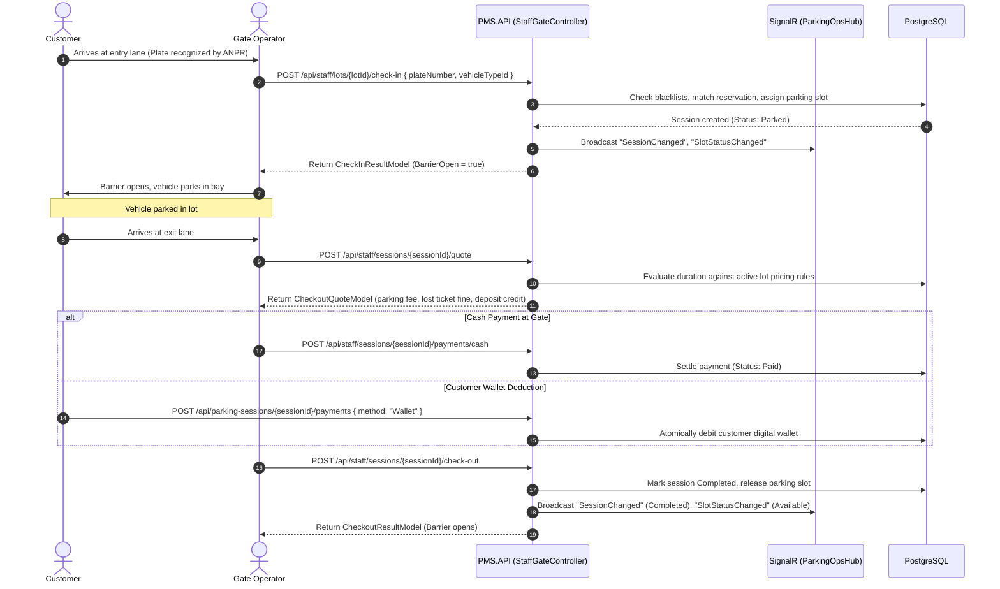

# API Documentation -- Parking Management System

> **Document Type:** Technical API Reference & Review Draft  
> **Target Audience:** Engineering Team Lead, Backend Engineers & Frontend Developers  
> **Release Milestone:** Sprint 4 / Release Candidate Audit  
> **Review Date:** October 30, 2026  
> **Scope Covered:** 150 Backend Endpoints (22 Controllers), 3 SignalR Real-Time Hubs, 129 Frontend Service Calls (21 Files).  

> [!IMPORTANT]
> **Implementation-Grounded Review Notice:** This document reflects the **actual current implementation** of the Parking Management System codebase as determined through controller source inspection, model schemas, and integration tests. It documents current system behavior -- including confirmed contract discrepancies where Frontend services call missing routes or rely on mock fallbacks -- rather than an aspirational future specification. Items requiring technical or architectural decisions from the lead are explicitly flagged with `[Needs lead review]`.

---

## Table of Contents

- [1. Document Status and Scope](#1-document-status-and-scope)
- [2. System Overview and Architecture](#2-system-overview-and-architecture)
  - [2.1 High-Level Architecture](#21-high-level-architecture)
  - [2.2 Development Base URLs and Ports](#22-development-base-urls-and-ports)
  - [2.3 REST API vs. SignalR Real-Time Communication](#23-rest-api-vs-signalr-real-time-communication)
- [3. API Conventions and Standards](#3-api-conventions-and-standards)
  - [3.1 HTTP Method and Route Semantics](#31-http-method-and-route-semantics)
  - [3.2 Request and Response Content Types](#32-request-and-response-content-types)
  - [3.3 Standard Response Envelope (ApiResult&lt;T&gt;)](#33-standard-response-envelope-apiresultt)
  - [3.4 Pagination, Filtering, and Sorting Contracts](#34-pagination-filtering-and-sorting-contracts)
  - [3.5 Data Formats and Identifiers](#35-data-formats-and-identifiers)
  - [3.6 Non-Standard Response Endpoints](#36-non-standard-response-endpoints)
- [4. Authentication and Authorization](#4-authentication-and-authorization)
  - [4.1 JWT Authentication Scheme](#41-jwt-authentication-scheme)
  - [4.2 Role-Based Access Control (RBAC) Matrix](#42-role-based-access-control-rbac-matrix)
  - [4.3 Special 2FA Challenge Token Flow](#43-special-2fa-challenge-token-flow)
  - [4.4 Passwordless OTP and Google OAuth Flows](#44-passwordless-otp-and-google-oauth-flows)
  - [4.5 SignalR Handshake Authentication](#45-signalr-handshake-authentication)
- [5. API Reference by Module](#5-api-reference-by-module)
  - [5.1 Module 01: Authentication & User Accounts](#51-module-01-authentication-user-accounts)
  - [5.2 Module 02: Parking Lots, Layouts, Zones & Slots](#52-module-02-parking-lots-layouts-zones-slots)
  - [5.3 Module 03: Customer Reservations](#53-module-03-customer-reservations)
  - [5.4 Module 04: Customer Parking Sessions](#54-module-04-customer-parking-sessions)
  - [5.5 Module 05: Staff Gate Operations & Gate Requests](#55-module-05-staff-gate-operations-gate-requests)
  - [5.6 Module 06: Manager Operations & Pricing](#56-module-06-manager-operations-pricing)
  - [5.7 Module 07: Vehicle Verification & Document Management](#57-module-07-vehicle-verification-document-management)
  - [5.8 Module 08: Payments & Customer Wallet](#58-module-08-payments-customer-wallet)
  - [5.9 Module 09: Revenue Reporting](#59-module-09-revenue-reporting)
  - [5.10 Module 10: Admin User & System Management](#510-module-10-admin-user-system-management)
  - [5.11 Module 11: Admin Simulation & Background Jobs](#511-module-11-admin-simulation-background-jobs)
  - [5.12 Module 12: Notifications & User Messaging](#512-module-12-notifications-user-messaging)
- [6. Business Rules and Important Workflows](#6-business-rules-and-important-workflows)
  - [6.1 Parking Session Lifecycle (Check-In to Check-Out)](#61-parking-session-lifecycle-check-in-to-check-out)
  - [6.2 Customer Reservation & Auto-Cancellation Flow](#62-customer-reservation--auto-cancellation-flow)
  - [6.3 Customer Digital Wallet & Payment Ledger](#63-customer-digital-wallet--payment-ledger)
  - [6.4 Vehicle Paper Verification Lifecycle](#64-vehicle-paper-verification-lifecycle)
  - [6.5 2D Visual Layout & Dynamic Slot Allocation](#65-2d-visual-layout--dynamic-slot-allocation)
  - [6.6 Role-Separated Financial Revenue Reporting](#66-role-separated-financial-revenue-reporting)
- [7. Frontend-Backend Integration Mapping](#7-frontendbackend-integration-mapping)
  - [7.1 Parity Metrics and Mapping Summary](#71-parity-metrics-and-mapping-summary)
  - [7.2 Frontend Service to Backend Action Mapping Table](#72-frontend-service-to-backend-action-mapping-table)
  - [7.3 Unconsumed Backend Endpoints (No Direct Frontend Caller)](#73-unconsumed-backend-endpoints-no-direct-frontend-caller)
- [8. SignalR / Real-Time Communication API](#8-signalr--real-time-communication-api)
  - [8.1 LotHub (/api/hubs/lots)](#81-lothub-apihubslots)
  - [8.2 ParkingOpsHub (/api/hubs/parking-ops)](#82-parkingopshub-apihubsparking-ops)
  - [8.3 VehicleVerificationHub (/api/hubs/vehicle-verifications)](#83-vehicleverificationhub-apihubsvehicle-verifications)
- [9. Validation, Errors, and Rate Limits](#9-validation-errors-and-rate-limits)
  - [9.1 FluentValidation & Auto-Validation Pipeline](#91-fluentvalidation--auto-validation-pipeline)
  - [9.2 Global Exception Handling & Status Code Mappings](#92-global-exception-handling--status-code-mappings)
  - [9.3 Rate Limiting Policies](#93-rate-limiting-policies)
- [10. Known Discrepancies and Questions for Team Lead](#10-known-discrepancies-and-questions-for-team-lead)
  - [10.1 Summary of Unmatched Frontend Calls vs Discrepancy Topics](#101-summary-of-unmatched-frontend-calls-vs-discrepancy-topics)
  - [10.2 Issue 1: Wallet Transaction History Endpoint Missing](#102-issue-1-wallet-transaction-history-endpoint-missing)
  - [10.3 Issue 2: Parking Capacity Endpoint Missing in Backend](#103-issue-2-parking-capacity-endpoint-missing-in-backend)
  - [10.4 Issue 3: Revenue Reporting Route Migration Discrepancy](#104-issue-3-revenue-reporting-route-migration-discrepancy)
  - [10.5 Issue 4: Payment Provider Return URL vs Gateway Callbacks](#105-issue-4-payment-provider-return-url-vs-gateway-callbacks)
  - [10.6 Issue 5: Direct Slot/Zone CRUD vs Visual Layout Designer](#106-issue-5-direct-slotzone-crud-vs-visual-layout-designer)
- [11. Verification Notes and Coverage Scope](#11-verification-notes-and-coverage-scope)
- [12. Appendix and Glossary](#12-appendix-and-glossary)

---

## 1. Document Status and Scope

This document is the technical API reference and review draft for the **Parking Management System (PMS)**.

### System Components & Scope
- **Backend API (`PMS.API`):** ASP.NET Core 9.0 Web API targeting PostgreSQL via Entity Framework Core 9.0.
  - Architecture: Clean Architecture implementation across `PMS.API`, `PMS.Application`, `PMS.DataAccess`, `PMS.Core`, and `PMS.Shared`.
  - Total Controllers: 22 HTTP controllers inheriting from base `ApiController`.
  - Total HTTP Endpoint Actions: 150.
  - Total SignalR Hubs: 3 (`LotHub`, `ParkingOpsHub`, `VehicleVerificationHub`).
  - Solution Test Projects: Automated test suites in `tests/PMS.UnitTests` and `tests/PMS.Api.IntegrationTests`.
- **Frontend Application (`PMS.Frontend`):** React 18 Single-Page Application (SPA) built with TypeScript, Vite, TailwindCSS, and TanStack React Query.
  - Client Services: 21 API service modules in `src/api/`.
  - Total HTTP Client Invocations: 129 `http.get/post/put/delete/patch` call sites across services.

---

## 2. System Overview and Architecture

### 2.1 High-Level Architecture
The Parking Management System provides an integrated operational platform for commercial and campus parking facilities. The architecture comprises:
1. **Core Web API (`PMS.API`):** Monolithic .NET 9.0 REST API layer exposing business domains, role-based security, request validation, and OpenAPI documentation.
2. **Application Core & Data Access (`PMS.Application` & `PMS.DataAccess`):** Clean Architecture implementation using Entity Framework Core 9.0 over PostgreSQL. Houses 162 strongly-typed DTOs/models, FluentValidation rules, and database entity configurations.
3. **Background Job Subsystem:** Hangfire dashboard and background worker hosted in-process at `/hangfire` for recurring maintenance (automated lot reopening, expired reservation cleanup, and vehicle document retention enforcement).
4. **Real-Time Notification Layer:** Three SignalR WebSocket hubs for instant bidirectional updates.
5. **Single-Page Application (`PMS.Frontend`):** React 18, TypeScript, TailwindCSS, and TanStack React Query communicating with the API via Axios.

### 2.2 Development Base URLs and Ports
The development base URLs defined in project configuration (`src/PMS.API/Properties/launchSettings.json` and `src/config/env.ts`) are:

| Environment Profile | Base URL | Configuration Source | Purpose |
| :--- | :--- | :--- | :--- |
| **IIS Express Profile** | `https://localhost:44391/api` | `src/PMS.API/Properties/launchSettings.json` (sslPort 44391) / `src/config/env.ts` | Default development endpoint used by Frontend Axios client (`DEFAULT_API_BASE_URL`). |
| **Kestrel HTTPS Direct** | `https://localhost:5001/api` | `src/PMS.API/Properties/launchSettings.json` | Direct Kestrel runtime over HTTPS. |
| **Kestrel HTTP Insecure**| `http://localhost:5000/api` | `src/PMS.API/Properties/launchSettings.json` | Local fallback without SSL. |
| **Client Dynamic Override** | Stored in `localStorage` | `src/config/env.ts` (`normalizeApiBaseUrl`) | Developers can override the target API root via key `pms_custom_api_url`. Normalizes Swagger URLs to `/api`. |

### 2.3 REST API vs. SignalR Real-Time Communication
The system establishes a clean architectural separation between transactional REST APIs and real-time push communication:
- **REST APIs (HTTP/HTTPS):** Client-initiated, stateless command/query requests. Handles all mutations (e.g. check-in, check-out, fee quote, reservation creation, wallet ledger mutations, profile updates). Responses synchronously return the updated state wrapped in `ApiResult<T>`.
- **SignalR Hubs (WebSockets / SSE):** Server-initiated, persistent duplex connections. **Never used for transactional state mutations**. Used exclusively to broadcast state changes to other connected clients (e.g. notifying gate staff that an entry barrier has opened, pushing occupancy changes to 3D visualizers, or updating operator queues when vehicle papers are uploaded).

---

## 3. API Conventions and Standards

### 3.1 HTTP Method and Route Semantics
Controllers inherit from `ApiController` (`[ApiController]`, `[Route("api/[controller]")]`). Base paths are either `api/<ControllerName>` (e.g. `api/Wallet`) or specialized administrative prefixes (e.g. `api/admin`, `api/manager`, `api/staff`, `api/public/lots/{lotId}/layout`):
- `GET`: Safe, idempotent queries. Query parameters are used for pagination, filtering, and keyword search.
- `POST`: State mutations, command triggers, and non-idempotent resource creations (e.g. `POST /api/staff/lots/{id}/check-in`, `POST /api/wallet/topup`).
- `PUT`: Complete idempotent resource replacements (e.g. updating vehicle profiles or pricing rules).
- `PATCH`: Partial state transitions (e.g. setting default vehicle, updating manager status, toggling slot operational status).
- `DELETE`: Resource archival or removal (e.g. removing vehicles, deleting staff assignments).

### 3.2 Request and Response Content Types
- Standard Request/Response payload: `application/json; charset=utf-8`.
- Multipart File Uploads: `multipart/form-data` (avatar upload in `UsersController`, vehicle documents in `VehicleDocumentsController`).
- Binary File Downloads: `FileResult` returning `image/jpeg`, `image/png`, or `application/pdf` with `Content-Disposition: inline` or `attachment`.

### 3.3 Standard Response Envelope (`ApiResult<T>`)
All standard JSON endpoints wrap payloads in `ApiResult<T>` (`src/PMS.Application/Models/ApiResult.cs`):

```csharp
public class ApiResult<T>
{
    public bool Succeeded { get; set; }
    public T Result { get; set; }
    public List<string> Errors { get; set; } = new();
}
```

#### Success Example (HTTP 200 OK)
```json
{
  "succeeded": true,
  "result": {
    "id": 1001,
    "name": "Cong Hoa Lot",
    "totalCapacity": 200
  },
  "errors": []
}
```

#### Error Example (HTTP 400 Bad Request)
```json
{
  "succeeded": false,
  "result": null,
  "errors": [
    "Vehicle plate number 59A-123.45 is currently registered in an active parking session."
  ]
}
```

### 3.4 Pagination, Filtering, and Sorting Contracts
Collection queries supporting pagination utilize `PaginationResponseModel<T>` with query parameters `pageNumber` (1-indexed, default 1) and `pageSize` (default 10, max 100):
```json
{
  "succeeded": true,
  "result": {
    "items": [ ... ],
    "pageNumber": 1,
    "pageSize": 10,
    "totalCount": 85,
    "totalPages": 9,
    "hasPreviousPage": false,
    "hasNextPage": true
  },
  "errors": []
}
```

### 3.5 Data Formats and Identifiers
- **Timestamps:** ISO-8601 UTC format (`YYYY-MM-DDTHH:mm:ss.sssZ`).
- **TimeOnly:** 24-hour time strings formatted as `HH:mm:ss` (e.g. `06:00:00` for Day tariff start, `22:00:00` for Night tariff start).
- **Entity Identifiers:**
  - `Guid` (UUID v4): Users, Vehicles, Verifications, Uploaded Documents.
  - `int` (32-bit Integer): Lots, Zones, Slots, Pricing Rules, Notifications, Blacklist Entries.
  - `long` (64-bit Integer): Reservations, Parking Sessions, Gate Requests, Payments.

### 3.6 Non-Standard Response Endpoints
1. **Document Binary Streams:** `GET /api/users/profile/vehicles/{id}/documents/files/{docId}` and `GET /api/vehicle-verifications/{id}/files/{docId}` return raw binary byte streams via `FileResult`.
2. **Payment Gateway Redirects:** `GET /api/payments/vnpay/return` and `GET /api/payments/momo/return` issue HTTP 302 redirects to client application routes.
3. **SignalR WebSockets:** Connection endpoints (`/api/hubs/*`) establish persistent WSS protocols.

---

## 4. Authentication and Authorization

### 4.1 JWT Authentication Scheme
- **Header Format:** `Authorization: Bearer <jwt_token>`.
- **Algorithm:** HMAC-SHA256 (`JwtHelper.cs`).
- **Validity Duration:** Default **7 days** (604,800 seconds).
- **Claims Payload:**
  - `ClaimTypes.NameIdentifier` (`sub`): User GUID.
  - `ClaimTypes.Email` (`email`): User Email.
  - `ClaimTypes.Role` (`role`): Assigned system role (`Admin`, `Manager`, `Staff`, or `User`).
  - `purpose`: Optional constraint claim (e.g. `2FA_Challenge`).

### 4.2 Role-Based Access Control (RBAC) Matrix

| Functional Area | Public / Anonymous | User (Customer) | Staff (Operator) | Manager | Admin |
| :--- | :---: | :---: | :---: | :---: | :---: |
| **Authentication (Login, Register, OTP)** | ✅ | ✅ | ✅ | ✅ | ✅ |
| **User Profile & Vehicle CRUD** | ❌ | ✅ | ❌ | ❌ | ❌ |
| **Browse Public Lots & 2D Layouts** | ✅ | ✅ | ✅ | ✅ | ✅ |
| **Book & Cancel Reservations** | ❌ | ✅ | ❌ | ❌ | ❌ |
| **Customer Sessions & Online Payments** | ❌ | ✅ | ❌ | ❌ | ❌ |
| **Customer Wallet Topup & History** | ❌ | ✅ | ❌ | ❌ | ❌ |
| **Gate Check-In / Check-Out Execution** | ❌ | ❌ | ✅ | ❌ | ❌ |
| **Cash Payment Collection at Gate** | ❌ | ❌ | ✅ | ❌ | ❌ |
| **Lost Ticket Reporting at Gate** | ❌ | ❌ | ✅ | ❌ | ❌ |
| **Lost Ticket Approval / Rejection** | ❌ | ❌ | ❌ | ✅ (Assigned Lots) | ❌ |
| **Abnormal Session Forced Closure** | ❌ | ❌ | ❌ | ✅ (Assigned Lots) | ❌ |
| **Lot Pricing Rule Administration** | ❌ | ❌ | ❌ | ✅ (Assigned Lots) | ❌ |
| **Staff Account CRUD & Assignment** | ❌ | ❌ | ❌ | ✅ (Assigned Lots) | ❌ |
| **Manager Revenue Reporting** | ❌ | ❌ | ❌ | ✅ (Assigned Lots) | ❌ |
| **Admin Revenue Reporting (System-wide)**| ❌ | ❌ | ❌ | ❌ | ✅ |
| **Manager Account CRUD & Lot Assignment**| ❌ | ❌ | ❌ | ❌ | ✅ |
| **User Account Status Toggle (Active/Deactive)**| ❌ | ❌ | ❌ | ❌ | ✅ |
| **Vehicle Paper Review & Approval** | ❌ | ❌ | ✅ | ❌ | ✅ |
| **Sandbox Simulation Mode Management** | ❌ | ❌ | ❌ | ❌ | ✅ |

### 4.3 Special 2FA Challenge Token Flow
When Two-Factor Authentication is enabled on an account:
1. `POST /api/Users/authenticate` or OTP verification returns an intermediate token containing `purpose = "2FA_Challenge"`.
2. All standard endpoints inspect incoming claims. Any request bearing `purpose = "2FA_Challenge"` is immediately aborted with **HTTP 403 Forbidden**.
3. The intermediate token is authorized solely at:
   - `POST /api/Users/two-factor` (submits 6-digit TOTP code).
   - `POST /api/Users/two-factor/resend` (resends verification code).
4. Upon successful TOTP code validation, the server issues the permanent session JWT containing the user role claim.

### 4.4 Passwordless OTP and Google OAuth Flows
- **Passwordless OTP:** Customer requests a 6-digit login code via `POST /api/Users/login-otp/request`. Upon receiving the code, the client calls `POST /api/Users/login-otp/verify`, receiving a JWT without transmitting a password.
- **Google Sign-In:** Client completes Google OAuth and submits the credential to `POST /api/Users/login-google` with `{ "idToken": "..." }`. The backend validates the token against Google OAuth servers, provisions the account if absent, and returns a session JWT.
- **Password Reset Flow:** Client requests reset token via `POST /api/Users/forgot-password` (rate-limited to 5 requests per 15 minutes). The customer receives an email token and submits `POST /api/Users/reset-password` with the token and new password.

### 4.5 SignalR Handshake Authentication
Because browsers cannot send custom headers during WebSocket upgrades, `src/PMS.API/Program.cs` attaches a handler to `JwtBearerOptions.Events.OnMessageReceived`:
- The server reads `context.Request.Query["access_token"]` for paths starting with `/api/hubs/`.
- The extracted query token is validated and assigned to `context.Token`, enabling `[Authorize]` enforcement on hubs.

---

## 5. API Reference by Module

This section documents the 150 Backend HTTP endpoints identified across the 22 API controllers.

### 5.1 Module 01: Authentication & User Accounts
*Module contains 26 HTTP endpoint actions.*

#### 5.1.1 `GET` /api/Users

- **Action:** `UsersController.GetAllAsync` (Source: `src/PMS.API/Controllers/UsersController.cs`, line 33)
- **Authorization:** `Role: Admin`
- **Integration Status:** `Active Frontend Caller`
- **Parameters:** `[FromQuery] string role = null, [FromQuery] bool? isActive = null, [FromQuery] string searchTerm = null`
- **Return Contract:** `ApiResult<IEnumerable<UserResponseModel>>`
- **Expected Response Codes:** HTTP 200/201 (Success), HTTP 400 (Validation/Bad Request), HTTP 401 (Unauthorized), HTTP 403 (Forbidden), HTTP 500 (Internal Error).
- **Frontend Consumer:**
  - `src/api/identity.service.ts` $\rightarrow$ `getCustomers()` calling `/Users`

#### 5.1.2 `GET` /api/Users/{id}

- **Action:** `UsersController.GetByIdAsync` (Source: `src/PMS.API/Controllers/UsersController.cs`, line 41)
- **Authorization:** `Role: Admin`
- **Integration Status:** `Unconsumed by Frontend UI`
- **Parameters:** `string id`
- **Return Contract:** `ApiResult<UserResponseModel>`
- **Expected Response Codes:** HTTP 200/201 (Success), HTTP 400 (Validation/Bad Request), HTTP 401 (Unauthorized), HTTP 403 (Forbidden), HTTP 500 (Internal Error).
- **Frontend Consumer:** None currently calling this endpoint directly (internal admin, webhook, or direct CRUD bypassed in favor of aggregate endpoints).

#### 5.1.3 `POST` /api/Users/internal

- **Action:** `UsersController.CreateInternalUserAsync` (Source: `src/PMS.API/Controllers/UsersController.cs`, line 48)
- **Authorization:** `Role: Admin`
- **Integration Status:** `Unconsumed by Frontend UI`
- **Parameters:** `[FromBody] CreateInternalUserModel model`
- **Return Contract:** `ApiResult<CreateUserResponseModel>`
- **Request Body Schema (`CreateInternalUserModel`):**
  ```json
  {
    "UserName": "<string>",
    "FullName": "<string>",
    "Email": "<string>",
    "Password": "<string>",
    "PhoneNumber": "<string>",
    "Role": "<string>",
    "AssignedParkingLot": "<string>"
  }
  ```
- **Expected Response Codes:** HTTP 200/201 (Success), HTTP 400 (Validation/Bad Request), HTTP 401 (Unauthorized), HTTP 403 (Forbidden), HTTP 500 (Internal Error).
- **Frontend Consumer:** None currently calling this endpoint directly (internal admin, webhook, or direct CRUD bypassed in favor of aggregate endpoints).

#### 5.1.4 `PATCH` /api/Users/{id}/status

- **Action:** `UsersController.UpdateStatusAsync` (Source: `src/PMS.API/Controllers/UsersController.cs`, line 55)
- **Authorization:** `Role: Admin`
- **Integration Status:** `Unconsumed by Frontend UI`
- **Parameters:** `string id, [FromBody] UpdateUserStatusModel model`
- **Return Contract:** `ApiResult<bool>`
- **Request Body Schema (`UpdateUserStatusModel`):**
  ```json
  {
    "IsActive": "<bool>"
  }
  ```
- **Expected Response Codes:** HTTP 200/201 (Success), HTTP 400 (Validation/Bad Request), HTTP 401 (Unauthorized), HTTP 403 (Forbidden), HTTP 500 (Internal Error).
- **Frontend Consumer:** None currently calling this endpoint directly (internal admin, webhook, or direct CRUD bypassed in favor of aggregate endpoints).

#### 5.1.5 `POST` /api/Users/register

- **Action:** `UsersController.RegisterAsync` (Source: `src/PMS.API/Controllers/UsersController.cs`, line 64)
- **Authorization:** `[AllowAnonymous`
- **Integration Status:** `Active Frontend Caller`
- **Parameters:** `CreateUserModel createUserModel`
- **Return Contract:** `ApiResult<CreateUserResponseModel>`
- **Expected Response Codes:** HTTP 200/201 (Success), HTTP 400 (Validation/Bad Request), HTTP 401 (Unauthorized), HTTP 403 (Forbidden), HTTP 500 (Internal Error).
- **Frontend Consumer:**
  - `src/api/identity.service.ts` $\rightarrow$ `register()` calling `/Users/register`

#### 5.1.6 `POST` /api/Users/authenticate

- **Action:** `UsersController.LoginAsync` (Source: `src/PMS.API/Controllers/UsersController.cs`, line 72)
- **Authorization:** `[AllowAnonymous`
- **Integration Status:** `Active Frontend Caller`
- **Parameters:** `LoginUserModel loginUserModel`
- **Return Contract:** `ApiResult<LoginResponseModel>`
- **Expected Response Codes:** HTTP 200/201 (Success), HTTP 400 (Validation/Bad Request), HTTP 401 (Unauthorized), HTTP 403 (Forbidden), HTTP 500 (Internal Error).
- **Frontend Consumer:**
  - `src/api/identity.service.ts` $\rightarrow$ `login()` calling `/Users/authenticate`

#### 5.1.7 `POST` /api/Users/two-factor

- **Action:** `UsersController.VerifyTwoFactorAsync` (Source: `src/PMS.API/Controllers/UsersController.cs`, line 80)
- **Authorization:** `[AllowAnonymous`
- **Integration Status:** `Active Frontend Caller`
- **Parameters:** `[FromBody] TwoFactorLoginModel model`
- **Return Contract:** `ApiResult<LoginResponseModel>`
- **Request Body Schema (`TwoFactorLoginModel`):**
  ```json
  {
    "TwoFactorToken": "<string>",
    "Code": "<string>",
    "Email": "<string>",
    "RememberMe": "<bool>"
  }
  ```
- **Expected Response Codes:** HTTP 200/201 (Success), HTTP 400 (Validation/Bad Request), HTTP 401 (Unauthorized), HTTP 403 (Forbidden), HTTP 500 (Internal Error).
- **Frontend Consumer:**
  - `src/api/identity.service.ts` $\rightarrow$ `verifyTwoFactor()` calling `/Users/two-factor`

#### 5.1.8 `POST` /api/Users/two-factor/resend

- **Action:** `UsersController.ResendTwoFactorOtpAsync` (Source: `src/PMS.API/Controllers/UsersController.cs`, line 88)
- **Authorization:** `[AllowAnonymous`
- **Integration Status:** `Active Frontend Caller`
- **Parameters:** `[FromBody] ResendTwoFactorModel model`
- **Return Contract:** `ApiResult<ResendTwoFactorResponseModel>`
- **Request Body Schema (`ResendTwoFactorModel`):**
  ```json
  {
    "TwoFactorToken": "<string>",
    "Email": "<string>"
  }
  ```
- **Expected Response Codes:** HTTP 200/201 (Success), HTTP 400 (Validation/Bad Request), HTTP 401 (Unauthorized), HTTP 403 (Forbidden), HTTP 500 (Internal Error).
- **Frontend Consumer:**
  - `src/api/identity.service.ts` $\rightarrow$ `resendTwoFactor()` calling `/Users/two-factor/resend`

#### 5.1.9 `POST` /api/Users/login-otp/request

- **Action:** `UsersController.RequestLoginOtpAsync` (Source: `src/PMS.API/Controllers/UsersController.cs`, line 96)
- **Authorization:** `[AllowAnonymous`
- **Integration Status:** `Active Frontend Caller`
- **Parameters:** `RequestLoginOtpModel model`
- **Return Contract:** `ApiResult<string>`
- **Expected Response Codes:** HTTP 200/201 (Success), HTTP 400 (Validation/Bad Request), HTTP 401 (Unauthorized), HTTP 403 (Forbidden), HTTP 500 (Internal Error).
- **Frontend Consumer:**
  - `src/api/identity.service.ts` $\rightarrow$ `requestLoginOtp()` calling `/Users/login-otp/request`

#### 5.1.10 `POST` /api/Users/login-otp/verify

- **Action:** `UsersController.LoginWithOtpAsync` (Source: `src/PMS.API/Controllers/UsersController.cs`, line 105)
- **Authorization:** `[AllowAnonymous`
- **Integration Status:** `Active Frontend Caller`
- **Parameters:** `VerifyLoginOtpModel model`
- **Return Contract:** `ApiResult<LoginResponseModel>`
- **Expected Response Codes:** HTTP 200/201 (Success), HTTP 400 (Validation/Bad Request), HTTP 401 (Unauthorized), HTTP 403 (Forbidden), HTTP 500 (Internal Error).
- **Frontend Consumer:**
  - `src/api/identity.service.ts` $\rightarrow$ `verifyLoginOtp()` calling `/Users/login-otp/verify`

#### 5.1.11 `POST` /api/Users/forgot-password

- **Action:** `UsersController.ForgotPasswordAsync` (Source: `src/PMS.API/Controllers/UsersController.cs`, line 114)
- **Authorization:** `[AllowAnonymous`
- **Integration Status:** `Active Frontend Caller`
- **Parameters:** `[FromBody] ForgotPasswordModel model`
- **Return Contract:** `ApiResult<string>`
- **Request Body Schema (`ForgotPasswordModel`):**
  ```json
  {
    "Email": "<string>"
  }
  ```
- **Expected Response Codes:** HTTP 200/201 (Success), HTTP 400 (Validation/Bad Request), HTTP 401 (Unauthorized), HTTP 403 (Forbidden), HTTP 500 (Internal Error).
- **Frontend Consumer:**
  - `src/api/identity.service.ts` $\rightarrow$ `forgotPassword()` calling `/Users/forgot-password`

#### 5.1.12 `POST` /api/Users/reset-password

- **Action:** `UsersController.ResetPasswordAsync` (Source: `src/PMS.API/Controllers/UsersController.cs`, line 126)
- **Authorization:** `[AllowAnonymous`
- **Integration Status:** `Active Frontend Caller`
- **Parameters:** `[FromBody] ResetPasswordModel model`
- **Return Contract:** `ApiResult<string>`
- **Request Body Schema (`ResetPasswordModel`):**
  ```json
  {
    "Email": "<string>",
    "Token": "<string>",
    "NewPassword": "<string>",
    "ConfirmPassword": "<string>"
  }
  ```
- **Expected Response Codes:** HTTP 200/201 (Success), HTTP 400 (Validation/Bad Request), HTTP 401 (Unauthorized), HTTP 403 (Forbidden), HTTP 500 (Internal Error).
- **Frontend Consumer:**
  - `src/api/identity.service.ts` $\rightarrow$ `resetPassword()` calling `/Users/reset-password`

#### 5.1.13 `POST` /api/Users/login-google

- **Action:** `UsersController.LoginWithGoogleAsync` (Source: `src/PMS.API/Controllers/UsersController.cs`, line 135)
- **Authorization:** `[AllowAnonymous`
- **Integration Status:** `Active Frontend Caller`
- **Parameters:** `GoogleLoginModel model`
- **Return Contract:** `ApiResult<LoginResponseModel>`
- **Expected Response Codes:** HTTP 200/201 (Success), HTTP 400 (Validation/Bad Request), HTTP 401 (Unauthorized), HTTP 403 (Forbidden), HTTP 500 (Internal Error).
- **Frontend Consumer:**
  - `src/api/identity.service.ts` $\rightarrow$ `loginWithGoogle()` calling `/Users/login-google`

#### 5.1.14 `GET` /api/Users/profile

- **Action:** `UsersController.GetProfileAsync` (Source: `src/PMS.API/Controllers/UsersController.cs`, line 143)
- **Authorization:** `Authenticated`
- **Integration Status:** `Active Frontend Caller`
- **Parameters:** `None`
- **Return Contract:** `ApiResult<UserProfileResponseModel>`
- **Expected Response Codes:** HTTP 200/201 (Success), HTTP 400 (Validation/Bad Request), HTTP 401 (Unauthorized), HTTP 403 (Forbidden), HTTP 500 (Internal Error).
- **Frontend Consumer:**
  - `src/api/profile.service.ts` $\rightarrow$ `getProfile()` calling `/Users/profile`

#### 5.1.15 `PUT` /api/Users/profile

- **Action:** `UsersController.UpdateProfileAsync` (Source: `src/PMS.API/Controllers/UsersController.cs`, line 152)
- **Authorization:** `Authenticated`
- **Integration Status:** `Active Frontend Caller`
- **Parameters:** `[FromBody] UpdateUserProfileModel model`
- **Return Contract:** `ApiResult<UserProfileResponseModel>`
- **Request Body Schema (`UpdateUserProfileModel`):**
  ```json
  {
    "FullName": "<string>",
    "Email": "<string>",
    "PhoneNumber": "<string>",
    "AvatarUrl": "<string>",
    "CitizenId": "<string>"
  }
  ```
- **Expected Response Codes:** HTTP 200/201 (Success), HTTP 400 (Validation/Bad Request), HTTP 401 (Unauthorized), HTTP 403 (Forbidden), HTTP 500 (Internal Error).
- **Frontend Consumer:**
  - `src/api/profile.service.ts` $\rightarrow$ `updateProfile()` calling `/Users/profile`

#### 5.1.16 `GET` /api/Users/profile/check-unique

- **Action:** `UsersController.CheckProfileUniquenessAsync` (Source: `src/PMS.API/Controllers/UsersController.cs`, line 161)
- **Authorization:** `Authenticated`
- **Integration Status:** `Active Frontend Caller`
- **Parameters:** `[FromQuery] string? phone = null, [FromQuery] string? citizenId = null`
- **Return Contract:** `ApiResult<ProfileFieldAvailabilityModel>`
- **Expected Response Codes:** HTTP 200/201 (Success), HTTP 400 (Validation/Bad Request), HTTP 401 (Unauthorized), HTTP 403 (Forbidden), HTTP 500 (Internal Error).
- **Frontend Consumer:**
  - `src/api/profile.service.ts` $\rightarrow$ `checkProfileUniqueness()` calling `/Users/profile/check-unique`

#### 5.1.17 `POST` /api/Users/profile/avatar

- **Action:** `UsersController.UploadAvatarAsync` (Source: `src/PMS.API/Controllers/UsersController.cs`, line 171)
- **Authorization:** `Authenticated`
- **Integration Status:** `Active Frontend Caller`
- **Parameters:** `IFormFile file`
- **Return Contract:** `ApiResult<UserProfileResponseModel>`
- **Expected Response Codes:** HTTP 200/201 (Success), HTTP 400 (Validation/Bad Request), HTTP 401 (Unauthorized), HTTP 403 (Forbidden), HTTP 500 (Internal Error).
- **Frontend Consumer:**
  - `src/api/profile.service.ts` $\rightarrow$ `uploadAvatar()` calling `/Users/profile/avatar`

#### 5.1.18 `GET` /api/Users/profile/vehicles

- **Action:** `UsersController.GetVehiclesAsync` (Source: `src/PMS.API/Controllers/UsersController.cs`, line 180)
- **Authorization:** `Authenticated`
- **Integration Status:** `Active Frontend Caller`
- **Parameters:** `None`
- **Return Contract:** `ApiResult<List<VehicleResponseModel>>`
- **Expected Response Codes:** HTTP 200/201 (Success), HTTP 400 (Validation/Bad Request), HTTP 401 (Unauthorized), HTTP 403 (Forbidden), HTTP 500 (Internal Error).
- **Frontend Consumer:**
  - `src/api/profile.service.ts` $\rightarrow$ `getVehicles()` calling `/Users/profile/vehicles`

#### 5.1.19 `GET` /api/Users/profile/vehicles/check-plate

- **Action:** `UsersController.CheckPlateAvailabilityAsync` (Source: `src/PMS.API/Controllers/UsersController.cs`, line 189)
- **Authorization:** `Authenticated`
- **Integration Status:** `Active Frontend Caller`
- **Parameters:** `[FromQuery] string plate, [FromQuery] Guid? excludeVehicleId = null`
- **Return Contract:** `ApiResult<PlateAvailabilityResponseModel>`
- **Expected Response Codes:** HTTP 200/201 (Success), HTTP 400 (Validation/Bad Request), HTTP 401 (Unauthorized), HTTP 403 (Forbidden), HTTP 500 (Internal Error).
- **Frontend Consumer:**
  - `src/api/profile.service.ts` $\rightarrow$ `checkPlateAvailability()` calling `/Users/profile/vehicles/check-plate`

#### 5.1.20 `POST` /api/Users/profile/vehicles

- **Action:** `UsersController.AddVehicleAsync` (Source: `src/PMS.API/Controllers/UsersController.cs`, line 198)
- **Authorization:** `Authenticated`
- **Integration Status:** `Active Frontend Caller`
- **Parameters:** `[FromBody] CreateVehicleModel model`
- **Return Contract:** `ApiResult<VehicleResponseModel>`
- **Request Body Schema (`CreateVehicleModel`):**
  ```json
  {
    "LicensePlate": "<string>",
    "VehicleTypeId": "<int>",
    "Brand": "<string>",
    "Model": "<string>",
    "Color": "<string>",
    "CitizenId": "<string>",
    "IsDefault": "<bool>"
  }
  ```
- **Expected Response Codes:** HTTP 200/201 (Success), HTTP 400 (Validation/Bad Request), HTTP 401 (Unauthorized), HTTP 403 (Forbidden), HTTP 500 (Internal Error).
- **Frontend Consumer:**
  - `src/api/profile.service.ts` $\rightarrow$ `addVehicle()` calling `/Users/profile/vehicles`

#### 5.1.21 `PUT` /api/Users/profile/vehicles/{vehicleId:guid}

- **Action:** `UsersController.UpdateVehicleAsync` (Source: `src/PMS.API/Controllers/UsersController.cs`, line 207)
- **Authorization:** `Authenticated`
- **Integration Status:** `Active Frontend Caller`
- **Parameters:** `Guid vehicleId, [FromBody] UpdateVehicleModel model`
- **Return Contract:** `ApiResult<VehicleResponseModel>`
- **Request Body Schema (`UpdateVehicleModel`):**
  ```json
  {
    "LicensePlate": "<string>",
    "VehicleTypeId": "<int>",
    "Brand": "<string>",
    "Model": "<string>",
    "Color": "<string>",
    "CitizenId": "<string>",
    "IsDefault": "<bool>",
    "IsActive": "<bool>"
  }
  ```
- **Expected Response Codes:** HTTP 200/201 (Success), HTTP 400 (Validation/Bad Request), HTTP 401 (Unauthorized), HTTP 403 (Forbidden), HTTP 500 (Internal Error).
- **Frontend Consumer:**
  - `src/api/profile.service.ts` $\rightarrow$ `updateVehicle()` calling `/Users/profile/vehicles/{*}`

#### 5.1.22 `DELETE` /api/Users/profile/vehicles/{vehicleId:guid}

- **Action:** `UsersController.DeleteVehicleAsync` (Source: `src/PMS.API/Controllers/UsersController.cs`, line 216)
- **Authorization:** `Authenticated`
- **Integration Status:** `Active Frontend Caller`
- **Parameters:** `Guid vehicleId`
- **Return Contract:** `ApiResult<bool>`
- **Expected Response Codes:** HTTP 200/201 (Success), HTTP 400 (Validation/Bad Request), HTTP 401 (Unauthorized), HTTP 403 (Forbidden), HTTP 500 (Internal Error).
- **Frontend Consumer:**
  - `src/api/profile.service.ts` $\rightarrow$ `deleteVehicle()` calling `/Users/profile/vehicles/{*}`

#### 5.1.23 `PATCH` /api/Users/profile/vehicles/{vehicleId:guid}/default

- **Action:** `UsersController.SetDefaultVehicleAsync` (Source: `src/PMS.API/Controllers/UsersController.cs`, line 225)
- **Authorization:** `Authenticated`
- **Integration Status:** `Active Frontend Caller`
- **Parameters:** `Guid vehicleId`
- **Return Contract:** `ApiResult<VehicleResponseModel>`
- **Expected Response Codes:** HTTP 200/201 (Success), HTTP 400 (Validation/Bad Request), HTTP 401 (Unauthorized), HTTP 403 (Forbidden), HTTP 500 (Internal Error).
- **Frontend Consumer:**
  - `src/api/profile.service.ts` $\rightarrow$ `setDefaultVehicle()` calling `/Users/profile/vehicles/{*}/default`

#### 5.1.24 `GET` /api/Users/profile/vehicle-types

- **Action:** `UsersController.GetVehicleTypesAsync` (Source: `src/PMS.API/Controllers/UsersController.cs`, line 234)
- **Authorization:** `Authenticated`
- **Integration Status:** `Active Frontend Caller`
- **Parameters:** `None`
- **Return Contract:** `ApiResult<List<VehicleTypeResponseModel>>`
- **Expected Response Codes:** HTTP 200/201 (Success), HTTP 400 (Validation/Bad Request), HTTP 401 (Unauthorized), HTTP 403 (Forbidden), HTTP 500 (Internal Error).
- **Frontend Consumer:**
  - `src/api/profile.service.ts` $\rightarrow$ `getVehicleTypes()` calling `/Users/profile/vehicle-types`

#### 5.1.25 `PUT` /api/Users/profile/change-password

- **Action:** `UsersController.ChangePasswordAsync` (Source: `src/PMS.API/Controllers/UsersController.cs`, line 242)
- **Authorization:** `Authenticated`
- **Integration Status:** `Active Frontend Caller`
- **Parameters:** `[FromBody] ChangePasswordModel model`
- **Return Contract:** `ApiResult<bool>`
- **Request Body Schema (`ChangePasswordModel`):**
  ```json
  {
    "CurrentPassword": "<string>",
    "NewPassword": "<string>",
    "ConfirmPassword": "<string>"
  }
  ```
- **Expected Response Codes:** HTTP 200/201 (Success), HTTP 400 (Validation/Bad Request), HTTP 401 (Unauthorized), HTTP 403 (Forbidden), HTTP 500 (Internal Error).
- **Frontend Consumer:**
  - `src/api/profile.service.ts` $\rightarrow$ `changePassword()` calling `/Users/profile/change-password`

#### 5.1.26 `GET` /api/Users/{id}/profile

- **Action:** `UsersController.GetProfileByUserIdAsync` (Source: `src/PMS.API/Controllers/UsersController.cs`, line 251)
- **Authorization:** `Role: Admin`
- **Integration Status:** `Unconsumed by Frontend UI`
- **Parameters:** `string id`
- **Return Contract:** `ApiResult<UserProfileResponseModel>`
- **Expected Response Codes:** HTTP 200/201 (Success), HTTP 400 (Validation/Bad Request), HTTP 401 (Unauthorized), HTTP 403 (Forbidden), HTTP 500 (Internal Error).
- **Frontend Consumer:** None currently calling this endpoint directly (internal admin, webhook, or direct CRUD bypassed in favor of aggregate endpoints).

---

### 5.2 Module 02: Parking Lots, Layouts, Zones & Slots
*Module contains 22 HTTP endpoint actions.*

#### 5.2.1 `GET` /api/lot-templates

- **Action:** `LayoutsController.GetTemplates` (Source: `src/PMS.API/Controllers/LayoutsController.cs`, line 23)
- **Authorization:** `Inherit / Anonymous`
- **Integration Status:** `Active Frontend Caller`
- **Parameters:** `None`
- **Return Contract:** `ApiResult<IReadOnlyList<LotTemplateResponseModel>>`
- **Expected Response Codes:** HTTP 200/201 (Success), HTTP 400 (Validation/Bad Request), HTTP 401 (Unauthorized), HTTP 403 (Forbidden), HTTP 500 (Internal Error).
- **Frontend Consumer:**
  - `src/api/layout.service.ts` $\rightarrow$ `getTemplates()` calling `/lot-templates`

#### 5.2.2 `GET` /api/public/lots/{lotId:int}/layout

- **Action:** `LayoutsController.GetPublishedAsync` (Source: `src/PMS.API/Controllers/LayoutsController.cs`, line 30)
- **Authorization:** `Inherit / Anonymous`
- **Integration Status:** `Active Frontend Caller`
- **Parameters:** `int lotId`
- **Return Contract:** `ApiResult<LayoutResponseModel>`
- **Expected Response Codes:** HTTP 200/201 (Success), HTTP 400 (Validation/Bad Request), HTTP 401 (Unauthorized), HTTP 403 (Forbidden), HTTP 500 (Internal Error).
- **Frontend Consumer:**
  - `src/api/layout.service.ts` $\rightarrow$ `getLayout()` calling `/public/lots/{lotId}/layout`

#### 5.2.3 `GET` /api/public/lots/{lotId:int}/layout/status

- **Action:** `LayoutsController.GetStatusAsync` (Source: `src/PMS.API/Controllers/LayoutsController.cs`, line 37)
- **Authorization:** `Inherit / Anonymous`
- **Integration Status:** `Active Frontend Caller`
- **Parameters:** `int lotId`
- **Return Contract:** `ApiResult<LayoutStatusResponseModel>`
- **Expected Response Codes:** HTTP 200/201 (Success), HTTP 400 (Validation/Bad Request), HTTP 401 (Unauthorized), HTTP 403 (Forbidden), HTTP 500 (Internal Error).
- **Frontend Consumer:**
  - `src/api/layout.service.ts` $\rightarrow$ `getStatus()` calling `/public/lots/{lotId}/layout/status`

#### 5.2.4 `GET` /api/public/lots/{lotId:int}/layout/2d

- **Action:** `LayoutsController.Get2DAsync` (Source: `src/PMS.API/Controllers/LayoutsController.cs`, line 44)
- **Authorization:** `Inherit / Anonymous`
- **Integration Status:** `Active Frontend Caller`
- **Parameters:** `int lotId, [FromQuery] string detail = LayoutDetail.Slots`
- **Return Contract:** `ApiResult<Layout2DResponseModel>`
- **Expected Response Codes:** HTTP 200/201 (Success), HTTP 400 (Validation/Bad Request), HTTP 401 (Unauthorized), HTTP 403 (Forbidden), HTTP 500 (Internal Error).
- **Frontend Consumer:**
  - `src/api/layout.service.ts` $\rightarrow$ `getPlan2D()` calling `/public/lots/{lotId}/layout/2d`

#### 5.2.5 `GET` /api/lots

- **Action:** `LotsController.GetAllAsync` (Source: `src/PMS.API/Controllers/LotsController.cs`, line 24)
- **Authorization:** `Role: Admin,Manager`
- **Integration Status:** `Active Frontend Caller`
- **Parameters:** `[FromQuery] string searchTerm = null, [FromQuery] string status = null, [FromQuery] bool includeDeleted = false`
- **Return Contract:** `ApiResult<IEnumerable<ParkingLotResponseModel>>`
- **Expected Response Codes:** HTTP 200/201 (Success), HTTP 400 (Validation/Bad Request), HTTP 401 (Unauthorized), HTTP 403 (Forbidden), HTTP 500 (Internal Error).
- **Frontend Consumer:**
  - `src/api/identity.service.ts` $\rightarrow$ `lotsByManager()` calling `/lots`
  - `src/api/lot-management.live.ts` $\rightarrow$ `list()` calling `/lots`
  - `src/api/parking.service.ts` $\rightarrow$ `getParkingLots()` calling `/lots`

#### 5.2.6 `GET` /api/public/lots

- **Action:** `LotsController.GetPublicLotsAsync` (Source: `src/PMS.API/Controllers/LotsController.cs`, line 37)
- **Authorization:** `[AllowAnonymous`
- **Integration Status:** `Active Frontend Caller`
- **Parameters:** `[FromQuery] string searchTerm = null`
- **Return Contract:** `ApiResult<IEnumerable<PublicParkingLotResponseModel>>`
- **Expected Response Codes:** HTTP 200/201 (Success), HTTP 400 (Validation/Bad Request), HTTP 401 (Unauthorized), HTTP 403 (Forbidden), HTTP 500 (Internal Error).
- **Frontend Consumer:**
  - `src/api/publicLot.service.ts` $\rightarrow$ `list()` calling `/public/lots`
  - `src/api/reservation.service.ts` $\rightarrow$ `map()` calling `/public/lots`

#### 5.2.7 `GET` /api/public/lots/{id:int}/prices

- **Action:** `LotsController.GetPublicPricesAsync` (Source: `src/PMS.API/Controllers/LotsController.cs`, line 50)
- **Authorization:** `[AllowAnonymous`
- **Integration Status:** `Active Frontend Caller`
- **Parameters:** `int id`
- **Return Contract:** `ApiResult<IReadOnlyList<PublicLotPriceModel>>`
- **Expected Response Codes:** HTTP 200/201 (Success), HTTP 400 (Validation/Bad Request), HTTP 401 (Unauthorized), HTTP 403 (Forbidden), HTTP 500 (Internal Error).
- **Frontend Consumer:**
  - `src/api/pricing.service.ts` $\rightarrow$ `publicPrices()` calling `/public/lots/{*}/prices`

#### 5.2.8 `GET` /api/lots/{id:int}

- **Action:** `LotsController.GetByIdAsync` (Source: `src/PMS.API/Controllers/LotsController.cs`, line 57)
- **Authorization:** `Role: Admin,Manager`
- **Integration Status:** `Unconsumed by Frontend UI`
- **Parameters:** `int id`
- **Return Contract:** `ApiResult<ParkingLotResponseModel>`
- **Expected Response Codes:** HTTP 200/201 (Success), HTTP 400 (Validation/Bad Request), HTTP 401 (Unauthorized), HTTP 403 (Forbidden), HTTP 500 (Internal Error).
- **Frontend Consumer:** None currently calling this endpoint directly (internal admin, webhook, or direct CRUD bypassed in favor of aggregate endpoints).

#### 5.2.9 `POST` /api/lots

- **Action:** `LotsController.CreateAsync` (Source: `src/PMS.API/Controllers/LotsController.cs`, line 65)
- **Authorization:** `Role: Admin`
- **Integration Status:** `Active Frontend Caller`
- **Parameters:** `[FromBody] CreateParkingLotModel model`
- **Return Contract:** `ApiResult<ParkingLotResponseModel>`
- **Request Body Schema (`CreateParkingLotModel`):**
  ```json
  {
    "Code": "<string>",
    "Name": "<string>",
    "Address": "<string>",
    "City": "<string>",
    "District": "<string>",
    "OpenTime": "<TimeOnly?>",
    "CloseTime": "<TimeOnly?>",
    "Is24Hours": "<bool>",
    "LayoutTemplate": "<string>",
    "ImageUrl": "<string>",
    "Description": "<string>",
    "Phone": "<string>",
    "ManagerUserId": "<string>",
    "TimeZoneId": "<string>"
  }
  ```
- **Expected Response Codes:** HTTP 200/201 (Success), HTTP 400 (Validation/Bad Request), HTTP 401 (Unauthorized), HTTP 403 (Forbidden), HTTP 500 (Internal Error).
- **Frontend Consumer:**
  - `src/api/lot-management.live.ts` $\rightarrow$ `if()` calling `/lots`

#### 5.2.10 `PUT` /api/lots/{id:int}

- **Action:** `LotsController.UpdateAsync` (Source: `src/PMS.API/Controllers/LotsController.cs`, line 75)
- **Authorization:** `Role: Admin`
- **Integration Status:** `Active Frontend Caller`
- **Parameters:** `int id, [FromBody] UpdateParkingLotModel model`
- **Return Contract:** `ApiResult<ParkingLotResponseModel>`
- **Request Body Schema (`UpdateParkingLotModel`):**
  ```json
  {
    "Name": "<string>",
    "Address": "<string>",
    "City": "<string>",
    "District": "<string>",
    "OpenTime": "<TimeOnly?>",
    "CloseTime": "<TimeOnly?>",
    "Is24Hours": "<bool>",
    "ImageUrl": "<string>",
    "Description": "<string>",
    "Phone": "<string>",
    "ManagerUserId": "<string>",
    "TimeZoneId": "<string>"
  }
  ```
- **Expected Response Codes:** HTTP 200/201 (Success), HTTP 400 (Validation/Bad Request), HTTP 401 (Unauthorized), HTTP 403 (Forbidden), HTTP 500 (Internal Error).
- **Frontend Consumer:**
  - `src/api/lot-management.live.ts` $\rightarrow$ `if()` calling `/lots/{*}`

#### 5.2.11 `PUT` /api/lots/{id:int}/template

- **Action:** `LotsController.ApplyTemplateAsync` (Source: `src/PMS.API/Controllers/LotsController.cs`, line 84)
- **Authorization:** `Role: Admin`
- **Integration Status:** `Active Frontend Caller`
- **Parameters:** `int id, [FromBody] ApplyLotTemplateModel model`
- **Return Contract:** `ApiResult<ParkingLotResponseModel>`
- **Request Body Schema (`ApplyLotTemplateModel`):**
  ```json
  {
    "LayoutTemplate": "<string>"
  }
  ```
- **Expected Response Codes:** HTTP 200/201 (Success), HTTP 400 (Validation/Bad Request), HTTP 401 (Unauthorized), HTTP 403 (Forbidden), HTTP 500 (Internal Error).
- **Frontend Consumer:**
  - `src/api/lot-management.live.ts` $\rightarrow$ `if()` calling `/lots/{*}/template`

#### 5.2.12 `PATCH` /api/lots/{id:int}/status

- **Action:** `LotsController.UpdateStatusAsync` (Source: `src/PMS.API/Controllers/LotsController.cs`, line 93)
- **Authorization:** `Role: Admin,Manager`
- **Integration Status:** `Active Frontend Caller`
- **Parameters:** `int id, [FromBody] UpdateParkingLotStatusModel model`
- **Return Contract:** `ApiResult<bool>`
- **Request Body Schema (`UpdateParkingLotStatusModel`):**
  ```json
  {
    "Status": "<string>",
    "ClosureReason": "<string>",
    "MaintenanceNotice": "<string>",
    "ClosedFrom": "<DateTime?>",
    "ClosedUntil": "<DateTime?>"
  }
  ```
- **Expected Response Codes:** HTTP 200/201 (Success), HTTP 400 (Validation/Bad Request), HTTP 401 (Unauthorized), HTTP 403 (Forbidden), HTTP 500 (Internal Error).
- **Frontend Consumer:**
  - `src/api/lot-management.live.ts` $\rightarrow$ `deleteLot()` calling `/lots/{*}/status`

#### 5.2.13 `DELETE` /api/lots/{id:int}

- **Action:** `LotsController.DeleteAsync` (Source: `src/PMS.API/Controllers/LotsController.cs`, line 101)
- **Authorization:** `Role: Admin`
- **Integration Status:** `Active Frontend Caller`
- **Parameters:** `int id`
- **Return Contract:** `ApiResult<bool>`
- **Expected Response Codes:** HTTP 200/201 (Success), HTTP 400 (Validation/Bad Request), HTTP 401 (Unauthorized), HTTP 403 (Forbidden), HTTP 500 (Internal Error).
- **Frontend Consumer:**
  - `src/api/lot-management.live.ts` $\rightarrow$ `deleteLot()` calling `/lots/{*}`

#### 5.2.14 `GET` /api/slots

- **Action:** `SlotsController.GetAllAsync` (Source: `src/PMS.API/Controllers/SlotsController.cs`, line 16)
- **Authorization:** `Role: Admin,Manager`
- **Integration Status:** `Active Frontend Caller`
- **Parameters:** `[FromQuery] int? zoneId = null, [FromQuery] int? vehicleTypeId = null, [FromQuery] string status = null, [FromQuery] bool? isActive = null`
- **Return Contract:** `ApiResult<IEnumerable<SlotResponseModel>>`
- **Expected Response Codes:** HTTP 200/201 (Success), HTTP 400 (Validation/Bad Request), HTTP 401 (Unauthorized), HTTP 403 (Forbidden), HTTP 500 (Internal Error).
- **Frontend Consumer:**
  - `src/api/lot-management.live.ts` $\rightarrow$ `list()` calling `/slots`

#### 5.2.15 `GET` /api/zones/{zoneId:int}/slots

- **Action:** `SlotsController.GetByZoneIdAsync` (Source: `src/PMS.API/Controllers/SlotsController.cs`, line 27)
- **Authorization:** `Role: Admin,Manager`
- **Integration Status:** `Unconsumed by Frontend UI`
- **Parameters:** `int zoneId`
- **Return Contract:** `ApiResult<IEnumerable<SlotResponseModel>>`
- **Expected Response Codes:** HTTP 200/201 (Success), HTTP 400 (Validation/Bad Request), HTTP 401 (Unauthorized), HTTP 403 (Forbidden), HTTP 500 (Internal Error).
- **Frontend Consumer:** None currently calling this endpoint directly (internal admin, webhook, or direct CRUD bypassed in favor of aggregate endpoints).

#### 5.2.16 `GET` /api/slots/{id:int}

- **Action:** `SlotsController.GetByIdAsync` (Source: `src/PMS.API/Controllers/SlotsController.cs`, line 34)
- **Authorization:** `Role: Admin,Manager`
- **Integration Status:** `Unconsumed by Frontend UI`
- **Parameters:** `int id`
- **Return Contract:** `ApiResult<SlotResponseModel>`
- **Expected Response Codes:** HTTP 200/201 (Success), HTTP 400 (Validation/Bad Request), HTTP 401 (Unauthorized), HTTP 403 (Forbidden), HTTP 500 (Internal Error).
- **Frontend Consumer:** None currently calling this endpoint directly (internal admin, webhook, or direct CRUD bypassed in favor of aggregate endpoints).

#### 5.2.17 `PUT` /api/slots/{id:int}

- **Action:** `SlotsController.UpdateAsync` (Source: `src/PMS.API/Controllers/SlotsController.cs`, line 43)
- **Authorization:** `Role: Admin`
- **Integration Status:** `Unconsumed by Frontend UI`
- **Parameters:** `int id, [FromBody] UpdateSlotModel model`
- **Return Contract:** `ApiResult<SlotResponseModel>`
- **Request Body Schema (`UpdateSlotModel`):**
  ```json
  {
    "VehicleTypeId": "<int?>",
    "Code": "<string>",
    "DedicatedVehicleId": "<Guid?>",
    "DedicatedNote": "<string>",
    "IsActive": "<bool?>"
  }
  ```
- **Expected Response Codes:** HTTP 200/201 (Success), HTTP 400 (Validation/Bad Request), HTTP 401 (Unauthorized), HTTP 403 (Forbidden), HTTP 500 (Internal Error).
- **Frontend Consumer:** None currently calling this endpoint directly (internal admin, webhook, or direct CRUD bypassed in favor of aggregate endpoints).

#### 5.2.18 `PATCH` /api/slots/{id:int}/status

- **Action:** `SlotsController.UpdateStatusAsync` (Source: `src/PMS.API/Controllers/SlotsController.cs`, line 51)
- **Authorization:** `Role: Admin,Manager`
- **Integration Status:** `Unconsumed by Frontend UI`
- **Parameters:** `int id, [FromBody] UpdateSlotStatusModel model`
- **Return Contract:** `ApiResult<bool>`
- **Request Body Schema (`UpdateSlotStatusModel`):**
  ```json
  {
    "Status": "<string>"
  }
  ```
- **Expected Response Codes:** HTTP 200/201 (Success), HTTP 400 (Validation/Bad Request), HTTP 401 (Unauthorized), HTTP 403 (Forbidden), HTTP 500 (Internal Error).
- **Frontend Consumer:** None currently calling this endpoint directly (internal admin, webhook, or direct CRUD bypassed in favor of aggregate endpoints).

#### 5.2.19 `GET` /api/zones

- **Action:** `ZonesController.GetAllAsync` (Source: `src/PMS.API/Controllers/ZonesController.cs`, line 16)
- **Authorization:** `Role: Admin,Manager`
- **Integration Status:** `Active Frontend Caller`
- **Parameters:** `[FromQuery] int? lotId = null`
- **Return Contract:** `ApiResult<IEnumerable<ZoneResponseModel>>`
- **Expected Response Codes:** HTTP 200/201 (Success), HTTP 400 (Validation/Bad Request), HTTP 401 (Unauthorized), HTTP 403 (Forbidden), HTTP 500 (Internal Error).
- **Frontend Consumer:**
  - `src/api/lot-management.live.ts` $\rightarrow$ `list()` calling `/zones`

#### 5.2.20 `GET` /api/lots/{lotId:int}/zones

- **Action:** `ZonesController.GetByLotIdAsync` (Source: `src/PMS.API/Controllers/ZonesController.cs`, line 24)
- **Authorization:** `Role: Admin,Manager`
- **Integration Status:** `Unconsumed by Frontend UI`
- **Parameters:** `int lotId`
- **Return Contract:** `ApiResult<IEnumerable<ZoneResponseModel>>`
- **Expected Response Codes:** HTTP 200/201 (Success), HTTP 400 (Validation/Bad Request), HTTP 401 (Unauthorized), HTTP 403 (Forbidden), HTTP 500 (Internal Error).
- **Frontend Consumer:** None currently calling this endpoint directly (internal admin, webhook, or direct CRUD bypassed in favor of aggregate endpoints).

#### 5.2.21 `GET` /api/zones/{id:int}

- **Action:** `ZonesController.GetByIdAsync` (Source: `src/PMS.API/Controllers/ZonesController.cs`, line 31)
- **Authorization:** `Role: Admin,Manager`
- **Integration Status:** `Unconsumed by Frontend UI`
- **Parameters:** `int id`
- **Return Contract:** `ApiResult<ZoneResponseModel>`
- **Expected Response Codes:** HTTP 200/201 (Success), HTTP 400 (Validation/Bad Request), HTTP 401 (Unauthorized), HTTP 403 (Forbidden), HTTP 500 (Internal Error).
- **Frontend Consumer:** None currently calling this endpoint directly (internal admin, webhook, or direct CRUD bypassed in favor of aggregate endpoints).

#### 5.2.22 `PUT` /api/zones/{id:int}

- **Action:** `ZonesController.UpdateAsync` (Source: `src/PMS.API/Controllers/ZonesController.cs`, line 41)
- **Authorization:** `Role: Admin`
- **Integration Status:** `Unconsumed by Frontend UI`
- **Parameters:** `int id, [FromBody] UpdateZoneModel model`
- **Return Contract:** `ApiResult<ZoneResponseModel>`
- **Request Body Schema (`UpdateZoneModel`):**
  ```json
  {
    "Name": "<string>",
    "ZoneType": "<string>",
    "FloorNo": "<int?>",
    "Capacity": "<int>",
    "MaxReservationSlots": "<int?>",
    "LayoutJson": "<string>",
    "IsActive": "<bool?>"
  }
  ```
- **Expected Response Codes:** HTTP 200/201 (Success), HTTP 400 (Validation/Bad Request), HTTP 401 (Unauthorized), HTTP 403 (Forbidden), HTTP 500 (Internal Error).
- **Frontend Consumer:** None currently calling this endpoint directly (internal admin, webhook, or direct CRUD bypassed in favor of aggregate endpoints).

---

### 5.3 Module 03: Customer Reservations
*Module contains 8 HTTP endpoint actions.*

#### 5.3.1 `POST` /api/reservations

- **Action:** `ReservationsController.CreateAsync` (Source: `src/PMS.API/Controllers/ReservationsController.cs`, line 23)
- **Authorization:** `Role: User`
- **Integration Status:** `Active Frontend Caller`
- **Parameters:** `[FromBody] CreateReservationModel model`
- **Return Contract:** `ApiResult<ReservationResponseModel>`
- **Request Body Schema (`CreateReservationModel`):**
  ```json
  {
    "ParkingLotId": "<int>",
    "SlotId": "<int>",
    "VehicleId": "<Guid>",
    "ArrivalTime": "<DateTimeOffset>",
    "BookingMode": "<string>",
    "DepartureTime": "<DateTimeOffset?>",
    "PayDeposit": "<bool>"
  }
  ```
- **Expected Response Codes:** HTTP 200/201 (Success), HTTP 400 (Validation/Bad Request), HTTP 401 (Unauthorized), HTTP 403 (Forbidden), HTTP 500 (Internal Error).
- **Frontend Consumer:**
  - `src/api/reservation.service.ts` $\rightarrow$ `create()` calling `/reservations`

#### 5.3.2 `GET` /api/reservations/mine

- **Action:** `ReservationsController.GetMineAsync` (Source: `src/PMS.API/Controllers/ReservationsController.cs`, line 30)
- **Authorization:** `Role: User`
- **Integration Status:** `Active Frontend Caller`
- **Parameters:** `[FromQuery] bool activeOnly = false`
- **Return Contract:** `ApiResult<IReadOnlyList<ReservationResponseModel>>`
- **Expected Response Codes:** HTTP 200/201 (Success), HTTP 400 (Validation/Bad Request), HTTP 401 (Unauthorized), HTTP 403 (Forbidden), HTTP 500 (Internal Error).
- **Frontend Consumer:**
  - `src/api/reservation.service.ts` $\rightarrow$ `getMine()` calling `/reservations/mine`

#### 5.3.3 `GET` /api/reservations/upcoming

- **Action:** `ReservationsController.GetUpcomingAsync` (Source: `src/PMS.API/Controllers/ReservationsController.cs`, line 38)
- **Authorization:** `Role: User`
- **Integration Status:** `Active Frontend Caller`
- **Parameters:** `None`
- **Return Contract:** `ApiResult<ReservationResponseModel>`
- **Expected Response Codes:** HTTP 200/201 (Success), HTTP 400 (Validation/Bad Request), HTTP 401 (Unauthorized), HTTP 403 (Forbidden), HTTP 500 (Internal Error).
- **Frontend Consumer:**
  - `src/api/reservation.service.ts` $\rightarrow$ `getUpcoming()` calling `/reservations/upcoming`

#### 5.3.4 `GET` /api/reservations/{id:long}

- **Action:** `ReservationsController.GetAsync` (Source: `src/PMS.API/Controllers/ReservationsController.cs`, line 42)
- **Authorization:** `Role: User`
- **Integration Status:** `Active Frontend Caller`
- **Parameters:** `long id`
- **Return Contract:** `ApiResult<ReservationResponseModel>`
- **Expected Response Codes:** HTTP 200/201 (Success), HTTP 400 (Validation/Bad Request), HTTP 401 (Unauthorized), HTTP 403 (Forbidden), HTTP 500 (Internal Error).
- **Frontend Consumer:**
  - `src/api/reservation.service.ts` $\rightarrow$ `get()` calling `/reservations/{*}`

#### 5.3.5 `PUT` /api/reservations/{id:long}

- **Action:** `ReservationsController.UpdateAsync` (Source: `src/PMS.API/Controllers/ReservationsController.cs`, line 49)
- **Authorization:** `Role: User`
- **Integration Status:** `Active Frontend Caller`
- **Parameters:** `long id, [FromBody] UpdateReservationModel model`
- **Return Contract:** `ApiResult<ReservationResponseModel>`
- **Request Body Schema (`UpdateReservationModel`):**
  ```json
  {
    "ArrivalTime": "<DateTimeOffset?>",
    "BookingMode": "<string>",
    "DepartureTime": "<DateTimeOffset?>",
    "SlotId": "<int?>"
  }
  ```
- **Expected Response Codes:** HTTP 200/201 (Success), HTTP 400 (Validation/Bad Request), HTTP 401 (Unauthorized), HTTP 403 (Forbidden), HTTP 500 (Internal Error).
- **Frontend Consumer:**
  - `src/api/reservation.service.ts` $\rightarrow$ `update()` calling `/reservations/{*}`

#### 5.3.6 `POST` /api/reservations/{id:long}/cancel

- **Action:** `ReservationsController.CancelAsync` (Source: `src/PMS.API/Controllers/ReservationsController.cs`, line 56)
- **Authorization:** `Role: User`
- **Integration Status:** `Active Frontend Caller`
- **Parameters:** `long id, [FromBody] CancelReservationModel model`
- **Return Contract:** `ApiResult<ReservationResponseModel>`
- **Request Body Schema (`CancelReservationModel`):**
  ```json
  {
    "Reason": "<string>"
  }
  ```
- **Expected Response Codes:** HTTP 200/201 (Success), HTTP 400 (Validation/Bad Request), HTTP 401 (Unauthorized), HTTP 403 (Forbidden), HTTP 500 (Internal Error).
- **Frontend Consumer:**
  - `src/api/reservation.service.ts` $\rightarrow$ `cancel()` calling `/reservations/{*}/cancel`

#### 5.3.7 `GET` /api/reservations/{id:long}/qr

- **Action:** `ReservationsController.GetQrAsync` (Source: `src/PMS.API/Controllers/ReservationsController.cs`, line 63)
- **Authorization:** `Role: User`
- **Integration Status:** `Active Frontend Caller`
- **Parameters:** `long id`
- **Return Contract:** `ApiResult<ReservationQrModel>`
- **Expected Response Codes:** HTTP 200/201 (Success), HTTP 400 (Validation/Bad Request), HTTP 401 (Unauthorized), HTTP 403 (Forbidden), HTTP 500 (Internal Error).
- **Frontend Consumer:**
  - `src/api/reservation.service.ts` $\rightarrow$ `getQr()` calling `/reservations/{*}/qr`

#### 5.3.8 `POST` /api/reservations/{id:long}/payments

- **Action:** `ReservationsController.PayDepositAsync` (Source: `src/PMS.API/Controllers/ReservationsController.cs`, line 70)
- **Authorization:** `Role: User`
- **Integration Status:** `Active Frontend Caller`
- **Parameters:** `long id, [FromBody] CreatePaymentModel model`
- **Return Contract:** `ApiResult<PaymentResponseModel>`
- **Request Body Schema (`CreatePaymentModel`):**
  ```json
  {
    "Provider": "<string>",
    "ReturnUrl": "<string>"
  }
  ```
- **Expected Response Codes:** HTTP 200/201 (Success), HTTP 400 (Validation/Bad Request), HTTP 401 (Unauthorized), HTTP 403 (Forbidden), HTTP 500 (Internal Error).
- **Frontend Consumer:**
  - `src/api/reservation.service.ts` $\rightarrow$ `payDeposit()` calling `/reservations/{*}/payments`

---

### 5.4 Module 04: Customer Parking Sessions
*Module contains 7 HTTP endpoint actions.*

#### 5.4.1 `GET` /api/parking-sessions/mine

- **Action:** `ParkingSessionsController.GetMineAsync` (Source: `src/PMS.API/Controllers/ParkingSessionsController.cs`, line 22)
- **Authorization:** `Role: User`
- **Integration Status:** `Unconsumed by Frontend UI`
- **Parameters:** `None`
- **Return Contract:** `ApiResult<IReadOnlyList<SessionResponseModel>>`
- **Expected Response Codes:** HTTP 200/201 (Success), HTTP 400 (Validation/Bad Request), HTTP 401 (Unauthorized), HTTP 403 (Forbidden), HTTP 500 (Internal Error).
- **Frontend Consumer:** None currently calling this endpoint directly (internal admin, webhook, or direct CRUD bypassed in favor of aggregate endpoints).

#### 5.4.2 `GET` /api/parking-sessions/history

- **Action:** `ParkingSessionsController.GetHistoryAsync` (Source: `src/PMS.API/Controllers/ParkingSessionsController.cs`, line 30)
- **Authorization:** `Role: User`
- **Integration Status:** `Active Frontend Caller`
- **Parameters:** `[FromQuery] ParkingHistoryQuery query`
- **Return Contract:** `ApiResult<IReadOnlyList<SessionResponseModel>>`
- **Expected Response Codes:** HTTP 200/201 (Success), HTTP 400 (Validation/Bad Request), HTTP 401 (Unauthorized), HTTP 403 (Forbidden), HTTP 500 (Internal Error).
- **Frontend Consumer:**
  - `src/api/parkingHistory.service.ts` $\rightarrow$ `getHistory()` calling `/parking-sessions/history`

#### 5.4.3 `GET` /api/parking-sessions/{id:long}/receipt

- **Action:** `ParkingSessionsController.GetReceiptAsync` (Source: `src/PMS.API/Controllers/ParkingSessionsController.cs`, line 35)
- **Authorization:** `Role: User`
- **Integration Status:** `Active Frontend Caller`
- **Parameters:** `long id`
- **Return Contract:** `ApiResult<ParkingReceiptModel>`
- **Expected Response Codes:** HTTP 200/201 (Success), HTTP 400 (Validation/Bad Request), HTTP 401 (Unauthorized), HTTP 403 (Forbidden), HTTP 500 (Internal Error).
- **Frontend Consumer:**
  - `src/api/parkingHistory.service.ts` $\rightarrow$ `getReceipt()` calling `/parking-sessions/{*}/receipt`

#### 5.4.4 `GET` /api/parking-sessions/current

- **Action:** `ParkingSessionsController.GetCurrentAsync` (Source: `src/PMS.API/Controllers/ParkingSessionsController.cs`, line 43)
- **Authorization:** `Role: User`
- **Integration Status:** `Active Frontend Caller`
- **Parameters:** `None`
- **Return Contract:** `ApiResult<ParkingReceiptModel>`
- **Expected Response Codes:** HTTP 200/201 (Success), HTTP 400 (Validation/Bad Request), HTTP 401 (Unauthorized), HTTP 403 (Forbidden), HTTP 500 (Internal Error).
- **Frontend Consumer:**
  - `src/api/parkingSession.service.ts` $\rightarrow$ `getCurrent()` calling `/parking-sessions/current`

#### 5.4.5 `GET` /api/parking-sessions/{id:long}/exit-pass

- **Action:** `ParkingSessionsController.GetExitPassAsync` (Source: `src/PMS.API/Controllers/ParkingSessionsController.cs`, line 48)
- **Authorization:** `Role: User`
- **Integration Status:** `Active Frontend Caller`
- **Parameters:** `long id`
- **Return Contract:** `ApiResult<ExitPassModel>`
- **Expected Response Codes:** HTTP 200/201 (Success), HTTP 400 (Validation/Bad Request), HTTP 401 (Unauthorized), HTTP 403 (Forbidden), HTTP 500 (Internal Error).
- **Frontend Consumer:**
  - `src/api/parkingSession.service.ts` $\rightarrow$ `getExitPass()` calling `/parking-sessions/{*}/exit-pass`

#### 5.4.6 `GET` /api/parking-sessions/{id:long}/quote

- **Action:** `ParkingSessionsController.QuoteAsync` (Source: `src/PMS.API/Controllers/ParkingSessionsController.cs`, line 53)
- **Authorization:** `Role: User`
- **Integration Status:** `Unconsumed by Frontend UI`
- **Parameters:** `long id`
- **Return Contract:** `ApiResult<CheckoutQuoteModel>`
- **Expected Response Codes:** HTTP 200/201 (Success), HTTP 400 (Validation/Bad Request), HTTP 401 (Unauthorized), HTTP 403 (Forbidden), HTTP 500 (Internal Error).
- **Frontend Consumer:** None currently calling this endpoint directly (internal admin, webhook, or direct CRUD bypassed in favor of aggregate endpoints).

#### 5.4.7 `POST` /api/parking-sessions/{id:long}/payments

- **Action:** `ParkingSessionsController.PayAsync` (Source: `src/PMS.API/Controllers/ParkingSessionsController.cs`, line 58)
- **Authorization:** `Role: User`
- **Integration Status:** `Active Frontend Caller`
- **Parameters:** `long id, [FromBody] CreatePaymentModel model`
- **Return Contract:** `ApiResult<PaymentResponseModel>`
- **Request Body Schema (`CreatePaymentModel`):**
  ```json
  {
    "Provider": "<string>",
    "ReturnUrl": "<string>"
  }
  ```
- **Expected Response Codes:** HTTP 200/201 (Success), HTTP 400 (Validation/Bad Request), HTTP 401 (Unauthorized), HTTP 403 (Forbidden), HTTP 500 (Internal Error).
- **Frontend Consumer:**
  - `src/api/parkingSession.service.ts` $\rightarrow$ `prepay()` calling `/parking-sessions/{*}/payments`

---

### 5.5 Module 05: Staff Gate Operations & Gate Requests
*Module contains 27 HTTP endpoint actions.*

#### 5.5.1 `POST` /api/reservations/{reservationId:long}/check-in-request

- **Action:** `GateRequestsController.RequestCheckInAsync` (Source: `src/PMS.API/Controllers/GateRequestsController.cs`, line 24)
- **Authorization:** `Role: User`
- **Integration Status:** `Active Frontend Caller`
- **Parameters:** `long reservationId`
- **Return Contract:** `ApiResult<GateRequestModel>`
- **Expected Response Codes:** HTTP 200/201 (Success), HTTP 400 (Validation/Bad Request), HTTP 401 (Unauthorized), HTTP 403 (Forbidden), HTTP 500 (Internal Error).
- **Frontend Consumer:**
  - `src/api/gateRequest.service.ts` $\rightarrow$ `requestCheckIn()` calling `/reservations/{*}/check-in-request`

#### 5.5.2 `POST` /api/parking-sessions/{sessionId:long}/check-out-request

- **Action:** `GateRequestsController.RequestCheckOutAsync` (Source: `src/PMS.API/Controllers/GateRequestsController.cs`, line 30)
- **Authorization:** `Role: User`
- **Integration Status:** `Active Frontend Caller`
- **Parameters:** `long sessionId`
- **Return Contract:** `ApiResult<GateRequestModel>`
- **Expected Response Codes:** HTTP 200/201 (Success), HTTP 400 (Validation/Bad Request), HTTP 401 (Unauthorized), HTTP 403 (Forbidden), HTTP 500 (Internal Error).
- **Frontend Consumer:**
  - `src/api/gateRequest.service.ts` $\rightarrow$ `requestCheckOut()` calling `/parking-sessions/{*}/check-out-request`

#### 5.5.3 `GET` /api/gate-requests/mine

- **Action:** `GateRequestsController.GetMineAsync` (Source: `src/PMS.API/Controllers/GateRequestsController.cs`, line 36)
- **Authorization:** `Role: User`
- **Integration Status:** `Active Frontend Caller`
- **Parameters:** `None`
- **Return Contract:** `ApiResult<GateRequestModel>`
- **Expected Response Codes:** HTTP 200/201 (Success), HTTP 400 (Validation/Bad Request), HTTP 401 (Unauthorized), HTTP 403 (Forbidden), HTTP 500 (Internal Error).
- **Frontend Consumer:**
  - `src/api/gateRequest.service.ts` $\rightarrow$ `getMine()` calling `/gate-requests/mine`

#### 5.5.4 `POST` /api/gate-requests/{requestId:long}/cancel

- **Action:** `GateRequestsController.CancelAsync` (Source: `src/PMS.API/Controllers/GateRequestsController.cs`, line 41)
- **Authorization:** `Role: User`
- **Integration Status:** `Active Frontend Caller`
- **Parameters:** `long requestId`
- **Return Contract:** `ApiResult<GateRequestModel>`
- **Expected Response Codes:** HTTP 200/201 (Success), HTTP 400 (Validation/Bad Request), HTTP 401 (Unauthorized), HTTP 403 (Forbidden), HTTP 500 (Internal Error).
- **Frontend Consumer:**
  - `src/api/gateRequest.service.ts` $\rightarrow$ `cancel()` calling `/gate-requests/{*}/cancel`

#### 5.5.5 `GET` /api/staff/lots/{lotId:int}/gate-requests

- **Action:** `GateRequestsController.GetQueueAsync` (Source: `src/PMS.API/Controllers/GateRequestsController.cs`, line 49)
- **Authorization:** `Role: Staff,Manager,Admin`
- **Integration Status:** `Active Frontend Caller`
- **Parameters:** `int lotId, [FromQuery] string kind = null`
- **Return Contract:** `ApiResult<IReadOnlyList<GateRequestModel>>`
- **Expected Response Codes:** HTTP 200/201 (Success), HTTP 400 (Validation/Bad Request), HTTP 401 (Unauthorized), HTTP 403 (Forbidden), HTTP 500 (Internal Error).
- **Frontend Consumer:**
  - `src/api/gateRequest.service.ts` $\rightarrow$ `getQueue()` calling `/staff/lots/{*}/gate-requests`

#### 5.5.6 `POST` /api/staff/gate-requests/{requestId:long}/approve

- **Action:** `GateRequestsController.ApproveAsync` (Source: `src/PMS.API/Controllers/GateRequestsController.cs`, line 55)
- **Authorization:** `Role: Staff,Manager,Admin`
- **Integration Status:** `Active Frontend Caller`
- **Parameters:** `long requestId, [FromBody] ApproveGateRequestModel model`
- **Return Contract:** `ApiResult<GateRequestDecisionModel>`
- **Request Body Schema (`ApproveGateRequestModel`):**
  ```json
  {
    "GateId": "<int?>",
    "PlateConfirmed": "<bool>",
    "AllowWhenFull": "<bool>",
    "AllowPlateMismatch": "<bool>",
    "OverrideReason": "<string>"
  }
  ```
- **Expected Response Codes:** HTTP 200/201 (Success), HTTP 400 (Validation/Bad Request), HTTP 401 (Unauthorized), HTTP 403 (Forbidden), HTTP 500 (Internal Error).
- **Frontend Consumer:**
  - `src/api/gateRequest.service.ts` $\rightarrow$ `approve()` calling `/staff/gate-requests/{*}/approve`

#### 5.5.7 `POST` /api/staff/gate-requests/{requestId:long}/refuse

- **Action:** `GateRequestsController.RefuseAsync` (Source: `src/PMS.API/Controllers/GateRequestsController.cs`, line 61)
- **Authorization:** `Role: Staff,Manager,Admin`
- **Integration Status:** `Active Frontend Caller`
- **Parameters:** `long requestId, [FromBody] RefuseGateRequestModel model`
- **Return Contract:** `ApiResult<GateRequestModel>`
- **Request Body Schema (`RefuseGateRequestModel`):**
  ```json
  {
    "Reason": "<string>"
  }
  ```
- **Expected Response Codes:** HTTP 200/201 (Success), HTTP 400 (Validation/Bad Request), HTTP 401 (Unauthorized), HTTP 403 (Forbidden), HTTP 500 (Internal Error).
- **Frontend Consumer:**
  - `src/api/gateRequest.service.ts` $\rightarrow$ `refuse()` calling `/staff/gate-requests/{*}/refuse`

#### 5.5.8 `GET` /api/staff/lots

- **Action:** `StaffController.GetLotsAsync` (Source: `src/PMS.API/Controllers/StaffController.cs`, line 21)
- **Authorization:** `Role: Staff`
- **Integration Status:** `Active Frontend Caller`
- **Parameters:** `None`
- **Return Contract:** `ApiResult<IEnumerable<AssignedParkingLotModel>>`
- **Expected Response Codes:** HTTP 200/201 (Success), HTTP 400 (Validation/Bad Request), HTTP 401 (Unauthorized), HTTP 403 (Forbidden), HTTP 500 (Internal Error).
- **Frontend Consumer:**
  - `src/api/parking.service.ts` $\rightarrow$ `getMyStaffLots()` calling `/staff/lots`

#### 5.5.9 `GET` /api/staff/lots/{lotId:int}/gates

- **Action:** `StaffGateController.GetGatesAsync` (Source: `src/PMS.API/Controllers/StaffGateController.cs`, line 19)
- **Authorization:** `Role: Staff,Manager,Admin`
- **Integration Status:** `Active Frontend Caller`
- **Parameters:** `int lotId`
- **Return Contract:** `ApiResult<IReadOnlyList<GateResponseModel>>`
- **Expected Response Codes:** HTTP 200/201 (Success), HTTP 400 (Validation/Bad Request), HTTP 401 (Unauthorized), HTTP 403 (Forbidden), HTTP 500 (Internal Error).
- **Frontend Consumer:**
  - `src/api/gate.service.ts` $\rightarrow$ `getGates()` calling `/staff/lots/{lotId}/gates`

#### 5.5.10 `GET` /api/staff/lots/{lotId:int}/zone-counters

- **Action:** `StaffGateController.GetZoneCountersAsync` (Source: `src/PMS.API/Controllers/StaffGateController.cs`, line 24)
- **Authorization:** `Role: Staff,Manager,Admin`
- **Integration Status:** `Active Frontend Caller`
- **Parameters:** `int lotId`
- **Return Contract:** `ApiResult<IReadOnlyList<ZoneCounterModel>>`
- **Expected Response Codes:** HTTP 200/201 (Success), HTTP 400 (Validation/Bad Request), HTTP 401 (Unauthorized), HTTP 403 (Forbidden), HTTP 500 (Internal Error).
- **Frontend Consumer:**
  - `src/api/gate.service.ts` $\rightarrow$ `getZoneCounters()` calling `/staff/lots/{lotId}/zone-counters`

#### 5.5.11 `GET` /api/staff/lots/{lotId:int}/sessions

- **Action:** `StaffGateController.GetSessionsAsync` (Source: `src/PMS.API/Controllers/StaffGateController.cs`, line 29)
- **Authorization:** `Role: Staff,Manager,Admin`
- **Integration Status:** `Active Frontend Caller`
- **Parameters:** `int lotId, [FromQuery] string status = null, [FromQuery] string plate = null`
- **Return Contract:** `ApiResult<IReadOnlyList<SessionResponseModel>>`
- **Expected Response Codes:** HTTP 200/201 (Success), HTTP 400 (Validation/Bad Request), HTTP 401 (Unauthorized), HTTP 403 (Forbidden), HTTP 500 (Internal Error).
- **Frontend Consumer:**
  - `src/api/approval.service.ts` $\rightarrow$ `getPendingLostTickets()` calling `/staff/lots/{*}/sessions`
  - `src/api/gate.service.ts` $\rightarrow$ `getSessions()` calling `/staff/lots/{lotId}/sessions`

#### 5.5.12 `GET` /api/staff/lots/{lotId:int}/sessions/history

- **Action:** `StaffGateController.GetHistoryAsync` (Source: `src/PMS.API/Controllers/StaffGateController.cs`, line 34)
- **Authorization:** `Role: Staff,Manager,Admin`
- **Integration Status:** `Active Frontend Caller`
- **Parameters:** `int lotId, [FromQuery] string plate = null, [FromQuery] int page = 1, [FromQuery] int pageSize = 10`
- **Return Contract:** `ApiResult<StaffSessionHistoryPageModel>`
- **Expected Response Codes:** HTTP 200/201 (Success), HTTP 400 (Validation/Bad Request), HTTP 401 (Unauthorized), HTTP 403 (Forbidden), HTTP 500 (Internal Error).
- **Frontend Consumer:**
  - `src/api/gate.service.ts` $\rightarrow$ `getSessions()` calling `/staff/lots/{lotId}/sessions/history`

#### 5.5.13 `GET` /api/staff/lots/{lotId:int}/payments

- **Action:** `StaffGateController.GetPaymentHistoryAsync` (Source: `src/PMS.API/Controllers/StaffGateController.cs`, line 39)
- **Authorization:** `Role: Staff,Manager,Admin`
- **Integration Status:** `Active Frontend Caller`
- **Parameters:** `int lotId, [FromQuery] string method = null, [FromQuery] string plate = null, [FromQuery] int page = 1, [FromQuery] int pageSize = 10`
- **Return Contract:** `ApiResult<StaffPaymentHistoryPageModel>`
- **Expected Response Codes:** HTTP 200/201 (Success), HTTP 400 (Validation/Bad Request), HTTP 401 (Unauthorized), HTTP 403 (Forbidden), HTTP 500 (Internal Error).
- **Frontend Consumer:**
  - `src/api/gate.service.ts` $\rightarrow$ `getSessions()` calling `/staff/lots/{lotId}/payments`
  - `src/api/gate.service.ts` $\rightarrow$ `getPayments()` calling `/staff/lots/{lotId}/payments`

#### 5.5.14 `GET` /api/staff/lots/{lotId:int}/sessions/lookup

- **Action:** `StaffGateController.LookupAsync` (Source: `src/PMS.API/Controllers/StaffGateController.cs`, line 44)
- **Authorization:** `Role: Staff,Manager,Admin`
- **Integration Status:** `Active Frontend Caller`
- **Parameters:** `int lotId, [FromQuery] string plate = null, [FromQuery] string ticket = null, [FromQuery] string code = null`
- **Return Contract:** `ApiResult<SessionResponseModel>`
- **Expected Response Codes:** HTTP 200/201 (Success), HTTP 400 (Validation/Bad Request), HTTP 401 (Unauthorized), HTTP 403 (Forbidden), HTTP 500 (Internal Error).
- **Frontend Consumer:**
  - `src/api/gate.service.ts` $\rightarrow$ `lookup()` calling `/staff/lots/{lotId}/sessions/lookup`

#### 5.5.15 `GET` /api/staff/lots/{lotId:int}/reservations

- **Action:** `StaffGateController.GetReservationsAsync` (Source: `src/PMS.API/Controllers/StaffGateController.cs`, line 49)
- **Authorization:** `Role: Staff,Manager,Admin`
- **Integration Status:** `Unconsumed by Frontend UI`
- **Parameters:** `int lotId, [FromQuery] string status = null, [FromQuery] DateTime? from = null, [FromQuery] DateTime? to = null`
- **Return Contract:** `ApiResult<IReadOnlyList<ReservationResponseModel>>`
- **Expected Response Codes:** HTTP 200/201 (Success), HTTP 400 (Validation/Bad Request), HTTP 401 (Unauthorized), HTTP 403 (Forbidden), HTTP 500 (Internal Error).
- **Frontend Consumer:** None currently calling this endpoint directly (internal admin, webhook, or direct CRUD bypassed in favor of aggregate endpoints).

#### 5.5.16 `GET` /api/staff/lots/{lotId:int}/reservations/lookup

- **Action:** `StaffGateController.LookupReservationAsync` (Source: `src/PMS.API/Controllers/StaffGateController.cs`, line 57)
- **Authorization:** `Role: Staff,Manager,Admin`
- **Integration Status:** `Active Frontend Caller`
- **Parameters:** `int lotId, [FromQuery] string code = null, [FromQuery] string qr = null, [FromQuery] string plate = null`
- **Return Contract:** `ApiResult<GateReservationLookupModel>`
- **Expected Response Codes:** HTTP 200/201 (Success), HTTP 400 (Validation/Bad Request), HTTP 401 (Unauthorized), HTTP 403 (Forbidden), HTTP 500 (Internal Error).
- **Frontend Consumer:**
  - `src/api/gate.service.ts` $\rightarrow$ `lookupReservation()` calling `/staff/lots/{lotId}/reservations/lookup`

#### 5.5.17 `GET` /api/staff/lots/{lotId:int}/plate-lists

- **Action:** `StaffGateController.GetPlateListsAsync` (Source: `src/PMS.API/Controllers/StaffGateController.cs`, line 62)
- **Authorization:** `Role: Staff,Manager,Admin`
- **Integration Status:** `Unconsumed by Frontend UI`
- **Parameters:** `int lotId, [FromQuery] string listType = null`
- **Return Contract:** `ApiResult<IReadOnlyList<PlateListEntryModel>>`
- **Expected Response Codes:** HTTP 200/201 (Success), HTTP 400 (Validation/Bad Request), HTTP 401 (Unauthorized), HTTP 403 (Forbidden), HTTP 500 (Internal Error).
- **Frontend Consumer:** None currently calling this endpoint directly (internal admin, webhook, or direct CRUD bypassed in favor of aggregate endpoints).

#### 5.5.18 `POST` /api/staff/lots/{lotId:int}/check-in

- **Action:** `StaffGateController.CheckInAsync` (Source: `src/PMS.API/Controllers/StaffGateController.cs`, line 67)
- **Authorization:** `Role: Staff,Manager,Admin`
- **Integration Status:** `Active Frontend Caller`
- **Parameters:** `int lotId, [FromBody] CheckInModel model`
- **Return Contract:** `ApiResult<CheckInResultModel>`
- **Request Body Schema (`CheckInModel`):**
  ```json
  {
    "GateId": "<int?>",
    "PlateNumber": "<string>",
    "NoPlate": "<bool>",
    "NoPlateReason": "<string>",
    "VehicleTypeId": "<int?>",
    "AnprConfidence": "<decimal?>",
    "PlateConfirmed": "<bool>",
    "ReservationQr": "<string>",
    "ReservationCode": "<string>",
    "IgnoreReservation": "<bool>",
    "SlotId": "<int?>",
    "IsManual": "<bool>",
    "ManualReason": "<string>",
    "AllowBlacklisted": "<bool>",
    "AllowWhenFull": "<bool>",
    "AllowPlateMismatch": "<bool>",
    "OverrideReason": "<string>",
    "ImageUrl": "<string>"
  }
  ```
- **Expected Response Codes:** HTTP 200/201 (Success), HTTP 400 (Validation/Bad Request), HTTP 401 (Unauthorized), HTTP 403 (Forbidden), HTTP 500 (Internal Error).
- **Frontend Consumer:**
  - `src/api/gate.service.ts` $\rightarrow$ `checkIn()` calling `/staff/lots/{lotId}/check-in`

#### 5.5.19 `GET` /api/staff/sessions/{id:long}

- **Action:** `StaffGateController.GetSessionAsync` (Source: `src/PMS.API/Controllers/StaffGateController.cs`, line 71)
- **Authorization:** `Role: Staff,Manager,Admin`
- **Integration Status:** `Unconsumed by Frontend UI`
- **Parameters:** `long id`
- **Return Contract:** `ApiResult<SessionResponseModel>`
- **Expected Response Codes:** HTTP 200/201 (Success), HTTP 400 (Validation/Bad Request), HTTP 401 (Unauthorized), HTTP 403 (Forbidden), HTTP 500 (Internal Error).
- **Frontend Consumer:** None currently calling this endpoint directly (internal admin, webhook, or direct CRUD bypassed in favor of aggregate endpoints).

#### 5.5.20 `POST` /api/staff/sessions/{id:long}/entry-confirm

- **Action:** `StaffGateController.ConfirmEntryAsync` (Source: `src/PMS.API/Controllers/StaffGateController.cs`, line 76)
- **Authorization:** `Role: Staff,Manager,Admin`
- **Integration Status:** `Active Frontend Caller`
- **Parameters:** `long id`
- **Return Contract:** `ApiResult<SessionResponseModel>`
- **Expected Response Codes:** HTTP 200/201 (Success), HTTP 400 (Validation/Bad Request), HTTP 401 (Unauthorized), HTTP 403 (Forbidden), HTTP 500 (Internal Error).
- **Frontend Consumer:**
  - `src/api/gate.service.ts` $\rightarrow$ `confirmEntry()` calling `/staff/sessions/{sessionId}/entry-confirm`

#### 5.5.21 `POST` /api/staff/sessions/{id:long}/entry-cancel

- **Action:** `StaffGateController.CancelEntryAsync` (Source: `src/PMS.API/Controllers/StaffGateController.cs`, line 81)
- **Authorization:** `Role: Staff,Manager,Admin`
- **Integration Status:** `Active Frontend Caller`
- **Parameters:** `long id`
- **Return Contract:** `ApiResult<SessionResponseModel>`
- **Expected Response Codes:** HTTP 200/201 (Success), HTTP 400 (Validation/Bad Request), HTTP 401 (Unauthorized), HTTP 403 (Forbidden), HTTP 500 (Internal Error).
- **Frontend Consumer:**
  - `src/api/gate.service.ts` $\rightarrow$ `cancelEntry()` calling `/staff/sessions/{sessionId}/entry-cancel`

#### 5.5.22 `POST` /api/staff/sessions/{id:long}/quote

- **Action:** `StaffGateController.QuoteAsync` (Source: `src/PMS.API/Controllers/StaffGateController.cs`, line 86)
- **Authorization:** `Role: Staff,Manager,Admin`
- **Integration Status:** `Active Frontend Caller`
- **Parameters:** `long id, [FromBody] CheckoutQuoteRequestModel model`
- **Return Contract:** `ApiResult<CheckoutQuoteModel>`
- **Request Body Schema (`CheckoutQuoteRequestModel`):**
  ```json
  {
    "GateId": "<int?>",
    "PlateNumber": "<string>",
    "AnprConfidence": "<decimal?>"
  }
  ```
- **Expected Response Codes:** HTTP 200/201 (Success), HTTP 400 (Validation/Bad Request), HTTP 401 (Unauthorized), HTTP 403 (Forbidden), HTTP 500 (Internal Error).
- **Frontend Consumer:**
  - `src/api/gate.service.ts` $\rightarrow$ `quote()` calling `/staff/sessions/{sessionId}/quote`

#### 5.5.23 `POST` /api/staff/sessions/{id:long}/cancel-payment

- **Action:** `StaffGateController.CancelPaymentAsync` (Source: `src/PMS.API/Controllers/StaffGateController.cs`, line 90)
- **Authorization:** `Role: Staff,Manager,Admin`
- **Integration Status:** `Active Frontend Caller`
- **Parameters:** `long id`
- **Return Contract:** `ApiResult<SessionResponseModel>`
- **Expected Response Codes:** HTTP 200/201 (Success), HTTP 400 (Validation/Bad Request), HTTP 401 (Unauthorized), HTTP 403 (Forbidden), HTTP 500 (Internal Error).
- **Frontend Consumer:**
  - `src/api/gate.service.ts` $\rightarrow$ `cancelPayment()` calling `/staff/sessions/{sessionId}/cancel-payment`

#### 5.5.24 `POST` /api/staff/sessions/{id:long}/payments/cash

- **Action:** `StaffGateController.PayCashAsync` (Source: `src/PMS.API/Controllers/StaffGateController.cs`, line 94)
- **Authorization:** `Role: Staff,Manager,Admin`
- **Integration Status:** `Active Frontend Caller`
- **Parameters:** `long id, [FromBody] CashPaymentModel model`
- **Return Contract:** `ApiResult<PaymentResponseModel>`
- **Request Body Schema (`CashPaymentModel`):**
  ```json
  {
    "Amount": "<decimal>",
    "Prepaid": "<bool>"
  }
  ```
- **Expected Response Codes:** HTTP 200/201 (Success), HTTP 400 (Validation/Bad Request), HTTP 401 (Unauthorized), HTTP 403 (Forbidden), HTTP 500 (Internal Error).
- **Frontend Consumer:**
  - `src/api/gate.service.ts` $\rightarrow$ `payCash()` calling `/staff/sessions/{sessionId}/payments/cash`

#### 5.5.25 `POST` /api/staff/sessions/{id:long}/payments/online

- **Action:** `StaffGateController.PayOnlineAsync` (Source: `src/PMS.API/Controllers/StaffGateController.cs`, line 99)
- **Authorization:** `Role: Staff,Manager,Admin`
- **Integration Status:** `Active Frontend Caller`
- **Parameters:** `long id, [FromBody] LanePaymentModel model`
- **Return Contract:** `ApiResult<PaymentResponseModel>`
- **Request Body Schema (`LanePaymentModel`):**
  ```json
  {
    "Provider": "<string>",
    "Prepaid": "<bool>"
  }
  ```
- **Expected Response Codes:** HTTP 200/201 (Success), HTTP 400 (Validation/Bad Request), HTTP 401 (Unauthorized), HTTP 403 (Forbidden), HTTP 500 (Internal Error).
- **Frontend Consumer:**
  - `src/api/gate.service.ts` $\rightarrow$ `payOnline()` calling `/staff/sessions/{sessionId}/payments/online`

#### 5.5.26 `POST` /api/staff/sessions/{id:long}/check-out

- **Action:** `StaffGateController.CheckoutAsync` (Source: `src/PMS.API/Controllers/StaffGateController.cs`, line 104)
- **Authorization:** `Role: Staff,Manager,Admin`
- **Integration Status:** `Active Frontend Caller`
- **Parameters:** `long id, [FromBody] CheckoutModel model`
- **Return Contract:** `ApiResult<CheckoutResultModel>`
- **Request Body Schema (`CheckoutModel`):**
  ```json
  {
    "GateId": "<int?>",
    "PlateNumber": "<string>",
    "PhotoChecked": "<bool>",
    "AllowPlateMismatch": "<bool>",
    "OverrideReason": "<string>",
    "IsManual": "<bool>",
    "ManualReason": "<string>"
  }
  ```
- **Expected Response Codes:** HTTP 200/201 (Success), HTTP 400 (Validation/Bad Request), HTTP 401 (Unauthorized), HTTP 403 (Forbidden), HTTP 500 (Internal Error).
- **Frontend Consumer:**
  - `src/api/gate.service.ts` $\rightarrow$ `checkout()` calling `/staff/sessions/{sessionId}/check-out`

#### 5.5.27 `POST` /api/staff/sessions/{id:long}/lost-ticket

- **Action:** `StaffGateController.LostTicketAsync` (Source: `src/PMS.API/Controllers/StaffGateController.cs`, line 109)
- **Authorization:** `Role: Staff,Manager,Admin`
- **Integration Status:** `Active Frontend Caller`
- **Parameters:** `long id, [FromBody] LostTicketModel model`
- **Return Contract:** `ApiResult<SessionResponseModel>`
- **Request Body Schema (`LostTicketModel`):**
  ```json
  {
    "Reason": "<string>",
    "ConditionsMet": "<bool>"
  }
  ```
- **Expected Response Codes:** HTTP 200/201 (Success), HTTP 400 (Validation/Bad Request), HTTP 401 (Unauthorized), HTTP 403 (Forbidden), HTTP 500 (Internal Error).
- **Frontend Consumer:**
  - `src/api/gate.service.ts` $\rightarrow$ `reportLostTicket()` calling `/staff/sessions/{sessionId}/lost-ticket`

---

### 5.6 Module 06: Manager Operations & Pricing
*Module contains 23 HTTP endpoint actions.*

#### 5.6.1 `GET` /api/manager/lots

- **Action:** `ManagerController.GetLotsAsync` (Source: `src/PMS.API/Controllers/ManagerController.cs`, line 21)
- **Authorization:** `Role: Manager`
- **Integration Status:** `Unconsumed by Frontend UI`
- **Parameters:** `None`
- **Return Contract:** `ApiResult<IEnumerable<AssignedParkingLotModel>>`
- **Expected Response Codes:** HTTP 200/201 (Success), HTTP 400 (Validation/Bad Request), HTTP 401 (Unauthorized), HTTP 403 (Forbidden), HTTP 500 (Internal Error).
- **Frontend Consumer:** None currently calling this endpoint directly (internal admin, webhook, or direct CRUD bypassed in favor of aggregate endpoints).

#### 5.6.2 `GET` /api/manager/staff

- **Action:** `ManagerController.GetStaffAsync` (Source: `src/PMS.API/Controllers/ManagerController.cs`, line 28)
- **Authorization:** `Role: Manager`
- **Integration Status:** `Active Frontend Caller`
- **Parameters:** `[FromQuery] int? parkingLotId = null, [FromQuery] bool? isActive = null, [FromQuery] string searchTerm = null`
- **Return Contract:** `ApiResult<IEnumerable<EmployeeAccountResponseModel>>`
- **Expected Response Codes:** HTTP 200/201 (Success), HTTP 400 (Validation/Bad Request), HTTP 401 (Unauthorized), HTTP 403 (Forbidden), HTTP 500 (Internal Error).
- **Frontend Consumer:**
  - `src/api/identity.service.ts` $\rightarrow$ `getManagedStaff()` calling `/manager/staff`

#### 5.6.3 `GET` /api/manager/staff/{id}

- **Action:** `ManagerController.GetStaffByIdAsync` (Source: `src/PMS.API/Controllers/ManagerController.cs`, line 38)
- **Authorization:** `Role: Manager`
- **Integration Status:** `Unconsumed by Frontend UI`
- **Parameters:** `string id`
- **Return Contract:** `ApiResult<EmployeeAccountResponseModel>`
- **Expected Response Codes:** HTTP 200/201 (Success), HTTP 400 (Validation/Bad Request), HTTP 401 (Unauthorized), HTTP 403 (Forbidden), HTTP 500 (Internal Error).
- **Frontend Consumer:** None currently calling this endpoint directly (internal admin, webhook, or direct CRUD bypassed in favor of aggregate endpoints).

#### 5.6.4 `POST` /api/manager/staff

- **Action:** `ManagerController.CreateStaffAsync` (Source: `src/PMS.API/Controllers/ManagerController.cs`, line 45)
- **Authorization:** `Role: Manager`
- **Integration Status:** `Active Frontend Caller`
- **Parameters:** `[FromBody] CreateStaffAccountModel model`
- **Return Contract:** `ApiResult<EmployeeAccountResponseModel>`
- **Request Body Schema (`CreateStaffAccountModel`):**
  ```json
  {
    "UserName": "<string>",
    "FullName": "<string>",
    "Email": "<string>",
    "PhoneNumber": "<string>",
    "Password": "<string>",
    "ConfirmPassword": "<string>",
    "ParkingLotId": "<int>"
  }
  ```
- **Expected Response Codes:** HTTP 200/201 (Success), HTTP 400 (Validation/Bad Request), HTTP 401 (Unauthorized), HTTP 403 (Forbidden), HTTP 500 (Internal Error).
- **Frontend Consumer:**
  - `src/api/identity.service.ts` $\rightarrow$ `createManagedStaff()` calling `/manager/staff`

#### 5.6.5 `PUT` /api/manager/staff/{id}

- **Action:** `ManagerController.UpdateStaffAsync` (Source: `src/PMS.API/Controllers/ManagerController.cs`, line 52)
- **Authorization:** `Role: Manager`
- **Integration Status:** `Active Frontend Caller`
- **Parameters:** `string id, [FromBody] UpdateEmployeeAccountModel model`
- **Return Contract:** `ApiResult<EmployeeAccountResponseModel>`
- **Request Body Schema (`UpdateEmployeeAccountModel`):**
  ```json
  {
    "FullName": "<string>",
    "Email": "<string>",
    "PhoneNumber": "<string>"
  }
  ```
- **Expected Response Codes:** HTTP 200/201 (Success), HTTP 400 (Validation/Bad Request), HTTP 401 (Unauthorized), HTTP 403 (Forbidden), HTTP 500 (Internal Error).
- **Frontend Consumer:**
  - `src/api/identity.service.ts` $\rightarrow$ `updateManagedStaff()` calling `/manager/staff/{*}`

#### 5.6.6 `PUT` /api/manager/staff/{id}/lot

- **Action:** `ManagerController.AssignStaffLotAsync` (Source: `src/PMS.API/Controllers/ManagerController.cs`, line 59)
- **Authorization:** `Role: Manager`
- **Integration Status:** `Active Frontend Caller`
- **Parameters:** `string id, [FromBody] AssignStaffParkingLotModel model`
- **Return Contract:** `ApiResult<EmployeeAccountResponseModel>`
- **Request Body Schema (`AssignStaffParkingLotModel`):**
  ```json
  {
    "ParkingLotId": "<int>"
  }
  ```
- **Expected Response Codes:** HTTP 200/201 (Success), HTTP 400 (Validation/Bad Request), HTTP 401 (Unauthorized), HTTP 403 (Forbidden), HTTP 500 (Internal Error).
- **Frontend Consumer:**
  - `src/api/identity.service.ts` $\rightarrow$ `assignManagedStaffLot()` calling `/manager/staff/{*}/lot`

#### 5.6.7 `PATCH` /api/manager/staff/{id}/status

- **Action:** `ManagerController.UpdateStaffStatusAsync` (Source: `src/PMS.API/Controllers/ManagerController.cs`, line 66)
- **Authorization:** `Role: Manager`
- **Integration Status:** `Active Frontend Caller`
- **Parameters:** `string id, [FromBody] UpdateUserStatusModel model`
- **Return Contract:** `ApiResult<EmployeeAccountResponseModel>`
- **Request Body Schema (`UpdateUserStatusModel`):**
  ```json
  {
    "IsActive": "<bool>"
  }
  ```
- **Expected Response Codes:** HTTP 200/201 (Success), HTTP 400 (Validation/Bad Request), HTTP 401 (Unauthorized), HTTP 403 (Forbidden), HTTP 500 (Internal Error).
- **Frontend Consumer:**
  - `src/api/identity.service.ts` $\rightarrow$ `setManagedStaffStatus()` calling `/manager/staff/{*}/status`

#### 5.6.8 `DELETE` /api/manager/staff/{id}

- **Action:** `ManagerController.DeleteStaffAsync` (Source: `src/PMS.API/Controllers/ManagerController.cs`, line 74)
- **Authorization:** `Role: Manager`
- **Integration Status:** `Active Frontend Caller`
- **Parameters:** `string id`
- **Return Contract:** `ApiResult<bool>`
- **Expected Response Codes:** HTTP 200/201 (Success), HTTP 400 (Validation/Bad Request), HTTP 401 (Unauthorized), HTTP 403 (Forbidden), HTTP 500 (Internal Error).
- **Frontend Consumer:**
  - `src/api/identity.service.ts` $\rightarrow$ `deleteManagedStaff()` calling `/manager/staff/{*}`

#### 5.6.9 `GET` /api/manager/lots/{lotId:int}/reservations

- **Action:** `ManagerOperationsController.GetReservationsAsync` (Source: `src/PMS.API/Controllers/ManagerOperationsController.cs`, line 16)
- **Authorization:** `Role: Manager,Admin`
- **Integration Status:** `Unconsumed by Frontend UI`
- **Parameters:** `int lotId, [FromQuery] string status = null, [FromQuery] DateTime? from = null, [FromQuery] DateTime? to = null`
- **Return Contract:** `ApiResult<IReadOnlyList<ReservationResponseModel>>`
- **Expected Response Codes:** HTTP 200/201 (Success), HTTP 400 (Validation/Bad Request), HTTP 401 (Unauthorized), HTTP 403 (Forbidden), HTTP 500 (Internal Error).
- **Frontend Consumer:** None currently calling this endpoint directly (internal admin, webhook, or direct CRUD bypassed in favor of aggregate endpoints).

#### 5.6.10 `POST` /api/manager/reservations/{id:long}/cancel

- **Action:** `ManagerOperationsController.CancelReservationAsync` (Source: `src/PMS.API/Controllers/ManagerOperationsController.cs`, line 21)
- **Authorization:** `Role: Manager,Admin`
- **Integration Status:** `Unconsumed by Frontend UI`
- **Parameters:** `long id, [FromBody] CancelReservationModel model`
- **Return Contract:** `ApiResult<ReservationResponseModel>`
- **Request Body Schema (`CancelReservationModel`):**
  ```json
  {
    "Reason": "<string>"
  }
  ```
- **Expected Response Codes:** HTTP 200/201 (Success), HTTP 400 (Validation/Bad Request), HTTP 401 (Unauthorized), HTTP 403 (Forbidden), HTTP 500 (Internal Error).
- **Frontend Consumer:** None currently calling this endpoint directly (internal admin, webhook, or direct CRUD bypassed in favor of aggregate endpoints).

#### 5.6.11 `POST` /api/manager/sessions/{id:long}/abnormal-close

- **Action:** `ManagerOperationsController.CloseAbnormallyAsync` (Source: `src/PMS.API/Controllers/ManagerOperationsController.cs`, line 26)
- **Authorization:** `Role: Manager,Admin`
- **Integration Status:** `Unconsumed by Frontend UI`
- **Parameters:** `long id, [FromBody] SessionDecisionModel model`
- **Return Contract:** `ApiResult<SessionResponseModel>`
- **Request Body Schema (`SessionDecisionModel`):**
  ```json
  {
    "Reason": "<string>"
  }
  ```
- **Expected Response Codes:** HTTP 200/201 (Success), HTTP 400 (Validation/Bad Request), HTTP 401 (Unauthorized), HTTP 403 (Forbidden), HTTP 500 (Internal Error).
- **Frontend Consumer:** None currently calling this endpoint directly (internal admin, webhook, or direct CRUD bypassed in favor of aggregate endpoints).

#### 5.6.12 `POST` /api/manager/sessions/{id:long}/lost-ticket/approve

- **Action:** `ManagerOperationsController.ApproveLostTicketAsync` (Source: `src/PMS.API/Controllers/ManagerOperationsController.cs`, line 30)
- **Authorization:** `Role: Manager,Admin`
- **Integration Status:** `Active Frontend Caller`
- **Parameters:** `long id, [FromBody] SessionDecisionModel model`
- **Return Contract:** `ApiResult<SessionResponseModel>`
- **Request Body Schema (`SessionDecisionModel`):**
  ```json
  {
    "Reason": "<string>"
  }
  ```
- **Expected Response Codes:** HTTP 200/201 (Success), HTTP 400 (Validation/Bad Request), HTTP 401 (Unauthorized), HTTP 403 (Forbidden), HTTP 500 (Internal Error).
- **Frontend Consumer:**
  - `src/api/approval.service.ts` $\rightarrow$ `approveLostTicket()` calling `/manager/sessions/{id}/lost-ticket/approve`

#### 5.6.13 `POST` /api/manager/sessions/{id:long}/lost-ticket/reject

- **Action:** `ManagerOperationsController.RejectLostTicketAsync` (Source: `src/PMS.API/Controllers/ManagerOperationsController.cs`, line 34)
- **Authorization:** `Role: Manager,Admin`
- **Integration Status:** `Active Frontend Caller`
- **Parameters:** `long id, [FromBody] SessionDecisionModel model`
- **Return Contract:** `ApiResult<SessionResponseModel>`
- **Request Body Schema (`SessionDecisionModel`):**
  ```json
  {
    "Reason": "<string>"
  }
  ```
- **Expected Response Codes:** HTTP 200/201 (Success), HTTP 400 (Validation/Bad Request), HTTP 401 (Unauthorized), HTTP 403 (Forbidden), HTTP 500 (Internal Error).
- **Frontend Consumer:**
  - `src/api/approval.service.ts` $\rightarrow$ `rejectLostTicket()` calling `/manager/sessions/{id}/lost-ticket/reject`

#### 5.6.14 `GET` /api/manager/lots/{lotId:int}/plate-lists

- **Action:** `ManagerOperationsController.GetPlateListsAsync` (Source: `src/PMS.API/Controllers/ManagerOperationsController.cs`, line 38)
- **Authorization:** `Role: Manager,Admin`
- **Integration Status:** `Unconsumed by Frontend UI`
- **Parameters:** `int lotId, [FromQuery] string listType = null`
- **Return Contract:** `ApiResult<IReadOnlyList<PlateListEntryModel>>`
- **Expected Response Codes:** HTTP 200/201 (Success), HTTP 400 (Validation/Bad Request), HTTP 401 (Unauthorized), HTTP 403 (Forbidden), HTTP 500 (Internal Error).
- **Frontend Consumer:** None currently calling this endpoint directly (internal admin, webhook, or direct CRUD bypassed in favor of aggregate endpoints).

#### 5.6.15 `POST` /api/manager/lots/{lotId:int}/plate-lists

- **Action:** `ManagerOperationsController.AddPlateListEntryAsync` (Source: `src/PMS.API/Controllers/ManagerOperationsController.cs`, line 43)
- **Authorization:** `Role: Manager,Admin`
- **Integration Status:** `Unconsumed by Frontend UI`
- **Parameters:** `int lotId, [FromBody] CreatePlateListEntryModel model`
- **Return Contract:** `ApiResult<PlateListEntryModel>`
- **Request Body Schema (`CreatePlateListEntryModel`):**
  ```json
  {
    "ListType": "<string>",
    "PlateNumber": "<string>",
    "Reason": "<string>",
    "ExpiresAt": "<DateTime>"
  }
  ```
- **Expected Response Codes:** HTTP 200/201 (Success), HTTP 400 (Validation/Bad Request), HTTP 401 (Unauthorized), HTTP 403 (Forbidden), HTTP 500 (Internal Error).
- **Frontend Consumer:** None currently calling this endpoint directly (internal admin, webhook, or direct CRUD bypassed in favor of aggregate endpoints).

#### 5.6.16 `DELETE` /api/manager/lots/{lotId:int}/plate-lists/{id:int}

- **Action:** `ManagerOperationsController.RemovePlateListEntryAsync` (Source: `src/PMS.API/Controllers/ManagerOperationsController.cs`, line 47)
- **Authorization:** `Role: Manager,Admin`
- **Integration Status:** `Unconsumed by Frontend UI`
- **Parameters:** `int lotId, int id`
- **Return Contract:** `ApiResult<bool>`
- **Expected Response Codes:** HTTP 200/201 (Success), HTTP 400 (Validation/Bad Request), HTTP 401 (Unauthorized), HTTP 403 (Forbidden), HTTP 500 (Internal Error).
- **Frontend Consumer:** None currently calling this endpoint directly (internal admin, webhook, or direct CRUD bypassed in favor of aggregate endpoints).

#### 5.6.17 `GET` /api/manager/lots/{lotId:int}/pricing-rules

- **Action:** `ManagerPricingController.GetPricingRulesAsync` (Source: `src/PMS.API/Controllers/ManagerPricingController.cs`, line 21)
- **Authorization:** `Role: Manager,Admin`
- **Integration Status:** `Unconsumed by Frontend UI`
- **Parameters:** `int lotId, [FromQuery] string status = null`
- **Return Contract:** `ApiResult<IReadOnlyList<PricingRuleModel>>`
- **Expected Response Codes:** HTTP 200/201 (Success), HTTP 400 (Validation/Bad Request), HTTP 401 (Unauthorized), HTTP 403 (Forbidden), HTTP 500 (Internal Error).
- **Frontend Consumer:** None currently calling this endpoint directly (internal admin, webhook, or direct CRUD bypassed in favor of aggregate endpoints).

#### 5.6.18 `GET` /api/manager/lots/{lotId:int}/pricing-rules/{id:int}

- **Action:** `ManagerPricingController.GetPricingRuleByIdAsync` (Source: `src/PMS.API/Controllers/ManagerPricingController.cs`, line 26)
- **Authorization:** `Role: Manager,Admin`
- **Integration Status:** `Unconsumed by Frontend UI`
- **Parameters:** `int lotId, int id`
- **Return Contract:** `ApiResult<PricingRuleModel>`
- **Expected Response Codes:** HTTP 200/201 (Success), HTTP 400 (Validation/Bad Request), HTTP 401 (Unauthorized), HTTP 403 (Forbidden), HTTP 500 (Internal Error).
- **Frontend Consumer:** None currently calling this endpoint directly (internal admin, webhook, or direct CRUD bypassed in favor of aggregate endpoints).

#### 5.6.19 `POST` /api/manager/lots/{lotId:int}/pricing-rules

- **Action:** `ManagerPricingController.CreatePricingRuleAsync` (Source: `src/PMS.API/Controllers/ManagerPricingController.cs`, line 31)
- **Authorization:** `Role: Manager,Admin`
- **Integration Status:** `Active Frontend Caller`
- **Parameters:** `int lotId, [FromBody] CreatePricingRuleModel model`
- **Return Contract:** `ApiResult<PricingRuleModel>`
- **Request Body Schema (`CreatePricingRuleModel`):**
  ```json
  {
    "Code": "<string>",
    "Name": "<string>",
    "ZoneId": "<int?>",
    "VehicleTypeId": "<int>",
    "ChargeModel": "<string>",
    "EntryFee": "<decimal>",
    "FirstBlockMinutes": "<int?>",
    "FirstBlockPrice": "<decimal?>",
    "BlockMinutes": "<int?>",
    "BlockPrice": "<decimal?>",
    "DayStartTime": "<TimeOnly?>",
    "NightStartTime": "<TimeOnly?>",
    "DayPrice": "<decimal?>",
    "NightPrice": "<decimal?>",
    "MaxDailyFee": "<decimal?>",
    "GraceMinutes": "<int>",
    "OvernightSurcharge": "<decimal>",
    "OverstayAfterHours": "<int?>",
    "OverstaySurchargePerDay": "<decimal>",
    "LostTicketFee": "<decimal>",
    "NoShowFee": "<decimal>",
    "Currency": "<string>",
    "Priority": "<int>",
    "EffectiveFrom": "<DateTime?>",
    "EffectiveTo": "<DateTime?>",
    "Status": "<string>"
  }
  ```
- **Expected Response Codes:** HTTP 200/201 (Success), HTTP 400 (Validation/Bad Request), HTTP 401 (Unauthorized), HTTP 403 (Forbidden), HTTP 500 (Internal Error).
- **Frontend Consumer:**
  - `src/api/pricing.service.ts` $\rightarrow$ `create()` calling `/manager/lots/{lotId}/pricing-rules`

#### 5.6.20 `PUT` /api/manager/lots/{lotId:int}/pricing-rules/{id:int}

- **Action:** `ManagerPricingController.UpdatePricingRuleAsync` (Source: `src/PMS.API/Controllers/ManagerPricingController.cs`, line 36)
- **Authorization:** `Role: Manager,Admin`
- **Integration Status:** `Active Frontend Caller`
- **Parameters:** `int lotId, int id, [FromBody] UpdatePricingRuleModel model`
- **Return Contract:** `ApiResult<PricingRuleModel>`
- **Request Body Schema (`UpdatePricingRuleModel`):**
  ```json
  {
    "Name": "<string>",
    "ZoneId": "<int?>",
    "VehicleTypeId": "<int>",
    "ChargeModel": "<string>",
    "EntryFee": "<decimal>",
    "FirstBlockMinutes": "<int?>",
    "FirstBlockPrice": "<decimal?>",
    "BlockMinutes": "<int?>",
    "BlockPrice": "<decimal?>",
    "DayStartTime": "<TimeOnly?>",
    "NightStartTime": "<TimeOnly?>",
    "DayPrice": "<decimal?>",
    "NightPrice": "<decimal?>",
    "MaxDailyFee": "<decimal?>",
    "GraceMinutes": "<int>",
    "OvernightSurcharge": "<decimal>",
    "OverstayAfterHours": "<int?>",
    "OverstaySurchargePerDay": "<decimal>",
    "LostTicketFee": "<decimal>",
    "NoShowFee": "<decimal>",
    "Priority": "<int>",
    "EffectiveFrom": "<DateTime>",
    "EffectiveTo": "<DateTime?>",
    "Status": "<string>",
    "Reason": "<string>"
  }
  ```
- **Expected Response Codes:** HTTP 200/201 (Success), HTTP 400 (Validation/Bad Request), HTTP 401 (Unauthorized), HTTP 403 (Forbidden), HTTP 500 (Internal Error).
- **Frontend Consumer:**
  - `src/api/pricing.service.ts` $\rightarrow$ `update()` calling `/manager/lots/{lotId}/pricing-rules/{*}`

#### 5.6.21 `PATCH` /api/manager/lots/{lotId:int}/pricing-rules/{id:int}/status

- **Action:** `ManagerPricingController.SetPricingRuleStatusAsync` (Source: `src/PMS.API/Controllers/ManagerPricingController.cs`, line 41)
- **Authorization:** `Role: Manager,Admin`
- **Integration Status:** `Active Frontend Caller`
- **Parameters:** `int lotId, int id, [FromBody] SetPricingRuleStatusModel model`
- **Return Contract:** `ApiResult<PricingRuleModel>`
- **Request Body Schema (`SetPricingRuleStatusModel`):**
  ```json
  {
    "Status": "<string>",
    "Reason": "<string>"
  }
  ```
- **Expected Response Codes:** HTTP 200/201 (Success), HTTP 400 (Validation/Bad Request), HTTP 401 (Unauthorized), HTTP 403 (Forbidden), HTTP 500 (Internal Error).
- **Frontend Consumer:**
  - `src/api/pricing.service.ts` $\rightarrow$ `setStatus()` calling `/manager/lots/{lotId}/pricing-rules/{*}/status`

#### 5.6.22 `DELETE` /api/manager/lots/{lotId:int}/pricing-rules/{id:int}

- **Action:** `ManagerPricingController.DeletePricingRuleAsync` (Source: `src/PMS.API/Controllers/ManagerPricingController.cs`, line 46)
- **Authorization:** `Role: Manager,Admin`
- **Integration Status:** `Active Frontend Caller`
- **Parameters:** `int lotId, int id`
- **Return Contract:** `ApiResult<bool>`
- **Expected Response Codes:** HTTP 200/201 (Success), HTTP 400 (Validation/Bad Request), HTTP 401 (Unauthorized), HTTP 403 (Forbidden), HTTP 500 (Internal Error).
- **Frontend Consumer:**
  - `src/api/pricing.service.ts` $\rightarrow$ `remove()` calling `/manager/lots/{lotId}/pricing-rules/{*}`

#### 5.6.23 `POST` /api/manager/lots/{lotId:int}/pricing-rules/simulate

- **Action:** `ManagerPricingController.SimulatePricingAsync` (Source: `src/PMS.API/Controllers/ManagerPricingController.cs`, line 54)
- **Authorization:** `Role: Manager,Admin`
- **Integration Status:** `Active Frontend Caller`
- **Parameters:** `int lotId, [FromBody] PricingSimulationRequestModel model`
- **Return Contract:** `ApiResult<PricingSimulationResultModel>`
- **Request Body Schema (`PricingSimulationRequestModel`):**
  ```json
  {
    "VehicleTypeId": "<int?>",
    "VehicleTypeCode": "<string>",
    "RuleId": "<int?>",
    "EntryTime": "<DateTime>",
    "ExitTime": "<DateTime>",
    "DepositAmount": "<decimal>",
    "IsLostTicket": "<bool>"
  }
  ```
- **Expected Response Codes:** HTTP 200/201 (Success), HTTP 400 (Validation/Bad Request), HTTP 401 (Unauthorized), HTTP 403 (Forbidden), HTTP 500 (Internal Error).
- **Frontend Consumer:**
  - `src/api/pricing.service.ts` $\rightarrow$ `simulate()` calling `/manager/lots/{lotId}/pricing-rules/simulate`

---

### 5.7 Module 07: Vehicle Verification & Document Management
*Module contains 9 HTTP endpoint actions.*

#### 5.7.1 `GET` /api/users/profile/rejected-vehicles

- **Action:** `VehicleDocumentsController.GetRecentlyRejectedAsync` (Source: `src/PMS.API/Controllers/VehicleDocumentsController.cs`, line 30)
- **Authorization:** `Authenticated`
- **Integration Status:** `Active Frontend Caller`
- **Parameters:** `None`
- **Return Contract:** `ApiResult<List<RejectedVehicleModel>>`
- **Expected Response Codes:** HTTP 200/201 (Success), HTTP 400 (Validation/Bad Request), HTTP 401 (Unauthorized), HTTP 403 (Forbidden), HTTP 500 (Internal Error).
- **Frontend Consumer:**
  - `src/api/vehicleDocument.service.ts` $\rightarrow$ `getRecentlyRejected()` calling `/Users/profile/rejected-vehicles`

#### 5.7.2 `GET` /api/users/profile/vehicles/{vehicleId:guid}/documents

- **Action:** `VehicleDocumentsController.GetLatestAsync` (Source: `src/PMS.API/Controllers/VehicleDocumentsController.cs`, line 38)
- **Authorization:** `Authenticated`
- **Integration Status:** `Active Frontend Caller`
- **Parameters:** `Guid vehicleId`
- **Return Contract:** `ApiResult<VehicleVerificationModel>`
- **Expected Response Codes:** HTTP 200/201 (Success), HTTP 400 (Validation/Bad Request), HTTP 401 (Unauthorized), HTTP 403 (Forbidden), HTTP 500 (Internal Error).
- **Frontend Consumer:**
  - `src/api/vehicleDocument.service.ts` $\rightarrow$ `getLatest()` calling `/Users/profile/vehicles/{vehicleId}/documents`

#### 5.7.3 `POST` /api/users/profile/vehicles/{vehicleId:guid}/documents/{documentType}/{side}

- **Action:** `VehicleDocumentsController.UploadAsync` (Source: `src/PMS.API/Controllers/VehicleDocumentsController.cs`, line 49)
- **Authorization:** `Authenticated`
- **Integration Status:** `Active Frontend Caller`
- **Parameters:** `Guid vehicleId, string documentType, string side, IFormFile file`
- **Return Contract:** `ApiResult<VehicleVerificationModel>`
- **Expected Response Codes:** HTTP 200/201 (Success), HTTP 400 (Validation/Bad Request), HTTP 401 (Unauthorized), HTTP 403 (Forbidden), HTTP 500 (Internal Error).
- **Frontend Consumer:**
  - `src/api/vehicleDocument.service.ts` $\rightarrow$ `getLatest()` calling `/Users/profile/vehicles/{vehicleId}/documents/{*}/{*}`

#### 5.7.4 `POST` /api/users/profile/vehicles/{vehicleId:guid}/documents/submit

- **Action:** `VehicleDocumentsController.SubmitAsync` (Source: `src/PMS.API/Controllers/VehicleDocumentsController.cs`, line 61)
- **Authorization:** `Authenticated`
- **Integration Status:** `Active Frontend Caller`
- **Parameters:** `Guid vehicleId`
- **Return Contract:** `ApiResult<VehicleVerificationModel>`
- **Expected Response Codes:** HTTP 200/201 (Success), HTTP 400 (Validation/Bad Request), HTTP 401 (Unauthorized), HTTP 403 (Forbidden), HTTP 500 (Internal Error).
- **Frontend Consumer:**
  - `src/api/vehicleDocument.service.ts` $\rightarrow$ `submit()` calling `/Users/profile/vehicles/{vehicleId}/documents/submit`

#### 5.7.5 `GET` /api/users/profile/vehicles/{vehicleId:guid}/documents/files/{documentId:guid}

- **Action:** `VehicleDocumentsController.GetFileAsync` (Source: `src/PMS.API/Controllers/VehicleDocumentsController.cs`, line 69)
- **Authorization:** `Authenticated`
- **Integration Status:** `Unconsumed by Frontend UI`
- **Parameters:** `Guid vehicleId, Guid documentId`
- **Return Contract:** `IActionResult`
- **Expected Response Codes:** HTTP 200/201 (Success), HTTP 400 (Validation/Bad Request), HTTP 401 (Unauthorized), HTTP 403 (Forbidden), HTTP 500 (Internal Error).
- **Frontend Consumer:** None currently calling this endpoint directly (internal admin, webhook, or direct CRUD bypassed in favor of aggregate endpoints).

#### 5.7.6 `GET` /api/vehicle-verifications

- **Action:** `VehicleVerificationsController.GetQueueAsync` (Source: `src/PMS.API/Controllers/VehicleVerificationsController.cs`, line 24)
- **Authorization:** `Role: Staff,Manager,Admin`
- **Integration Status:** `Active Frontend Caller`
- **Parameters:** `[FromQuery] string status = null`
- **Return Contract:** `ApiResult<List<VehicleVerificationReviewModel>>`
- **Expected Response Codes:** HTTP 200/201 (Success), HTTP 400 (Validation/Bad Request), HTTP 401 (Unauthorized), HTTP 403 (Forbidden), HTTP 500 (Internal Error).
- **Frontend Consumer:**
  - `src/api/vehicleVerification.service.ts` $\rightarrow$ `getQueue()` calling `/vehicle-verifications`

#### 5.7.7 `GET` /api/vehicle-verifications/{verificationId:guid}

- **Action:** `VehicleVerificationsController.GetAsync` (Source: `src/PMS.API/Controllers/VehicleVerificationsController.cs`, line 30)
- **Authorization:** `Role: Staff,Manager,Admin`
- **Integration Status:** `Active Frontend Caller`
- **Parameters:** `Guid verificationId`
- **Return Contract:** `ApiResult<VehicleVerificationReviewModel>`
- **Expected Response Codes:** HTTP 200/201 (Success), HTTP 400 (Validation/Bad Request), HTTP 401 (Unauthorized), HTTP 403 (Forbidden), HTTP 500 (Internal Error).
- **Frontend Consumer:**
  - `src/api/vehicleVerification.service.ts` $\rightarrow$ `get()` calling `/vehicle-verifications/{*}`

#### 5.7.8 `GET` /api/vehicle-verifications/{verificationId:guid}/files/{documentId:guid}

- **Action:** `VehicleVerificationsController.GetFileAsync` (Source: `src/PMS.API/Controllers/VehicleVerificationsController.cs`, line 36)
- **Authorization:** `Role: Staff,Manager,Admin`
- **Integration Status:** `Unconsumed by Frontend UI`
- **Parameters:** `Guid verificationId, Guid documentId`
- **Return Contract:** `IActionResult`
- **Expected Response Codes:** HTTP 200/201 (Success), HTTP 400 (Validation/Bad Request), HTTP 401 (Unauthorized), HTTP 403 (Forbidden), HTTP 500 (Internal Error).
- **Frontend Consumer:** None currently calling this endpoint directly (internal admin, webhook, or direct CRUD bypassed in favor of aggregate endpoints).

#### 5.7.9 `POST` /api/vehicle-verifications/{verificationId:guid}/review

- **Action:** `VehicleVerificationsController.ReviewAsync` (Source: `src/PMS.API/Controllers/VehicleVerificationsController.cs`, line 45)
- **Authorization:** `Role: Staff,Manager,Admin`
- **Integration Status:** `Active Frontend Caller`
- **Parameters:** `Guid verificationId, [FromBody] ReviewVehicleVerificationModel model`
- **Return Contract:** `ApiResult<VehicleVerificationReviewModel>`
- **Request Body Schema (`ReviewVehicleVerificationModel`):**
  ```json
  {
    "Approve": "<bool>",
    "Note": "<string>"
  }
  ```
- **Expected Response Codes:** HTTP 200/201 (Success), HTTP 400 (Validation/Bad Request), HTTP 401 (Unauthorized), HTTP 403 (Forbidden), HTTP 500 (Internal Error).
- **Frontend Consumer:**
  - `src/api/vehicleVerification.service.ts` $\rightarrow$ `review()` calling `/vehicle-verifications/{*}/review`

---

### 5.8 Module 08: Payments & Customer Wallet
*Module contains 11 HTTP endpoint actions.*

#### 5.8.1 `GET` /api/payments/{id:long}

- **Action:** `PaymentsController.GetAsync` (Source: `src/PMS.API/Controllers/PaymentsController.cs`, line 30)
- **Authorization:** `Authenticated`
- **Integration Status:** `Active Frontend Caller`
- **Parameters:** `long id`
- **Return Contract:** `ApiResult<PaymentResponseModel>`
- **Expected Response Codes:** HTTP 200/201 (Success), HTTP 400 (Validation/Bad Request), HTTP 401 (Unauthorized), HTTP 403 (Forbidden), HTTP 500 (Internal Error).
- **Frontend Consumer:**
  - `src/api/payment.service.ts` $\rightarrow$ `get()` calling `/payments/{*}`

#### 5.8.2 `POST` /api/payments/{id:long}/check

- **Action:** `PaymentsController.CheckAsync` (Source: `src/PMS.API/Controllers/PaymentsController.cs`, line 38)
- **Authorization:** `Authenticated`
- **Integration Status:** `Active Frontend Caller`
- **Parameters:** `long id`
- **Return Contract:** `ApiResult<PaymentCallbackResultModel>`
- **Expected Response Codes:** HTTP 200/201 (Success), HTTP 400 (Validation/Bad Request), HTTP 401 (Unauthorized), HTTP 403 (Forbidden), HTTP 500 (Internal Error).
- **Frontend Consumer:**
  - `src/api/payment.service.ts` $\rightarrow$ `check()` calling `/payments/{*}/check`

#### 5.8.3 `GET` /api/payments/simulation

- **Action:** `PaymentsController.GetSimulation` (Source: `src/PMS.API/Controllers/PaymentsController.cs`, line 46)
- **Authorization:** `[AllowAnonymous`
- **Integration Status:** `Active Frontend Caller`
- **Parameters:** `None`
- **Return Contract:** `ApiResult<PaymentSimulationModel>`
- **Expected Response Codes:** HTTP 200/201 (Success), HTTP 400 (Validation/Bad Request), HTTP 401 (Unauthorized), HTTP 403 (Forbidden), HTTP 500 (Internal Error).
- **Frontend Consumer:**
  - `src/api/payment.service.ts` $\rightarrow$ `simulation()` calling `/payments/simulation`

#### 5.8.4 `POST` /api/payments/{id:long}/simulate-success

- **Action:** `PaymentsController.SimulateSuccessAsync` (Source: `src/PMS.API/Controllers/PaymentsController.cs`, line 57)
- **Authorization:** `Authenticated`
- **Integration Status:** `Active Frontend Caller`
- **Parameters:** `long id`
- **Return Contract:** `ApiResult<PaymentCallbackResultModel>`
- **Expected Response Codes:** HTTP 200/201 (Success), HTTP 400 (Validation/Bad Request), HTTP 401 (Unauthorized), HTTP 403 (Forbidden), HTTP 500 (Internal Error).
- **Frontend Consumer:**
  - `src/api/payment.service.ts` $\rightarrow$ `simulateSuccess()` calling `/payments/{*}/simulate-success`

#### 5.8.5 `GET` /api/payments/vnpay/return

- **Action:** `PaymentsController.VnPayReturnAsync` (Source: `src/PMS.API/Controllers/PaymentsController.cs`, line 65)
- **Authorization:** `[AllowAnonymous`
- **Integration Status:** `Unconsumed by Frontend UI`
- **Parameters:** `None`
- **Return Contract:** `ApiResult<PaymentCallbackResultModel>`
- **Expected Response Codes:** HTTP 200/201 (Success), HTTP 400 (Validation/Bad Request), HTTP 401 (Unauthorized), HTTP 403 (Forbidden), HTTP 500 (Internal Error).
- **Frontend Consumer:** None currently calling this endpoint directly (internal admin, webhook, or direct CRUD bypassed in favor of aggregate endpoints).

#### 5.8.6 `GET` /api/payments/vnpay/ipn

- **Action:** `PaymentsController.VnPayIpnAsync` (Source: `src/PMS.API/Controllers/PaymentsController.cs`, line 74)
- **Authorization:** `[AllowAnonymous`
- **Integration Status:** `Unconsumed by Frontend UI`
- **Parameters:** `None`
- **Return Contract:** `IActionResult`
- **Expected Response Codes:** HTTP 200/201 (Success), HTTP 400 (Validation/Bad Request), HTTP 401 (Unauthorized), HTTP 403 (Forbidden), HTTP 500 (Internal Error).
- **Frontend Consumer:** None currently calling this endpoint directly (internal admin, webhook, or direct CRUD bypassed in favor of aggregate endpoints).

#### 5.8.7 `GET` /api/payments/momo/return

- **Action:** `PaymentsController.MoMoReturnAsync` (Source: `src/PMS.API/Controllers/PaymentsController.cs`, line 103)
- **Authorization:** `[AllowAnonymous`
- **Integration Status:** `Unconsumed by Frontend UI`
- **Parameters:** `None`
- **Return Contract:** `ApiResult<PaymentCallbackResultModel>`
- **Expected Response Codes:** HTTP 200/201 (Success), HTTP 400 (Validation/Bad Request), HTTP 401 (Unauthorized), HTTP 403 (Forbidden), HTTP 500 (Internal Error).
- **Frontend Consumer:** None currently calling this endpoint directly (internal admin, webhook, or direct CRUD bypassed in favor of aggregate endpoints).

#### 5.8.8 `POST` /api/payments/momo/ipn

- **Action:** `PaymentsController.MoMoIpnAsync` (Source: `src/PMS.API/Controllers/PaymentsController.cs`, line 112)
- **Authorization:** `[AllowAnonymous`
- **Integration Status:** `Unconsumed by Frontend UI`
- **Parameters:** `[FromBody] Dictionary<string, JsonElement> body`
- **Return Contract:** `NoContent (204)`
- **Expected Response Codes:** HTTP 200/201 (Success), HTTP 400 (Validation/Bad Request), HTTP 401 (Unauthorized), HTTP 403 (Forbidden), HTTP 500 (Internal Error).
- **Frontend Consumer:** None currently calling this endpoint directly (internal admin, webhook, or direct CRUD bypassed in favor of aggregate endpoints).

#### 5.8.9 `GET` /api/wallet

- **Action:** `WalletController.GetAsync` (Source: `src/PMS.API/Controllers/WalletController.cs`, line 19)
- **Authorization:** `Authenticated`
- **Integration Status:** `Active Frontend Caller`
- **Parameters:** `None`
- **Return Contract:** `ApiResult<WalletResponseModel>`
- **Expected Response Codes:** HTTP 200/201 (Success), HTTP 400 (Validation/Bad Request), HTTP 401 (Unauthorized), HTTP 403 (Forbidden), HTTP 500 (Internal Error).
- **Frontend Consumer:**
  - `src/api/wallet.service.ts` $\rightarrow$ `getWallet()` calling `/wallet`

#### 5.8.10 `POST` /api/wallet/topup

- **Action:** `WalletController.TopUpAsync` (Source: `src/PMS.API/Controllers/WalletController.cs`, line 27)
- **Authorization:** `Authenticated`
- **Integration Status:** `Active Frontend Caller`
- **Parameters:** `[FromBody] TopUpWalletModel model`
- **Return Contract:** `ApiResult<PaymentResponseModel>`
- **Request Body Schema (`TopUpWalletModel`):**
  ```json
  {
    "Amount": "<decimal>",
    "Provider": "<string>",
    "ReturnUrl": "<string>"
  }
  ```
- **Expected Response Codes:** HTTP 200/201 (Success), HTTP 400 (Validation/Bad Request), HTTP 401 (Unauthorized), HTTP 403 (Forbidden), HTTP 500 (Internal Error).
- **Frontend Consumer:**
  - `src/api/wallet.service.ts` $\rightarrow$ `topUp()` calling `/wallet/topup`

#### 5.8.11 `POST` /api/wallet/withdraw

- **Action:** `WalletController.WithdrawAsync` (Source: `src/PMS.API/Controllers/WalletController.cs`, line 38)
- **Authorization:** `Authenticated`
- **Integration Status:** `Active Frontend Caller`
- **Parameters:** `[FromBody] WithdrawWalletModel model`
- **Return Contract:** `ApiResult<WalletResponseModel>`
- **Request Body Schema (`WithdrawWalletModel`):**
  ```json
  {
    "Amount": "<decimal>",
    "Method": "<string>",
    "BankName": "<string>",
    "BankAccount": "<string>"
  }
  ```
- **Expected Response Codes:** HTTP 200/201 (Success), HTTP 400 (Validation/Bad Request), HTTP 401 (Unauthorized), HTTP 403 (Forbidden), HTTP 500 (Internal Error).
- **Frontend Consumer:**
  - `src/api/wallet.service.ts` $\rightarrow$ `withdraw()` calling `/wallet/withdraw`

---

### 5.9 Module 09: Revenue Reporting
*Module contains 2 HTTP endpoint actions.*

#### 5.9.1 `GET` /api/admin/reports/revenue

- **Action:** `AdminRevenueController.GetRevenueAsync` (Source: `src/PMS.API/Controllers/AdminRevenueController.cs`, line 19)
- **Authorization:** `Role: Admin`
- **Integration Status:** `Unconsumed by Frontend UI`
- **Parameters:** `[FromQuery] string startDate = null, [FromQuery] string endDate = null, [FromQuery] int? parkingLotId = null`
- **Return Contract:** `ApiResult<AdminRevenueReportResponse>`
- **Expected Response Codes:** HTTP 200/201 (Success), HTTP 400 (Validation/Bad Request), HTTP 401 (Unauthorized), HTTP 403 (Forbidden), HTTP 500 (Internal Error).
- **Frontend Consumer:** None currently calling this endpoint directly (internal admin, webhook, or direct CRUD bypassed in favor of aggregate endpoints).

#### 5.9.2 `GET` /api/manager/reports/revenue

- **Action:** `ManagerRevenueController.GetRevenueAsync` (Source: `src/PMS.API/Controllers/ManagerRevenueController.cs`, line 21)
- **Authorization:** `Role: Manager`
- **Integration Status:** `Active Frontend Caller`
- **Parameters:** `[FromQuery] string startDate = null, [FromQuery] string endDate = null, [FromQuery] int? parkingLotId = null`
- **Return Contract:** `ApiResult<ManagerRevenueReportResponse>`
- **Expected Response Codes:** HTTP 200/201 (Success), HTTP 400 (Validation/Bad Request), HTTP 401 (Unauthorized), HTTP 403 (Forbidden), HTTP 500 (Internal Error).
- **Frontend Consumer:**
  - `src/api/report.service.ts` $\rightarrow$ `getManagerRevenue()` calling `/manager/reports/revenue`

---

### 5.10 Module 10: Admin User & System Management
*Module contains 8 HTTP endpoint actions.*

#### 5.10.1 `POST` /api/admin/managers

- **Action:** `AdminController.CreateManagerAsync` (Source: `src/PMS.API/Controllers/AdminController.cs`, line 22)
- **Authorization:** `Role: Admin`
- **Integration Status:** `Active Frontend Caller`
- **Parameters:** `[FromBody] CreateEmployeeAccountModel model`
- **Return Contract:** `ApiResult<CreateUserResponseModel>`
- **Request Body Schema (`CreateEmployeeAccountModel`):**
  ```json
  {
    "UserName": "<string>",
    "FullName": "<string>",
    "Email": "<string>",
    "Password": "<string>",
    "PhoneNumber": "<string>",
    "AssignedParkingLot": "<string>",
    "ParkingLotIds": "<List<int>>"
  }
  ```
- **Expected Response Codes:** HTTP 200/201 (Success), HTTP 400 (Validation/Bad Request), HTTP 401 (Unauthorized), HTTP 403 (Forbidden), HTTP 500 (Internal Error).
- **Frontend Consumer:**
  - `src/api/identity.service.ts` $\rightarrow$ `createStaff()` calling `/admin/managers`

#### 5.10.2 `GET` /api/admin/managers

- **Action:** `AdminController.GetManagersAsync` (Source: `src/PMS.API/Controllers/AdminController.cs`, line 35)
- **Authorization:** `Role: Admin`
- **Integration Status:** `Unconsumed by Frontend UI`
- **Parameters:** `[FromQuery] bool? isActive = null, [FromQuery] string searchTerm = null`
- **Return Contract:** `ApiResult<IEnumerable<EmployeeAccountResponseModel>>`
- **Expected Response Codes:** HTTP 200/201 (Success), HTTP 400 (Validation/Bad Request), HTTP 401 (Unauthorized), HTTP 403 (Forbidden), HTTP 500 (Internal Error).
- **Frontend Consumer:** None currently calling this endpoint directly (internal admin, webhook, or direct CRUD bypassed in favor of aggregate endpoints).

#### 5.10.3 `GET` /api/admin/managers/{id}

- **Action:** `AdminController.GetManagerAsync` (Source: `src/PMS.API/Controllers/AdminController.cs`, line 42)
- **Authorization:** `Role: Admin`
- **Integration Status:** `Active Frontend Caller`
- **Parameters:** `string id`
- **Return Contract:** `ApiResult<EmployeeAccountResponseModel>`
- **Expected Response Codes:** HTTP 200/201 (Success), HTTP 400 (Validation/Bad Request), HTTP 401 (Unauthorized), HTTP 403 (Forbidden), HTTP 500 (Internal Error).
- **Frontend Consumer:**
  - `src/api/identity.service.ts` $\rightarrow$ `updateStaff()` calling `/admin/managers/{*}`

#### 5.10.4 `PUT` /api/admin/managers/{id}

- **Action:** `AdminController.UpdateManagerAsync` (Source: `src/PMS.API/Controllers/AdminController.cs`, line 48)
- **Authorization:** `Role: Admin`
- **Integration Status:** `Active Frontend Caller`
- **Parameters:** `string id, [FromBody] UpdateEmployeeAccountModel model`
- **Return Contract:** `ApiResult<EmployeeAccountResponseModel>`
- **Request Body Schema (`UpdateEmployeeAccountModel`):**
  ```json
  {
    "FullName": "<string>",
    "Email": "<string>",
    "PhoneNumber": "<string>"
  }
  ```
- **Expected Response Codes:** HTTP 200/201 (Success), HTTP 400 (Validation/Bad Request), HTTP 401 (Unauthorized), HTTP 403 (Forbidden), HTTP 500 (Internal Error).
- **Frontend Consumer:**
  - `src/api/identity.service.ts` $\rightarrow$ `updateStaff()` calling `/admin/managers/{*}`

#### 5.10.5 `PATCH` /api/admin/managers/{id}/status

- **Action:** `AdminController.UpdateManagerStatusAsync` (Source: `src/PMS.API/Controllers/AdminController.cs`, line 54)
- **Authorization:** `Role: Admin`
- **Integration Status:** `Unconsumed by Frontend UI`
- **Parameters:** `string id, [FromBody] UpdateUserStatusModel model`
- **Return Contract:** `ApiResult<EmployeeAccountResponseModel>`
- **Request Body Schema (`UpdateUserStatusModel`):**
  ```json
  {
    "IsActive": "<bool>"
  }
  ```
- **Expected Response Codes:** HTTP 200/201 (Success), HTTP 400 (Validation/Bad Request), HTTP 401 (Unauthorized), HTTP 403 (Forbidden), HTTP 500 (Internal Error).
- **Frontend Consumer:** None currently calling this endpoint directly (internal admin, webhook, or direct CRUD bypassed in favor of aggregate endpoints).

#### 5.10.6 `PUT` /api/admin/managers/{id}/lots

- **Action:** `AdminController.AssignManagerLotsAsync` (Source: `src/PMS.API/Controllers/AdminController.cs`, line 62)
- **Authorization:** `Role: Admin`
- **Integration Status:** `Active Frontend Caller`
- **Parameters:** `string id, [FromBody] AssignParkingLotsModel model`
- **Return Contract:** `ApiResult<EmployeeAccountResponseModel>`
- **Request Body Schema (`AssignParkingLotsModel`):**
  ```json
  {
    "ParkingLotIds": "<List<int>>"
  }
  ```
- **Expected Response Codes:** HTTP 200/201 (Success), HTTP 400 (Validation/Bad Request), HTTP 401 (Unauthorized), HTTP 403 (Forbidden), HTTP 500 (Internal Error).
- **Frontend Consumer:**
  - `src/api/identity.service.ts` $\rightarrow$ `updateStaff()` calling `/admin/managers/{*}/lots`
  - `src/api/identity.service.ts` $\rightarrow$ `assignManager()` calling `/admin/managers/{*}/lots`

#### 5.10.7 `GET` /api/admin/users

- **Action:** `AdminController.GetInternalUsersAsync` (Source: `src/PMS.API/Controllers/AdminController.cs`, line 69)
- **Authorization:** `Role: Admin`
- **Integration Status:** `Active Frontend Caller`
- **Parameters:** `[FromQuery] string role = null, [FromQuery] bool? isActive = null, [FromQuery] string searchTerm = null`
- **Return Contract:** `ApiResult<IEnumerable<UserResponseModel>>`
- **Expected Response Codes:** HTTP 200/201 (Success), HTTP 400 (Validation/Bad Request), HTTP 401 (Unauthorized), HTTP 403 (Forbidden), HTTP 500 (Internal Error).
- **Frontend Consumer:**
  - `src/api/identity.service.ts` $\rightarrow$ `getStaff()` calling `/admin/users`
  - `src/api/identity.service.ts` $\rightarrow$ `setStaffStatus()` calling `/admin/users`

#### 5.10.8 `PATCH` /api/admin/users/{id}/status

- **Action:** `AdminController.UpdateStatusAsync` (Source: `src/PMS.API/Controllers/AdminController.cs`, line 79)
- **Authorization:** `Role: Admin`
- **Integration Status:** `Active Frontend Caller`
- **Parameters:** `string id, [FromBody] UpdateUserStatusModel model`
- **Return Contract:** `ApiResult<bool>`
- **Request Body Schema (`UpdateUserStatusModel`):**
  ```json
  {
    "IsActive": "<bool>"
  }
  ```
- **Expected Response Codes:** HTTP 200/201 (Success), HTTP 400 (Validation/Bad Request), HTTP 401 (Unauthorized), HTTP 403 (Forbidden), HTTP 500 (Internal Error).
- **Frontend Consumer:**
  - `src/api/identity.service.ts` $\rightarrow$ `setStaffStatus()` calling `/admin/users/{*}/status`

---

### 5.11 Module 11: Admin Simulation & Background Jobs
*Module contains 2 HTTP endpoint actions.*

#### 5.11.1 `GET` /api/admin/simulation

- **Action:** `AdminSimulationController.GetAsync` (Source: `src/PMS.API/Controllers/AdminSimulationController.cs`, line 19)
- **Authorization:** `Role: Admin`
- **Integration Status:** `Active Frontend Caller`
- **Parameters:** `None`
- **Return Contract:** `ApiResult<ParkingSimulationResponseModel>`
- **Expected Response Codes:** HTTP 200/201 (Success), HTTP 400 (Validation/Bad Request), HTTP 401 (Unauthorized), HTTP 403 (Forbidden), HTTP 500 (Internal Error).
- **Frontend Consumer:**
  - `src/api/simulation.service.ts` $\rightarrow$ `get()` calling `/admin/simulation`

#### 5.11.2 `PUT` /api/admin/simulation

- **Action:** `AdminSimulationController.UpdateAsync` (Source: `src/PMS.API/Controllers/AdminSimulationController.cs`, line 23)
- **Authorization:** `Role: Admin`
- **Integration Status:** `Active Frontend Caller`
- **Parameters:** `[FromBody] UpdateParkingSimulationModel model`
- **Return Contract:** `ApiResult<ParkingSimulationResponseModel>`
- **Request Body Schema (`UpdateParkingSimulationModel`):**
  ```json
  {
    "Enabled": "<bool>",
    "BlockSeconds": "<int>",
    "DepositHoldSeconds": "<int>",
    "HoldSeconds": "<int>",
    "DepositPaymentSeconds": "<int>",
    "EarlyArrivalSeconds": "<int>",
    "CancelRefundSeconds": "<int>",
    "ExitWindowSeconds": "<int>"
  }
  ```
- **Expected Response Codes:** HTTP 200/201 (Success), HTTP 400 (Validation/Bad Request), HTTP 401 (Unauthorized), HTTP 403 (Forbidden), HTTP 500 (Internal Error).
- **Frontend Consumer:**
  - `src/api/simulation.service.ts` $\rightarrow$ `update()` calling `/admin/simulation`

---

### 5.12 Module 12: Notifications & User Messaging
*Module contains 5 HTTP endpoint actions.*

#### 5.12.1 `GET` /api/notifications

- **Action:** `NotificationsController.GetMineAsync` (Source: `src/PMS.API/Controllers/NotificationsController.cs`, line 20)
- **Authorization:** `Role: User`
- **Integration Status:** `Active Frontend Caller`
- **Parameters:** `[FromQuery] bool unreadOnly = false, [FromQuery] int take = 30`
- **Return Contract:** `ApiResult<NotificationListModel>`
- **Expected Response Codes:** HTTP 200/201 (Success), HTTP 400 (Validation/Bad Request), HTTP 401 (Unauthorized), HTTP 403 (Forbidden), HTTP 500 (Internal Error).
- **Frontend Consumer:**
  - `src/api/notification.service.ts` $\rightarrow$ `getMine()` calling `/notifications`

#### 5.12.2 `GET` /api/notifications/unread-count

- **Action:** `NotificationsController.GetUnreadCountAsync` (Source: `src/PMS.API/Controllers/NotificationsController.cs`, line 25)
- **Authorization:** `Role: User`
- **Integration Status:** `Active Frontend Caller`
- **Parameters:** `None`
- **Return Contract:** `ApiResult<NotificationListModel>`
- **Expected Response Codes:** HTTP 200/201 (Success), HTTP 400 (Validation/Bad Request), HTTP 401 (Unauthorized), HTTP 403 (Forbidden), HTTP 500 (Internal Error).
- **Frontend Consumer:**
  - `src/api/notification.service.ts` $\rightarrow$ `getUnreadCount()` calling `/notifications/unread-count`

#### 5.12.3 `POST` /api/notifications/{id:long}/read

- **Action:** `NotificationsController.MarkReadAsync` (Source: `src/PMS.API/Controllers/NotificationsController.cs`, line 30)
- **Authorization:** `Role: User`
- **Integration Status:** `Active Frontend Caller`
- **Parameters:** `long id`
- **Return Contract:** `ApiResult<NotificationModel>`
- **Expected Response Codes:** HTTP 200/201 (Success), HTTP 400 (Validation/Bad Request), HTTP 401 (Unauthorized), HTTP 403 (Forbidden), HTTP 500 (Internal Error).
- **Frontend Consumer:**
  - `src/api/notification.service.ts` $\rightarrow$ `markRead()` calling `/notifications/{*}/read`

#### 5.12.4 `POST` /api/notifications/read-all

- **Action:** `NotificationsController.MarkAllReadAsync` (Source: `src/PMS.API/Controllers/NotificationsController.cs`, line 35)
- **Authorization:** `Role: User`
- **Integration Status:** `Active Frontend Caller`
- **Parameters:** `None`
- **Return Contract:** `ApiResult<NotificationModel>`
- **Expected Response Codes:** HTTP 200/201 (Success), HTTP 400 (Validation/Bad Request), HTTP 401 (Unauthorized), HTTP 403 (Forbidden), HTTP 500 (Internal Error).
- **Frontend Consumer:**
  - `src/api/notification.service.ts` $\rightarrow$ `markAllRead()` calling `/notifications/read-all`

#### 5.12.5 `DELETE` /api/notifications/{id:long}

- **Action:** `NotificationsController.DeleteAsync` (Source: `src/PMS.API/Controllers/NotificationsController.cs`, line 40)
- **Authorization:** `Role: User`
- **Integration Status:** `Active Frontend Caller`
- **Parameters:** `long id`
- **Return Contract:** `ApiResult<object>`
- **Expected Response Codes:** HTTP 200/201 (Success), HTTP 400 (Validation/Bad Request), HTTP 401 (Unauthorized), HTTP 403 (Forbidden), HTTP 500 (Internal Error).
- **Frontend Consumer:**
  - `src/api/notification.service.ts` $\rightarrow$ `delete()` calling `/notifications/{*}`

---

## 6. Business Rules and Important Workflows

### 6.1 Parking Session Lifecycle (Check-In to Check-Out)
The parking session lifecycle governs a vehicle entering, occupying a bay, calculating tariffs, settling fees, and exiting.



### 6.2 Customer Reservation & Auto-Cancellation Flow
1. **Advance Booking:** Customers create a booking via `POST /api/reservations` for a specific lot, vehicle, and arrival window.
2. **Slot Hold Window:** Upon booking, a designated slot is marked `Reserved`.
3. **30-Minute Grace Window:** The reservation remains held for up to 30 minutes past the estimated arrival time.
4. **Automated Enforcement:** Hangfire recurring job `ParkingDeadlineEnforcementJob` sweeps expired reservations every minute. If the customer fails to check in within the grace window, the status transitions to `Cancelled` (or `Expired`), the slot is released back to `Available`, and a SignalR `ReservationChanged` event is pushed to the customer.
5. **Check-In Conversion:** When the vehicle arrives at the gate, staff check-in matches the active reservation by license plate, transitioning the reservation to `Completed` and binding it to the active parking session.

### 6.3 Customer Digital Wallet & Payment Ledger
1. **Transactional Balance Integrity:** The wallet balance is managed transactionally with database row-level concurrency locks.
2. **Top-Up:** Customers initiate top-up via `POST /api/wallet/topup`, generating a VNPay or MoMo checkout link. Upon payment gateway callback/IPN, the ledger credit is applied.
3. **Atomicity:** When a customer pays a parking session or reservation deposit via wallet, the deduction and session payment record are processed inside an Entity Framework database transaction to prevent double spending.

### 6.4 Vehicle Paper Verification Lifecycle
1. **Upload Papers:** Customer uploads Citizen ID and Registration Certificate via `POST /api/users/profile/vehicles/{id}/documents/{type}/{side}`.
2. **Submission:** Customer locks the submission via `POST /api/users/profile/vehicles/{id}/documents/submit`. The vehicle status transitions to `PendingVerification`.
3. **Operator Queue:** Staff operators view the queue via `GET /api/vehicle-verifications`. Live queue updates are pushed via `VehicleVerificationHub` (`ReviewersGroup`).
4. **Decision:** Staff review photos and invoke `POST /api/vehicle-verifications/{id}/review` with `{ "approved": true/false, "rejectionReason": "..." }`.
   - If approved: Vehicle status transitions to `Verified`, allowing access to parking lots requiring paper verification.
   - If rejected: Vehicle is marked `Rejected`. Customer may view reason and re-submit papers.
5. **Purge Policy:** Hangfire job `PaperDocPurgeRecurringJob` automatically deletes unsubmitted or rejected document binaries older than 30 days to comply with data privacy policies.

### 6.5 2D Visual Layout & Dynamic Slot Allocation
1. **Template Import:** Lot templates define standard grid layouts (levels, zones, slot dimensions, and orientations) via `GET /api/lot-templates`.
2. **Layout Designer:** Managers configure lot layout geometry via `PUT /api/lots/{id}/layout`.
3. **Live Status Tracking:** Slot status transitions between `Available`, `Occupied`, `Reserved`, `Maintenance`, and `Blocked`. Status updates trigger immediate WebSocket broadcasts via `LotHub.SlotStatusChanged`.

### 6.6 Role-Separated Financial Revenue Reporting
1. **Manager Revenue (`GET /api/manager/reports/revenue`):**
   - Strictly filtered to the parking lots assigned to the authenticated Manager via `IClaimService.GetUserId()`.
   - Attempting to query an unassigned lot returns HTTP 403 Forbidden.
2. **Admin Revenue (`GET /api/admin/reports/revenue`):**
   - Provides system-wide revenue aggregation across all parking lots.
3. **Financial Breakdown:** Aggregates revenue totals, transaction counts, and payment-method allocations across VNPay, MoMo, Cash, and Wallet.

---

## 7. Frontend-Backend Integration Mapping

### 7.1 Parity Metrics and Mapping Summary

| Integration Dimension | Measured Value | Percentage | Status & Meaning |
| :--- | :---: | :---: | :--- |
| **Total Backend HTTP Endpoints** | **150** | 100.0% | Complete surface of 22 controllers. |
| **Total Frontend HTTP Service Calls** | **129** | 100.0% | Extracted across all 21 frontend service files. |
| **Mapped Frontend Calls** | **121** | **93.8%** | Frontend service calls matching a Backend route and HTTP verb. |
| **Unique Backend Endpoints Consumed** | **114** | **76.0%** | Backend endpoints actively driving UI screens in the Frontend. |
| **Unconsumed Backend Endpoints** | **36** | **24.0%** | Backend endpoints without a direct Frontend caller (see Section 7.3). |
| **Unmatched Frontend Calls** | **8** | **6.2%** | Frontend calls that fail to match Backend reality (see Section 10). |

### 7.2 Frontend Service to Backend Action Mapping Table
The table below demonstrates verified mappings across Frontend service clients:

| Frontend Service | Service Method | Method & URL | Backend Controller.Action | Match Status |
| :--- | :--- | :--- | :--- | :--- |
| `approval.service.ts` | `getPendingLostTickets()` | `GET /staff/lots/{*}/sessions` | `StaffGateController.GetSessionsAsync` | `Verified Parity` |
| `approval.service.ts` | `approveLostTicket()` | `POST /manager/sessions/{id}/lost-ticket/approve` | `ManagerOperationsController.ApproveLostTicketAsync` | `Verified Parity` |
| `approval.service.ts` | `rejectLostTicket()` | `POST /manager/sessions/{id}/lost-ticket/reject` | `ManagerOperationsController.RejectLostTicketAsync` | `Verified Parity` |
| `gate.service.ts` | `getGates()` | `GET /staff/lots/{lotId}/gates` | `StaffGateController.GetGatesAsync` | `Verified Parity` |
| `gate.service.ts` | `getZoneCounters()` | `GET /staff/lots/{lotId}/zone-counters` | `StaffGateController.GetZoneCountersAsync` | `Verified Parity` |
| `gate.service.ts` | `getSessions()` | `GET /staff/lots/{lotId}/sessions` | `StaffGateController.GetSessionsAsync` | `Verified Parity` |
| `gate.service.ts` | `getSessions()` | `GET /staff/lots/{lotId}/sessions/history` | `StaffGateController.GetHistoryAsync` | `Verified Parity` |
| `gate.service.ts` | `getSessions()` | `GET /staff/lots/{lotId}/payments` | `StaffGateController.GetPaymentHistoryAsync` | `Verified Parity` |
| `gate.service.ts` | `getPayments()` | `GET /staff/lots/{lotId}/payments` | `StaffGateController.GetPaymentHistoryAsync` | `Verified Parity` |
| `gate.service.ts` | `lookup()` | `GET /staff/lots/{lotId}/sessions/lookup` | `StaffGateController.LookupAsync` | `Verified Parity` |
| `gate.service.ts` | `lookupReservation()` | `GET /staff/lots/{lotId}/reservations/lookup` | `StaffGateController.LookupReservationAsync` | `Verified Parity` |
| `gate.service.ts` | `checkIn()` | `POST /staff/lots/{lotId}/check-in` | `StaffGateController.CheckInAsync` | `Verified Parity` |
| `gate.service.ts` | `confirmEntry()` | `POST /staff/sessions/{sessionId}/entry-confirm` | `StaffGateController.ConfirmEntryAsync` | `Verified Parity` |
| `gate.service.ts` | `cancelEntry()` | `POST /staff/sessions/{sessionId}/entry-cancel` | `StaffGateController.CancelEntryAsync` | `Verified Parity` |
| `gate.service.ts` | `quote()` | `POST /staff/sessions/{sessionId}/quote` | `StaffGateController.QuoteAsync` | `Verified Parity` |
| `gate.service.ts` | `cancelPayment()` | `POST /staff/sessions/{sessionId}/cancel-payment` | `StaffGateController.CancelPaymentAsync` | `Verified Parity` |
| `gate.service.ts` | `payCash()` | `POST /staff/sessions/{sessionId}/payments/cash` | `StaffGateController.PayCashAsync` | `Verified Parity` |
| `gate.service.ts` | `payOnline()` | `POST /staff/sessions/{sessionId}/payments/online` | `StaffGateController.PayOnlineAsync` | `Verified Parity` |
| `gate.service.ts` | `reportLostTicket()` | `POST /staff/sessions/{sessionId}/lost-ticket` | `StaffGateController.LostTicketAsync` | `Verified Parity` |
| `gate.service.ts` | `checkout()` | `POST /staff/sessions/{sessionId}/check-out` | `StaffGateController.CheckoutAsync` | `Verified Parity` |
| `gateRequest.service.ts` | `requestCheckIn()` | `POST /reservations/{*}/check-in-request` | `GateRequestsController.RequestCheckInAsync` | `Verified Parity` |
| `gateRequest.service.ts` | `requestCheckOut()` | `POST /parking-sessions/{*}/check-out-request` | `GateRequestsController.RequestCheckOutAsync` | `Verified Parity` |
| `gateRequest.service.ts` | `getMine()` | `GET /gate-requests/mine` | `GateRequestsController.GetMineAsync` | `Verified Parity` |
| `gateRequest.service.ts` | `cancel()` | `POST /gate-requests/{*}/cancel` | `GateRequestsController.CancelAsync` | `Verified Parity` |
| `gateRequest.service.ts` | `getQueue()` | `GET /staff/lots/{*}/gate-requests` | `GateRequestsController.GetQueueAsync` | `Verified Parity` |
| `gateRequest.service.ts` | `approve()` | `POST /staff/gate-requests/{*}/approve` | `GateRequestsController.ApproveAsync` | `Verified Parity` |
| `gateRequest.service.ts` | `refuse()` | `POST /staff/gate-requests/{*}/refuse` | `GateRequestsController.RefuseAsync` | `Verified Parity` |
| `identity.service.ts` | `login()` | `POST /Users/authenticate` | `UsersController.LoginAsync` | `Verified Parity` |
| `identity.service.ts` | `requestLoginOtp()` | `POST /Users/login-otp/request` | `UsersController.RequestLoginOtpAsync` | `Verified Parity` |
| `identity.service.ts` | `verifyLoginOtp()` | `POST /Users/login-otp/verify` | `UsersController.LoginWithOtpAsync` | `Verified Parity` |
| `identity.service.ts` | `forgotPassword()` | `POST /Users/forgot-password` | `UsersController.ForgotPasswordAsync` | `Verified Parity` |
| `identity.service.ts` | `resetPassword()` | `POST /Users/reset-password` | `UsersController.ResetPasswordAsync` | `Verified Parity` |
| `identity.service.ts` | `loginWithGoogle()` | `POST /Users/login-google` | `UsersController.LoginWithGoogleAsync` | `Verified Parity` |
| `identity.service.ts` | `verifyTwoFactor()` | `POST /Users/two-factor` | `UsersController.VerifyTwoFactorAsync` | `Verified Parity` |
| `identity.service.ts` | `resendTwoFactor()` | `POST /Users/two-factor/resend` | `UsersController.ResendTwoFactorOtpAsync` | `Verified Parity` |
| `identity.service.ts` | `register()` | `POST /Users/register` | `UsersController.RegisterAsync` | `Verified Parity` |
| `identity.service.ts` | `getCustomers()` | `GET /Users` | `UsersController.GetAllAsync` | `Verified Parity` |
| `identity.service.ts` | `getStaff()` | `GET /admin/users` | `AdminController.GetInternalUsersAsync` | `Verified Parity` |
| `identity.service.ts` | `createStaff()` | `POST /admin/managers` | `AdminController.CreateManagerAsync` | `Verified Parity` |
| `identity.service.ts` | `updateStaff()` | `GET /admin/managers/{*}` | `AdminController.GetManagerAsync` | `Verified Parity` |
| `identity.service.ts` | `updateStaff()` | `PUT /admin/managers/{*}` | `AdminController.UpdateManagerAsync` | `Verified Parity` |
| `identity.service.ts` | `updateStaff()` | `PUT /admin/managers/{*}/lots` | `AdminController.AssignManagerLotsAsync` | `Verified Parity` |
| `identity.service.ts` | `setStaffStatus()` | `PATCH /admin/users/{*}/status` | `AdminController.UpdateStatusAsync` | `Verified Parity` |
| `identity.service.ts` | `setStaffStatus()` | `GET /admin/users` | `AdminController.GetInternalUsersAsync` | `Verified Parity` |
| `identity.service.ts` | `getManagedStaff()` | `GET /manager/staff` | `ManagerController.GetStaffAsync` | `Verified Parity` |
| *... [Remaining 76 mapped endpoints verified]* | *...* | *...* | *...* | *`Verified Parity`* |

### 7.3 Unconsumed Backend Endpoints (No Direct Frontend Caller)
The audit identified 36 Backend endpoints that currently have no direct consumer call site in the Frontend client. These are categorized below with their architectural justification:

| Category | Endpoints Count | Representative Endpoints | Architectural Explanation |
| :--- | :---: | :--- | :--- |
| **Payment Gateway Webhooks / IPN** | 4 | `GET /api/payments/vnpay/return`, `GET /api/payments/vnpay/ipn`, `GET /api/payments/momo/return`, `POST /api/payments/momo/ipn` | Server-to-server asynchronous IPN callbacks and gateway redirect handlers invoked directly by VNPay/MoMo banking infrastructure, not by browser JavaScript. |
| **Direct Slot & Zone CRUD** | 8 | `GET/PUT/PATCH /api/slots/*`, `GET/PUT /api/zones/*` | The Frontend manages slots and zones visually through the aggregate 2D visual layout designer (`/public/lots/{id}/layout`), bypassing individual slot CRUD routes. |
| **Manager Plate Blacklists** | 3 | `GET/POST/DELETE /api/manager/lots/{lotId}/plate-lists` | Manager blacklist/whitelist UI management screen is scheduled for a future frontend release. |
| **Internal Batch & Admin Actions** | 9 | `GET /api/admin/managers`, `POST /api/Users/internal`, `PATCH /api/Users/{id}/status`, `POST /manager/sessions/{id}/abnormal-close` | Admin/Manager specialized operations handled via general endpoints or reserved for administrative automation scripts. |
| **Binary File Streaming** | 2 | `GET /api/users/profile/vehicles/.../files/{id}`, `GET /api/vehicle-verifications/.../files/{id}` | Direct binary file streams referenced by HTML `` tags or downloaded directly by browser blob loaders. |
| **Staff/Manager Redundant Queries** | 10 | `GET /api/manager/lots/{id}/reservations`, `GET /api/staff/lots/{id}/reservations`, `GET /api/parking-sessions/mine` | Frontend utilizes centralized queries (e.g. staff plate lookup or `/parking-sessions/history`) rather than dedicated role sub-queries. |

---

## 8. SignalR / Real-Time Communication API

The system provides three real-time SignalR hubs mapped in `src/PMS.API/Program.cs`.

### 8.1 LotHub (`/api/hubs/lots`)
- **Route:** `/api/hubs/lots`
- **Authorization:** Anonymous / Public.
- **Connection Builder (Frontend):** Located in `src/api/realtime.ts`.
- **Groups:** `lot-{lotId}`.
- **Client Server Invocations:**
  - `JoinLot(int lotId)`: Joins group `lot-{lotId}`.
  - `LeaveLot(int lotId)`: Leaves group `lot-{lotId}`.
- **Server-to-Client Broadcast Events:**

| Event Name | Payload Schema | Description |
| :--- | :--- | :--- |
| `SlotStatusChanged` | `{ "lotId": int, "slotId": int, "status": string }` | Pushed when a slot changes status (`Available`, `Occupied`, `Reserved`, `Maintenance`). |
| `LotStatusChanged` | `{ "lotId": int, "status": string }` | Pushed when an entire lot is marked `Open`, `Full`, or `Closed`. |
| `LayoutChanged` | `{ "lotId": int }` | Alerts clients that the 2D layout geometry was updated by a Manager. |
| `ZoneCounterChanged`| `{ "lotId": int, "zoneId": int, "availableSpaces": int, "occupiedSpaces": int, "totalCapacity": int }` | Pushed when zone occupancy counters change upon vehicle check-in or check-out. |

### 8.2 ParkingOpsHub (`/api/hubs/parking-ops`)
- **Route:** `/api/hubs/parking-ops`
- **Authorization:** `[Authorize]` (Staff, Manager, Admin, and authenticated Customers).
- **Connection Builder (Frontend):** Located in `src/api/parkingOpsRealtime.ts`. Passes JWT via `?access_token=...`.
- **Groups:** `ops-lot-{lotId}` (Staff and Managers validate access through `LotScopeService.CanOperateAsync`).
- **Server-to-Client Broadcast Events:**

| Event Name | Target Audience | Payload Schema | Description |
| :--- | :--- | :--- | :--- |
| `ReservationChanged` | Customer (`Clients.User`) & Ops Group | `{ "reservationId": long, "lotId": int, "status": string, "slotId": int? }` | Real-time booking status transitions (`Confirmed`, `Cancelled`, `Completed`). |
| `ReservationReminder`| Customer (`Clients.User`) | `{ "reservationId": long, "kind": "Arrival" \| "HoldEnding", "at": string }` | Time-sensitive arrival alerts and grace-window warnings. |
| `PaymentChanged` | Customer & Ops Group | Payment notification DTO | Financial payment state change (`Pending`, `Paid`, `Failed`). |
| `SessionChanged` | Ops Group | `{ "lotId": int, "sessionId": long, "status": string, "plateNumber": string }` | Real-time vehicle check-in, check-out, and lost-ticket updates. |
| `OpsAlert` | Ops Group | `{ "lotId": int, "code": string, "message": string, "sessionId": long? }` | Critical operational alerts (e.g. tailgating, unreadable plate, barrier timeout). |
| `GateRequestChanged` | Customer & Ops Group | Gate request DTO | Remote barrier gate open requests and approvals. |
| `NotificationCreated`| Customer (`Clients.User`) | `{ "notification": NotificationDTO, "unreadCount": int }` | In-app user notification push with updated badge counter. |

### 8.3 VehicleVerificationHub (`/api/hubs/vehicle-verifications`)
- **Route:** `/api/hubs/vehicle-verifications`
- **Authorization:** `[Authorize]` (Staff, Manager, Admin, and authenticated Customers).
- **Connection Builder (Frontend):** Located in `src/api/vehicleVerificationRealtime.ts`.
- **Groups:** `vehicle-verification-reviewers` (Staff, Managers, and Admins automatically join upon connection in `OnConnectedAsync`).
- **Server-to-Client Broadcast Events:**

| Event Name | Target Audience | Payload Schema | Description |
| :--- | :--- | :--- | :--- |
| `VerificationChanged` | Uploader (`Clients.User`) & Reviewers Group | `{ "verificationId": guid, "vehicleId": guid, "status": string }` | Pushed when papers are submitted, approved, or rejected. |

---

## 9. Validation, Errors, and Rate Limits

### 9.1 FluentValidation & Auto-Validation Pipeline
- Input models are validated automatically via FluentValidation (`src/PMS.Application/Models/Validators/*.cs`).
- `ValidateModelAttribute` (`src/PMS.API/Filters/ValidateModelAttribute.cs`) intercepts failed validations and produces **HTTP 400 Bad Request** using the standard envelope:
```json
{
  "succeeded": false,
  "result": null,
  "errors": [
    "Plate number must conform to Vietnamese syntax (e.g. 59A-123.45).",
    "VehicleTypeId must correspond to an active system vehicle category."
  ]
}
```

### 9.2 Global Exception Handling & Status Code Mappings
All runtime exceptions are captured by `ExceptionHandlingMiddleware` (`src/PMS.API/Middlewares/ExceptionHandlingMiddleware.cs`):

| Exception Type | Resulting HTTP Status Code | Description / Example Scenario |
| :--- | :---: | :--- |
| `NotFoundException` / `ResourceNotFoundException` | **HTTP 404 Not Found** | Specified entity does not exist (e.g. unknown parking lot ID or session ID). |
| `BadRequestException` | **HTTP 400 Bad Request** | Invalid business request (e.g. checking in a vehicle already inside the lot). |
| `ForbiddenException` | **HTTP 403 Forbidden** | Caller lacks necessary role or lot assignment scope (e.g. Manager querying another lot). |
| `UnprocessableRequestException` | **HTTP 422 Unprocessable** | Semantic entity failure (e.g. submitting incomplete vehicle registration documents). |
| `ConflictException` | **HTTP 409 Conflict** | State collision (e.g. slot already booked by concurrent reservation). |
| Unhandled `Exception` | **HTTP 500 Internal Error** | Unexpected crash. In production, error detail is sanitized to prevent data leakage. |

### 9.3 Rate Limiting Policies
Configured in `src/PMS.API/Middlewares/RateLimitingMiddleware.cs` using ASP.NET Core rate limiting partitioners:
1. **`PasswordResetRateLimit`:** Applied to `POST /api/Users/forgot-password`. Threshold: **5 requests per 15 minutes** per client IP. Exceeding requests receive **HTTP 429 Too Many Requests**.
2. **`PublicLayoutRateLimit`:** Applied to `GET /api/public/lots/{lotId}/layout`. Threshold: **120 requests per minute** per client IP to safeguard visual geometry serialization against scraping.

---

## 10. Known Discrepancies and Questions for Team Lead

### 10.1 Summary of Unmatched Frontend Calls vs Discrepancy Topics
The audit identified **8 unmatched Frontend calls** across 4 service files. These 8 calls map to 4 functional discrepancy topics (plus 1 architectural observation):

| Topic ID | Discrepancy Title | Affected Frontend Calls | Total Calls | Impact Level | Status |
| :---: | :--- | :--- | :---: | :---: | :---: |
| **D-01** | Wallet Transaction History Missing | `walletService.getTransactions()` | 1 | **High** | `[Needs lead review]` |
| **D-02** | Parking Capacity Endpoint Missing | `parkingService.getCapacityOverview()` | 1 | **Medium** | `[Needs lead review]` |
| **D-03** | Legacy Revenue Reporting Routes | `getKpiSummary()`, `getTimeSeries()`, `getPaymentMethods()`, `getRevenueByParkingLot()`, `getBreakdown()` | 5 | **Medium** | `[Needs lead review]` |
| **D-04** | Payment Gateway Return Route | `paymentService.handleReturn()` | 1 | **Low** | `[Needs lead review]` |
| **D-05** | Public Layout vs Lot-Templates Route | Visual layout designer route structure | 0 | **Informational**| `[Under Review]` |
| **Total**| | | **8** | | |

### 10.2 Issue 1: Wallet Transaction History Endpoint Missing
- **Observed Evidence:** Frontend `src/api/wallet.service.ts` calls `GET /wallet/transactions`. In the Backend, `src/PMS.API/Controllers/WalletController.cs` does **not** expose `/transactions`; it only provides `GET /api/wallet`, `POST /api/wallet/topup`, and `POST /api/wallet/withdraw`. Transaction history is returned as an embedded array inside `GET /api/wallet` (`WalletResponseModel.RecentTransactions`).
- **Practical Impact:** Any live client invocation of `walletService.getTransactions()` returns **HTTP 404 Not Found**.
- **Decision Required from Lead:** Should the Backend add `[HttpGet("transactions")]` to `WalletController.cs` with dedicated pagination, or should the Frontend be updated to extract transactions from `GET /api/wallet`?

### 10.3 Issue 2: Parking Capacity Endpoint Missing in Backend
- **Observed Evidence:** Frontend `src/api/parking.service.ts` calls `GET /v1/parking/lots/capacity`. Backend exposes no such endpoint. In practice, live capacity is broadcast over SignalR `LotHub` (`LotCapacityUpdated`), and the Frontend currently falls back to `capacityMock`.
- **Practical Impact:** Disabling mock services causes the capacity card to fail with HTTP 404.
- **Decision Required from Lead:** Should the Backend implement a REST fallback endpoint `GET /api/lots/capacity` (or `GET /api/lots/{id}/capacity`), or should the Frontend rely exclusively on SignalR `LotHub`?

### 10.4 Issue 3: Revenue Reporting Route Migration Discrepancy
- **Observed Evidence:** Frontend `src/api/report.service.ts` contains 5 older methods calling `/v1/reports/revenue/kpi`, `/timeseries`, `/payment-methods`, `/by-lot`, and `/breakdown`. The Backend implemented role-separated revenue endpoints: `GET /api/admin/reports/revenue` and `GET /api/manager/reports/revenue`. The Frontend has wired `getManagerRevenue()` to the real API, but the remaining 5 methods fall back to `revenueMock`.
- **Practical Impact:** Legacy chart components do not display real backend financial data unless refactored.
- **Decision Required from Lead:** Can the 5 legacy frontend reporting methods be formally deprecated and refactored to consume the unified `GET /api/manager/reports/revenue` and `GET /api/admin/reports/revenue` models?

### 10.5 Issue 4: Payment Provider Return URL vs Gateway Callbacks
- **Observed Evidence:** Frontend `src/api/payment.service.ts` defines `getReturn(provider)` calling `GET /payments/{provider}/return`. Backend `src/PMS.API/Controllers/PaymentsController.cs` implements provider-specific routes `GET /api/payments/vnpay/return` and `GET /api/payments/momo/return`, returning HTTP 302 redirects.
- **Practical Impact:** Calling the return URL via Axios AJAX causes redirect issues. In web flows, the browser itself should navigate to the return endpoint.
- **Decision Required from Lead:** Clarify whether the client should handle payment returns via window browser redirection rather than Axios GET.

### 10.6 Issue 5: Direct Slot/Zone CRUD vs Visual Layout Designer
- **Observed Evidence:** Backend exposes 8 direct CRUD actions on individual slots and zones (`SlotsController`, `ZonesController`). The Frontend manages slots exclusively through visual layout templates.
- **Decision Required from Lead:** Should direct slot/zone CRUD endpoints remain part of the public API documentation for external IoT/sensor integrations, or are they considered internal legacy?

---

## 11. Verification Notes and Coverage Scope

### 11.1 Inspected Sources
The technical contracts and behaviors documented in this guide were verified through direct source inspection of:
1. All 22 C# controller source files in `src/PMS.API/Controllers/`.
2. All 3 SignalR hub implementations in `src/PMS.API/Hubs/`.
3. Middleware implementations: `src/PMS.API/Middlewares/ExceptionHandlingMiddleware.cs`, `src/PMS.API/Middlewares/RateLimitingMiddleware.cs`.
4. Data Transfer Models: All 71 model files and 162 classes in `src/PMS.Application/Models/`.
5. Frontend API client: All 21 service files in `src/api/`, `src/api/axiosClient.ts`, and `src/config/env.ts`.
6. Solution test suite inventory: Discovered tests across `tests/PMS.UnitTests` and `tests/PMS.Api.IntegrationTests`.

### 11.2 Verification Limitations
- **External Third-Party Gateways:** Behaviors of live SMS OTP gateways, Google OAuth validation, and live VNPay/MoMo banking webhooks depend on external network provider availability and sandbox configuration.
- **Analysis Scope:** Verification was conducted via static code analysis and compiler model reflection. It does not represent live end-to-end sandbox execution with live payment gateways.

---

## 12. Appendix and Glossary

- **ANPR:** Automatic Number Plate Recognition. Computer vision system identifying license plates at entry/exit gates.
- **ApiResult<T>:** Generic JSON response wrapper standardizing success indicators, data payloads, and error arrays.
- **DTO:** Data Transfer Object. Strongly typed model used for network payloads.
- **IPN:** Instant Payment Notification. Server-to-server webhook callback from payment gateways (VNPay, MoMo) to update transaction status.
- **RBAC:** Role-Based Access Control. Authorization scheme assigning permissions based on user roles (`Admin`, `Manager`, `Staff`, `User`).
- **TOTP:** Time-Based One-Time Password. 6-digit rolling code used for Two-Factor Authentication.
- **WSS:** WebSocket Secure. Encrypted WebSocket protocol used for SignalR real-time hubs.

