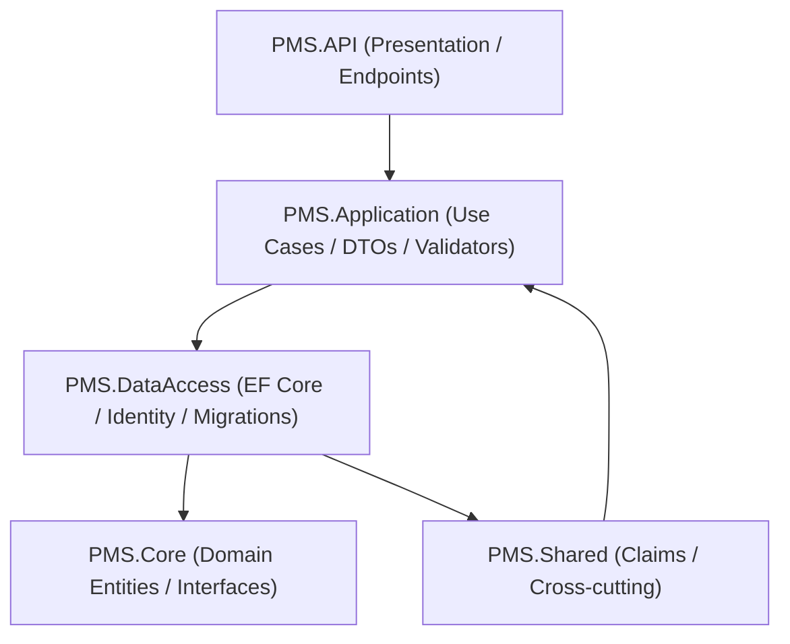

# Phase 1: Parking System Codebase Reconnaissance Report

## 1. Executive Summary

This report establishes the baseline technical state of the **Parking System** codebase as of October 14, 2026. A comprehensive, read-only architectural and static analysis was performed on the repository located at `C:\DEV\OJT-FSA-Team3\parking-management-system`.

### Key Conclusions
- **Implementation Reality vs. Domain Scope**: The repository contains extensive scaffolding for a complete enterprise parking management system (63 database entities covering parking lots, gates, zones, slots, parking sessions, pricing time bands, electronic invoices, and employee shifts). However, **only identity, user authentication, customer profiling, and vehicle management features are currently implemented** in the API and service layers.
- **Architectural Paradigm**: The solution is built upon an ASP.NET Core 9 Clean Architecture / N-Tier template. It exhibits architectural friction between the original boilerplate code (an unused generic repository pattern bound to `DatabaseContext`) and the newly scaffolded domain (`PmsDbContext`), where application services directly query EF Core `DbSet`s.
- **Database Schema Divergence**: Database migrations exist **only** for ASP.NET Identity tables. A raw SQL script in `AutomatedMigration.cs` programmatically creates 3 domain tables (`VehicleTypes`, `Customers`, and `Vehicles`) on application boot if they do not exist. The remaining 60 scaffolded entities currently have **no corresponding EF Core migrations or automated schema provisioning scripts** within the codebase.
- **Test Baseline**: Test automation comprises 4 unit test classes (covering profile services, user services, template services, and user validators) and 1 integration test class (covering user registration and authentication). No integration tests exist for the newly added vehicle and profile endpoints. Automated tests were verified via static analysis and not executed during Phase 1 to prevent generating build artifacts in the read-only repository.

---

## 2. Repository Identity and Current State

### 2.1 Workspace and Repository Root
- **Active Workspace Directory**: `C:\DEV\OJT-FSA-Team3`
  - *Observation*: The outer directory contains an uninitialized Git repository (`No commits yet` on `main`) with untracked `.vs/` and `parking-management-system/`.
- **Actual Target Repository Root**: `C:\DEV\OJT-FSA-Team3\parking-management-system`
  - Remote Origin URL: `https://git.fsoft-academy.edu.vn/hcm26-cpl-net-07/team-03/parking-management-system.git`
  - Active Working Branch: `develop` (Up to date with `origin/develop`)
  - Working Tree State: Clean (no unstaged or uncommitted tracked modifications)
  - Pre-existing Stash: `stash@{0}: On develop: !!GitHub_Desktop<develop>` (preserved untouched)
  - Ignored Artifacts: `.vs/`, legacy project artifacts in `src/N-Tier.*/` and `tests/N-Tier.*/`

### 2.2 Git History and Provenance
The commit history indicates the repository originated as a fork/template of the open-source `N-Tier-Architecture` boilerplate, initialized on 2026-10-02, and subsequently adapted for the Parking Management System:
1. `996f15e` (2026-10-02): *clean architecture initialization and authentication setup*
2. `3a60444` (2026-10-02): *login configuring and registeration API*
3. `0a5ab68` (2026-10-02): *automated migration intergration*
4. `d663787` (2026-10-07): *Renaming source and configuring Swagger Title*
5. `0e944f1` (2026-10-07): *configurring .sql file gitignore*
6. `aad8137` (2026-10-07): *Remove sql file from git tracking* (removed 186 KB `pmsv2.sql`)
7. `545c466` (2026-10-07): *Scaffolding database* (generated 63 entities and `PmsDbContext` from `pmsv2.sql`)
8. `720a426` (2026-10-11): *User profile & User's Vehicle APIs* (latest commit on `develop`)

### 2.3 Top-Level Structure
```text
parking-management-system/
├── .dockerignore
├── .editorconfig
├── .gitignore
├── docker-compose.yml
├── Dockerfile
├── PMS.sln
├── src/
│   ├── PMS.API/
│   ├── PMS.Application/
│   ├── PMS.Core/
│   ├── PMS.DataAccess/
│   └── PMS.Shared/
└── tests/
    ├── PMS.Api.IntegrationTests/
    └── PMS.Application.UnitTests/
```

---

## 3. Technology Stack

| Component | Technology | Version | Location / Evidence | Confirmation |
| :--- | :--- | :--- | :--- | :--- |
| **Language & Runtime** | C# / .NET | `net9.0` (Shared: `netstandard2.1`) | `src/PMS.API/PMS.API.csproj:4` | `[CONFIRMED]` |
| **Web API Framework** | ASP.NET Core | 9.0 | `src/PMS.API/Program.cs:11-62` | `[CONFIRMED]` |
| **Frontend** | None | N/A | No SPA/web frameworks present | `[CONFIRMED]` |
| **Database Engine** | Microsoft SQL Server | 2022 (`2022-latest`) | `docker-compose.yml:16` | `[CONFIRMED]` |
| **ORM / Data Access** | Entity Framework Core | 9.0.4 | `src/PMS.DataAccess/PMS.DataAccess.csproj:22` | `[CONFIRMED]` |
| **Identity & Security** | ASP.NET Core Identity | 9.0.4 | `src/PMS.DataAccess/PMS.DataAccess.csproj:20` | `[CONFIRMED]` |
| **Authentication** | JWT Bearer Authentication | 9.0.4 | `src/PMS.API/ApiDependencyInjection.cs:10-33` | `[CONFIRMED]` |
| **Object Mapping** | Mapster | 7.4.0 | `src/PMS.Application/PMS.Application.csproj:12` | `[CONFIRMED]` |
| **Validation** | FluentValidation | 11.3.0 | `src/PMS.Application/PMS.Application.csproj:10` | `[CONFIRMED]` |
| **API Documentation** | Swashbuckle (Swagger) | 8.1.1 | `src/PMS.API/PMS.API.csproj:20` | `[CONFIRMED]` |
| **Email Service** | MailKit / MimeKit | 4.18.1 | `src/PMS.API/PMS.API.csproj:11,18` | `[CONFIRMED]` |
| **Containerization** | Docker / Compose | Compose 3.9 | `Dockerfile`, `docker-compose.yml` | `[CONFIRMED]` |
| **Testing** | xUnit, FluentAssertions, NSubstitute, NBuilder | 2.9.3, 8.2.0, 5.3.0, 6.1.0 | `tests/PMS.Application.UnitTests/PMS.Application.UnitTests.csproj` | `[CONFIRMED]` |
| **Integration Testing**| WebApplicationFactory | 9.0.4 | `tests/PMS.Api.IntegrationTests/PMS.Api.IntegrationTests.csproj` | `[CONFIRMED]` |

---

## 4. Architecture and Component Map

### 4.1 Solution Layering


1. **`PMS.API` (Presentation Layer)**:
   - Hosting, dependency injection wiring (`Program.cs`, `ApiDependencyInjection.cs`).
   - Controllers (`ApiController.cs`, `UsersController.cs`).
   - Global HTTP pipeline middleware: `PerformanceMiddleware`, `TransactionMiddleware`, `ExceptionHandlingMiddleware`.
   - Filters: `ValidateModelAttribute`.

2. **`PMS.Application` (Business Logic & Use Cases)**:
   - Services & Contracts: `IUserService`, `IUserProfileService`, `IEmailService`, `ITemplateService`.
   - Implementations: `UserService`, `UserProfileService`, `EmailService`, `DevEmailService`, `TemplateService`.
   - DTOs / Request & Response Models (`Models/User/*`, `Models/Profile/*`).
   - FluentValidation validators (`Models/Validators/*`).
   - Mapster object mapping setup (`ApplicationDependencyInjection.cs`).

3. **`PMS.Core` (Domain Layer)**:
   - Base abstractions: `BaseEntity.cs` (Guid ID), `IAuditedEntity.cs` (Audit timestamps/users).
   - Domain exceptions: `ResourceNotFoundException.cs`.
   - 63 scaffolded database entities (`src/PMS.Core/Entities/*.cs`).

4. **`PMS.DataAccess` (Persistence & Identity Layer)**:
   - Dual DbContext architecture: `DatabaseContext` (Identity) and `PmsDbContext` (Domain).
   - Identity User definition: `ApplicationUser.cs` extending `IdentityUser`.
   - Automated startup migration and seed logic: `AutomatedMigration.cs`, `DatabaseContextSeed.cs`.
   - Entity type configurations: `ApplicationUserConfiguration.cs`.
   - Legacy generic repository abstraction: `IBaseRepository<T>`, `BaseRepository<T>`.

5. **`PMS.Shared` (Cross-Cutting Layer)**:
   - User claim extraction: `IClaimService`, `ClaimService` wrapping `IHttpContextAccessor`.

---

## 5. API and Data Model Overview

### 5.1 API Endpoint Inventory
The entire HTTP surface area is currently exposed through `UsersController` (`src/PMS.API/Controllers/UsersController.cs`):

| HTTP Method | Route | Auth / Roles | Request DTO | Response DTO | Implemented Handler |
| :--- | :--- | :--- | :--- | :--- | :--- |
| `GET` | `/api/users` | `AllowAnonymous` | None | `ApiResult<IEnumerable<UserResponseModel>>` | `IUserService.GetAllAsync` |
| `GET` | `/api/users/{id}` | `AllowAnonymous` | `string id` (path) | `ApiResult<UserResponseModel>` | `IUserService.GetByIdAsync` |
| `POST` | `/api/users/register` | `AllowAnonymous` | `CreateUserModel` | `ApiResult<CreateUserResponseModel>` | `IUserService.CreateAsync` |
| `POST` | `/api/users/authenticate` | `AllowAnonymous` | `LoginUserModel` | `ApiResult<LoginResponseModel>` | `IUserService.LoginAsync` |
| `GET` | `/api/users/profile` | `Authorize` | None | `ApiResult<UserProfileResponseModel>` | `IUserProfileService.GetProfileAsync` |
| `PUT` | `/api/users/profile` | `Authorize` | `UpdateUserProfileModel` | `ApiResult<UserProfileResponseModel>` | `IUserProfileService.UpdateProfileAsync` |
| `GET` | `/api/users/profile/vehicles` | `Authorize` | None | `ApiResult<List<VehicleResponseModel>>` | `IUserProfileService.GetVehiclesAsync` |
| `POST` | `/api/users/profile/vehicles` | `Authorize` | `CreateVehicleModel` | `ApiResult<VehicleResponseModel>` | `IUserProfileService.AddVehicleAsync` |
| `PUT` | `/api/users/profile/vehicles/{vehicleId:guid}` | `Authorize` | `Guid vehicleId`, `UpdateVehicleModel` | `ApiResult<VehicleResponseModel>` | `IUserProfileService.UpdateVehicleAsync` |
| `DELETE` | `/api/users/profile/vehicles/{vehicleId:guid}` | `Authorize` | `Guid vehicleId` | `ApiResult<bool>` | `IUserProfileService.DeleteVehicleAsync` (Soft delete) |
| `PATCH` | `/api/users/profile/vehicles/{vehicleId:guid}/default` | `Authorize` | `Guid vehicleId` | `ApiResult<VehicleResponseModel>` | `IUserProfileService.SetDefaultVehicleAsync` |
| `GET` | `/api/users/profile/vehicle-types` | `Authorize` | None | `ApiResult<List<VehicleTypeResponseModel>>` | `IUserProfileService.GetVehicleTypesAsync` |
| `PUT` | `/api/users/profile/change-password` | `Authorize` | `ChangePasswordModel` | `ApiResult<bool>` | `IUserProfileService.ChangePasswordAsync` |
| `GET` | `/api/users/{id}/profile` | `Authorize(Roles = "Admin")`| `string id` (path) | `ApiResult<UserProfileResponseModel>` | `IUserProfileService.GetProfileAsync` |

### 5.2 Data Model and Schema Management

#### Dual DbContext Model
1. **`DatabaseContext`** (`src/PMS.DataAccess/Persistence/DatabaseContext.cs`):
   - Extends `IdentityDbContext<ApplicationUser>`.
   - Manages ASP.NET Core Identity authentication tables: `Users`, `AspNetRoles`, `AspNetRoleClaims`, `AspNetUserClaims`, `AspNetUserLogins`, `AspNetUserTokens`.
   - Maps `ApplicationUser` to the custom table name `Users` (`src/PMS.DataAccess/Persistence/Configurations/ApplicationUserConfiguration.cs:11`).
   - Covered by EF Core migration: `20261001025913_InitialCreate.cs`.

2. **`PmsDbContext`** (`src/PMS.DataAccess/Persistence/PmsDbContext.cs`):
   - Scaffolded reverse-engineered DbContext (1,407 lines) containing 63 `DbSet` properties.
   - Covers all parking operational entities.
   - Not covered by EF Core migrations.

#### Tables Provisioned at Runtime (`AutomatedMigration.cs`)
When `AutomatedMigration.MigrateAsync()` runs at application startup, it executes custom DDL via `EnsurePmsTablesAsync()`:
- `dbo.VehicleTypes`: Seeded with `CAR_4`, `CAR_7`, `MOTORBIKE`, `BICYCLE`.
- `dbo.Customers`: Linked via `UserId` (`nvarchar(450)`) to `dbo.Users`.
- `dbo.Vehicles`: Primary Key `Id` (`uniqueidentifier`), Foreign Keys to `Customers` and `VehicleTypes`, non-clustered index on `PlateNormalized`.

#### Unprovisioned Entities
The following domain clusters exist as entity classes and `DbSet` declarations but have no automated DDL script in the repository:
- **Parking Infrastructure**: `ParkingLot`, `ParkingLotImage`, `Zone`, `ZoneOccupancy`, `ZoneVehicleCapacity`, `Slot`, `Gate`, `Device`, `DeviceEvent`, `BarrierControlLog`.
- **Sessions & Reservations**: `ParkingSession`, `Reservation`, `SessionViolation`.
- **Pricing & Subscriptions**: `PricingRule`, `PricingRuleHistory`, `PricingTimeBand`, `Subscription`, `SubscriptionPlan`, `SubscriptionRenewal`, `Promotion`, `Voucher`, `Holiday`.
- **Billing & Wallets**: `Invoice`, `Einvoice`, `Payment`, `Wallet`, `WalletTransaction`, `LinkedPaymentAccount`.
- **Operations & Staff**: `Employee`, `EmployeeAssignment`, `EmployeePerformanceReview`, `Shift`, `ShiftCashCount`, `ShiftSchedule`, `ShiftTemplate`.
- **System & Auditing**: `SystemSetting`, `AuditLog`, `BackupJob`, `Integration`, `Partner`, `WebhookEndpoint`, `LoyaltyTransaction`, `AccessCard`, `ApiKey`, `OtpCode`, `DataDeletionRequest`, `UserConsent`, `UserLotAccess`.

---

## 6. Existing Tests and Verification Status

### 6.1 Test Inventory
The project contains 2 test assemblies:

1. **`PMS.Application.UnitTests`** (`tests/PMS.Application.UnitTests`):
   - `UserProfileServiceTests.cs` (6 test methods): Exercises profile retrieval, update, vehicle creation/normalization, default vehicle toggling, and soft deletion. Uses EF Core InMemory provider and NSubstitute.
   - `UserServiceTests.cs` (8 test methods): Exercises user registration, login success/failure, listing, and ID lookup.
   - `TemplateServiceTests.cs` (1 test method): Verifies simple placeholder string substitution.
   - `CreateUserModelValidatorTests.cs` (13 test cases): Verifies username length/uniqueness, password constraints, email formatting, and Vietnamese phone number validation.

2. **`PMS.Api.IntegrationTests`** (`tests/PMS.Api.IntegrationTests`):
   - `UsersEndpointTests.cs` (11 test methods): End-to-end HTTP pipeline tests for `POST /api/users/register`, `POST /api/users/authenticate`, `GET /api/users`, and `GET /api/users/{id}` using `WebApplicationFactory<Program>`.

### 6.2 Test Execution Status
- **Status**: `NOT EXECUTED (READ-ONLY PHASE CONSTRAINT)`
- **Rationale**: Under Phase 1 safety rules, no modifications or generated files may be introduced into `C:\DEV\OJT-FSA-Team3\parking-management-system`. Running `dotnet test` or `dotnet build` compiles binaries and mutates the project's `bin/` and `obj/` directories. All test assessments were performed using static code analysis of test declarations, assertions, and dependencies.

### 6.3 Test Coverage Observations and Gaps
- **Profile & Vehicle Endpoint Coverage Gap**: No integration tests exist for the 10 newly introduced profile, vehicle, and vehicle-type endpoints in `UsersController`.
- **Missing Validator Unit Tests**: No unit tests exist for `CreateVehicleModelValidator`, `UpdateVehicleModelValidator`, `ChangePasswordModelValidator`, or `UpdateUserProfileModelValidator`.
- **Isolated Integration Test Configuration**: `ApiApplicationFactory` overrides `DatabaseContext` with a dynamically generated in-memory database name, but leaves `PmsDbContext` pointing to the static name `"NTierDatabase"`. If an integration test were written to verify vehicle registration across both contexts, cross-database reference failures would occur.

---

## 7. Initial Technical Risks and Uncertainties

### 7.1 Confirmed Technical Debts and Architecture Risks
1. **Transaction Middleware Behavioral Flaw (`PMS.API/Middleware/TransactionMiddleware.cs:9-23`)**:
   - `TransactionMiddleware` opens a transaction strictly on `DatabaseContext`. However, core entity mutations in `UserProfileService` occur on `PmsDbContext`, rendering them outside the transaction scope.
   - The middleware catches all exceptions without re-throwing (`catch { await transaction.RollbackAsync(); }`). This can swallow uncaught exceptions and distort the HTTP pipeline error response flow.
   - Every incoming HTTP request (including read-only `GET` requests) opens and commits a database transaction, introducing unnecessary lock and latency overhead.
2. **Entity Namespace Architecture Leakage**:
   - 63 entity classes in `PMS.Core/Entities` are declared under `namespace PMS.DataAccess.Persistence.Entities;`. This violates layer isolation conventions and leaves scaffolding namespace artifacts in the domain core.
3. **Repository Pattern Disconnect**:
   - `IBaseRepository<T>` and `BaseRepository<T>` enforce `where T : BaseEntity`. However, none of the 63 domain entities inherit from `BaseEntity`. The repository layer is completely bypassed in favor of direct DbContext injection.
4. **Audit Trailing Inconsistency**:
   - `DatabaseContext.SaveChangesAsync` inspects `IAuditedEntity` to populate `CreatedBy`/`UpdatedBy`. Because no entities implement `IAuditedEntity`, automated audit tracking is non-operational.
5. **Template Replacement Bug (`PMS.Application/Services/Impl/TemplateService.cs:28-30`)**:
   - `ReplaceInTemplate` contains a loop bug: `foreach (var temp in replaceWords) response = input.Replace(temp.Key, temp.Value);`. Each iteration replaces from `input` rather than the accumulated `response`, discarding all replacements except the final key.
6. **Synchronous Blocking in FluentValidation (`CreateUserModelValidator.cs:60,70`)**:
   - `.GetAwaiter().GetResult()` is invoked on `UserManager.FindByEmailAsync` and `FindByNameAsync`. Synchronous blocking during validation can induce thread pool starvation under high concurrent load.

### 7.2 Uncertainties Requiring Phase 2 Clarification
1. **Scope of Assigned Task**:
   - `[UNKNOWN]`: Does the assigned project task pertain to expanding the Parking Core (sessions, check-in/out, barrier control, slot allocation, payments), or is it focused on customer portals, subscriptions, or reporting?
2. **Target Database Provisioning Strategy**:
   - `[UNKNOWN]`: Is the team planning to generate EF Core migrations for the remaining 60 tables in `PmsDbContext`, or will the system rely on external SQL setup scripts (e.g., `pmsv2.sql`)?
3. **Cross-Customer License Plate Uniqueness**:
   - `[UNKNOWN]`: `UserProfileService.AddVehicleAsync` checks license plate uniqueness strictly scoped to `CustomerId` (`v.CustomerId == customer.Id`). Whether the business rules permit duplicate plates across different accounts requires requirement verification.

---

## 8. Key Files and Evidence Index

| File Relative Path | Primary Purpose | Key Symbols / Evidence | Confirmation |
| :--- | :--- | :--- | :--- |
| `PMS.sln` | Solution Definition | 5 src projects, 2 test projects | `[CONFIRMED]` |
| `Dockerfile` | Container Build | Multi-stage build targeting .NET 9.0 | `[CONFIRMED]` |
| `docker-compose.yml` | Container Services | `pms-api` (port 8080), `pms-sqlserver` (MSSQL 2022) | `[CONFIRMED]` |
| `src/PMS.API/Program.cs` | Application Entry Point | DI registration, middleware pipeline (lines 11-62) | `[CONFIRMED]` |
| `src/PMS.API/Controllers/UsersController.cs` | API Endpoint Controller | 14 user, profile, and vehicle endpoints (lines 18-123) | `[CONFIRMED]` |
| `src/PMS.API/Middleware/TransactionMiddleware.cs` | Request Transaction Filter | Transaction on `DatabaseContext`, catches without rethrow | `[CONFIRMED]` |
| `src/PMS.Application/Services/Impl/UserProfileService.cs`| Profile & Vehicle Logic | Queries `PmsDbContext.Customers`, `Vehicles` directly | `[CONFIRMED]` |
| `src/PMS.Application/Services/Impl/UserService.cs` | Auth & Registration Logic | ASP.NET Identity + Customer provisioning | `[CONFIRMED]` |
| `src/PMS.Application/Services/Impl/TemplateService.cs` | Template Engine | Contains single-key replacement overwrite bug (lines 28-30) | `[CONFIRMED]` |
| `src/PMS.Application/Models/Validators/User/UserValidatorConfiguration.cs`| Validation Regexes | Vietnam phone and license plate regex patterns | `[CONFIRMED]` |
| `src/PMS.DataAccess/Persistence/DatabaseContext.cs` | Identity DbContext | Inherits `IdentityDbContext<ApplicationUser>` | `[CONFIRMED]` |
| `src/PMS.DataAccess/Persistence/PmsDbContext.cs` | Domain DbContext | 63 DbSets (lines 15-130) | `[CONFIRMED]` |
| `src/PMS.DataAccess/Persistence/AutomatedMigration.cs` | Runtime Schema Setup | Creates `VehicleTypes`, `Customers`, `Vehicles` tables | `[CONFIRMED]` |
| `tests/PMS.Application.UnitTests/Services/UserProfileServiceTests.cs` | Profile Unit Tests | 6 xUnit tests covering vehicle and profile operations | `[CONFIRMED]` |
| `tests/PMS.Api.IntegrationTests/Tests/UsersEndpointTests.cs` | User Integration Tests | 11 xUnit tests covering registration and authentication | `[CONFIRMED]` |

---

## 9. Recommended Phase 2 Investigation Plan

When the two project requirement documents are provided in Phase 2, the following systematic investigation steps are recommended:

1. **Map Requirement Scope to Implemented Code**:
   - Compare functional requirements against the 14 active endpoints in `UsersController`.
   - Determine whether the task requires expanding the existing User/Vehicle profile module, or starting a new functional domain (e.g. Parking Lot Management, Parking Sessions, Card/RFID Scanning, Payment Processing).
2. **Resolve the Data Model and Migration Path**:
   - Cross-reference the required feature entities against the 60 unprovisioned tables in `PmsDbContext`.
   - Determine whether database schema creation must be done via formal EF Core migrations or if a database script is supplied.
3. **Harmonize Architecture and Repository Conventions**:
   - Clarify whether the team expects new services to continue querying `PmsDbContext` directly or if a revised repository/Unit-of-Work layer is required.
   - Address the `TransactionMiddleware` mismatch between `DatabaseContext` and `PmsDbContext` if new state-changing transactions are introduced.
4. **Establish Missing Test Suites**:
   - Formulate integration tests for the vehicle and profile endpoints.
   - Correct the dual-database mismatch in `ApiApplicationFactory`.
