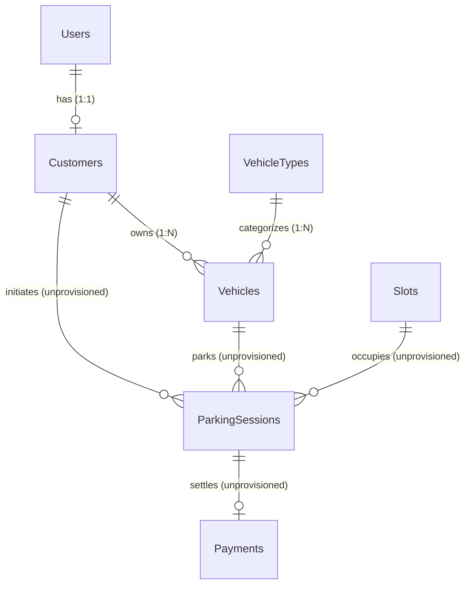
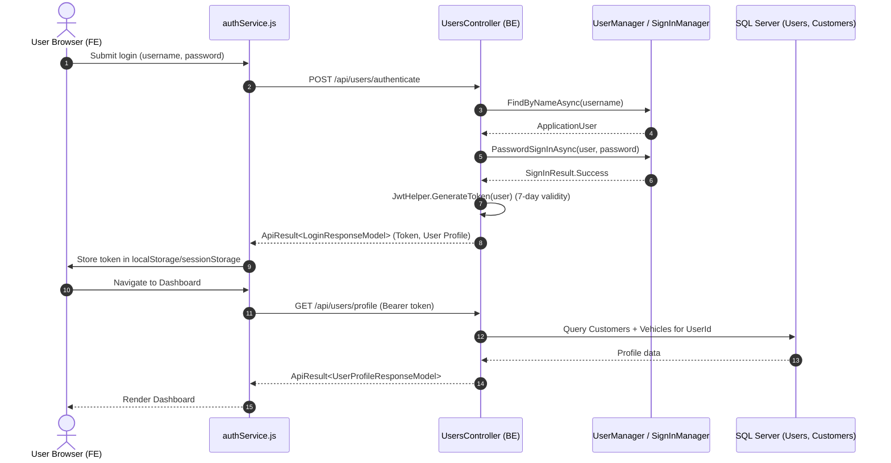

# Phase 1: Full-Stack Parking System Reconnaissance Report

## 1. Executive Summary

This report establishes the baseline technical state of the entire **Parking System** solution, comprising both the Backend (`parking-management-system`) and Frontend (`parking-management-system-frontend`) repositories. A comprehensive, read-only architectural, static code, and cross-repository integration analysis was performed on October 14, 2026.

### Core Discoveries
- **Architectural Symmetry on User & Vehicle Profiles**: The frontend (`pms-frontend`, React 19 / Vite) and backend (`PMS.API`, ASP.NET Core 9 / EF Core 9) are **100% contract-compatible** across 12 active API endpoints covering user authentication, registration, profile retrieval, profile updates, vehicle CRUD, default vehicle selection, and vehicle type catalog queries. The frontend API client (`src/services/authService.js`) was purpose-built to consume the backend's `UsersController`.
- **The Functional Illusion (Core Parking Operations are Simulated)**: While the backend domain models include 63 database entities representing parking infrastructure, lots, slots, parking sessions, barriers, and electronic billing, **no backend API endpoints or application services exist for parking operations**. In the frontend (`UserScreen.jsx`), parking slot maps, active parking session timers, live parking fee counters, QR check-in codes, reservation forms, notifications, and "Pay Now" checkout flows are **100% simulated client-side stubs** utilizing hardcoded mock state, SVG placeholders, and browser alerts.
- **Backend Persistence & Migration Divergence**: Database migrations exist only for ASP.NET Identity. `AutomatedMigration.cs` executes custom raw SQL on startup to create 3 domain tables (`VehicleTypes`, `Customers`, and `Vehicles`). The remaining 60 scaffolded entities currently have **no automated migrations or DDL provisioning scripts** within the codebase.
- **Frontend Architecture & Tooling**: The frontend is a lightweight Single-Page Application built on React 19.1.0 and Vite 7.0.4 using vanilla JavaScript/JSX. It contains no external routing libraries (e.g., `react-router`), no HTTP libraries (e.g., `axios`), and no external UI component libraries. Routing is managed via state-driven screen switching (`App.jsx`).

---

## 2. Scope, Methodology, and Restrictions

### 2.1 Scope of Inspection
- **Backend Repository**: `C:\DEV\OJT-FSA-Team3\parking-management-system`
- **Frontend Repository**: `C:\DEV\OJT-FSA-Team3\parking-management-system-frontend`
- **Team Workspace Root**: `C:\DEV\OJT-FSA-Team3`
- **Reporting Repository Target**: `C:\DEV\OJT-report`

### 2.2 Methodology and Strict Operational Boundaries
- **Zero-Modification Policy**: No files were created, edited, renamed, formatted, or deleted in the team workspace or either team repository.
- **Absolute Git Prohibition on Team Repositories**: In accordance with project instructions, **zero Git commands** (read-only or mutating) were executed against `C:\DEV\OJT-FSA-Team3`, `parking-management-system`, or `parking-management-system-frontend`.
- **Git Metadata Status**: Because Git commands are strictly prohibited on team repositories, branches, remote URLs, commit histories, working-tree statuses, and stashes for the team repositories are classified as `[NOT INSPECTED]`.
- **Static Analysis Only**: No builds (`dotnet build`, `vite build`) or test executions (`dotnet test`, `npm test`) were run to prevent generating build artifacts or modifying file system state.
- **Credential Protection**: No secrets, connection strings with credentials, JWT signing keys, or passwords were copied into this report.

---

## 3. Repository Inventory (BE and FE)

### 3.1 Backend Repository Structure (`parking-management-system`)
```text
parking-management-system/
├── .dockerignore
├── .editorconfig
├── .gitignore
├── docker-compose.yml
├── Dockerfile
├── PMS.sln
├── src/
│   ├── PMS.API/
│   │   ├── Controllers/ (ApiController.cs, UsersController.cs)
│   │   ├── Filters/ (ValidateModelAttribute.cs)
│   │   ├── Middleware/ (ExceptionHandling, Performance, Transaction)
│   │   ├── Properties/ (launchSettings.json)
│   │   ├── ApiDependencyInjection.cs
│   │   ├── appsettings*.json
│   │   └── Program.cs
│   ├── PMS.Application/
│   │   ├── Common/ (Email, SmtpSettings)
│   │   ├── Exceptions/ (BadRequest, NotFound, UnprocessableRequest)
│   │   ├── Helpers/ (JwtHelper, RandomGenerator)
│   │   ├── MappingProfiles/ (IMappingProfilesMarker)
│   │   ├── Models/ (ApiResult, User/*, Profile/*, Validators/*)
│   │   ├── Services/ (UserService, UserProfileService, EmailService, TemplateService)
│   │   ├── Templates/ (confirmation_email.html)
│   │   └── ApplicationDependencyInjection.cs
│   ├── PMS.Core/
│   │   ├── Common/ (BaseEntity, IAuditedEntity)
│   │   ├── Entities/ (63 domain entity classes)
│   │   └── Exceptions/ (ResourceNotFoundException)
│   ├── PMS.DataAccess/
│   │   ├── Identity/ (ApplicationUser)
│   │   ├── Persistence/ (DatabaseContext, PmsDbContext, AutomatedMigration, Seed)
│   │   ├── Repositories/ (IBaseRepository, BaseRepository)
│   │   └── DataAccessDependencyInjection.cs
│   └── PMS.Shared/
│       └── Services/ (IClaimService, ClaimService)
└── tests/
    ├── PMS.Api.IntegrationTests/ (UsersEndpointTests, ApiApplicationFactory)
    └── PMS.Application.UnitTests/ (UserProfileServiceTests, UserServiceTests, etc.)
```

### 3.2 Frontend Repository Structure (`parking-management-system-frontend`)
```text
parking-management-system-frontend/
├── .github/
│   └── copilot-instructions.md
├── public/
│   └── lamborghini.jpg
├── src/
│   ├── components/
│   │   ├── ApiStatusBadge.jsx   (Live API connection monitor & preset URL switcher)
│   │   ├── LoginScreen.jsx      (Password login, simulated 2FA OTP, simulated SSO)
│   │   ├── ParkingLogo.jsx       (Vector SVG branding)
│   │   ├── RegisterScreen.jsx   (Client validation, auto-generated username registration)
│   │   └── UserScreen.jsx       (Dashboard: map, live active session, vehicles, profile)
│   ├── services/
│   │   └── authService.js       (Fetch API client for PMS.API backend)
│   ├── App.css                  (Theme styling, glassmorphism, responsive styles)
│   ├── App.jsx                  (Root view switcher: login | register | user)
│   ├── index.css                (Reset and global variables)
│   └── main.jsx                 (React DOM root render)
├── .gitignore
├── eslint.config.js
├── index.html
├── package-lock.json
├── package.json
├── README.md
└── vite.config.js
```

---

## 4. Technology Stack

| Domain | Technology / Library | Version | File Reference | Evidence / Status |
| :--- | :--- | :--- | :--- | :--- |
| **BE Language & Framework** | C# / ASP.NET Core | `net9.0` | `BE: src/PMS.API/PMS.API.csproj:4` | `[CONFIRMED]` |
| **BE Shared Library** | .NET Standard | `netstandard2.1` | `BE: src/PMS.Shared/PMS.Shared.csproj:4` | `[CONFIRMED]` |
| **BE Database Server** | Microsoft SQL Server | 2022 | `BE: docker-compose.yml:16` | `[CONFIRMED]` |
| **BE ORM** | Entity Framework Core | 9.0.4 | `BE: src/PMS.DataAccess/PMS.DataAccess.csproj:22` | `[CONFIRMED]` |
| **BE Identity & Auth** | ASP.NET Core Identity + JWT | 9.0.4 | `BE: src/PMS.DataAccess/PMS.DataAccess.csproj:20` | `[CONFIRMED]` |
| **BE Object Mapper** | Mapster | 7.4.0 | `BE: src/PMS.Application/PMS.Application.csproj:12` | `[CONFIRMED]` |
| **BE Validation** | FluentValidation | 11.3.0 | `BE: src/PMS.Application/PMS.Application.csproj:10` | `[CONFIRMED]` |
| **BE Swagger** | Swashbuckle.AspNetCore | 8.1.1 | `BE: src/PMS.API/PMS.API.csproj:20` | `[CONFIRMED]` |
| **BE Mailer** | MailKit / MimeKit | 4.18.1 | `BE: src/PMS.API/PMS.API.csproj:11,18` | `[CONFIRMED]` |
| **BE Testing** | xUnit, FluentAssertions, NSubstitute | 2.9.3 / 8.2.0 | `BE: tests/PMS.Application.UnitTests/*.csproj` | `[CONFIRMED]` |
| **FE Framework** | React | ^19.1.0 | `FE: package.json:13` | `[CONFIRMED]` |
| **FE Build Tool** | Vite | ^7.0.4 | `FE: package.json:23` | `[CONFIRMED]` |
| **FE Routing** | Custom State-Based | N/A | `FE: src/App.jsx:47` (no react-router) | `[CONFIRMED]` |
| **FE HTTP Client** | Native Fetch API | Browser Native | `FE: src/services/authService.js` (no axios) | `[CONFIRMED]` |
| **FE Linter** | ESLint | ^9.30.0 | `FE: package.json:19` | `[CONFIRMED]` |
| **FE Node Engine Requirement** | Node.js | 20.19+ / 22.12+ | `FE: README.md:7` | `[CONFIRMED]` |

---

## 5. Backend Architecture and Implementation

### 5.1 Architecture Overview
The backend adheres to a Clean / N-Tier Architecture consisting of 5 projects:
- Presentation (`PMS.API`)
- Application (`PMS.Application`)
- Core Domain (`PMS.Core`)
- Persistence & Identity (`PMS.DataAccess`)
- Cross-Cutting (`PMS.Shared`)

### 5.2 Key Backend Components
1. **API Entrypoint (`Program.cs`)**:
   - Registers services across all layers.
   - Adds global filters (`ValidateModelAttribute`).
   - Configures Swagger with JWT Bearer authentication scheme.
   - Executes startup automated migration (`AutomatedMigration.MigrateAsync`).
   - Middleware pipeline order: `PerformanceMiddleware` -> `TransactionMiddleware` -> `ExceptionHandlingMiddleware`.
2. **Application Services (`PMS.Application/Services/Impl`)**:
   - `UserService`: Manages registration, authentication, token issuance, user queries.
   - `UserProfileService`: Manages customer profile, vehicle CRUD, default vehicle selection, and vehicle type catalog.
   - `EmailService` / `DevEmailService`: Mail sending abstraction (falls back to console logger in Development).
   - `TemplateService`: Reads HTML templates from disk for emails.
3. **Dual Persistence Model (`PMS.DataAccess/Persistence`)**:
   - `DatabaseContext`: Inherits `IdentityDbContext<ApplicationUser>`, handles authentication entities.
   - `PmsDbContext`: Scaffolded reverse-engineered DbContext (1,407 lines) containing 63 `DbSet` properties representing full parking domain operations.

---

## 6. Frontend Architecture and Implementation

### 6.1 Architecture Overview
The frontend is a lightweight Single-Page Application (SPA) designed as a responsive cyber/glassmorphism portal. It has zero heavy third-party UI dependencies, relying entirely on modern CSS3 and React 19 functional components with hooks (`useState`, `useEffect`, `useCallback`, `memo`, `useRef`).

### 6.2 Key Frontend Components
1. **`App.jsx`**:
   - Acts as the root state machine.
   - Tracks `currentView`: `'login'`, `'register'`, or `'user'`.
   - Manages top navigation bar, global toast notifications, dynamic ambient lighting, and Lamborghini luxury background for auth screens.
   - Wraps screens in an `ErrorBoundary` component.
2. **`components/LoginScreen.jsx`**:
   - Tab 1: Password login via `authService.login()`.
   - Tab 2: Simulated OTP / 2FA verification.
   - Quick Demo helpers: "Auto-fill Demo" and "Instant Access Demo" (bypasses backend with a client-side mock user).
   - Simulated SSO buttons (Google, Microsoft) and Forgot Password modal.
3. **`components/RegisterScreen.jsx`**:
   - Registration form with client-side password strength meter (0-100%).
   - Client-side validation for Vietnamese phone numbers, email format, password matching, and terms acceptance.
   - Auto-generates a backend-compatible `userName` from email prefix before invoking `authService.register()`.
4. **`components/UserScreen.jsx`**:
   - Comprehensive dashboard view:
     - Top bar with user avatar, profile menu, notification bell, and logout.
     - Live Vehicle Management: lists registered vehicles, supports Add/Edit/Delete/Set Default modals connected to live backend APIs.
     - Profile Management: modal for editing full name, email, phone, avatar URL, and change password modal.
     - Simulated Parking Map: interactive SVG/CSS slot grid (Level 1, Level 2, Level 3).
     - Simulated Active Parking Card: real-time timer ticking upwards with dynamic fee accumulation and clickable QR check-in code.
     - Simulated Quick Reservation and "Pay Now" checkout modal.
5. **`components/ApiStatusBadge.jsx`**:
   - Pings backend every 60 seconds (`authService.checkConnection()`).
   - Modal allows switching API base URL dynamically between presets:
     - IIS Express: `https://localhost:44391/api`
     - Kestrel HTTPS: `https://localhost:5001/api`
     - Kestrel HTTP: `http://localhost:5000/api`
     - Custom user-entered URL stored in `localStorage`.
6. **`services/authService.js`**:
   - Centralized HTTP client wrapping native `fetch()`.
   - Persists JWT token and user profile in `localStorage` (if remember me) or `sessionStorage`.
   - Normalizes URLs and unwraps backend `ApiResult<T>` envelope.

---

## 7. API Endpoint Inventory

All currently active backend endpoints are hosted on `UsersController` (`src/PMS.API/Controllers/UsersController.cs`):

| # | HTTP Method | Route | Authorization | Request DTO | Response DTO | Backend Action |
| :- | :--- | :--- | :--- | :--- | :--- | :--- |
| 1 | `GET` | `/api/users` | `[AllowAnonymous]` | None | `ApiResult<IEnumerable<UserResponseModel>>` | `UsersController.GetAllAsync` |
| 2 | `GET` | `/api/users/{id}` | `[AllowAnonymous]` | `string id` (path) | `ApiResult<UserResponseModel>` | `UsersController.GetByIdAsync` |
| 3 | `POST` | `/api/users/register` | `[AllowAnonymous]` | `CreateUserModel` | `ApiResult<CreateUserResponseModel>` | `UsersController.RegisterAsync` |
| 4 | `POST` | `/api/users/authenticate` | `[AllowAnonymous]` | `LoginUserModel` | `ApiResult<LoginResponseModel>` | `UsersController.LoginAsync` |
| 5 | `GET` | `/api/users/profile` | `[Authorize]` | None | `ApiResult<UserProfileResponseModel>` | `UsersController.GetProfileAsync` |
| 6 | `PUT` | `/api/users/profile` | `[Authorize]` | `UpdateUserProfileModel` | `ApiResult<UserProfileResponseModel>` | `UsersController.UpdateProfileAsync` |
| 7 | `GET` | `/api/users/profile/vehicles` | `[Authorize]` | None | `ApiResult<List<VehicleResponseModel>>` | `UsersController.GetVehiclesAsync` |
| 8 | `POST` | `/api/users/profile/vehicles` | `[Authorize]` | `CreateVehicleModel` | `ApiResult<VehicleResponseModel>` | `UsersController.AddVehicleAsync` |
| 9 | `PUT` | `/api/users/profile/vehicles/{vehicleId:guid}` | `[Authorize]` | `Guid vehicleId`, `UpdateVehicleModel` | `ApiResult<VehicleResponseModel>` | `UsersController.UpdateVehicleAsync` |
| 10 | `DELETE`| `/api/users/profile/vehicles/{vehicleId:guid}` | `[Authorize]` | `Guid vehicleId` (path) | `ApiResult<bool>` | `UsersController.DeleteVehicleAsync` |
| 11 | `PATCH` | `/api/users/profile/vehicles/{vehicleId:guid}/default` | `[Authorize]` | `Guid vehicleId` (path) | `ApiResult<VehicleResponseModel>` | `UsersController.SetDefaultVehicleAsync` |
| 12 | `GET` | `/api/users/profile/vehicle-types` | `[Authorize]` | None | `ApiResult<List<VehicleTypeResponseModel>>` | `UsersController.GetVehicleTypesAsync` |
| 13 | `PUT` | `/api/users/profile/change-password` | `[Authorize]` | `ChangePasswordModel` | `ApiResult<bool>` | `UsersController.ChangePasswordAsync` |
| 14 | `GET` | `/api/users/{id}/profile` | `[Authorize(Roles = "Admin")]`| `string id` (path) | `ApiResult<UserProfileResponseModel>` | `UsersController.GetProfileByUserIdAsync` |

---

## 8. Frontend-to-Backend Integration Matrix

| Frontend Feature | Frontend API Call | Backend Endpoint | Contract Compatibility | Evidence | Status |
| :--- | :--- | :--- | :--- | :--- | :--- |
| **API Health Ping** | `authService.checkConnection()` | `GET /api/users` | Headers & status check compatible. Note: dumps all users to test connectivity. | `FE: authService.js:52`<br>`BE: UsersController.cs:18` | `MATCH` |
| **Password Login** | `authService.login(username, password)` | `POST /api/users/authenticate` | Payload `{ username, password }` and `ApiResult<LoginResponseModel>` match. | `FE: authService.js:81`<br>`BE: UsersController.cs:39` | `MATCH` |
| **User Registration** | `authService.register(data)` | `POST /api/users/register` | Payload matches `CreateUserModel`. FE auto-derives username from email. | `FE: authService.js:165`<br>`BE: UsersController.cs:32` | `MATCH` |
| **Get Profile** | `authService.fetchProfile()` | `GET /api/users/profile` | Bearer token header, response fields match `UserProfileResponseModel`. | `FE: authService.js:284`<br>`BE: UsersController.cs:46` | `MATCH` |
| **Update Profile** | `authService.updateProfile(data)` | `PUT /api/users/profile` | Payload matches `UpdateUserProfileModel` (`fullName`, `email`, `phone`, `avatar`). | `FE: authService.js:328`<br>`BE: UsersController.cs:54` | `MATCH` |
| **Get Vehicles** | `authService.fetchVehicles()` | `GET /api/users/profile/vehicles` | Returns array of `VehicleResponseModel`. | `FE: authService.js:382`<br>`BE: UsersController.cs:62` | `MATCH` |
| **Get Vehicle Types**| `authService.fetchVehicleTypes()` | `GET /api/users/profile/vehicle-types` | Returns list of `VehicleTypeResponseModel`. | `FE: authService.js:408`<br>`BE: UsersController.cs:101` | `MATCH` |
| **Add Vehicle** | `authService.addVehicle(data)` | `POST /api/users/profile/vehicles` | Payload matches `CreateVehicleModel`. Plate format validated. | `FE: authService.js:433`<br>`BE: UsersController.cs:70` | `MATCH` |
| **Update Vehicle** | `authService.updateVehicle(id, data)` | `PUT /api/users/profile/vehicles/{id}` | Route parameter GUID and payload match `UpdateVehicleModel`. | `FE: authService.js:473`<br>`BE: UsersController.cs:78` | `MATCH` |
| **Delete Vehicle** | `authService.deleteVehicle(id)` | `DELETE /api/users/profile/vehicles/{id}` | Route GUID matches, soft-deletes vehicle, returns boolean. | `FE: authService.js:514`<br>`BE: UsersController.cs:86` | `MATCH` |
| **Set Default Vehicle**| `authService.setDefaultVehicle(id)` | `PATCH /api/users/profile/vehicles/{id}/default` | Route GUID matches, toggles default vehicle flag. | `FE: authService.js:545`<br>`BE: UsersController.cs:94` | `MATCH` |
| **Change Password** | `authService.changePassword(data)` | `PUT /api/users/profile/change-password` | Payload matches `ChangePasswordModel` (`current`, `new`, `confirm`). | `FE: authService.js:576`<br>`BE: UsersController.cs:109` | `MATCH` |
| **OTP / 2FA Login** | `authService.requestOtp()`, `verifyOtpAndLogin()` | None | Client-side simulation using `123456`. No backend 2FA endpoint. | `FE: authService.js:207,220`<br>`BE: No matching action` | `NOT FOUND IN INSPECTED SCOPE` |
| **SSO Login** | `LoginScreen.jsx: handleSsoLogin()` | None | Client-side simulation generating dummy token. | `FE: LoginScreen.jsx:135`<br>`BE: No matching action` | `NOT FOUND IN INSPECTED SCOPE` |
| **Forgot Password** | `LoginScreen.jsx: Modal` | None | Pure UI alert with no network request. | `FE: LoginScreen.jsx:438`<br>`BE: No matching action` | `NOT FOUND IN INSPECTED SCOPE` |
| **Slot Map & Levels**| `UserScreen.jsx: Slot Grid` | None | Client-side mock state. No endpoint for parking slots or occupancy. | `FE: UserScreen.jsx:650-820`<br>`BE: No matching action` | `NOT FOUND IN INSPECTED SCOPE` |
| **Active Parking Session**| `UserScreen.jsx: ActiveParkingCard` | None | Client-side `setInterval` counter. No endpoint for sessions. | `FE: UserScreen.jsx:43-73`<br>`BE: No matching action` | `NOT FOUND IN INSPECTED SCOPE` |
| **Quick Reservation**| `UserScreen.jsx: handleFindSlots()` | None | Client-side string feedback. No endpoint for reservations. | `FE: UserScreen.jsx:107-145`<br>`BE: No matching action` | `NOT FOUND IN INSPECTED SCOPE` |
| **Pay Now Checkout** | `UserScreen.jsx: Modal` | None | Pure UI alert ("Payment processed!"). No payment endpoint. | `FE: UserScreen.jsx:995-1045`<br>`BE: No matching action` | `NOT FOUND IN INSPECTED SCOPE` |
| **Notifications** | `UserScreen.jsx: Notifications` | None | Static hardcoded array of 2 notifications. | `FE: UserScreen.jsx:120-123`<br>`BE: No matching action` | `NOT FOUND IN INSPECTED SCOPE` |
| **Admin View Profile**| None (No frontend admin view) | `GET /api/users/{id}/profile` | Endpoint exists with `[Authorize(Roles = "Admin")]`, no FE caller. | `BE: UsersController.cs:117` | `NOT APPLICABLE` |
| **Get User By ID** | None | `GET /api/users/{id}` | Endpoint exists, no direct FE caller found. | `BE: UsersController.cs:25` | `NOT APPLICABLE` |

---

## 9. Database and Domain Model Overview

### 9.1 Database Realities
1. **Migrations vs. Scaffolding**:
   - Formal EF Core Migrations exist **only** for Identity tables (`20261001025913_InitialCreate.cs`).
   - Startup DDL in `AutomatedMigration.cs` programmatically creates 3 domain tables using raw SQL:
     - `dbo.VehicleTypes` (seeded with CAR_4, CAR_7, MOTORBIKE, BICYCLE)
     - `dbo.Customers` (linked to `Users.UserId`)
     - `dbo.Vehicles` (FKs to `Customers` and `VehicleTypes`)
   - **The remaining 60 entities have no migrations or automated SQL provisioning scripts in the repository**.
2. **Scaffolded Domain Clusters**:
   - Infrastructure: `ParkingLot`, `Zone`, `Slot`, `Gate`, `Device`, `DeviceEvent`, `BarrierControlLog`.
   - Operations: `ParkingSession`, `Reservation`, `SessionViolation`.
   - Tariffs & Passes: `PricingRule`, `PricingTimeBand`, `Subscription`, `SubscriptionPlan`, `Promotion`, `Voucher`.
   - Payments & Billing: `Invoice`, `Einvoice`, `Payment`, `Wallet`, `WalletTransaction`.
   - Staff Management: `Employee`, `Shift`, `ShiftCashCount`, `ShiftSchedule`, `ShiftTemplate`.



---

## 10. Authentication and Authorization

### 10.1 Flow Architecture


### 10.2 Security Observations
- **JWT Expiration**: Tokens expire after 7 days (`DateTime.UtcNow.AddDays(7)` in `JwtHelper.cs:40`).
- **Token Validation**: Issuer and Audience validation are disabled (`ValidateIssuer = false`, `ValidateAudience = false` in `ApiDependencyInjection.cs:29-30`).
- **No Refresh Token Flow**: Although a `RefreshToken` entity exists in `PMS.Core`, no refresh token issuance or endpoint is implemented.
- **Login Identifier Limitation**: Backend `LoginAsync` strictly evaluates `u.UserName == loginUserModel.Username`. Entering an email address fails unless the username equals the email.

---

## 11. Testing and Verification Status

### 11.1 Backend Test Inventory
- **`PMS.Application.UnitTests`**:
  - `UserProfileServiceTests.cs` (6 tests): Unit tests for profile retrieval, vehicle CRUD, and default vehicle selection.
  - `UserServiceTests.cs` (8 tests): Unit tests for user creation, login, and queries.
  - `TemplateServiceTests.cs` (1 test): Verifies single-key placeholder replacement.
  - `CreateUserModelValidatorTests.cs` (13 tests): Validates registration rules.
- **`PMS.Api.IntegrationTests`**:
  - `UsersEndpointTests.cs` (11 tests): End-to-end integration tests for user registration, login, and queries.
- **Execution Status**: `[NOT EXECUTED]` to honor read-only restrictions and prevent generating binaries in `bin/` and `obj/`.

### 11.2 Frontend Test Inventory
- **Automated Tests**: None found. No test files (`*.test.js`, `*.spec.jsx`), no testing packages (`jest`, `vitest`, `playwright`), and no test script in `package.json`.
- **Lint Script**: `npm run lint` (`eslint .`) configured via `eslint.config.js`.

---

## 12. Confirmed Technical Defects and Potential Risks

### 12.1 Confirmed Defects `[CONFIRMED]`
1. **`TemplateService` Loop Replacement Defect (`BE: src/PMS.Application/Services/Impl/TemplateService.cs:28-30`)**:
   - `foreach (var temp in replaceWords) response = input.Replace(temp.Key, temp.Value);`. Every iteration resets the search against the original `input`, discarding all previous replacements and returning only the substitution of the final dictionary key.
2. **`TransactionMiddleware` Exception Swallowing (`BE: src/PMS.API/Middleware/TransactionMiddleware.cs:19-22`)**:
   - `catch { await transaction.RollbackAsync(); }` catches all unhandled exceptions without re-throwing (`throw;`). This terminates pipeline execution abnormally and bypasses standard error response generation.
3. **`TransactionMiddleware` Context Mismatch (`BE: src/PMS.API/Middleware/TransactionMiddleware.cs:9-11`)**:
   - Opens a database transaction strictly on `DatabaseContext`. All vehicle and profile writes occur against `PmsDbContext`, which executes outside of the transaction.
4. **Integration Test Database Context Mismatch (`BE: tests/PMS.Api.IntegrationTests/Common/ApiApplicationFactory.cs:44-52`)**:
   - `ApiApplicationFactory` overrides `DatabaseContext` with a dynamically generated in-memory name, while leaving `PmsDbContext` bound to the static name `"NTierDatabase"`. Cross-context queries will fail due to database separation.

### 12.2 Potential Technical Risks `[RISK]`
1. **Unprotected User Dump on Connection Check (`FE: src/services/authService.js:52`)**:
   - `authService.checkConnection()` pings `GET /api/users` every 60 seconds. Because `GET /api/users` is `[AllowAnonymous]`, every ping transfers the entire user list across the network.
2. **Lack of Global Vehicle Plate Uniqueness (`BE: src/PMS.Application/Services/Impl/UserProfileService.cs:151-156`)**:
   - Plate uniqueness check is scoped only to the current customer (`v.CustomerId == customer.Id`). Two different user accounts can register the exact same license plate.
3. **Synchronous Async Blocking in Validators (`BE: src/PMS.Application/Models/Validators/User/CreateUserModelValidator.cs:60,70`)**:
   - Invoking `.GetAwaiter().GetResult()` inside FluentValidation synchronous rules risks thread pool starvation under high concurrent traffic.

---

## 13. Incomplete and Unverified Areas

1. **Unprovisioned Parking Core (`[INFERRED]` / `[UNKNOWN]`)**:
   - 60 domain tables and associated operational workflows (sessions, RFID scanning, barrier gate hardware, payment processing) are not yet implemented in either the API or database schema.
2. **Runtime Database Execution (`[NOT INSPECTED]`)**:
   - No live database engine connection was tested; all conclusions are derived from static SQL DDL and C# models.
3. **Team Repository Git Status (`[NOT INSPECTED]`)**:
   - Git branches, commit history, remotes, and working-tree status for `parking-management-system` and `parking-management-system-frontend` were not inspected because Git commands against team repositories are strictly forbidden.
4. **Requirement Compliance (`[UNKNOWN]`)**:
   - Whether the current implementation represents the intended scope or a preliminary milestone cannot be determined until the user provides the two requirement documents in Phase 2.

---

## 14. Evidence Index

| Repository | File Path | Key Lines / Symbols | Classification |
| :--- | :--- | :--- | :--- |
| **BE** | `PMS.sln` | Lines 6-23: 7 projects in solution | `[CONFIRMED]` |
| **BE** | `src/PMS.API/Program.cs` | Lines 11-62: Middleware, DI, startup migrations | `[CONFIRMED]` |
| **BE** | `src/PMS.API/Controllers/UsersController.cs` | Lines 18-123: 14 API actions | `[CONFIRMED]` |
| **BE** | `src/PMS.API/Middleware/TransactionMiddleware.cs` | Lines 9-23: Transaction on DatabaseContext, swallows error | `[CONFIRMED]` |
| **BE** | `src/PMS.Application/Services/Impl/UserProfileService.cs` | Lines 27-339: Profile and vehicle business logic | `[CONFIRMED]` |
| **BE** | `src/PMS.Application/Services/Impl/TemplateService.cs` | Lines 28-30: `ReplaceInTemplate` loop bug | `[CONFIRMED]` |
| **BE** | `src/PMS.DataAccess/Persistence/AutomatedMigration.cs` | Lines 43-163: Raw SQL table creation for 3 tables | `[CONFIRMED]` |
| **BE** | `src/PMS.DataAccess/Persistence/PmsDbContext.cs` | Lines 15-130: 63 scaffolded entity `DbSet`s | `[CONFIRMED]` |
| **FE** | `package.json` | Lines 12-24: React 19.1, Vite 7.0, no router/axios | `[CONFIRMED]` |
| **FE** | `src/App.jsx` | Lines 47-59, 178-225: Root state router | `[CONFIRMED]` |
| **FE** | `src/services/authService.js` | Lines 8-25: Base URL logic; 35-613: API client methods | `[CONFIRMED]` |
| **FE** | `src/components/LoginScreen.jsx` | Lines 32-56: Login; 81-106: OTP simulation; 134-147: SSO mock | `[CONFIRMED]` |
| **FE** | `src/components/RegisterScreen.jsx` | Lines 66-75: Auto-derives username, client validation | `[CONFIRMED]` |
| **FE** | `src/components/UserScreen.jsx` | Lines 43-73: Simulated timer; 205-358: Live vehicles API | `[CONFIRMED]` |
| **FE** | `src/components/ApiStatusBadge.jsx` | Lines 12-29: Ping timer; 103-127: Port presets | `[CONFIRMED]` |

---

## 15. Recommended Phase 2 Investigation Plan

When the user provides the two requirement documents and authorizes Phase 2, the following investigation priorities are recommended:

1. **Clarify the Functional Target**:
   - Determine whether the assigned task focuses on completing the User/Vehicle profile module (e.g., adding 2FA, avatar upload, plate verification) OR implementing the Core Parking subsystem (slot booking, live sessions, payment gateway integration).
2. **Determine Schema Migration Strategy**:
   - Clarify whether the remaining 60 domain tables must be migrated via EF Core migrations or if an authoritative external SQL script should be executed.
3. **Address Cross-Repository Discrepancies**:
   - Align username vs. email login handling on `LoginScreen.jsx` and `UserService.cs`.
   - Replace the ping check endpoint (`GET /api/users`) with a dedicated lightweight health check (e.g., `/health` or `GET /api/users/profile/vehicle-types`).
4. **Resolve Middleware Defects**:
   - Refactor `TransactionMiddleware.cs` to avoid swallowing exceptions and align transaction management with `PmsDbContext`.
