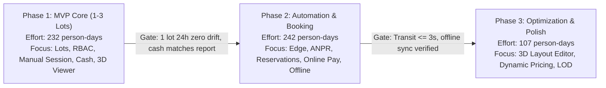

# Phase 2: Requirements and Implementation Plan Analysis Report

## 1. Document Inventory and Analysis Limitations

### 1.1 Document Inventory
This analysis is based on two official project documents provided for the Parking System project on October 14, 2026. Both source files were inspected, verified, and archived in the reporting repository:

| Document Role | Source Filename | Byte Size | SHA256 Hash | Author / Date |
| :--- | :--- | :--- | :--- | :--- |
| **SRS Document** | `SRS v1.3 – Hệ thống Quản lý Nhiều Bãi Đỗ Xe.docx` | 137,445 bytes | `F72686FB2CED8ED23070850F6F2FFF1661E33F054E9869928685C9F87BA5834A` | `@f` · Oct 11, 2026 |
| **Implementation Plan** | `Implementation Plan - Hệ thống Quản lý Nhiều Bãi Đỗ Xe.docx` | 118,372 bytes | `333630CB21CD5D69EFD01A74D099A356A045B58B0632A69D5244CBA96AADCFBA` | `@FrankyMilky` · Oct 11, 2026 |

**Archived Location**:
`C:\DEV\OJT-report\reports\parking-system\source-documents/`
Both files are byte-identical to their original inputs.

### 1.2 Analysis Limitations and Extraction Notes
1. **Embedded Diagrams**:
   - `SRS v1.3`: Contains one embedded image (`word/media/image1.png`, 122,502 bytes) illustrating three finite state machines: **Slot**, **Session**, and **Reservation (Đặt chỗ)**. The image transitions and state labels were completely extracted and cross-checked against Section 4.2 of the text.
   - `Implementation Plan`: Contains one embedded image (`word/media/image1.png`, 108,669 bytes) depicting the high-level 3-phase delivery roadmap. All milestones and text labels were completely extracted and cross-checked against Section 5.
2. **Missing Quantitative Timelines**:
   - The Implementation Plan calculates effort in **person-days** (người-ngày) and assumes 2-week sprints, but explicitly omits calendar start dates, calendar deadlines, and team staffing headcount (noted in Plan Section 5 as dependent on team capacity).
3. **Repository Scope Boundary**:
   - In accordance with Phase 2 rules, source code was not re-audited broadly. The Phase 1 full-stack reconnaissance report (`phase-1-fullstack-codebase-scan.md`) was utilized strictly as supplementary baseline evidence.

---

## 2. Executive Summary

This evaluation analyzes **SRS v1.3** and its companion **Implementation Plan** to establish requirement completeness, feasibility, cross-document alignment, and operational readiness before proceeding with further development.

### Key Conclusions
1. **High Quality of Functional Specifics**: SRS v1.3 represents a mature, well-scoped requirements baseline. Key improvements over prior drafts (v1.0–v1.2) include discarding shift management, formalizing a two-mode parking model (individual slot tracking for reservations vs. aggregate `ZoneCounter` for transient vehicles), enforcing an Exit Window on paid sessions, mandating Maker-Checker authorization for financial exceptions, requiring offline autonomy at gates, and enforcing privacy on public 3D streams.
2. **Critical Plan-to-Code Sequence Inversion**:
   - The **Implementation Plan** schedules User/Customer registration, profile management, and vehicle CRUD in **Phase 2 (Automation & Reservations)** under items `B2.7` and `F2.3`.
   - In contrast, the **existing codebase** already implemented User registration, profile management, vehicle CRUD, and default vehicle toggling (`UsersController`, `UserProfileService`, `LoginScreen.jsx`, `UserScreen.jsx`).
   - Conversely, **none of Phase 1's planned MVP foundation** (Parking Lots, Zones, Slots, ZoneCounter, Manual Session check-in/out, POS interface, or basic pricing engine) exists in the codebase today. The project implemented Phase 2 customer features ahead of Phase 1 core operations.
3. **Ghost Schema vs. Out-of-Scope Modules**:
   - SRS v1.3 explicitly places **Out of Scope**: Monthly/Subscription passes, E-invoices, Wallets/Loyalty points, Tenant multi-tenancy, Partner revenue sharing, and Shift management (Section 2.5).
   - However, the backend repository's `PmsDbContext.cs` and `PMS.Core/Entities` contain 63 scaffolded tables inherited from legacy `pmsv2.sql`, including `Subscriptions`, `Einvoices`, `Wallets`, `Shifts`, `ShiftSchedules`, `Partners`, and `LoyaltyTransactions`. Maintaining these unused entities introduces schema noise and architectural technical debt.
4. **Resolution of Blocking Open Question 1**:
   - SRS v1.3 Open Question 1 and Implementation Plan Table 6 declare: *"What data type is `dbo.Users.Id`? Blocks B1.2 and all database scripts."*
   - Fact: The codebase already resolved this in `20261001025913_InitialCreate.cs` and `ApplicationUserConfiguration.cs`, where `dbo.Users.UserId` is defined as `nvarchar(450)`. This question can be closed immediately.
5. **Significant Architectural Dependencies**:
   - Phase 2 success heavily hinges on the **Edge Service** (IoT gate controller) and hardware ANPR SDK integration. While software tasks are estimated, hardware lead times, MQTT topic topologies, and network disconnection edge-cases represent the highest project delivery risk.

---

## 3. SRS Analysis (SRS v1.3)

### 3.1 Purpose, Scope, and System Boundaries
- **System Objective**: Automate end-to-end multi-lot parking operations: vehicle ingress/egress, fee calculation, parking space management, online reservations, payments, and chain-wide reporting, supplemented by a 3D parking lot digital twin rendered entirely in WebGL on the client (SRS 1.1).
- **Core Scope**:
  - Web Admin / Dashboard (Admin, Manager).
  - POS Staff application (touch-optimized, <= 3 taps per transaction).
  - Customer Portal (Web & App for User, Guest).
  - IoT Edge Service running locally at each gate interfacing with ANPR cameras, automated barriers, ticket printers, RFID/QR scanners, and LED message boards.
- **Explicit Out-of-Scope Items (SRS 2.5)**:
  - Monthly / periodic subscription passes (weekly, monthly, corporate).
  - Official Electronic Tax Invoices (E-invoices); system issues payment receipts only.
  - Internal stored-value wallets, Auto-Pay, loyalty point programs, user reviews/complaints.
  - Multi-tenant multi-owner management, public open APIs, partner revenue-sharing.
  - Shift scheduling and staff cash handover management.
  - Per-slot ultrasonic/video sensors for transient vehicles.
  - AI predictive analytics and external map navigation integrations (Google Maps, Mapbox).

### 3.2 Actors and Roles
SRS v1.3 defines 5 actors, but explicitly clarifies that the database contains only **4 internal system roles** (Guest has no account):
1. **Admin (A1)**: Full system administration, Manager provisioning, global parameters, gateway settings, device catalogs, audit logs, backup/restore. No daily parking operations.
2. **Manager (A2)**: Operational management of assigned parking lots: zones, slots, pricing rules, staff provisioning/assignment, 3D Layout Editor, lost ticket approvals, refund approvals (Maker-Checker), daily reconciliation, reporting.
3. **Staff (A3)**: Gate operator at POS: manual check-in/out, verifying ANPR blacklist/discrepancies, lost ticket verification, cash collection, incident logging, refund proposals.
4. **User (A4)**: Public registered customer: vehicle profile, 3D reservation booking, deposit payment, QR check-in, live parking session tracking, pre-payment.
5. **Guest (A5)**: Transient customer (no account): views lot vacancies/3D layout (plates hidden), pulls QR ticket/card at gate, pays cash or dynamic QR at exit.

### 3.3 Key Architectural Principles Introduced in v1.3 (SRS 2.3)
1. **Two-Mode Space Management**:
   - **Reserved Vehicles**: Tracked by specific physical slot (`SlotId`).
   - **Transient Vehicles (Guest/Walk-in)**: Tracked strictly via aggregate **`ZoneCounter`** on entry/exit. No slot assignment is performed.
   - 3D layout displays occupied slots for reserved vehicles and zone-level density heatmaps.
2. **Decoupled 3D Layout**:
   - `Slot` is the primary business entity.
   - `Layout3D` stores only visual metadata (coordinates, rotation, floor, GLB asset URI) and maintains a **Draft** vs. **Published** lifecycle.
3. **Exit Window**:
   - Customers paying in advance receive a configurable grace period (default: 15 minutes) to exit. Exceeding this window triggers automated overtime surcharge calculations.
4. **Maker-Checker Security**:
   - Financial adjustments, refunds, manual free exits, and lost ticket fee waivers require two distinct internal identities: one to propose (Staff/Manager) and a different Manager to approve.
5. **Delegated Account Provisioning**:
   - Admin creates Manager; Manager creates Staff strictly within their assigned parking lot. No public self-registration for internal roles.
6. **Mandatory Edge Offline Autonomy**:
   - Edge Service caches open sessions, reservation QRs, blacklists, and rate cards. Gates must continue processing entries and exits when WAN connectivity fails (cash-only during offline).
7. **Privacy Preservation on 3D Streams**:
   - Public WebSocket channels stream only slot status and zone occupancy counts. License plate numbers are strictly forbidden on public feeds.

### 3.4 Finite State Machines (SRS 4.2)
1. **Slot State Machine**:
   $$\text{Bảo trì} \longleftrightarrow \text{Trống} \xrightarrow{\text{User chọn slot}} \text{Giữ chỗ} \xrightarrow{\text{Check-in QR}} \text{Đang đỗ} \xrightarrow{\text{Xe ra}} \text{Trống}$$
   *(Abort path: Giữ chỗ $\rightarrow$ Trống upon expiration or cancellation).*
2. **Session State Machine**:
   $$\text{Đang đỗ} \xrightarrow{\text{Tới cổng ra}} \text{Chờ thanh toán} \xrightarrow{\text{Thanh toán xong}} \text{Đã thanh toán} \xrightarrow{\text{Barie mở}} \text{Hoàn tất}$$
   *(Exception paths: Đang đỗ $\rightarrow$ Xử lý thủ công $\rightarrow$ Chờ thanh toán; Đã thanh toán $\xrightarrow{\text{Quá Exit Window}}$ Chờ thanh toán).*
3. **Reservation State Machine**:
   $$\text{Chờ cọc} \xrightarrow{\text{Cọc thành công}} \text{Đã xác nhận} \xrightarrow{\text{Quét QR tại cổng}} \text{Đã check-in} \xrightarrow{\text{Xe ra}} \text{Hoàn tất}$$
   *(Failure paths: Chờ cọc $\xrightarrow{\text{Hết hạn cọc}}$ Hết hạn; Đã xác nhận $\xrightarrow{\text{User hủy}}$ Hủy; Đã xác nhận $\xrightarrow{\text{Hết thời gian giữ}}$ No-show).*

### 3.5 Non-Functional Requirements Summary
- **Throughput & Latency (NFR-01)**: Gate transit processing (ANPR to barrier open) $\le 3$ seconds (including online payment sync).
- **Reporting Performance (NFR-02)**: 12-month dashboard query across 50 lots loads in $\le 3$ seconds.
- **Scalability (NFR-03)**: Support $\ge 100$ parking lots and 10,000 vehicle transits/day/lot via horizontal scaling.
- **Availability (NFR-04)**: Cloud uptime $\ge 99.5\%$; gates operate offline via local Edge caching.
- **Financial Immutability (NFR-08)**: Financial records are immutable; adjustments must be separate debit/credit transactions with full audit trails.
- **Disaster Recovery (NFR-09)**: RPO $\le 15$ minutes, RTO $\le 2$ hours.
- **3D Graphics (NFR-3D-01 to 04)**: $\ge 30$ FPS on mid-range client hardware for 500-slot lots; initial GLB load $\le 5$ seconds ($\le 10$ MB/lot, Draco/KTX2 compressed); state update delta $\le 2$ seconds via WebSocket; automatic fallback to 2D canvas/SVG.

---

## 4. Implementation Plan Analysis

### 4.1 Architecture and Structural Strategy
- **Backend Architectural Style**: Modular Monolith on ASP.NET Core 9, Entity Framework Core 9, and ASP.NET Identity.
- **Data & Middleware Infrastructure**:
  - Microsoft SQL Server for primary transactional persistence.
  - Redis for `ZoneCounter` caching, rate limiting, and SignalR scale-out backplane.
  - MQTT broker + REST API for Edge Service communication.
  - Hangfire or Quartz.NET for scheduled background jobs (reservation expiry, payment reconciliation, image retention pruning).
  - Blob Storage + CDN for 3D GLB assets and camera capture images.
- **Frontend Breakdown**:
  - Web Admin: React + TypeScript (management, reports, 3D Layout Editor).
  - POS Staff: Touch-optimized Android or Windows client (maximum 3 taps per flow).
  - Customer App/Web: React Native or responsive Web (search, 3D booking, payment).
  - Shared 3D Renderer Library: Three.js WebGL component shared across all three frontends.

### 4.2 Three-Phase Implementation Roadmap
The plan structures 61 FRs, 10 UCs, and 18 NFRs across 3 sequential phases:

- **Phase 1: MVP Operations (232 person-days: BE 108, FE 124)**:
  - Backend: B1.1 to B1.11 (CI/CD, Schema 1, RBAC, Parking CRUD, public APIs, Pricing engine, manual Session, cash payment, lost tickets, basic reporting).
  - Frontend: F1.1 to F1.13 (Design system, internal login + 2FA, staff management, parking CRUD, pricing UI, POS check-in/out, 3D viewer library, 2D fallback, guest public page, revenue report).
  - Acceptance Gate: 1 parking lot operates for 1 full business day with zero `ZoneCounter` drift and 100% cash reconciliation.
- **Phase 2: Automation & Reservations (242 person-days: BE 134, FE 108)**:
  - Backend: B2.1 to B2.11 (EdgeSync MQTT/REST, ANPR ingestion, reservation engine, VNPay/MoMo/VietQR gateways, Exit Window logic, gateway reconciliation, customer profile API, notifications, automated backup).
  - Frontend: F2.1 to F2.10 (POS gate monitoring, dynamic QR display, customer app auth/profile, 3D slot booking, online checkout, parking history, admin gateway configuration, push notifications).
  - Acceptance Gate: Vehicle transit $\le 3$ seconds; gate operates when physically disconnected from WAN and synchronizes queued events accurately upon reconnection.
- **Phase 3: Optimization & Advanced Features (107 person-days: BE 46, FE 61)**:
  - Backend: B3.1 to B3.6 (Layout3D Draft/Publish API, CDN asset storage, Dynamic Pricing engine, slot pathfinding API, 12-month analytics optimization).
  - Frontend: F3.1 to F3.5 (3D Layout Editor, LOD & Draco compression, vehicle navigation markers, dynamic pricing management, advanced manager analytics).
  - Acceptance Gate: 500-slot lot maintains $\ge 30$ FPS on mid-range test devices.

### 4.3 Total Project Effort Summary
- **Backend Effort**: 288 person-days (~58 sprints of 2-week individual equivalents).
- **Frontend Effort**: 293 person-days.
- **Total Combined Development Effort**: **581 person-days** (excluding real-hardware testing and QA cycles).

---

## 5. Cross-Document Comparison

### 5.1 Alignment and Consistency
- **Scope Alignment**: Both documents agree on the functional boundaries, 10 modules, 10 Use Cases, and the removal of shift management.
- **Phasing Alignment**: The 3 phases in the Implementation Plan precisely reflect the roadmap outlined in Section 9 of the SRS.
- **Acceptance Criteria**: The acceptance gates for each phase in the plan match the criteria stated in SRS Section 9.

### 5.2 Critical Divergences and Gaps

| Dimension | SRS v1.3 Specification | Implementation Plan Specification | Analysis & Project Impact |
| :--- | :--- | :--- | :--- |
| **User/Vehicle API Scheduling** | `FR-AUTH-01`, `FR-CUS-01` are Must (M) requirements. | Scheduled in **Phase 2** (`B2.7`, `F2.3`). | **Sequence Inversion with Codebase**: The existing team codebase already built User registration, login, and vehicle management. If the team follows the Plan strictly, they would be planning already-completed features while missing core Phase 1 dependencies. |
| **`dbo.Users.Id` Type** | Open Question 1 states Id type is unknown and blocks database design. | Plan Table 6 states Question 1 blocks `B1.2` and all database scripts. | **False Blocker**: The codebase already established `dbo.Users.UserId` as `nvarchar(450)` in EF Core migrations. This does not block development. |
| **Zone Overflow Behavior** | Open Question 4 asks whether to block or admit transient cars when zone is full. | Assigned to `B1.7`, `B2.2`, `F2.1`, but rule remains unfinalized. | **Operational Risk**: If an ANPR camera detects a transient car at an entry gate when `ZoneCounter == 0`, software behavior is undefined. |
| **Deposit & No-show Calculation** | Open Question 3: Is deposit fixed cash or % of first hour? | Assigned to `B2.3`, `F2.4`, `F2.7`, but formula is not defined. | **Financial Risk**: Cannot implement reservation checkout until the pricing policy formula is formally decided. |
| **Manager Multi-lot Scope** | Open Question 7: Can a Manager oversee multiple lots? | In Plan `B1.3`, multi-lot scope is assumed supported via `UserParkingLot`. | Requires BA confirmation whether Maker-Checker allows a single Manager to self-approve if no second Manager exists. |
| **Edge Hardware Responsibility** | SRS states Edge Service runs on IoT gateway. | Plan assumes Edge Service is built by a separate hardware team. | **Integration Boundary Risk**: If the hardware team's interface changes, `B2.1` and `F2.1` will require redesign. |

---

## 6. Requirement Traceability Matrix

The matrix below maps each of the 61 Functional Requirements, plus key NFRs and UCs, to the Implementation Plan items and cross-references their current status in the existing codebase.

*Coverage Assessment Legend*:
- `COVERED`: The requirement is explicitly addressed in the Implementation Plan with dedicated items and effort.
- `PARTIALLY COVERED`: Addressed in part, but critical sub-rules or technical dependencies are omitted.
- `NOT MENTIONED IN PLAN`: Absent from the plan work-breakdown structure.
- `CONFLICT`: A direct conflict exists in phasing, scope, or business logic.

| Req ID | Requirement Summary | SRS Ref | Plan Item(s) | Plan Phase | Coverage Assessment | Codebase Status (Phase 1 Baseline) | Gap / Clarification Needed |
| :--- | :--- | :--- | :--- | :--- | :--- | :--- | :--- |
| **FR-AUTH-01** | Public User registration/login (OTP/password) | 3.1 | `B2.7`, `F2.3` | Phase 2 | `CONFLICT` (Phasing) | **Implemented in Codebase** | Plan schedules this for Phase 2, but BE & FE already implemented password auth. OTP is mocked in FE. |
| **FR-AUTH-02** | Internal staff login + 2FA | 3.1 | `B1.3`, `F1.2` | Phase 1 | `COVERED` | Not Implemented | Backend lacks 2FA logic; FE only has simulated 2FA. |
| **FR-AUTH-03** | RBAC across 4 roles + lot scope | 3.1 | `B1.3` | Phase 1 | `COVERED` | Not Implemented | Current code has string `Role` on user; lacks `UserParkingLot` table. |
| **FR-AUTH-04** | Admin user management (internal) | 3.1 | `B1.3`, `F1.3` | Phase 1 | `COVERED` | Partially Implemented | `UsersController` has Admin view profile, lacks full management. |
| **FR-AUTH-05** | Audit logging of administrative actions | 3.1 | `B1.3`, `F1.3` | Phase 1 | `COVERED` | Not Implemented | Entity `AuditLog` exists in Core, but no logging service writes to it. |
| **FR-AUTH-06** | Public guest browsing without login | 3.1 | `B1.5`, `F1.11`| Phase 1 | `COVERED` | Partially Implemented | `GET /api/users` is public; FE has public view, but lacks lot data. |
| **FR-AUTH-07** | Manager creates/manages Staff in lot | 3.1 | `B1.3`, `F1.3` | Phase 1 | `COVERED` | Not Implemented | No endpoint or service logic exists for delegated staff creation. |
| **FR-AUTH-08** | Internal account activation & forced 2FA | 3.1 | `B1.3`, `F1.2` | Phase 1 | `COVERED` | Not Implemented | No activation link or initial password change workflow. |
| **FR-LOT-01** | CRUD parking lots (Admin) | 3.2 | `B1.4`, `F1.4` | Phase 1 | `COVERED` | Not Implemented | Entity `ParkingLot` exists; zero API controllers or endpoints. |
| **FR-LOT-02** | Configure Zone/Floor and Slots by vehicle | 3.2 | `B1.4`, `F1.4` | Phase 1 | `COVERED` | Not Implemented | Entities `Zone`, `Slot` exist; zero API controllers or endpoints. |
| **FR-LOT-03** | 4 slot states + ZoneCounter tracking | 3.2 | `B1.4` | Phase 1 | `COVERED` | Not Implemented | Crucial domain logic; no `ZoneCounter` table in current DB schema. |
| **FR-LOT-04** | Lot status toggling & maintenance notice | 3.2 | `B1.4`, `F1.4` | Phase 1 | `COVERED` | Not Implemented | No lot status endpoint. |
| **FR-LOT-05** | Public lot listing with live occupancy | 3.2 | `B1.5`, `F1.11`| Phase 1 | `COVERED` | Not Implemented | No public lot query endpoint. |
| **FR-LOT-06** | Configure reservation slot quotas | 3.2 | `B1.4`, `F1.4` | Phase 1 | `COVERED` | Not Implemented | No quota management logic. |
| **FR-3D-01** | 3D lot model rendering from published layout| 3.3 | `B1.5`, `F1.9` | Phase 1 | `COVERED` | Not Implemented | FE has 2D SVG canvas; no Three.js or GLB ingestion. |
| **FR-3D-02** | Real-time color updates via WebSocket | 3.3 | `B1.5`, `F1.9` | Phase 1 | `COVERED` | Not Implemented | No SignalR hub in BE; FE uses client-side simulated state. |
| **FR-3D-03** | 3D interactions (rotate, pan, zoom, click)| 3.3 | `F1.9` | Phase 1 | `COVERED` | Not Implemented | Must be implemented in Three.js shared library. |
| **FR-3D-04** | Select empty slot on 3D to book | 3.3 | `F2.4` | Phase 2 | `COVERED` | Partially Mocked | FE allows clicking SVG slot, but booking is in-memory mock. |
| **FR-3D-05** | 3D Layout Editor (Draft/Publish) | 3.3 | `B3.1`, `F3.1` | Phase 3 | `COVERED` | Not Implemented | Complex WebGL editor scheduled for Phase 3. |
| **FR-3D-06** | 2D canvas/SVG fallback + LOD | 3.3 | `F1.10` | Phase 1 | `COVERED` | Partially Mocked | FE currently uses 2D layout as primary (no 3D exists). |
| **FR-3D-07** | Parked car marker & pathfinding guide | 3.3 | `B3.4`, `F3.3` | Phase 3 | `COVERED` | Not Implemented | Dependent on 3D engine in Phase 3. |
| **FR-3D-08** | Public 3D data privacy (no license plates)| 3.3 | `B1.5` | Phase 1 | `COVERED` | Not Implemented | Must enforce DTO projection excluding vehicle plate strings. |
| **FR-OPS-01** | Check-in flow (ANPR / QR ticket / Barrier) | 3.4 | `B1.7`, `B2.2`, `F1.7`| Phase 1 / 2 | `COVERED` | Not Implemented | Phase 1 manual POS; Phase 2 automated ANPR. |
| **FR-OPS-02** | Check-out flow (Exit Window / Payment) | 3.4 | `B1.7`, `B2.2`, `F1.7`| Phase 1 / 2 | `COVERED` | Not Implemented | No check-out session endpoints exist. |
| **FR-OPS-03** | Manual check-in/out with mandatory reason | 3.4 | `B1.7`, `F1.7` | Phase 1 | `COVERED` | Not Implemented | Requires POS interface with touch reason prompt. |
| **FR-OPS-04** | Plate discrepancy verification at gate | 3.4 | `B1.7`, `B2.2`, `F2.1`| Phase 1 / 2 | `COVERED` | Not Implemented | Image matching comparison logic. |
| **FR-OPS-05** | Lost ticket handling with Maker-Checker | 3.4 | `B1.8`, `F1.8` | Phase 1 | `COVERED` | Not Implemented | Requires two-actor proposal/approval workflow. |
| **FR-OPS-07** | Blacklist/Whitelist license plate management| 3.4 | `B2.2`, `F2.7` | Phase 2 | `COVERED` | Not Implemented | Entity `PlateList` exists in Core; no endpoints exist. |
| **FR-OPS-08** | Incident recording with photo attachment | 3.4 | `B2.9`, `F2.7` | Phase 2 | `COVERED` | Not Implemented | Entity `Incident` exists in Core. |
| **FR-OPS-09** | Edge Service offline gate autonomy | 3.4 | `B2.1`, `F2.1` | Phase 2 | `COVERED` | Not Implemented | Crucial offline caching and idempotency synchronization. |
| **FR-PRC-01** | Configure pricing rules by lot/zone/vehicle | 3.5 | `B1.6`, `F1.5` | Phase 1 | `COVERED` | Not Implemented | Entity `PricingRule` exists; no evaluation engine. |
| **FR-PRC-02** | Fee calculation models (blocks, hourly, etc)| 3.5 | `B1.6` | Phase 1 | `COVERED` | Not Implemented | Requires complex domain calculation service. |
| **FR-PRC-03** | Grace period, overnight surcharge, penalty | 3.5 | `B1.6`, `B2.5` | Phase 1 / 2 | `COVERED` | Not Implemented | Logic tied to Exit Window. |
| **FR-PRC-04** | Historical pricing rule versioning | 3.5 | `B1.6`, `F1.5` | Phase 1 | `COVERED` | Not Implemented | Entity `PricingRuleHistory` exists. |
| **FR-PRC-05** | Dynamic pricing (peak/holiday) & vouchers | 3.5 | `B3.3`, `F3.4` | Phase 3 | `COVERED` | Not Implemented | Scheduled for Phase 3 optimization. |
| **FR-RSV-01** | Search lots & preview 3D before booking | 3.6 | `F2.4` | Phase 2 | `COVERED` | Partially Mocked | FE has search mock; no live lot query. |
| **FR-RSV-02** | Slot booking with hold time & deposit | 3.6 | `B2.3`, `F2.4` | Phase 2 | `COVERED` | Not Implemented | Deposit formula must be finalized. |
| **FR-RSV-03** | Change/Cancel reservation & refund deposit | 3.6 | `B2.3`, `F2.4` | Phase 2 | `COVERED` | Not Implemented | Cancellation policy dependent on Question 3. |
| **FR-RSV-04** | Generate QR reservation check-in code | 3.6 | `B2.3`, `F2.2` | Phase 2 | `COVERED` | Partially Mocked | FE displays hardcoded SVG QR code. |
| **FR-RSV-05** | Auto-expire hold & charge no-show fee | 3.6 | `B2.3` | Phase 2 | `COVERED` | Not Implemented | Requires background worker (Hangfire/Quartz). |
| **FR-RSV-06** | Configure reservation policy (hold, deposit) | 3.6 | `B2.3`, `F2.7` | Phase 2 | `COVERED` | Not Implemented | Admin configuration endpoint. |
| **FR-PAY-01** | Cash collection at POS | 3.7 | `B1.8`, `F1.7` | Phase 1 | `COVERED` | Not Implemented | POS cash flow. |
| **FR-PAY-02** | Online payment (VNPay, MoMo, VietQR) | 3.7 | `B2.4`, `F2.5` | Phase 2 | `COVERED` | Partially Mocked | FE has mock modal; no gateway webhook integration. |
| **FR-PAY-03** | Dynamic QR payment at exit for Guest | 3.7 | `B2.4`, `F2.2` | Phase 2 | `COVERED` | Not Implemented | Dynamic VietQR generation from payment amount. |
| **FR-PAY-04** | Refund/adjustment via Maker-Checker | 3.7 | `B1.8`, `F1.8` | Phase 1 | `COVERED` | Not Implemented | Immutable ledger with separate adjustment transactions. |
| **FR-PAY-05** | Daily reconciliation with Payment Gateway | 3.7 | `B2.6`, `F2.7` | Phase 2 | `COVERED` | Not Implemented | Daily automated reconciliation job. |
| **FR-PAY-06** | Issue digital receipt via Push/SMS/Email | 3.7 | `B2.8`, `F2.5` | Phase 2 | `COVERED` | Not Implemented | Basic email service exists in BE; lacks receipt templates. |
| **FR-PAY-07** | Exit Window countdown & overtime fees | 3.7 | `B2.5`, `F2.5` | Phase 2 | `COVERED` | Partially Mocked | FE has simulated timer; no BE session window tracking. |
| **FR-CUS-01** | Manage customer profile and vehicles | 3.8 | `B2.7`, `F2.3` | Phase 2 | `CONFLICT` (Phasing) | **Implemented in Codebase** | Fully active in `UsersController` & `UserScreen.jsx`. |
| **FR-CUS-02** | View parking session history & entry photos| 3.8 | `B2.7`, `F2.6` | Phase 2 | `COVERED` | Not Implemented | No history endpoint exists in backend. |
| **FR-CUS-03** | Track live parked vehicle & pre-pay | 3.8 | `B2.7`, `F2.5` | Phase 2 | `COVERED` | Partially Mocked | FE has simulated active card; BE has zero session APIs. |
| **FR-RPT-01** | Multi-lot overview dashboard | 3.9 | `B1.10`, `F1.12`| Phase 1 | `COVERED` | Not Implemented | Dashboard endpoints not implemented in BE. |
| **FR-RPT-02** | Revenue reports with multiple filters | 3.9 | `B1.10`, `F1.12`| Phase 1 | `COVERED` | Not Implemented | Financial aggregation endpoints missing. |
| **FR-RPT-03** | Exception reports (overtime, manual barrier)| 3.9 | `B2.9`, `F2.8` | Phase 2 | `COVERED` | Not Implemented | Requires incident and audit log aggregation. |
| **FR-RPT-04** | Export reports to Excel/PDF | 3.9 | `B2.9`, `F2.8` | Phase 2 | `COVERED` | Not Implemented | Document generation libraries not configured. |
| **FR-SYS-01** | Employee management & gate assignment | 3.10 | `B1.9`, `F1.3` | Phase 1 | `COVERED` | Not Implemented | Staff management endpoints missing. |
| **FR-SYS-02** | Global parameters (currency, timezone, exit)| 3.10 | `B1.9`, `F1.6` | Phase 1 | `COVERED` | Not Implemented | System setting persistence missing. |
| **FR-SYS-03** | Device catalog & Online/Offline heartbeat | 3.10 | `B1.9`, `B2.9`, `F1.6`| Phase 1 / 2 | `COVERED` | Not Implemented | Heartbeat tracking not implemented. |
| **FR-SYS-04** | Payment gateway keys & webhook configuration| 3.10 | `B2.4`, `F2.7` | Phase 2 | `COVERED` | Not Implemented | Gateway credential store missing. |
| **FR-SYS-05** | Backup and Disaster Recovery | 3.10 | `B2.10` | Phase 2 | `COVERED` | Not Implemented | Backup automation missing. |
| **FR-SYS-06** | System notifications (Push/SMS/Email) | 3.10 | `B2.8`, `F2.9` | Phase 2 | `COVERED` | Partially Implemented | MailKit configured; Push/SMS gateways not integrated. |

---

## 7. Conflicts, Ambiguities, Missing Details, and Risks

### 7.1 Critical Findings (Severity: High / Critical)

#### 1. Plan Phasing Inversion vs. Existing Implementation
- **Source Evidence**: Implementation Plan Table 3 (`B2.7: Customer API`) and Table 4 (`F2.3: Đăng ký/đăng nhập OTP, hồ sơ, danh sách xe`) place User Registration and Vehicle Profiles in **Phase 2**.
- **Reality**: The codebase already completed these features in Phase 1 (`UsersController.cs`, `UserProfileService.cs`, `RegisterScreen.jsx`, `UserScreen.jsx`).
- **Risk**: Following the plan sequentially without accounting for the codebase will waste resources re-planning completed work while ignoring missing Phase 1 MVP prerequisites (Lots, Zones, Slots, Manual Sessions, Pricing).
- **Required Action**: Formally baseline the existing User/Vehicle implementation into Phase 1 completion records and refocus the immediate backlog on Phase 1 MVP Core operations.

#### 2. Ghost Entities from Out-of-Scope Modules in Database Context
- **Source Evidence**: SRS Section 2.5 explicitly excludes Subscriptions, E-invoices, Wallets, and Shifts.
- **Reality**: `PmsDbContext.cs` contains 63 scaffolded entities, including `Shift`, `ShiftSchedule`, `Subscription`, `Einvoice`, `Wallet`, and `LoyaltyTransaction`.
- **Risk**: Database pollution, unnecessary foreign key overhead, and developer confusion regarding which entities are active vs. discarded.
- **Required Action**: Prune or partition `PmsDbContext` to remove all tables explicitly excluded by SRS v1.3.

#### 3. Unresolved Transient Vehicle Overflow Behavior (SRS Question 4)
- **Source Evidence**: SRS Open Question 4 asks whether an entry gate should physically block or admit with a warning when transient parking capacity (`ZoneCounter == 0`) is reached.
- **Risk**: Gate automation in Phase 2 (`B2.2`, `F2.1`) cannot be coded deterministically. A physical car trapped in an entry chute without an automated reject/turnaround mechanism creates street traffic gridlock.
- **Required Action**: Stakeholders must formally approve gate barrier behavior when `ZoneCounter <= 0`.

#### 4. Deposit & No-Show Fee Formula Ambiguity (SRS Question 3)
- **Source Evidence**: SRS Open Question 3 leaves reservation deposit amounts and no-show fee structures undecided.
- **Risk**: Blocks database schema for `ReservationPolicy`, payment gateway intent creation (`B2.4`), and customer booking screens (`F2.4`).
- **Required Action**: BA/Product Owner must specify whether deposits are fixed VND figures or percentages of anticipated hourly fees.

### 7.2 High and Medium Findings (Severity: Medium / High)

#### 5. Maker-Checker Deadlock on Single-Manager Parking Lots (SRS Question 7)
- **Source Evidence**: SRS Section 2.3 mandates that the proposer and approver for refunds/lost tickets must be two distinct individuals. Question 7 acknowledges that smaller lots may have only 1 Manager.
- **Risk**: If a single Manager proposes a legitimate refund or lost ticket waiver, the system deadlocks because no second Manager exists at that lot to approve it.
- **Required Action**: Establish an escalation policy (e.g., lot-level Manager proposals escalate to System Admin or regional Manager).

#### 6. Missing Offline Duration Limit & Method of Payment (SRS Question 6)
- **Source Evidence**: SRS Question 6 asks what the maximum acceptable offline duration is for an Edge gate, and whether payment methods other than cash are allowed offline.
- **Risk**: Stale local blacklists and offline cash reconciliation drift increase vulnerability to fraud if offline periods exceed several days.
- **Required Action**: Define maximum offline operational tolerance (e.g., 24 hours) after which an alert escalates.

#### 7. Performance Risk of Three.js 3D Engine on Mid-Range Mobile (NFR-3D-01)
- **Source Evidence**: SRS NFR-3D-01 demands $\ge 30$ FPS for 500-slot lots, while NFR-3D-02 limits initial load to $\le 5$ seconds over 4G networks.
- **Risk**: Complex WebGL meshes running in mobile WebViews frequently suffer memory throttling and frame drops without aggressive geometry instancing, Draco compression, and early LOD implementation.
- **Required Action**: Build and benchmark the shared 3D Renderer library (`F1.9`) on actual target mobile hardware in Phase 1 before committing to extensive 3D features.

---

## 8. Questions Requiring Stakeholder Decisions

The following 8 critical questions must be decided by the Project Manager, System Architect, or Business Analyst before commencing development sprints:

| # | Question / Issue | Impacted Components | Proposed Recommendation | Approval Needed By |
| :- | :--- | :--- | :--- | :--- |
| **Q1** | **Confirmation of `dbo.Users.Id` Type** | `B1.2`, Database Migrations | **Confirm `nvarchar(450)`** as already established in ASP.NET Identity migrations. Close question immediately. | System Architect |
| **Q2** | **Transient Ingress when Zone Full** | `B1.7`, `B2.2`, `F2.1`, Edge Gate | **Physical barrier remains closed**; gate LCD displays *"Khu vực đầy chỗ (Full)"*; camera logs rejection event. | Product Owner / Operations |
| **Q3** | **Reservation Deposit & No-Show Policy** | `B2.3`, `B2.4`, `F2.4`, Billing | **Fixed deposit of 50,000 VND**; no-show forfeits 100% of deposit after 15-minute hold expires. | Business Analyst / Finance |
| **Q4** | **Exit Window Duration** | `B2.5`, `F2.5`, Check-out | **Confirm default 15 minutes**. Surcharges apply at standard hourly rates for overtime. | Operations Lead |
| **Q5** | **Maker-Checker Single Manager Resolution** | `B1.3`, `B1.8`, `F1.8`, Approval Workflow | If a lot has only 1 Manager, approval requests automatically **escalate to Admin** role. | Security Lead / BA |
| **Q6** | **Offline Gate Limitations** | `B2.1`, `F2.1`, Edge Hardware | **Maximum 24 hours offline**. Offline mode permits **cash only**; all online QR/app payments require connectivity. | System Architect / Operations |
| **Q7** | **Image Retention & Decree 13/2023/ND-CP** | `B2.10`, Blob Storage Pruning | **Retain vehicle capture photos for 90 days**, then permanently delete via scheduled background worker. | Legal / Compliance |
| **Q8** | **ANPR Verification Confidence Threshold** | `B2.2`, `F2.1`, Gate POS | Set threshold at **85%**. Plates read below 85% confidence force Staff manual confirmation on POS. | Hardware / SA |

---

## 9. Prioritized Recommendations

### Phase 1 Course Correction
1. **Re-align Implementation Plan with Existing Codebase**:
   - Officially mark User Profile and Vehicle CRUD (`B2.7` / `F2.3`) as **Complete** in the project backlog.
   - Reallocate Phase 1 sprint priorities immediately to the unbuilt MVP operational core: **Parking Lots, Zones, Slots, ZoneCounter, Manual Sessions, and Pricing Engine**.
2. **Purge Scaffolded Out-of-Scope Entities**:
   - Strip out `Shift`, `Subscription`, `Einvoice`, `Wallet`, and `Partner` entities from `PmsDbContext.cs` to align directly with SRS v1.3 Section 2.5.
3. **Resolve Open Question 1 Formally**:
   - Issue an architectural memo confirming `dbo.Users.Id` is `nvarchar(450)` to unblock pending database scripts.
4. **Implement Missing Phase 1 Testing**:
   - Add integration tests for the existing profile and vehicle endpoints, resolving the dual-database context mismatch in `ApiApplicationFactory`.

### Phase 2 Preparation
5. **Freeze Edge Service Interface Contract**:
   - Publish formal OpenAPI and MQTT JSON schemas for the Edge Service early in Phase 1 to prevent downstream blocking in Phase 2.
6. **Prototype Three.js Renderer on Real Devices**:
   - Validate Three.js WebGL performance on target Android and iOS devices before building complex 3D booking flows.
