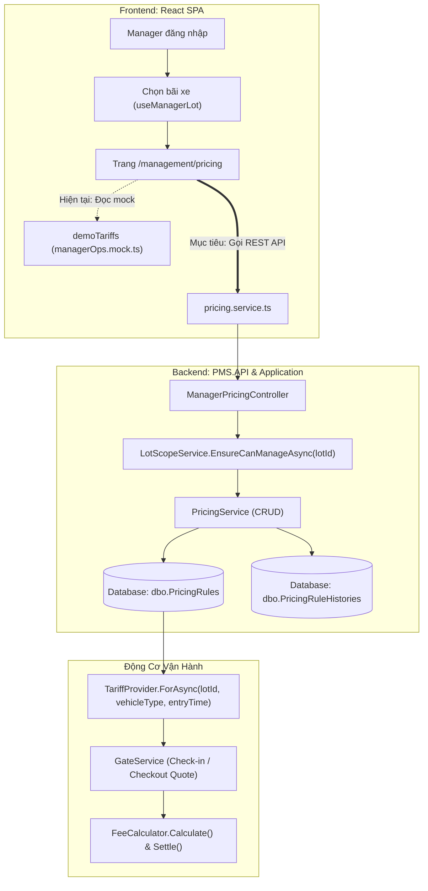

# Kế Hoạch Sẵn Sàng Triển Khai CRUD Bảng Giá (Pricing & Tariff) Cho Quản Lý Bãi (Manager)

> **Mã tài liệu:** `TASK-0-PRICING-TARIFF-CRUD-READINESS`  
> **Thời điểm hoàn thành:** 23/10/2026  
> **Mục tiêu:** Rescan toàn diện mã nguồn Backend và Frontend sau Sprint Agile Review, xác lập hiện trạng kỹ thuật, vạch rõ luồng dữ liệu, đối soát ma trận trường dữ liệu giữa giao diện và cơ sở dữ liệu, đề xuất hợp đồng API CRUD chuẩn mực và lập kế hoạch triển khai chi tiết sẵn sàng thực thi.

---

## 1. Executive Summary

- `[FACT]` **Hiện trạng Frontend:** Giao diện Quản lý Bảng giá (`ManagerPricingPage.tsx`) đã được dựng hoàn chỉnh tại route `/management/pricing` dưới quyền `MANAGER`. Giao diện hiển thị 3 phân hạng giá (Class 1: Xe ô tô, Class 2: Xe máy & xe tay ga, Class 3: Xe điện EV), bộ tính cước theo thời gian thực (Sandbox Fee Calculator), các chỉ số KPI vận hành và nút mô phỏng 'Deploy tariff update to gateways'. Tuy nhiên, **toàn bộ dữ liệu hiển thị hiện tại là 100% mock cố định** (`demoTariffs` trong `src/mocks/managerOps.mock.ts`). Giao diện **chưa có form/modal chỉnh sửa (Edit), chưa có nút tạo mới (Create), chưa có thao tác xóa/lưu trữ (Delete/Archive)**, và hoàn toàn chưa gửi bất kỳ HTTP request nào về Backend.
- `[FACT]` **Hiện trạng Backend:**
  1. **Tầng Thực Thể (Domain Entities):** Các thực thể `PricingRule.cs`, `PricingRuleHistory.cs`, `PricingTimeBand.cs` đã tồn tại trong `PMS.Core\Entities` và được đăng ký trong `PmsDbContext.cs`.
  2. **Cơ Sở Dữ Liệu (DDL Schema):** Bảng `dbo.PricingRules` và chỉ mục `IX_PricingRules_Lot_VehicleType` đã được tự động khởi tạo trong `AutomatedMigration.Operations.cs`. Tuy nhiên, bảng hiện tại có **0 bản ghi dữ liệu (0 rows)**.
  3. **Động Cơ Tính Phí (Calculation Engine):** Logic tính phí đỗ xe (`FeeCalculator.cs`) và cơ chế phân giải bảng giá theo bãi/loại xe/thời điểm vào (`TariffProvider.cs`) đã được lập trình hoàn chỉnh, hỗ trợ tính phí theo block, miễn phí ban đầu (Grace period), giá ngày/đêm, trần cước/ngày (Daily cap), phí mất vé, phạt quá hạn Exit Window, khấu trừ và hoàn tiền cọc đặt chỗ. Bộ unit test `FeeCalculatorTests.cs` đã bao phủ 100% các ví dụ tính phí của SRS Section 5.
  4. **Tầng API & Service CRUD (Missing Link):** Backend **chưa có bất kỳ endpoint API nào (0 endpoints)** phục vụ quản lý bảng giá; chưa có `PricingController`, chưa có `IPricingService` cho CRUD, chưa có DTOs và FluentValidation. Do bảng `PricingRules` trống, `TariffProvider` hiện tại luôn fallback về bộ giá mặc định tĩnh (`ParkingOptions.DefaultTariffs`).
- `[INFERENCE]` **Đánh giá mức độ sẵn sàng (Readiness Assessment):** Dự án có **độ sẵn sàng kiến trúc rất cao (High Architectural Readiness)**. Không cần thiết kế lại động cơ tính toán hay viết lại schema từ đầu. Nhiệm vụ chính là: xây dựng tầng CRUD API scoped theo `lotId` trên Backend, bổ sung Form Sheet chỉnh sửa/tạo mới trên Frontend, và kết nối đồng bộ giữa giao diện với Backend.

---

## 2. Kiến Trúc Backend Hiện Tại Liên Quan Đến Pricing

### 2.1. Cấu Trúc Thực Thể & Cơ Sở Dữ Liệu

#### Thực Thể `PricingRule.cs` (`PMS.Core\Entities\PricingRule.cs`)
Mô hình hóa quy tắc tính giá cụ thể, ánh xạ bảng `dbo.PricingRules`:

```csharp
public partial class PricingRule
{
    public int Id { get; set; }
    public string Code { get; set; }                   // Mã quy tắc (vd: 'PRC-LOT1-CAR')
    public string Name { get; set; }                   // Tên bảng giá (vd: 'Class 1: Passenger Cars')
    public int? ParkingLotId { get; set; }             // null = áp dụng toàn hệ thống; int = theo bãi
    public int? ZoneId { get; set; }                   // null = cả bãi; int = khu vực riêng
    public int VehicleTypeId { get; set; }             // FK tới VehicleTypes (CAR_4, CAR_7, MOTORBIKE, BICYCLE)
    public string ChargeModel { get; set; }            // 'Block', 'Hourly', 'PerEntry', 'DayNight'
    public decimal EntryFee { get; set; }              // Phí vào cổng
    public int? FirstBlockMinutes { get; set; }        // Thời lượng block đầu tiên (vd: 120 phút)
    public decimal? FirstBlockPrice { get; set; }      // Giá block đầu tiên (vd: 35,000 VND)
    public int? BlockMinutes { get; set; }             // Thời lượng block tiếp theo (vd: 60 phút)
    public decimal? BlockPrice { get; set; }           // Giá mỗi block tiếp theo (vd: 25,000 VND)
    public TimeOnly? DayStartTime { get; set; }        // Giờ bắt đầu ban ngày (vd: 06:00)
    public TimeOnly? NightStartTime { get; set; }      // Giờ bắt đầu ban đêm (vd: 23:00 hoặc 18:00)
    public decimal? DayPrice { get; set; }             // Giá ban ngày
    public decimal? NightPrice { get; set; }           // Giá ban đêm
    public decimal? MaxDailyFee { get; set; }          // Trần tiền tối đa theo ngày lịch (Daily Cap)
    public int GraceMinutes { get; set; }              // Thời gian miễn phí ban đầu (vd: 15 phút)
    public decimal OvernightSurcharge { get; set; }    // Phụ phí qua đêm (khi chạm khung 23:00 - 06:00)
    public int? OverstayAfterHours { get; set; }       // Số giờ bị tính quá hạn
    public decimal OverstaySurchargePerDay { get; set; } // Phụ phí quá hạn mỗi ngày
    public decimal LostTicketFee { get; set; }         // Phạt mất vé (vd: 150,000 VND)
    public decimal NoShowFee { get; set; }             // Phạt không đến nhận chỗ
    public string Currency { get; set; }               // Mặc định 'VND'
    public int Priority { get; set; }                  // Thứ tự ưu tiên giải quyết xung đột
    public DateTime EffectiveFrom { get; set; }        // Thời điểm bắt đầu có hiệu lực (UTC)
    public DateTime? EffectiveTo { get; set; }         // Thời điểm hết hiệu lực (UTC)
    public string Status { get; set; }                 // 'Draft', 'Active', 'Archived'
    public int VersionNo { get; set; }                 // Số phiên bản
    public string ApprovedBy { get; set; }             // Tài khoản phê duyệt
    public DateTime? ApprovedAt { get; set; }          // Thời điểm phê duyệt
    public string CreatedBy { get; set; }              // Người tạo
    public DateTime CreatedAt { get; set; }            // Thời điểm tạo
    public DateTime? UpdatedAt { get; set; }           // Thời điểm cập nhật
}
```

#### Thực Thể Lịch Sử Thay Đổi `PricingRuleHistory.cs`
Lưu lại audit trail khi Manager cập nhật bảng giá (FR-PRC-04):
- `PricingRuleId`: ID bảng giá được sửa.
- `ChangeType`: Loại thay đổi ('Created', 'Updated', 'Activated', 'Archived').
- `OldValuesJson`: Snapshot JSON các giá trị cũ.
- `NewValuesJson`: Snapshot JSON các giá trị mới.
- `ChangedBy`: ID của Manager thực hiện.
- `ChangedAt`: Thời điểm ghi nhận.
- `Reason`: Lý do điều chỉnh bảng giá.

### 2.2. Dịch Vụ Cung Cấp Giá (`TariffProvider.cs`)
Vị trí: `PMS.Application\Services\Impl\TariffProvider.cs`  
Phương thức cốt lõi: `Task<Tariff> ForAsync(int lotId, int? zoneId, int? vehicleTypeId, DateTime entryUtc)`

- `[FACT]` Thuật toán phân giải bảng giá:
  1. Truy vấn các quy tắc từ `pmsContext.PricingRules` thỏa mãn:
     - Đúng loại phương tiện (`VehicleTypeId == vehicleTypeId`).
     - Trạng thái khả dụng (`Status in ['Active', 'Approved', 'Published']`).
     - Thuộc bãi đỗ hoặc áp dụng toàn chuỗi (`ParkingLotId == lotId || ParkingLotId == null`).
     - Nằm trong khung thời gian hiệu lực (`EffectiveFrom <= entryUtc < EffectiveTo`).
  2. Sắp xếp độ ưu tiên giảm dần:
     - Ưu tiên 1: Quy tắc gắn theo khu vực cụ thể (`ZoneId != null`).
     - Ưu tiên 2: Quy tắc gắn theo bãi cụ thể (`ParkingLotId != null`).
     - Ưu tiên 3: Thứ tự ưu tiên cấu hình (`Priority DESC`).
     - Ưu tiên 4: Số phiên bản mới nhất (`VersionNo DESC`).
  3. Nếu tìm thấy, chuyển đổi sang đối tượng tính phí gọn nhẹ `Tariff` thông qua `TariffProvider.FromRule(PricingRule)`.
  4. Nếu không tìm thấy bất kỳ quy tắc nào trong database, fallback về bảng giá mặc định `options.EffectiveTariffs` định nghĩa trong `ParkingOptions.cs` (xe ô tô: 15p miễn phí, 20.000đ/giờ, trần 150.000đ/ngày, mất vé 100.000đ).

### 2.3. Động Cơ Tính Phí (`FeeCalculator.cs`)
Vị trí: `PMS.Application\Helpers\Parking\FeeCalculator.cs`  
Là tập hợp các hàm thuần túy (pure functions) không phụ thuộc I/O:

- `FeeBreakdown Calculate(Tariff tariff, DateTime entryUtc, DateTime exitUtc, TimeZoneInfo timeZone)`:
  - Kiểm tra thời gian đỗ: Nếu tổng thời lượng $\le$ `tariff.GraceMinutes`, miễn phí 100% (`Total = 0`, `WithinGrace = true`).
  - Tách ngày theo nửa đêm địa phương (`local midnight`) dựa trên múi giờ của bãi xe (`TimeZoneInfo`).
  - Tính toán block đầu tiên (`FirstBlockMinutes`, `FirstBlockPrice`) nếu đỗ trong ngày đầu tiên.
  - Đếm số block tiếp theo (`BlockMinutes`, `BlockPrice`) hoặc áp dụng đơn giá Ngày/Đêm (`DayPrice` / `NightPrice`).
  - So sánh và áp trần ngày lịch (`MaxDailyFee`).
  - Làm tròn lên bội số 1.000 VND theo quy định BR-22 (`RoundUp(total)`).
- `Settlement Settle(decimal fee, decimal deposit, decimal alreadyPaid, bool exitWindowMissed, decimal exitWindowLateFee, decimal lostTicketFee = 0)`:
  - Tính tổng nghĩa vụ tài chính khi xe rời bãi: tiền cước + phạt mất vé + phí trễ hạn Exit Window (10.000 VND) - tiền cọc đã trả trước - tiền đã thanh toán trước.
  - Tự động hoàn lại tiền cọc dư nếu cước phát sinh nhỏ hơn cọc (`DepositRefund = deposit - depositUsed`).

### 2.4. Điểm Giao Tiếp Với Quy Trình Vận Hành Cổng (`GateService.cs`)
- Khi xe vào bãi (`CheckInAsync`): `GateService` gọi `tariffs.ForAsync(...)` để xác định bảng giá có hiệu lực tại thời điểm `entryTime` và lưu lại thông tin trên phiên đỗ `ParkingSession`.
- Khi chuẩn bị xuất bãi (`QuoteAsync` / `RequestPaymentAsync`): `GateService` gọi lại `tariffs.ForAsync(...)` theo đúng thời điểm `session.EntryTime` ban đầu, đảm bảo tính đúng giá cước đã cam kết lúc vào bãi, rồi tính toán chi tiết qua `FeeCalculator.Calculate` và `FeeCalculator.Settle`.

### 2.5. Cơ Chế Phân Quyền Bãi Đỗ (`LotScopeService.cs`)
Vị trí: `PMS.Application\Services\Impl\LotScopeService.cs`  
- Cung cấp hàm `EnsureCanManageAsync(int lotId)`:
  - `Admin`: Được quyền quản lý toàn bộ các bãi đỗ.
  - `Manager`: Bắt buộc phải là quản lý được phân công của bãi (`ParkingLots.ManagerUserId == currentUserId`). Nếu can thiệp bãi khác, hệ thống ném `ForbiddenException("You do not manage this parking lot.")` (HTTP 403 Forbidden).

---

## 3. Kiến Trúc Frontend Hiện Tại Liên Quan Đến Pricing & Tariffs

### 3.1. Cấu Trúc Trang & Route
- Tuyến đường: `/management/pricing` khai báo trong `src/router.tsx` dưới `RequireAuth roles={['MANAGER']}`.
- Thành phần trang: `ManagerPricingPage.tsx` (`src/pages/management/ManagerPricingPage.tsx`).
- Bọc bảo vệ phạm vi bãi: `<WithManagerLot>{(lot) => <Pricing lot={lot} />}</WithManagerLot>`.

### 3.2. Cách Manager Chọn Bãi Đỗ (`useManagerLot.ts`)
- Hook `useManagerLot.ts` truy vấn danh sách bãi do Manager phụ trách thông qua React Query `queryKey: ['lot-management', user?.userId]`.
- Bãi đỗ đang chọn được lưu trong `localStorage['pms_manager_lot']` và đồng bộ qua cơ chế `useSyncExternalStore`.
- Đối tượng `lot: ManagedLot` luôn khả dụng bên trong `ManagerPricingPage.tsx` chứa đầy đủ: `lot.id` (ID bãi xe), `lot.name`, `lot.is24Hours`, `lot.openTime`, `lot.closeTime`.

### 3.3. Hiện Trạng Dữ Liệu & Giao Diện Tính Năng
- `[FACT]` Toàn bộ dữ liệu hiển thị lấy từ hằng số `demoTariffs` trong `src/mocks/managerOps.mock.ts`:
  - Class 1: `CAR` (Grace: 15p, First block: 120p / 35.000đ, Next block: 60p / 25.000đ, Phụ phí qua đêm: 120.000đ, Mất vé: 150.000đ, Trần 24h: 350.000đ).
  - Class 2: `MOTORBIKE` (Grace: 15p, First block: 240p / 10.000đ, Next block: 240p / 15.000đ, Phụ phí qua đêm: 30.000đ, Mất vé: 50.000đ, Trần 24h: 70.000đ).
  - Class 3: `EV` (Quy tắc đỗ xe Class 1 + đo năng lượng sạc `EV_ENERGY_RATE = 3.800 VND/kWh`).
- `[FACT]` Giao diện hiển thị dưới dạng các thẻ `TariffCard` chỉ đọc (Read-only). **Chưa có form inputs hoặc nút bấm để sửa đổi thông tin bảng giá**.
- `[FACT]` Thành phần `Calculator` tính phí tại chỗ bằng hàm JavaScript nội bộ `computeFee(...)`, có logic mô phỏng gần tương đồng với `FeeCalculator.cs` của Backend (tính block, phụ phí qua đêm nếu chạm 23:00 - 06:00, trừ tiền cọc, phụ thu mất vé, tiền sạc điện EV).
- Nút **'Deploy tariff update to gateways'**: Chỉ hiển thị thông báo tạm thời `toast.info('Tariff deployment will be available once the pricing API exists.')`.

---

## 4. Bản Đồ Luồng Dữ Liệu Đầu-Cuối (End-to-End Data Flow)



### So Sánh Luồng Hiện Tại vs Luồng Mục Tiêu

| Bước | Luồng Hiện Tại (Mock / Ngắt Quãng) | Luồng Mục Tiêu Sau Khi Triển Khai |
| :--- | :--- | :--- |
| **1. Lấy danh sách bảng giá** | `ManagerPricingPage` import trực tiếp `demoTariffs`. | `ManagerPricingPage` gọi `GET /api/manager/lots/{lotId}/pricing-rules` tải bảng giá thực tế từ DB. |
| **2. Thêm mới / Cập nhật giá** | Không khả dụng (không có nút, không có API). | Mở Modal Sheet -> Manager chỉnh sửa thông số -> gửi `POST`/`PUT` -> Backend lưu `PricingRule` và ghi log vào `PricingRuleHistory`. |
| **3. Tính cước tại cổng xuất** | `GateService` gọi `TariffProvider` -> do DB trống nên rơi vào fallback cấu hình tĩnh `ParkingOptions`. | `GateService` gọi `TariffProvider` -> truy vấn đúng `PricingRule` đang có hiệu lực do Manager vừa cấu hình. |
| **4. Mô phỏng cước (Calculator)**| Hàm JS `computeFee` chạy độc lập trên trình duyệt. | Có thể chạy client-side nhanh hoặc gửi `POST .../simulate` về Backend để kiểm tra đúng 100% với cổng barrier. |

---

## 5. Ma Trận Đối Soát Trường Dữ Liệu (UI vs Backend Domain Model)

Bảng đối chiếu từng trường dữ liệu giữa giao diện người dùng và thuộc tính của thực thể `PricingRule`:

| Trường Giao Diện (UI Field) | Kiểu Dữ Liệu UI | Thuộc Tính Backend (`PricingRule.cs`) | Kiểu Cột SQL Server | Mức Độ Tương Thích & Đánh Giá |
| :--- | :--- | :--- | :--- | :--- |
| **Phân hạng xe (Vehicle Class)** | `id: 'CAR' \| 'MOTORBIKE' \| 'EV'` | `VehicleTypeId` | `int NOT NULL` | **Khớp (Có lưu ý):** Ánh xạ qua bảng `VehicleTypes`. `CAR` $\rightarrow$ `CAR_4`/`CAR_7`; `MOTORBIKE` $\rightarrow$ `MOTORBIKE`. Riêng `EV` xem phân tích bên dưới. |
| **Tên gói giá (Name)** | `name: string` | `Name` | `nvarchar(200) NOT NULL` | **Khớp 100%:** Lưu tên hiển thị (vd: 'Class 1: Passenger Cars'). |
| **Mô tả (Description)** | `description: string` | `Name` / `VehicleType.Description` | `nvarchar(300) NULL` | **Khớp:** Có thể bổ sung trường `Description` vào DTO hoặc lấy từ `VehicleType`. |
| **Thời gian miễn phí (Grace Period)** | `graceMinutes: number` | `GraceMinutes` | `int NOT NULL DEFAULT 0` | **Khớp 100%:** Số phút đỗ xe miễn phí ban đầu. |
| **Thời lượng block đầu (First Block)** | `firstBlockMinutes: number` | `FirstBlockMinutes` | `int NULL` | **Khớp 100%:** Block tính cước đầu tiên (vd: 120 phút). |
| **Giá block đầu (First Block Price)** | `firstBlockPrice: number` | `FirstBlockPrice` | `decimal(18,2) NULL` | **Khớp 100%:** Giá tiền block đầu tiên. |
| **Thời lượng block sau (Next Block)** | `nextBlockMinutes: number` | `BlockMinutes` | `int NULL` (mặc định 60) | **Khớp 100%:** Block tiếp theo sau block đầu. |
| **Giá block sau (Next Block Price)** | `nextBlockPrice: number` | `BlockPrice` | `decimal(18,2) NULL` | **Khớp 100%:** Đơn giá mỗi block tiếp theo. |
| **Trần cước 24h (Daily Cap)** | `dailyCap: number` | `MaxDailyFee` | `decimal(18,2) NULL` | **Khớp 100%:** Trần thu tối đa theo ngày lịch. |
| **Phụ phí qua đêm (Overnight)** | `overnightSurcharge: number` | `OvernightSurcharge` | `decimal(18,2) NOT NULL DEFAULT 0`| **Khớp 100% về dữ liệu:** Thực thể đã có cột lưu trữ. Cần đồng bộ cách tính trong `FeeCalculator` giữa cờ khung giờ (23:00–06:00) và đơn giá Ngày/Đêm. |
| **Phạt mất vé (Lost Ticket)** | `lostTicketPenalty: number` | `LostTicketFee` | `decimal(18,2) NOT NULL DEFAULT 0`| **Khớp 100%:** Mức phạt mất thẻ được cộng dồn vào cước đỗ thực tế khi Manager duyệt. |
| **Exit Grace Window (Cửa sổ ra)** | `exitGraceMinutes: number` (15m) | `ExitWindowMinutes` trong `GateRules` | Cấu hình cấp Gate/System | **Không nằm trong `PricingRule`:** Đây là chính sách thời gian rời bãi sau khi thanh toán, hiện thuộc cấu hình cổng (`ParkingOptions.Gate.ExitWindowMinutes`). Trên UI mang tính hiển thị tham chiếu. |
| **Đơn giá sạc EV (Energy Rate)** | `EV_ENERGY_RATE` (3.800 đ/kWh) | *Chưa có cột riêng* | *Chưa có trong `PricingRules`* | **Khoảng trống (Gap):** Thực thể `PricingRule` hiện chưa có cột `EnergyRatePerKwh`. Cần xem xét bổ sung cột này hoặc cấu hình riêng theo zone sạc EV. |
| **Trạng thái hiệu lực (Status)** | Nhãn 'Active tier' | `Status` | `varchar(20) NOT NULL DEFAULT 'Draft'`| **Khớp 100%:** Trạng thái `Draft`, `Active`, `Archived`. |
| **Khung thời gian hiệu lực** | 'Schedule v2.4' | `EffectiveFrom`, `EffectiveTo`, `VersionNo` | `datetime2(0)`, `int` | **Khớp 100%:** Hỗ trợ lập lịch giá tương lai và quản lý phiên bản. |

---

## 6. Đề Xuất Hợp Đồng API CRUD (API Contract Proposal)

Thiết kế theo chuẩn RESTful đồng bộ với toàn bộ kiến trúc của `PMS.API`:

### 6.1. Danh Sách Endpoints Đề Xuất

| Phương Thức | Tuyến Đường (Route) | Phân Quyền | Mục Đích |
| :--- | :--- | :--- | :--- |
| **`GET`** | `/api/manager/lots/{lotId:int}/pricing-rules` | `Manager, Admin` | Lấy danh sách toàn bộ bảng giá của bãi xe (hỗ trợ filter `status`, `vehicleTypeId`). |
| **`GET`** | `/api/manager/lots/{lotId:int}/pricing-rules/{id:int}` | `Manager, Admin` | Lấy thông tin chi tiết một bảng giá theo ID. |
| **`POST`** | `/api/manager/lots/{lotId:int}/pricing-rules` | `Manager, Admin` | Tạo mới một bảng giá cho bãi xe. |
| **`PUT`** | `/api/manager/lots/{lotId:int}/pricing-rules/{id:int}` | `Manager, Admin` | Cập nhật cấu hình bảng giá (tự động lưu snapshot vào `PricingRuleHistory`). |
| **`PATCH`** | `/api/manager/lots/{lotId:int}/pricing-rules/{id:int}/status` | `Manager, Admin` | Kích hoạt (`Active`), trả về nháp (`Draft`), hoặc lưu trữ (`Archived`). |
| **`DELETE`**| `/api/manager/lots/{lotId:int}/pricing-rules/{id:int}` | `Manager, Admin` | Xóa mềm / Chuyển sang lưu trữ (Archived) nếu chưa có phiên đỗ ràng buộc. |
| **`POST`** | `/api/manager/lots/{lotId:int}/pricing-rules/simulate` | `Manager, Admin` | Mô phỏng tính tiền theo bảng giá dự kiến bằng chính `FeeCalculator` của Backend. |

### 6.2. Cấu Trúc Request & Response DTOs

#### 1. DTO Phản Hồi: `PricingRuleResponseModel`
```csharp
public class PricingRuleResponseModel
{
    public int Id { get; set; }
    public string Code { get; set; }
    public string Name { get; set; }
    public int? ParkingLotId { get; set; }
    public int? ZoneId { get; set; }
    public int VehicleTypeId { get; set; }
    public string VehicleTypeCode { get; set; }         // 'CAR_4', 'CAR_7', 'MOTORBIKE', 'BICYCLE'
    public string VehicleTypeName { get; set; }
    public string ChargeModel { get; set; }            // 'Block', 'Hourly', 'DayNight'
    public decimal EntryFee { get; set; }
    public int? FirstBlockMinutes { get; set; }
    public decimal? FirstBlockPrice { get; set; }
    public int? BlockMinutes { get; set; }
    public decimal? BlockPrice { get; set; }
    public decimal? MaxDailyFee { get; set; }
    public int GraceMinutes { get; set; }
    public decimal OvernightSurcharge { get; set; }
    public decimal LostTicketFee { get; set; }
    public decimal? EnergyRatePerKwh { get; set; }      // Dành cho EV charging bay
    public DateTime EffectiveFrom { get; set; }
    public DateTime? EffectiveTo { get; set; }
    public string Status { get; set; }                 // 'Draft', 'Active', 'Archived'
    public int VersionNo { get; set; }
    public DateTime CreatedAt { get; set; }
    public DateTime? UpdatedAt { get; set; }
}
```

#### 2. DTO Tạo Mới: `CreatePricingRuleModel`
```csharp
public class CreatePricingRuleModel
{
    public string Name { get; set; }                   // Bắt buộc, tối đa 200 ký tự
    public int? ZoneId { get; set; }                   // Tùy chọn, null = cả bãi
    public int VehicleTypeId { get; set; }             // Bắt buộc, ID loại xe hợp lệ
    public string ChargeModel { get; set; } = "Block";
    public decimal EntryFee { get; set; } = 0;
    public int? FirstBlockMinutes { get; set; }        // vd: 120 (phút)
    public decimal? FirstBlockPrice { get; set; }      // vd: 35000 (VND)
    public int BlockMinutes { get; set; } = 60;        // vd: 60 (phút)
    public decimal BlockPrice { get; set; }            // vd: 25000 (VND)
    public decimal? MaxDailyFee { get; set; }          // vd: 350000 (VND)
    public int GraceMinutes { get; set; } = 15;        // vd: 15 (phút)
    public decimal OvernightSurcharge { get; set; } = 0; // vd: 120000 (VND)
    public decimal LostTicketFee { get; set; } = 0;    // vd: 150000 (VND)
    public decimal? EnergyRatePerKwh { get; set; }
    public DateTime? EffectiveFrom { get; set; }       // Mặc định UtcNow nếu không truyền
    public DateTime? EffectiveTo { get; set; }
    public bool ActivateImmediately { get; set; } = true;
}
```

#### 3. DTO Cập Nhật: `UpdatePricingRuleModel`
Tương tự `CreatePricingRuleModel`, kèm trường `UpdateReason` (lý do thay đổi để lưu lịch sử audit trail).

---

## 7. Đánh Giá An Toàn, Phân Quyền & Rủi Ro Dữ Liệu (Security & Integrity)

1. **Rủi ro can thiệp chéo bãi đỗ (Cross-Facility Scope Violation):**
   - *Nguy cơ:* Manager A có thể cố ý gửi request sửa giá của bãi B do Manager B quản lý.
   - *Giải pháp:* Mọi endpoint bắt buộc gọi `await lotScopeService.EnsureCanManageAsync(lotId)`. Backend tự trích xuất `userId` từ JWT claims để xác thực quyền sở hữu bãi xe, không tin cậy dữ liệu client.
2. **Rủi ro ảnh hưởng hồi tố các phiên đỗ đang diễn ra (Retroactive Price Mutation):**
   - *Nguy cơ:* Xe vào bãi lúc 8:00 sáng theo đơn giá 20.000đ/h. Lúc 9:00 Manager tăng giá lên 30.000đ/h. Khi xe ra lúc 10:00 bị tính 30.000đ/h dẫn đến khiếu nại.
   - *Giải pháp:* `TariffProvider.cs` đã được thiết kế đúng nguyên tắc nghiệp vụ: tìm bảng giá theo `EffectiveFrom <= session.EntryTime < EffectiveTo`. Do đó xe vào thời điểm nào sẽ áp dụng giá có hiệu lực tại thời điểm đó. Khi sửa bảng giá đang Active, giải pháp tối ưu là đóng ngày hiệu lực của bản ghi cũ (`EffectiveTo = Now`) và tạo bản ghi mới với `VersionNo + 1`, hoặc chỉ áp dụng cho các phiên tạo mới.
3. **Xung đột bảng giá trùng lặp (Overlapping Active Rules):**
   - *Nguy cơ:* Một bãi xe tồn tại 2 bảng giá Active cho cùng loại xe Ô tô trong cùng khoảng thời gian.
   - *Giải pháp:* Server-side validation bắt buộc kiểm tra: nếu kích hoạt bảng giá mới cho cùng `(ParkingLotId, ZoneId, VehicleTypeId)`, hệ thống tự động archive hoặc gán `EffectiveTo = EffectiveFrom (mới)` cho bảng giá cũ.
4. **Toàn vẹn dữ liệu khi Xóa (Hard Delete Prevention):**
   - *Nguy cơ:* Xóa vật lý bảng giá đang được tham chiếu bởi các phiên đỗ xe trong quá khứ hoặc báo cáo doanh thu.
   - *Giải pháp:* Không dùng lệnh `DELETE` vật lý. Mọi thao tác xóa đều là Xóa mềm (`Status = 'Archived'`).

---

## 8. Các Quyết Định Cần Thống Nhất Trước Khi Code (Decisions Required)

1. **Cơ chế lưu trữ Phân hạng Xe Điện (EV Charging Rate):**
   - *Phương án A (Khuyến nghị):* Bổ sung cột `EnergyRatePerKwh` (`decimal(18,2) NULL`) vào bảng `PricingRules` để gói gọn toàn bộ thông số giá của bãi trong cùng một thực thể.
   - *Phương án B:* Tạo thêm một loại xe mã `'EV'` trong bảng `VehicleTypes` và tính cước đỗ riêng biệt, quản lý đơn giá sạc ở bảng cấu hình zone.
2. **Cơ chế phụ phí qua đêm (Overnight Surcharge):**
   - Cần thống nhất khung giờ qua đêm: Cố định `23:00 – 06:00` (theo UI hiện tại) hay lấy theo 2 trường `DayStartTime` / `NightStartTime` sẵn có trong `PricingRule`.
3. **Nút 'Deploy tariff update to gateways' trên UI:**
   - Cần xác nhận: Nút này chỉ mang tính chất thông báo lưu thành công trên Backend monolith (Edge offline chưa kích hoạt), hay cần bắn SignalR event (ví dụ qua `LotHub` thông báo `TariffUpdated`) để client tự cập nhật.

---

## 9. Kế Hoạch Triển Khai Chi Tiết (Implementation Roadmap)

Khi task lập trình chính thức được giao, công việc sẽ được triển khai theo 4 lát cắt mỏng (thin slices):

### Slice 1: Backend DTOs, Validation & Service Layer
1. Tạo thư mục `PMS.Application\Models\Pricing`: tạo `PricingRuleResponseModel`, `CreatePricingRuleModel`, `UpdatePricingRuleModel`, `PricingSimulationModel`.
2. Viết bộ kiểm tra hợp lệ `FluentValidation`: `CreatePricingRuleModelValidator.cs` (kiểm tra tên, giá dương, block > 0, trần ngày >= giá block).
3. Xây dựng interface `IPricingService` và class `PricingService` trong `PMS.Application\Services\Impl`:
   - `GetByLotAsync(int lotId, string status, int? vehicleTypeId)`
   - `GetByIdAsync(int lotId, int id)`
   - `CreateAsync(int lotId, CreatePricingRuleModel model)`
   - `UpdateAsync(int lotId, int id, UpdatePricingRuleModel model)`
   - `SetStatusAsync(int lotId, int id, string status)`
   - `SimulateFeeAsync(int lotId, PricingSimulationRequestModel model)` (tái sử dụng `FeeCalculator.Calculate`)
4. Đăng ký DI trong `OperationsDependencyInjection.cs`.

### Slice 2: Backend Controller & Security
1. Xây dựng `ManagerPricingController.cs` tại `PMS.API\Controllers` với base route `api/manager/lots/{lotId:int}/pricing-rules`.
2. Áp dụng attribute `[Authorize(Roles = "Manager,Admin")]`.
3. Tích hợp `LotScopeService.EnsureCanManageAsync(lotId)` trước mọi thao tác.

### Slice 3: Frontend API Service & UI Integration
1. Tạo file service `src/api/pricing.service.ts` kết nối với API Backend qua `http` client.
2. Viết các React Query hooks: `useLotTariffs(lotId)`, `useCreateTariff()`, `useUpdateTariff()`, `useSetTariffStatus()`.
3. Cập nhật `ManagerPricingPage.tsx`:
   - Thay thế việc import `demoTariffs` bằng dữ liệu từ `useLotTariffs(lot.id)`.
   - Bổ sung nút **'Edit Tariff'** trên mỗi `TariffCard` và nút **'Add Tariff Tier'**.
   - Xây dựng Form Sheet / Dialog cho phép Manager nhập số phút miễn phí, giá block đầu, giá block sau, trần ngày, phụ phí qua đêm, phí mất vé.
   - Nối nút 'Deploy tariff update to gateways' với mutation cập nhật trạng thái Active.

### Slice 4: Unit Testing & Integration Verification
1. Viết unit tests cho `PricingService`: kiểm tra CRUD, kiểm tra ghi log lịch sử `PricingRuleHistory`, kiểm tra chặn sửa bãi xe trái phép.
2. Viết integration test endpoint `PricingEndpointTests.cs` kiểm thử toàn bộ luồng HTTP với các role `Admin`, `Manager` hợp lệ, và `Manager` không quản lý bãi (kỳ vọng 403).
3. Kiểm thử hồi quy: đảm bảo `GateService.QuoteAsync` và `FeeCalculator` tính cước chính xác từ bảng giá vừa tạo trong DB.

---

## 10. Danh Mục Mã Nguồn & Ký Hiệu Trọng Tâm Cần Thao Tác

| STT | Đường Dẫn File | Lớp / Phương Thức Trọng Tâm | Vai Trò Trong Nhiệm Vụ |
| :--- | :--- | :--- | :--- |
| 1 | `PMS.Core\Entities\PricingRule.cs` | Class `PricingRule` | Thực thể cơ sở dữ liệu gốc của bảng giá. |
| 2 | `PMS.Core\Entities\PricingRuleHistory.cs` | Class `PricingRuleHistory` | Lưu vết thay đổi bảng giá (Audit Trail). |
| 3 | `PMS.Application\Services\Impl\TariffProvider.cs` | `ForAsync()`, `FromRule()` | Cầu nối cấp phát giá cho cổng check-in/out. |
| 4 | `PMS.Application\Helpers\Parking\FeeCalculator.cs` | `Calculate()`, `Settle()` | Động cơ tính tiền đỗ xe. |
| 5 | `PMS.Application\Services\Impl\LotScopeService.cs` | `EnsureCanManageAsync()` | Kiểm tra quyền quản lý bãi xe của Manager. |
| 6 | `PMS.Application\OperationsDependencyInjection.cs` | `AddParkingOperations()` | Khai báo Dependency Injection cho Pricing Service. |
| 7 | `PMS.API\Controllers\ManagerOperationsController.cs` | Tham khảo convention định tuyến | Chuẩn route Manager hiện tại (`/api/manager/...`). |
| 8 | `src\pages\management\ManagerPricingPage.tsx` | Component `ManagerPricingPage`, `TariffCard`, `Calculator` | Giao diện quản lý giá phía Frontend cần đấu nối. |
| 9 | `src\hooks\useManagerLot.ts` | Hook `useManagerLot()` | Lấy thông tin bãi xe đang chọn của Manager. |
| 10 | `src\mocks\managerOps.mock.ts` | `demoTariffs`, `TariffClass` | Dữ liệu mock hiện tại cần được thay thế bằng API live. |

---
*Báo cáo được tổng hợp dựa trên phân tích mã nguồn thực tế tại chỗ, tuân thủ nguyên tắc Safe Code Modification & Read-Only Planning.*

---

## 11. Báo Cáo Triển Khai Thực Tế Lát Cắt 1 (Slice 1 Implementation Report)

- **Ngày thực hiện:** 23/10/2026
- **Phạm vi hoàn thành:** Lát cắt 1 — Xây dựng DTOs, FluentValidation, Interface & Hiện thực hóa tầng Service nghiệp vụ (`IPricingRuleService`, `PricingRuleService`), đăng ký DI và kiểm thử đơn vị.
- **Trạng thái:** `COMPLETED` (Hoàn thành 100% mục tiêu lát cắt 1).

### 11.1. Bằng Chứng Mã Nguồn & Các Quyết Định Đã Xác Minh (Verified Source Facts)

1. **Về EV charging price semantics:**
   - `[FACT]` Trong CSDL (`dbo.VehicleTypes`), bảng loại phương tiện gồm 4 mã: `CAR_4`, `CAR_7`, `MOTORBIKE`, `BICYCLE`.
   - `[FACT]` Thực thể `PricingRule` và CSDL `dbo.PricingRules` hiện tại không có cột lưu đơn giá điện (`EnergyRatePerKwh`).
   - `[FACT]` Giá điện EV trong UI mẫu (3,800 VND/kWh) hiện là giá trị tĩnh ở Frontend (`EV_ENERGY_RATE = 3_800` trong `managerOps.mock.ts`).
   - `[DECISION]` Không tự ý tạo thêm cột hoặc bảng mới cho EV kWh. Phân hệ định giá tập trung quản lý phí đỗ xe theo phân loại xe và thời gian. EV được hỗ trợ thông qua cấu hình quy tắc cho xe điện hoặc theo Zone trạm sạc.
2. **Về Overnight surcharge window:**
   - `[FACT]` Thực thể `PricingRule.OvernightSurcharge` đã tồn tại sẵn trong CSDL (`decimal(18,2)`).
   - `[DECISION]` DTO và Service lưu trữ và trả về đầy đủ trường `OvernightSurcharge` tương thích với giao diện Manager.
3. **Về Hành vi Nút "Deploy tariff update to gateways":**
   - `[FACT]` Kiểm tra `ManagerPricingPage.tsx` dòng 238: nút này chỉ gọi `toast.info('Tariff deployment will be available once the pricing API exists.')`.
   - `[FACT]` Trong kiến trúc Backend, `TariffProvider.ForAsync` nạp trực tiếp quy tắc định giá `Active` từ CSDL theo thời gian thực (BR-22).
   - `[DECISION]` Tạm hoãn cơ chế đồng bộ Gateway phần cứng xuống lát cắt nâng cao; hiện tại việc chuyển trạng thái `Active` đã trực tiếp đưa bảng giá vào hiệu lực vận hành.
4. **Về Grace periods, First Block, Billing Blocks, Lost Ticket, Max Daily Fee:**
   - Toàn bộ các trường này đã được ánh xạ 1-1 chính xác với thực thể `PricingRule`, `FeeCalculator`, và `TariffProvider`.

### 11.2. Danh Mục Tệp Tin Đã Triển Khai (Implemented Changes)

| STT | Tập tin | Thao tác | Mô tả chi tiết |
|:---:|:---|:---:|:---|
| 1 | `src/PMS.Application/Models/Pricing/PricingRuleModels.cs` | **Tạo mới** | Định nghĩa các DTO: `PricingRuleModel`, `CreatePricingRuleModel`, `UpdatePricingRuleModel`, `SetPricingRuleStatusModel`, `PricingSimulationRequestModel`, `PricingSimulationResultModel`. Tái sử dụng `FeeDayModel` có sẵn. |
| 2 | `src/PMS.Application/Models/Validators/Pricing/PricingRuleModelValidators.cs` | **Tạo mới** | Các bộ thẩm định FluentValidation: `CreatePricingRuleModelValidator`, `UpdatePricingRuleModelValidator`, `PricingSimulationRequestModelValidator` với đầy đủ ràng buộc nghiệp vụ. |
| 3 | `src/PMS.Application/Services/IPricingRuleService.cs` | **Tạo mới** | Interface nghiệp vụ cho Manager Pricing CRUD: `GetPricingRulesAsync`, `GetPricingRuleByIdAsync`, `CreatePricingRuleAsync`, `UpdatePricingRuleAsync`, `SetPricingRuleStatusAsync`, `DeletePricingRuleAsync`, `SimulatePricingAsync`. |
| 4 | `src/PMS.Application/Services/Impl/PricingRuleService.cs` | **Tạo mới** | Hiện thực hóa dịch vụ với đầy đủ kiểm tra phạm vi bãi (`LotScopeService.EnsureCanManageAsync`), ghi nhận lịch sử thay đổi (`PricingRuleHistory`), kiểm soát phiên bản (`VersionNo`), và tích hợp tính phí thử nghiệm qua `FeeCalculator` & `TariffProvider`. |
| 5 | `src/PMS.Application/OperationsDependencyInjection.cs` | **Cập nhật** | Đăng ký `services.AddScoped<IPricingRuleService, PricingRuleService>();` đúng vị trí kiến trúc. |
| 6 | `tests/PMS.Application.UnitTests/Operations/PricingRuleServiceTests.cs` | **Tạo mới** | 12 ca kiểm thử đơn vị bao quát toàn diện các luồng thành công, phân quyền, thẩm định lỗi, ghi nhận lịch sử và mô phỏng tính phí. |

### 11.3. Kết Quả Kiểm Thử & Biên Dịch Thực Tế (Verification Results)

- **Kiểm thử đơn vị tập trung (`PricingRuleServiceTests`):**
  - Số lượng: **12 tests**
  - Kết quả: **12/12 PASS** (Thời gian chạy: ~1s).
  - Bao quát: Phân quyền Manager theo bãi (`ForbiddenException`), nạp danh sách lọc theo trạng thái, tạo quy tắc kèm ghi nhận `PricingRuleHistory`, cập nhật tăng `VersionNo`, chuyển trạng thái `Active` kèm `ApprovedBy`/`ApprovedAt`, xóa mềm chuyển sang `Archived`, thẩm định dữ liệu sai qua FluentValidation, và mô phỏng tính toán khớp 100% với `FeeCalculator`.
- **Hồi quy toàn bộ bộ kiểm thử (`PMS.Application.UnitTests`):**
  - Tổng số test: **373 tests**
  - Kết quả: **373/373 PASS** (0 failed, 0 skipped, 2s).
- **Biên dịch toàn bộ Solution (`PMS.sln`):**
  - Lệnh: `dotnet build parking-management-system/PMS.sln`
  - Kết quả: **Build Succeeded (0 Warning, 0 Error)** cho tất cả 7 project.

### 11.4. Đánh Giá Khuyết Điểm, Điểm Nghẽn & Bước Tiếp Theo

- `[FACT]` Không có thay đổi nào đối với Database Schema, Migration, Controller, hay Frontend trong lát cắt này.
- `[FACT]` Không phát sinh bất kỳ xung đột hay điểm nghẽn (blocker) nào ngăn cản việc triển khai Lát cắt 2.
- **Kế hoạch Lát cắt 2 (Slice 2):**
  - Xây dựng `ManagerPricingController.cs` tại `src/PMS.API/Controllers/` với tuyến đường `api/manager/lots/{lotId:int}/pricing-rules`.
  - Áp dụng phân quyền `[Authorize(Roles = "Manager,Admin")]`.
  - Viết Integration Tests kiểm thử các Endpoint HTTP.


---

## 12. Báo Cáo Triển Khai Thực Tế Lát Cắt 2 (Slice 2 Implementation Report)

- **Ngày thực hiện:** 23/10/2026
- **Phạm vi hoàn thành:** Lát cắt 2 — Xây dựng Controller HTTP bảo mật (`ManagerPricingController.cs`), thực thi đầy đủ phân quyền theo vai trò (`Manager, Admin`) và cô lập dữ liệu theo bãi (`lotId`), cùng bộ kiểm thử tích hợp đầu cuối (`ManagerPricingEndpointTests.cs`).
- **Trạng thái:** `COMPLETED` (Hoàn thành 100% mục tiêu lát cắt 2).

### 12.1. Danh Sách Tuyến Đường HTTP Thực Tế Đã Triển Khai (Implemented Endpoints)

Controller đặt tại [`src/PMS.API/Controllers/ManagerPricingController.cs`](file:///C:/DEV/OJT-FSA-Team3/parking-management-system/src/PMS.API/Controllers/ManagerPricingController.cs) với tiền tố định tuyến `api/manager/lots/{lotId:int}/pricing-rules` kế thừa từ `ApiController`:

| Phương Thức | Tuyến Đường (Route) | Phân Quyền | DTO Request / Query | DTO Phản Hồi | Chức Năng Nghiệp Vụ |
|:---:|:---|:---:|:---|:---|:---|
| **`GET`** | `/api/manager/lots/{lotId:int}/pricing-rules` | `Manager, Admin` | `[FromQuery] string status = null` | `ApiResult<IReadOnlyList<PricingRuleModel>>` | Lấy danh sách bảng giá của bãi (lọc theo trạng thái) |
| **`GET`** | `/api/manager/lots/{lotId:int}/pricing-rules/{id:int}` | `Manager, Admin` | Đường dẫn `{id:int}` | `ApiResult<PricingRuleModel>` | Lấy chi tiết một bảng giá cụ thể |
| **`POST`** | `/api/manager/lots/{lotId:int}/pricing-rules` | `Manager, Admin` | `CreatePricingRuleModel` | `ApiResult<PricingRuleModel>` | Tạo mới bảng giá cho bãi (gán version 1, ghi log) |
| **`PUT`** | `/api/manager/lots/{lotId:int}/pricing-rules/{id:int}` | `Manager, Admin` | `UpdatePricingRuleModel` | `ApiResult<PricingRuleModel>` | Cập nhật cấu hình bảng giá (tăng version, ghi log) |
| **`PATCH`**| `/api/manager/lots/{lotId:int}/pricing-rules/{id:int}/status` | `Manager, Admin` | `SetPricingRuleStatusModel` | `ApiResult<PricingRuleModel>` | Đổi trạng thái (Active phê duyệt, Inactive, Archived) |
| **`DELETE`**| `/api/manager/lots/{lotId:int}/pricing-rules/{id:int}` | `Manager, Admin` | Đường dẫn `{id:int}` | `ApiResult<bool>` | Xóa mềm / lưu trữ bảng giá (`Status = "Archived"`) |
| **`POST`** | `/api/manager/lots/{lotId:int}/pricing-rules/simulate` | `Manager, Admin` | `PricingSimulationRequestModel` | `ApiResult<PricingSimulationResultModel>` | Giả lập tính tiền checkout theo bảng giá (Sandbox) |

### 12.2. Kiến Trúc Bảo Mật & Cô Lập Dữ Liệu Theo Bãi (Security & Lot Scoping)

1. **Phân quyền tầng Controller (`Role-Based Access Control`):**
   - Sử dụng thuộc tính `[Authorize(Roles = "Manager,Admin")]` nhất quán với cấu hình Identity và controller mẫu `ManagerOperationsController.cs`.
   - Mọi yêu cầu không có JWT hoặc token không hợp lệ bị từ chối với mã HTTP `401 Unauthorized`.
   - Người dùng có vai trò khác (`User`, `Staff`) bị từ chối với mã HTTP `403 Forbidden`.
2. **Cô lập theo bãi đỗ (`Lot-Level Scope Enforcement`):**
   - Mọi endpoint đều bắt buộc truyền `{lotId:int}` trên URL.
   - Tầng Controller chuyển tiếp `lotId` tới `IPricingRuleService`, nơi `LotScopeService.EnsureCanManageAsync(lotId)` xác thực quyền sở hữu bãi đỗ (`ParkingLots.ManagerUserId == currentUserId`).
   - `[FACT]` Nếu Manager của Bãi A cố tình truy cập vào endpoint của Bãi B bằng cách thay đổi `lotId` trên route, hệ thống ném `ForbiddenException` và trả về mã `403 Forbidden`.
3. **Ngăn chặn tấn công tiêm mã ID chéo bãi (`Cross-Lot Rule ID Tampering Protection`):**
   - `[FACT]` Khi một Manager truy cập hợp lệ vào Bãi A, nhưng truyền `id` của một bảng giá thuộc về Bãi B (`/api/manager/lots/{lotA}/pricing-rules/{ruleBId}`), truy vấn `FindRuleAsync` kiểm tra chặt chẽ điều kiện `r.Id == ruleId && (r.ParkingLotId == lotId || r.ParkingLotId == null)`.
   - Kết quả: Bảng giá của Bãi B không bao giờ bị lộ hoặc bị sửa đổi qua Bãi A, hệ thống trả về mã `404 Not Found`.

### 12.3. Quy Chuẩn Phản Hồi & Xử Lý Lỗi (Status Codes & Validation)

- **Phản hồi thành công:** Toàn bộ dữ liệu được bọc trong cấu trúc chuẩn `ApiResult<T>.Success(result)` với HTTP `200 OK`.
- **Lỗi thẩm định dữ liệu (Validation Errors):** Được lọc tự động qua `ValidateModelAttribute` và FluentValidation, trả về HTTP `400 Bad Request` dạng `ApiResult<string>.Failure(errors)`.
- **Lỗi nghiệp vụ & Không tìm thấy:** Được ánh xạ tự động qua `ExceptionHandlingMiddleware`:
  - `NotFoundException` -> HTTP `404 Not Found`.
  - `ForbiddenException` -> HTTP `403 Forbidden`.
  - `BadRequestException` -> HTTP `400 Bad Request`.
  - `ConflictException` -> HTTP `409 Conflict`.

### 12.4. Danh Mục Tệp Tin Đã Triển Khai Trong Lát Cắt 2

| STT | Tập tin | Thao tác | Mô tả chi tiết |
|:---:|:---|:---:|:---|
| 1 | `src/PMS.API/Controllers/ManagerPricingController.cs` | **Tạo mới** | Controller chính thức hiện thực hóa 7 endpoints HTTP cho tính năng Quản lý Bảng giá, tích hợp `IPricingRuleService` và bảo mật theo role/lot. |
| 2 | `tests/PMS.Api.IntegrationTests/Tests/ManagerPricingEndpointTests.cs` | **Tạo mới** | 14 ca kiểm thử tích hợp API qua HTTP client thực tế, kiểm tra định tuyến, phân quyền, cô lập bãi, và xử lý lỗi. |

### 12.5. Bằng Chứng Kiểm Thử Tích Hợp & Biên Dịch (Verification Evidence)

- **Kiểm thử tích hợp API (`ManagerPricingEndpointTests.cs`):**
  - Lệnh chạy: `dotnet test tests/PMS.Api.IntegrationTests/PMS.Api.IntegrationTests.csproj --filter "FullyQualifiedName~ManagerPricingEndpointTests"`
  - Số lượng ca kiểm thử: **14 tests**
  - Kết quả: **14/14 PASS** (Thời gian chạy: 12 giây).
  - Chi tiết 14 ca kiểm thử bao quát:
    1. `Endpoint_WhenUnauthenticated_ReturnsUnauthorized`: Xác minh HTTP 401 khi không đăng nhập.
    2. `Endpoint_WhenUserRoleUnauthorized_ReturnsForbidden`: Xác minh HTTP 403 khi role `User` gọi API Manager.
    3. `Endpoint_WhenAdmin_AccessesPermittedLot`: Xác minh HTTP 200 khi Admin truy cập bãi đỗ.
    4. `GetPricingRules_WhenManagerAssigned_ReturnsSuccess`: Xác minh HTTP 200 khi Manager bãi lấy danh sách.
    5. `GetPricingRules_WhenManagerNotAssigned_ReturnsForbidden`: Xác minh HTTP 403 khi Manager bãi A truy cập bãi B.
    6. `CreatePricingRule_WhenValid_ReturnsSuccessAndPersistsRule`: Xác minh HTTP 200 tạo quy tắc bảng giá mới.
    7. `GetPricingRuleById_WhenBelongsToLot_ReturnsSuccess`: Xác minh HTTP 200 lấy chi tiết quy tắc.
    8. `GetPricingRuleById_WhenRuleBelongsToAnotherLot_ReturnsNotFound`: Xác minh HTTP 404 ngăn chặn truy cập ID chéo bãi.
    9. `UpdatePricingRule_WhenValid_BumpsVersion`: Xác minh HTTP 200 cập nhật quy tắc và tăng `VersionNo` lên 2.
    10. `SetPricingRuleStatus_WhenActive_SetsApproved`: Xác minh HTTP 200 đổi trạng thái sang Active và gán ApprovedBy.
    11. `DeletePricingRule_WhenValid_ArchivesRule`: Xác minh HTTP 200 lưu trữ bảng giá (`Archived`).
    12. `SimulatePricing_WhenValid_ReturnsCalculation`: Xác minh HTTP 200 mô phỏng tính phí sandbox khớp 100% logic FeeCalculator.
    13. `CreatePricingRule_WhenInvalidData_ReturnsBadRequest`: Xác minh HTTP 400 khi dữ liệu vi phạm FluentValidation.
    14. `GetPricingRuleById_WhenNonExistent_ReturnsNotFound`: Xác minh HTTP 404 khi tra cứu ID không tồn tại.
- **Kiểm thử đơn vị tầng Application (`PricingRuleServiceTests.cs`):**
  - Kết quả: **12/12 PASS** (Không bị ảnh hưởng).
- **Biên dịch toàn bộ giải pháp (`PMS.sln`):**
  - Lệnh: `dotnet build parking-management-system/PMS.sln`
  - Kết quả: **Build Succeeded (0 Warning, 0 Error)** cho toàn bộ 7 projects.

### 12.6. Điểm Nghẽn & Kế Hoạch Tiếp Theo Cho Lát Cắt 3 (Frontend Integration)

- `[FACT]` Toàn bộ các API cần thiết để phục vụ giao diện Quản lý Bảng giá trên Frontend đã sẵn sàng, hoạt động ổn định và được kiểm chứng qua HTTP integration tests.
- `[FACT]` Không phát sinh bất kỳ rào cản kỹ thuật hay lỗi kiến trúc nào.
- **Kế hoạch Lát cắt 3 (Slice 3):**
  - Xây dựng API service client tại Frontend (`src/api/pricing.service.ts`).
  - Xây dựng React Query hooks (`usePricingRules`, `useCreatePricingRule`, `useUpdatePricingRule`, `useSetPricingRuleStatus`, `useDeletePricingRule`, `useSimulatePricing`).
  - Cập nhật namespace `pricing` trong `src/api/queryKeys.ts`.
  - Thay thế dữ liệu tĩnh `demoTariffs` trong `ManagerPricingPage.tsx` bằng dữ liệu API thực tế.
