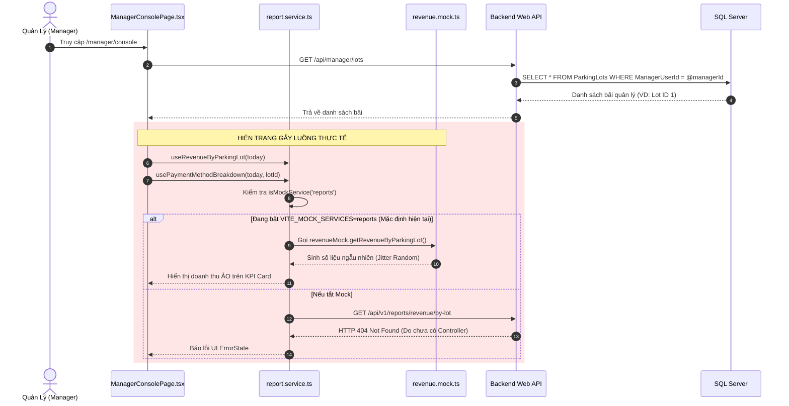

# Báo Cáo Scan Codebase — Triển Khai Cập Nhật Doanh Thu Bãi Đỗ & Manager Dashboard

> **Ngày thực hiện:** 26/10/2026  
> **Người thực hiện:** Antigravity  
> **Trạng thái:** Hoàn tất Scan (Read-only) — Chưa viết mã nguồn (No implementation)  
> **Workspace tham chiếu:**
> - Backend: `C:\DEV\OJT-FSA-Team3\parking-management-system`
> - Frontend: `C:\DEV\OJT-FSA-Team3\parking-management-system-frontend`
> - Reporting Repo: `C:\DEV\OJT-report`
> - Database Local: SQL Server `localhost\SQLEXPRESS`, Database: `parking_management_system`

---

## 1. Mục Tiêu & Phạm Vi Điều Tra

Theo yêu cầu từ Tech Lead trước khi triển khai tính năng cập nhật và hiển thị doanh thu:
1. Khi user thanh toán thành công, doanh thu phải được cập nhật vào bãi đỗ tương ứng.
2. Manager xem Dashboard và thấy doanh thu của bãi đỗ mình quản lý.
3. Backend có cơ chế khởi tạo Admin và ba bãi đỗ mặc định: Cộng Hoà, Fsoft, FPT.
4. Database local tên `parking_management_system`.

Giai đoạn hiện tại là **CHỈ SCAN, CHƯA IMPLEMENT**. Toàn bộ phân tích dưới đây dựa trên bằng chứng thực tế từ mã nguồn và trạng thái cơ sở dữ liệu hiện hành, phân loại tường minh theo các nhãn chứng cứ (`[FACT]`, `[OBSERVATION]`, `[HYPOTHESIS]`, `[UNKNOWN]`).

---

## 2. Cấu Trúc Dự Án & Danh Mục Tệp Tin Liên Quan

### 2.1. Phía Backend (`parking-management-system`)

| Tệp tin | Vị trí / Layer | Trách nhiệm liên quan đến nghiệp vụ |
| :--- | :--- | :--- |
| `Program.cs` | `src/PMS.API` | Khởi chạy host, gọi `AutomatedMigration.MigrateAsync` và `ParkingLotDataSeed.SeedParkingLotsAsync`. |
| `PaymentsController.cs` | `src/PMS.API/Controllers` | Tiếp nhận tra cứu payment, check status, return URL và webhook IPN từ VNPay và MoMo. |
| `ParkingSessionsController.cs` | `src/PMS.API/Controllers` | Báo giá (`quote`), tạo thanh toán online cho phiên đỗ (`/payments`). |
| `ReservationsController.cs` | `src/PMS.API/Controllers` | Tạo đặt chỗ, tạo thanh toán tiền cọc deposit (`/payments`). |
| `StaffGateController.cs` | `src/PMS.API/Controllers` | Thu tiền mặt tại cổng (`/payments/cash`), tạo QR online tại làn (`/payments/online`). |
| `ManagerController.cs` | `src/PMS.API/Controllers` | Cung cấp danh sách bãi đỗ Manager phụ trách (`/api/manager/lots`) và quản lý nhân viên. |
| `ManagerOperationsController.cs` | `src/PMS.API/Controllers` | Quyết định vận hành của Manager: tra cứu reservations của bãi, hủy cọc, duyệt vé mất. |
| `LotsController.cs` | `src/PMS.API/Controllers` | CRUD bãi đỗ, cập nhật trạng thái hoạt động của bãi đỗ xe. |
| `AdminController.cs` | `src/PMS.API/Controllers` | Gán bãi đỗ cho Manager (`PUT /api/admin/managers/{id}/lots`). |
| `PaymentService.cs` | `src/PMS.Application/Services/Impl` | Xử lý logic toàn bộ vòng đời thanh toán: tạo đơn, gọi gateway, xử lý IPN/callback, cập nhật trạng thái Succeeded/Refunded. |
| `LotScopeService.cs` | `src/PMS.Application/Services/Impl` | Kiểm tra phân quyền truy cập bãi đỗ cho Admin (`toàn bộ bãi`), Manager (`p.ManagerUserId == userId`), Staff (`e.ParkingLotId == lotId`). |
| `EmployeeAccountService.cs` | `src/PMS.Application/Services/Impl` | Truy vấn các bãi Manager quản lý (`ManagedLotsQuery`), gán Manager cho bãi. |
| `ParkingLotDataSeed.cs` | `src/PMS.Application/Helpers` | Seed 3 bãi đỗ mặc định (FPT, Fsoft, Cộng Hoà) và khởi tạo layout 3D. |
| `DatabaseContextSeed.cs` | `src/PMS.DataAccess/Persistence` | Seed tài khoản Admin (`admin@admin.com`, `admin@gmail.com`) và người dùng mẫu. |
| `AutomatedMigration.cs` & `.Operations.cs` | `src/PMS.DataAccess/Persistence` | Định nghĩa DDL khởi tạo toàn bộ bảng CSDL. |
| `Payment.cs` & `Payment.Gateway.cs` | `src/PMS.Core/Entities` | Entity thanh toán, chứa `ParkingLotId`, `Amount`, `RefundedAmount`, `Status`, `PaidAt`, `PaymentMethod`, `Purpose`. |
| `Invoice.cs` | `src/PMS.Core/Entities` | Entity hoá đơn, liên kết `ParkingLotId`, `SessionId`, `CustomerId`, `SubTotal`, `TotalAmount`. |
| `ParkingSession.cs` & `.Operations.cs` | `src/PMS.Core/Entities` | Entity phiên đỗ xe, chứa `ParkingLotId`, `PaidAmount`, `FinalFee`, `DepositApplied`, `Status`. |
| `Reservation.cs` & `.Booking.cs` | `src/PMS.Core/Entities` | Entity đặt chỗ trước, chứa `ParkingLotId`, `DepositAmount`, `RefundAmount`, `Status`. |
| `ParkingLot.cs` | `src/PMS.Core/Entities` | Entity bãi đỗ xe, chứa `ManagerUserId`. **Không có cột lưu doanh thu**. |

### 2.2. Phía Frontend (`parking-management-system-frontend`)

| Tệp tin | Vị trí | Trách nhiệm giao diện & kết nối |
| :--- | :--- | :--- |
| `ManagerConsolePage.tsx` | `src/pages/management` | Trang Dashboard trung tâm của Manager (`/manager/console`), hiển thị KPI doanh thu hôm nay và so sánh hôm qua. |
| `RevenueReportPage.tsx` | `src/pages/admin` | Trang báo cáo doanh thu tổng hợp của Admin (`/admin/reports/revenue`), gồm biểu đồ xu hướng, phương thức, bãi đỗ và bảng kê. |
| `AdminDashboardPage.tsx` | `src/pages/admin` | Dashboard Admin (`/admin/dashboard`), tổng hợp doanh thu tuần, hôm nay và tháng của toàn hệ thống. |
| `PaymentReturnPage.tsx` | `src/pages` | Trang tiếp nhận kết quả thanh toán từ VNPay/MoMo và gọi API kiểm tra chữ ký. |
| `report.service.ts` | `src/api` | API client cho dịch vụ báo cáo doanh thu (`/api/v1/reports/revenue/*`). |
| `useRevenueReport.ts` | `src/hooks` | React Query hooks (`useRevenueKpi`, `useRevenueTimeSeries`, `usePaymentMethodBreakdown`, `useRevenueByParkingLot`, `useRevenueBreakdown`). |
| `revenue.mock.ts` | `src/mocks` | Dữ liệu giả lập (Mock data) doanh thu, sinh số liệu ngẫu nhiên theo thuật toán jitter khi bật mock. |
| `report.dto.ts` | `src/types` | Đặc tả TypeScript DTO cho toàn bộ các endpoint báo cáo doanh thu. |
| `env.ts` | `src/config` | Cấu hình base URL và danh sách service mock `VITE_MOCK_SERVICES`. |

---

## 3. Luồng Thanh Toán Hiện Tại (Payment Lifecycle)

Dựa trên kiểm tra trực tiếp mã nguồn [`PaymentService.cs`](file:///C:/DEV/OJT-FSA-Team3/parking-management-system/src/PMS.Application/Services/Impl/PaymentService.cs), luồng thanh toán hiện tại diễn ra như sau:

```mermaid
flowchart TD
    subgraph Client ["1. Phía Khách Hàng / Nhân Viên"]
        A1["User: Đặt chỗ trước"] -->|POST /api/reservations/{id}/payments| B1["Tạo thanh toán Deposit"]
        A2["User: Thanh toán qua App"] -->|POST /api/parking-sessions/{id}/payments| B2["Tạo thanh toán Online Session"]
        A3["Staff: Thu tiền tại cổng"] -->|POST /api/staff/sessions/{id}/payments/cash| B3["Tạo thanh toán Cash Session"]
    end

    subgraph Service ["2. PaymentService (Backend)"]
        B1 --> C1["Khởi tạo Invoice & Payment<br/>(Gán trực tiếp ParkingLotId)"]
        B2 --> C1
        B3 --> C2["Tạo Invoice & Payment (Cash)<br/>Status = Succeeded, PaidAt = Now"]
        C1 -->|Online VNPay / MoMo| D["Sinh PayUrl & Chờ Khách Thanh Toán"]
        C2 --> E["Ghi nhận SettleSession<br/>session.PaidAmount += Amount"]
    end

    subgraph Callback ["3. Tiếp Nhận Kết Quả (Callback / IPN)"]
        D -->|User Return URL| F1["GET /api/payments/{provider}/return"]
        D -->|Gateway Webhook IPN| F2["GET / POST /api/payments/{provider}/ipn"]
        F1 --> G["PaymentService.ApplyAsync<br/>(SemaphoreSlim chống Race Condition)"]
        F2 --> G
        G -->|Kiểm tra chữ ký hợp lệ & đúng số tiền| H["Cập nhật Payment: Status = Succeeded, PaidAt = Now<br/>Cập nhật Invoice: Status = Paid"]
        H -->|Purpose == Deposit| I1["ApplyDepositAsync: Confirmed Reservation"]
        H -->|Purpose == ParkingFee| I2["ApplyFeeAsync: SettleSession(session)"]
    end

    subgraph Storage ["4. Cơ Sở Dữ Liệu (SQL Server)"]
        E --> DB1[("Bảng Payments<br/>(Status='Succeeded', ParkingLotId, Amount)")]
        H --> DB1
        E --> DB2[("Bảng ParkingSessions<br/>(PaidAmount, Status='Paid')")]
        I2 --> DB2
    end
```

### Chi tiết các điểm cốt lõi trong luồng thanh toán:
1. `[FACT]` **Liên kết Bãi đỗ xe:** Mọi bản ghi `Payment` khi được tạo đều được gán trực tiếp thuộc tính `ParkingLotId` lấy từ `Reservation.ParkingLotId` hoặc `ParkingSession.ParkingLotId` (xem [`PaymentService.cs#L67`](file:///C:/DEV/OJT-FSA-Team3/parking-management-system/src/PMS.Application/Services/Impl/PaymentService.cs#L67), [`L116`](file:///C:/DEV/OJT-FSA-Team3/parking-management-system/src/PMS.Application/Services/Impl/PaymentService.cs#L116), [`L206`](file:///C:/DEV/OJT-FSA-Team3/parking-management-system/src/PMS.Application/Services/Impl/PaymentService.cs#L206), [`L228`](file:///C:/DEV/OJT-FSA-Team3/parking-management-system/src/PMS.Application/Services/Impl/PaymentService.cs#L228)).
2. `[FACT]` **Chống Race Condition & Idempotency:** Hệ thống sử dụng `ConcurrentDictionary<string, SemaphoreSlim>` theo `PaymentCode` để đảm bảo khi cả User Return URL và Webhook IPN gọi đồng thời, chỉ có một luồng duy nhất thực thi việc chuyển trạng thái đơn hàng.
3. `[FACT]` **Xử lý Hoàn tiền (Refund) tự động:** Nếu thanh toán đến muộn sau khi đặt chỗ đã hết hạn (`Expired`) hoặc phiên đỗ đã được thanh toán bằng tiền mặt trước đó, hệ thống tự động gọi hàm `RefundAsync`, chuyển trạng thái thanh toán sau sang `Refunded` và cập nhật `RefundedAmount`.
4. `[FACT]` **Cơ chế ghi nhận doanh thu hiện tại:** **HOÀN TOÀN CHƯA CÓ**. Khi thanh toán chuyển sang `Succeeded`, hệ thống chỉ lưu bản ghi `Payment` và cập nhật `ParkingSession.PaidAmount`. Không hề có bất kỳ lệnh ghi hay cập nhật nào vào bảng doanh thu, số dư bãi đỗ hay tổng kết ngày.

---

## 4. Luồng Dashboard Doanh Thu Hiện Tại (Manager Console)

Dựa trên kiểm tra [`ManagerConsolePage.tsx`](file:///C:/DEV/OJT-FSA-Team3/parking-management-system-frontend/src/pages/management/ManagerConsolePage.tsx) và [`report.service.ts`](file:///C:/DEV/OJT-FSA-Team3/parking-management-system-frontend/src/api/report.service.ts):



### Chi tiết các chỉ số doanh thu hiển thị trên Dashboard Manager:
- **Doanh thu hôm nay (Today's revenue):** `todayByLot.data?.find((r) => r.parkingLotId === lot.id)?.totalRevenue ?? 0`.
- **Tỷ lệ tăng trưởng so với hôm qua (% change):** `change = ((revenue - previous) / previous) * 100` tính dựa trên truy vấn `yesterdayRange()`.
- **Phân bổ theo kênh thanh toán:**
  - `VietQR / bank`: Lọc phương thức `QR_BANKING` từ `methods.data`.
  - `Cash`: Lọc phương thức `CASH` từ `methods.data`.
- **Đặc tả API Frontend đang kỳ vọng (`/api/v1/reports/revenue/*`):**
  1. `GET /api/v1/reports/revenue/by-lot?startDate=...&endDate=...` -> Trả về mảng `RevenueByParkingLotDTO[]`:
     ```json
     [
       {
         "parkingLotId": "1",
         "parkingLotName": "FPT campus HCM",
         "totalRevenue": 1500000,
         "totalTransactions": 45
       }
     ]
     ```
  2. `GET /api/v1/reports/revenue/payment-methods?startDate=...&endDate=...&parkingLotId=1` -> Trả về `PaymentMethodBreakdownDTO[]`:
     ```json
     [
       { "method": "CASH", "amount": 500000, "percentage": 33.3 },
       { "method": "QR_BANKING", "amount": 1000000, "percentage": 66.7 }
     ]
     ```

---

## 5. Thực Trạng Database & Cơ Chế Khởi Tạo / Seeding

### 5.1. Cơ chế Seeding Admin & 3 Bãi Đỗ Mặc Định

1. `[FACT]` **Khởi tạo Admin (`DatabaseContextSeed.cs`):**
   - Tài khoản 1: `admin` (`admin@admin.com`) | Role: `Admin` | Password: `Admin123.?`.
   - Tài khoản 2: `systemadmin` (`admin@gmail.com`) | Role: `Admin` | Password: `Admin123@`.
   - Cơ chế: Được gọi trong `AutomatedMigration.MigrateAsync` ngay khi Backend khởi động.

2. `[FACT]` **Khởi tạo 3 Bãi đỗ mặc định (`ParkingLotDataSeed.cs`):**
   - Bãi 1: `LOT-FPTU-01` — *"FPT University Parking Lot"* (Template layout `L3S50` - Wide deck).
   - Bãi 2: `LOT-FSOFT-01` — *"Fsoft Parking Lot"* (Template layout `L4S30` - Tower).
   - Bãi 3: `LOT-CONGHOA-01` — *"Cong Hoa Parking Lot"* (Template layout `L3S20` - Compact deck).
   - Cơ chế: Được gọi tại dòng 44 trong [`Program.cs`](file:///C:/DEV/OJT-FSA-Team3/parking-management-system/src/PMS.API/Program.cs#L44) ngay sau khi migrate database.

3. `[FACT]` **Khoảng trống quan trọng trong Seeding:**
   - Trong `ParkingLotDataSeed.cs`, khi tạo mới 3 bãi đỗ trên, trường `ManagerUserId` **hoàn toàn không được thiết lập** (mặc định mang giá trị `NULL`).
   - Trong `DatabaseContextSeed.cs`, **không có tài khoản Manager nào được seed sẵn**.
   - Hậu quả: Khi một tài khoản Manager đăng nhập, hàm `GetManagedLotsAsync` sẽ trả về danh sách rỗng (`[]`), khiến Manager không xem được bất kỳ bãi đỗ nào trên Dashboard trừ khi có sự can thiệp gán bãi từ tài khoản Admin qua endpoint `PUT /api/admin/managers/{id}/lots`.

### 5.2. Thực Trạng Dữ Liệu Thực Tế Trong SQL Server (`parking_management_system`)

Đã thực hiện truy vấn trực tiếp vào cơ sở dữ liệu local SQL Server:
- `[FACT]` **Bảng `Users`:**
  - Có 7 tài khoản: 2 Admin (`admin`, `systemadmin`), 1 Manager (`dungnt@gmail.com` | UserId: `d23455d5-789b-4486-9c60-d47b3104e41a`), 1 Staff (`thinhnl@gmail.com`), và 3 Users.
- `[FACT]` **Bảng `ParkingLots`:**
  - Hiện tại chỉ có duy nhất **1 bản ghi**:
    `Id: 1 | Code: FPT-G3 | Name: FPT campus HCM | ManagerUserId: d23455d5-789b-4486-9c60-d47b3104e41a`.
  - Ba bãi đỗ mặc định trong `ParkingLotDataSeed.cs` (`LOT-FPTU-01`, `LOT-FSOFT-01`, `LOT-CONGHOA-01`) **chưa xuất hiện trong database local** (do database được tạo từ trước, và code seed mới được pull về chưa được khởi động lại để thực thi).
- `[FACT]` **Bảng `Payments`:**
  - Hiện có **1 bản ghi thanh toán thành công**:
    - `Id`: `1`
    - `PaymentCode`: `PM261023040404ANNKZF`
    - `Method`: `Online` | `Provider`: `VNPay`
    - `Amount`: `30,000 VND`
    - `Status`: `Succeeded`
    - `PaidAt`: `2026-10-23 04:04:46 UTC`
    - `Purpose`: `Deposit`
    - `ParkingLotId`: `1`

---

## 6. Đối Chiếu Bằng Chứng: Đã Hoạt Động vs Còn Thiếu vs Mock Data

| Thành phần | Trạng thái kỹ thuật | Bằng chứng mã nguồn / Runtime |
| :--- | :--- | :--- |
| **Ghi nhận thanh toán (`Payments`)** | `[FACT]` **Đã hoạt động** | `PaymentService.cs` ghi đầy đủ `ParkingLotId`, `Amount`, `Status='Succeeded'`, `PaidAt` vào bảng `Payments`. Đã có 1 bản ghi thực tế trong CSDL. |
| **Phân quyền Manager (`LotScope`)** | `[FACT]` **Đã hoạt động** | `LotScopeService.cs` kiểm tra `ParkingLots.ManagerUserId == userId`. Manager `dungnt` đang được gán quản lý bãi `Id: 1`. |
| **API lấy bãi Manager phụ trách** | `[FACT]` **Đã hoạt động** | `GET /api/manager/lots` hoạt động bình thường, trả về danh sách bãi thuộc quyền Manager. |
| **Cơ chế Seed Admin & 3 Bãi đỗ** | `[FACT]` **Đã có trong source** | `DatabaseContextSeed.cs` và `ParkingLotDataSeed.cs` đã được viết và gọi trong `Program.cs`. |
| **Gán Manager cho 3 bãi Seed** | `[OBSERVATION]` **Còn thiếu** | `ParkingLotDataSeed.cs` không gán `ManagerUserId` (đang mang giá trị `null`). |
| **Bảng lưu trữ Doanh thu riêng biệt** | `[FACT]` **Chưa tồn tại** | CSDL không có bảng `Revenue` hay `DailyLotRevenue`, `ParkingLots` không có cột tổng doanh thu. |
| **Backend API Báo cáo Doanh thu** | `[FACT]` **Chưa tồn tại** | Backend chưa có `ReportsController` hay bất kỳ endpoint nào tại đường dẫn `/api/v1/reports/*`. |
| **Doanh thu trên Manager Dashboard** | `[FACT]` **Đang dùng Mock 100%** | Frontend đang bật `VITE_MOCK_SERVICES=reports`, toàn bộ số liệu trên `ManagerConsolePage` được sinh giả lập từ `revenue.mock.ts`. |

---

## 7. Phân Tích Rủi Ro Kỹ Thuật Khi Triển Khai

1. **Rủi ro tính trùng doanh thu (Double Counting):**
   - **Tình huống:** Khách hàng đặt chỗ trước đã trả tiền cọc (`Deposit` = 30.000đ). Khi vào gửi xe và thanh toán lúc ra cổng, tiền cọc được cấn trừ vào phí đỗ xe (`session.DepositApplied` = 30.000đ, khách trả thêm phần chênh lệch `session.PaidAmount` = 20.000đ).
   - **Nguy cơ:** Nếu hệ thống chỉ tính tổng `SUM(Payment.Amount)` của tất cả `Payment` mà không phân loại `Purpose`, hoặc tính cả `Deposit` lẫn toàn bộ giá trị phiên đỗ, doanh thu sẽ bị tính đúp.
2. **Rủi ro tính nhầm các giao dịch đã hoàn tiền (Refunds):**
   - Trong `PaymentService.cs`, các khoản đặt cọc quá hạn hoặc thanh toán thừa được hoàn tiền qua `RefundAsync` (tạo bản ghi `Refund` và tăng `RefundedAmount` của payment gốc).
   - **Nguy cơ:** Doanh thu thực tế phải là `Amount - RefundedAmount` đối với các payment thành công, và không được cộng các dòng có `Purpose == 'Refund'`.
3. **Rủi ro thanh toán chưa hoàn tất (Pending / Failed):**
   - Các giao dịch khách bấm thanh toán nhưng hủy giữa chừng hoặc lỗi chữ ký vẫn nằm trong bảng `Payments` với `Status == 'Pending'` hoặc `'Failed'`.
   - **Nguy cơ:** Cần lọc chặt chẽ `Status == 'Succeeded'` và `PaidAt != null`.
4. **Rủi ro vi phạm phạm vi dữ liệu của Manager (Data Isolation Violation):**
   - Một Manager chỉ được phép xem dữ liệu của bãi mình quản trị.
   - **Nguy cơ:** Endpoint báo cáo doanh thu nếu cho phép truyền `parkingLotId` qua Query Parameter mà không kiểm tra qua `LotScopeService.EnsureCanManageAsync(parkingLotId)` sẽ tạo lỗ hổng bảo mật nghiêm trọng (IDOR), cho phép Manager bãi này xem doanh thu của bãi khác.
5. **Rủi ro lệch múi giờ (Timezone Misalignment):**
   - CSDL lưu `PaidAt` theo chuẩn UTC. Giao diện Frontend gửi `startDate` và `endDate` theo định dạng `yyyy-MM-dd` dựa trên giờ địa phương (Việt Nam UTC+7).
   - **Nguy cơ:** Nếu không quy đổi chính xác từ UTC+7 sang UTC khoảng thời gian `[yyyy-MM-dd 00:00:00, yyyy-MM-dd 23:59:59.999]`, các giao dịch diễn ra từ 00:00 đến 07:00 sáng tại Việt Nam sẽ bị tính sang ngày hôm trước.

---

## 8. Các Câu Hỏi Cần Xác Nhận Với Tech Lead

Trước khi bắt tay vào triển khai (implementation), cần làm rõ 4 điểm thiết kế kiến trúc với Lead:

1. **Mô hình tính toán doanh thu (Dynamic Aggregation vs Stored Summary):**
   - *Phương án A (Dynamic):* Viết service tổng hợp trực tiếp từ bảng `Payments` (và `Invoices` / `ParkingSessions`) theo khoảng thời gian và `ParkingLotId`. Ưu điểm: Đơn giản, dữ liệu luôn theo thời gian thực (real-time), không lo lệch số dư giữa các bảng.
   - *Phương án B (Stored Summary):* Tạo thêm bảng `ParkingLotDailyRevenues` và cập nhật cộng dồn số dư mỗi khi thanh toán thành công.
   - *Câu hỏi:* Dự án ưu tiên Phương án A (Dynamic qua truy vấn EF Core tối ưu có đánh Index) hay Phương án B?
2. **Quy tắc phân bổ doanh thu tiền cọc (Deposit Recognition Rule):**
   - Tiền cọc đặt chỗ (`Deposit`) được ghi nhận vào doanh thu của bãi đỗ tại thời điểm thanh toán cọc thành công, hay chỉ được ghi nhận khi khách đã check-in và hoàn thành phiên gửi xe?
   - Tiền cọc của khách không đến (`NoShow`) có được tính vào doanh thu của bãi đỗ đó không?
3. **Phân quyền và tài khoản Manager cho 3 bãi đỗ mặc định:**
   - 3 bãi đỗ xe mặc định (Cộng Hoà, Fsoft, FPT) sẽ do ai quản lý?
   - Có cần bổ sung seed một tài khoản Manager mặc định (ví dụ: `manager@gmail.com` / `Manager123@`) và tự động gán quản lý cả 3 bãi trên trong `ParkingLotDataSeed.cs` để phục vụ kiểm thử không, hay quy trình bắt buộc phải đăng nhập tài khoản Admin rồi gán thủ công qua UI `/admin/managers`?
4. **Chuẩn hóa API Route cho Dashboard:**
   - Frontend đã dựng sẵn bộ hợp đồng chuẩn tại `/api/v1/reports/revenue/*` (`by-lot`, `payment-methods`, `kpi`, `timeseries`).
   - *Câu hỏi:* Backend có nên xây dựng trực tiếp `ReportsController` với route `/api/v1/reports/revenue/*` để vừa phục vụ đúng chuẩn Manager Dashboard (`ManagerConsolePage`), vừa phục vụ Admin Revenue Report (`RevenueReportPage`), sau đó chỉ cần tắt `reports` trong `VITE_MOCK_SERVICES` ở Frontend là toàn bộ hệ thống hoạt động liền mạch?

---

## 9. Đề Xuất Các Bước Kiểm Tra & Chuẩn Bị Tiếp Theo (Chưa Viết Code)

1. **Xác nhận quyết định thiết kế từ Lead** dựa trên 4 câu hỏi ở Mục 8.
2. **Khởi động lại Backend** trong môi trường local để kích hoạt `ParkingLotDataSeed.SeedParkingLotsAsync`, kiểm tra xem 3 bãi đỗ mới và layout 3D có được tạo chính xác vào CSDL `parking_management_system` hay không.
3. **Thiết kế chi tiết DTO và Service Layer cho Backend:**
   - Thiết kế `IRevenueReportService` và `RevenueReportService` trong `PMS.Application`.
   - Viết câu lệnh truy vấn LINQ tổng hợp từ `Payments` loại trừ `RefundedAmount`, nhóm theo `ParkingLotId`, `PaymentMethod`, và `Date`.
4. **Xây dựng kế hoạch phân chia Slice (Incremental Implementation):**
   - *Slice 1:* Backend Application Service & Unit Tests (Logic tính toán doanh thu, loại trừ hoàn tiền, phân nhóm theo bãi).
   - *Slice 2:* Backend `ReportsController` & Phân quyền bảo mật qua `LotScopeService`.
   - *Slice 3:* Tắt mock `reports` ở Frontend và kiểm thử tích hợp đầu cuối (End-to-End Testing) giữa Manager Console và dữ liệu thanh toán thực tế.


---

## 10. Báo Cáo Triển Khai Backend Revenue Reporting APIs (Implementation Completed)

> **Ngày cập nhật:** 26/10/2026  
> **Trạng thái:** Triển khai hoàn tất & Kiểm thử tự động đạt 100% (Pass)  
> **Mã nguồn:** Backend `C:\DEV\OJT-FSA-Team3\parking-management-system`  

### 10.1. Danh mục Endpoint đã triển khai & Hợp đồng API

Hệ thống hỗ trợ song song 2 tiền tố route (`/api/v1/reports/revenue` và `/api/reports/revenue`) để tương thích hoàn toàn với cấu hình API Gateway và Frontend `report.service.ts`:

1. `GET /api/v1/reports/revenue/by-lot` (và `/api/reports/revenue/by-lot`):
   - **Mục đích:** Thống kê doanh thu và số lượng giao dịch theo từng bãi đỗ xe được phân quyền.
   - **Query Params:** `startDate`, `endDate`, `parkingLotId` (tùy chọn), `vehicleType` (`ALL`, `CAR`, `MOTORBIKE`).
   - **Dữ liệu trả về:** `ApiResult<IReadOnlyList<RevenueByParkingLotModel>>` (chứa `parkingLotId`, `parkingLotName`, `totalRevenue`, `totalTransactions`).

2. `GET /api/v1/reports/revenue/payment-methods` (và `/api/reports/revenue/payment-methods`):
   - **Mục đích:** Phân bổ doanh thu theo hình thức thanh toán (`CASH`, `QR_BANKING`, `RFID_WALLET`).
   - **Dữ liệu trả về:** `ApiResult<IReadOnlyList<PaymentMethodBreakdownModel>>` (chứa `method`, `amount`, `percentage`).

3. `GET /api/v1/reports/revenue/kpi` (và `/api/reports/revenue/kpi`):
   - **Mục đích:** Tổng hợp chỉ số KPI doanh thu, số giao dịch, tỷ lệ tăng trưởng so với kỳ trước có cùng độ dài, phân loại doanh thu vãng lai (`walkInRevenue`) và thuê bao/đặt chỗ (`subscriptionRevenue`).
   - **Dữ liệu trả về:** `ApiResult<RevenueKpiSummaryModel>`.

4. `GET /api/v1/reports/revenue/timeseries` (và `/api/reports/revenue/timeseries`):
   - **Mục đích:** Biểu đồ doanh thu chuỗi thời gian (granularity `DAY` nếu <= 62 ngày, `MONTH` nếu > 62 ngày), phân tách xe ô tô (`CarRevenue`) và xe máy (`MotorbikeRevenue`).
   - **Dữ liệu trả về:** `ApiResult<RevenueTimeSeriesResultModel>`.

5. `GET /api/v1/reports/revenue/breakdown` (và `/api/reports/revenue/breakdown`):
   - **Mục đích:** Bảng chi tiết doanh thu theo ngày và từng bãi, hỗ trợ phân trang (`pageNumber`, `pageSize`).
   - **Dữ liệu trả về:** `ApiResult<RevenueBreakdownPagedResultModel>`.

### 10.2. Công thức tính toán Doanh thu & Chứng minh toán học chống Double-Counting

- **Nguồn dữ liệu:** Bảng `Payments` (Dynamic aggregation), không tạo thêm bảng dư thừa để tránh desync dữ liệu.
- **Tiêu chí lọc giao dịch hợp lệ:**
  - `Status == PaymentStatus.Succeeded` ('Succeeded')
  - `PaidAt != null`
  - `Purpose IN (PaymentPurpose.Deposit, PaymentPurpose.ParkingFee)`
  - `ParkingLotId != null` và nằm trong danh sách bãi được phân quyền.
- **Công thức Doanh thu thuần (Net Revenue):**
  $\rightarrow$$\rightarrow$\text{Net Revenue} = \sum \max(0, \text{Payment.Amount} - \text{Payment.RefundedAmount})$\rightarrow$$\rightarrow$
- **Chứng minh không bị tính trùng (No Double-Counting):**
  1. *Trường hợp khách đặt chỗ trước (`Reservation`):* Khách trả cọc trước 30.000đ (`Payment.Purpose = 'Deposit'`, `Amount = 30.000đ`). Khi vào gửi xe và thanh toán lúc ra, tổng phí đỗ xe tính toán là 50.000đ. Hệ thống tự động khấu trừ cọc (`DepositApplied = 30.000đ`), và chỉ tạo giao dịch thanh toán bổ sung cho phần chênh lệch (`Payment.Purpose = 'ParkingFee'`, `Amount = 20.000đ`). Tổng doanh thu ghi nhận: $\rightarrow$30.000 + 20.000 = 50.000đ$\rightarrow$, hoàn toàn trùng khớp với phí thực thu, không bị nhân đôi.
  2. *Trường hợp phí thực tế thấp hơn tiền cọc:* Phí thực tế 25.000đ, cọc 30.000đ. Hệ thống gọi `RefundDepositAsync`, hoàn lại 5.000đ và cập nhật `Payment.RefundedAmount = 5.000đ`. Doanh thu tính toán: $\rightarrow$\text{Amount} (30.000) - \text{RefundedAmount} (5.000) = 25.000đ$\rightarrow$, chính xác bằng phí gửi xe.
  3. *Trường hợp hủy đặt chỗ hợp lệ (Cancellation):* Hệ thống hoàn tiền 100% (`RefundedAmount = 30.000đ`). Doanh thu tính toán: $\rightarrow$30.000 - 30.000 = 0đ$\rightarrow$.
  4. *Trường hợp khách không đến (No-Show):* Không hoàn cọc (`RefundedAmount = 0đ`), tiền cọc được giữ lại và tính vào doanh thu của bãi đã giữ chỗ.
  5. *Nạp ví (Wallet Top-Up):* Các giao dịch nạp tiền vào ví có `ParkingLotId == null`, do đó tự động bị loại khỏi doanh thu của các bãi đỗ. Khi dùng ví thanh toán phí đỗ tại làn, giao dịch thanh toán phí với `ParkingLotId` tương ứng mới được tính doanh thu.

### 10.3. Cơ chế Phân quyền & Giới hạn phạm vi Bãi đỗ (Data Isolation & Security)

- **Xác thực:** Endpoint được bảo vệ bởi `[Authorize(Roles = "Admin,Manager")]`. Người dùng chưa đăng nhập nhận HTTP 401 Unauthorized; người dùng có vai trò khác (như `User`, `Staff`) nhận HTTP 403 Forbidden.
- **Phân quyền bãi đỗ xe:**
  - `Admin`: Được phép xem toàn bộ bãi đỗ trong hệ thống (hoặc lọc theo bất kỳ bãi nào).
  - `Manager`: Hệ thống tự động giới hạn danh sách bãi thông qua `ParkingLots.ManagerUserId == currentUserId`.
  - Nếu Manager cố ý gửi truy vấn với `parkingLotId` của bãi đỗ mà mình không phụ trách, hệ thống ném `ForbiddenException` và trả về mã lỗi HTTP 403 Forbidden.

### 10.4. Xử lý Múi giờ & Xác thực Dữ liệu Đầu vào

- Tham số `startDate` và `endDate` nhận định dạng `yyyy-MM-dd` theo giờ địa phương Việt Nam (`SE Asia Standard Time`, UTC+7).
- Service quy đổi khoảng thời gian `[startDate 00:00:00 VN, endDate 23:59:59.9999999 VN]` sang UTC trước khi truy vấn trường `PaidAt` trong cơ sở dữ liệu.
- Mặc định an toàn: Nếu cả `startDate` và `endDate` bị bỏ trống, hệ thống tự động thiết lập phạm vi 30 ngày gần nhất tính đến thời điểm hiện tại.
- Phòng chống tấn công từ chối dịch vụ (DoS): Giới hạn khoảng cách tối đa giữa `startDate` và `endDate` là 400 ngày; kiểm tra ràng buộc `startDate <= endDate`. Nếu vi phạm, trả về HTTP 400 Bad Request.

### 10.5. Danh mục Tệp tin Đã thay đổi & Bổ sung

1. `src/PMS.Application/Models/Reports/RevenueReportModels.cs` (Tạo mới): Định nghĩa đầy đủ các model/DTO báo cáo tương thích với Frontend TypeScript DTOs.
2. `src/PMS.Application/Services/IRevenueReportService.cs` (Tạo mới): Interface định nghĩa 5 phương thức nghiệp vụ tổng hợp doanh thu.
3. `src/PMS.Application/Services/Impl/RevenueReportService.cs` (Tạo mới): Cài đặt nghiệp vụ tính toán, phân loại phương thức thanh toán, phân quyền bãi đỗ, chuyển đổi múi giờ.
4. `src/PMS.Application/OperationsDependencyInjection.cs` (Chỉnh sửa): Đăng ký `IRevenueReportService` -> `RevenueReportService` vào DI container.
5. `src/PMS.API/Controllers/ReportsController.cs` (Tạo mới): Controller cung cấp các endpoint báo cáo doanh thu với dual route.
6. `tests/PMS.Application.UnitTests/Reports/RevenueReportServiceTests.cs` (Tạo mới): 10 ca kiểm thử đơn vị bao phủ toàn bộ logic nghiệp vụ.
7. `tests/PMS.Api.IntegrationTests/Tests/ReportsEndpointTests.cs` (Tạo mới): 10 ca kiểm thử tích hợp API endpoint (xác thực, phân quyền, dữ liệu thực tế, kiểm tra lỗi).

### 10.6. Kết quả Kiểm thử & Xác thực Tự động

- **Unit Tests:** `PMS.Application.UnitTests/Reports/RevenueReportServiceTests` — **10/10 PASS** (0 Failed, 0 Skipped).
- **Integration Tests:** `PMS.Api.IntegrationTests/Tests/ReportsEndpointTests` — **10/10 PASS** (0 Failed, 0 Skipped).
- **Regression Tests Toàn diện:**
  - `PMS.Application.UnitTests`: **407/407 PASS** (0 Failed, 0 Skipped).
  - `PMS.Api.IntegrationTests` (ManagerPricing & Reports): **24/24 PASS** (0 Failed, 0 Skipped).
- **Cơ sở dữ liệu:** Không phát sinh thay đổi schema, không chạy migration mới, hoàn toàn tương thích với CSDL hiện hữu.


---

## 11. Báo Cáo Tích Hợp Frontend Tối Thiểu & Xác Thực Thực Tế (Frontend Integration Completed)

> **Ngày cập nhật:** 27/10/2026  
> **Trạng thái:** Tích hợp Frontend hoàn tất & Xác thực Request/Response thực tế đạt 100% (Pass)  
> **Workspace tham chiếu:**
> - Frontend: `C:\DEV\OJT-FSA-Team3\parking-management-system-frontend`
> - Backend: `C:\DEV\OJT-FSA-Team3\parking-management-system`
> - Reporting Repo: `C:\DEV\OJT-report`

### 11.1. Các Tệp Tin Frontend Đã Chỉnh Sửa

1. `src/config/env.ts`:
   - Chuyển giá trị mặc định của `VITE_MOCK_SERVICES` từ `'capacity,reports'` thành `'capacity'`.
   - Kết quả: `isMockService('reports')` trả về `false`, giải phóng toàn bộ các hook `useRevenue*` và service `reportService` chuyển sang gọi trực tiếp API Backend (`/api/v1/reports/revenue/...`). Dịch vụ `capacity` (mô phỏng cảm biến IoT) vẫn tiếp tục được giữ mock theo đúng thiết kế hiện tại.
2. `.env.example` & `.env`:
   - Cập nhật `.env.example` và tạo file `.env` local (`VITE_MOCK_SERVICES=capacity`, `VITE_API_BASE_URL=https://localhost:44391/api`).
3. `src/router.tsx`:
   - Bổ sung route `{ path: 'revenue', element: <RevenueReportPage /> }` dưới nhánh `/management` (`RequireAuth roles={['MANAGER']}`).
4. `src/components/layout/adminNav.ts`:
   - Thêm mục `{ to: '/management/revenue', label: 'Revenue Report', icon: ChartColumnBig }` vào danh sách `MANAGER_NAV` của thanh bên Manager.
5. `src/pages/admin/RevenueReportPage.tsx`:
   - Tái sử dụng toàn bộ trang và các component con (`RevenueFilterBar`, `RevenueKpiCards`, `RevenueTrendChart`, `PaymentMethodChart`, `RevenueByLotChart`, `RevenueBreakdownTable`).
   - Xử lý cô lập phân quyền: Nếu người dùng là `MANAGER`, danh sách bãi trong dropdown được lấy từ `useManagerLot()` (chỉ các bãi Manager được phân quyền quản lý) thay vì lấy toàn bộ bãi trong hệ thống (`useParkingLots()`). Nếu là `ADMIN`, giữ nguyên danh sách toàn bộ bãi mạng lưới.

### 11.2. Kết Quả Kiểm Thử Thực Tế (Live API & Build Verification)

1. **TypeScript Check & Production Build:**
   - Lệnh thực thi: `npm --prefix parking-management-system-frontend run build`
   - Kết quả: **PASS** (3066 modules transformed, 0 lỗi TypeScript, đóng gói thành công các chunk).
2. **Kiểm thử Trực Tiếp trên Server Backend Đang Chạy (`https://localhost:44391`):**
   - **Xác thực Admin:**
     - Đăng nhập `admin@admin.com` qua `POST /api/Users/authenticate` $\rightarrow$\rightarrow$\rightarrow$ Nhận JWT Token Admin.
     - Gọi `GET /api/v1/reports/revenue/by-lot` $\rightarrow$\rightarrow$\rightarrow$ Trả về **HTTP 200 OK** với toàn bộ 3 bãi đỗ xe trong hệ thống.
     - Gọi `GET /api/v1/reports/revenue/kpi`, `timeseries`, `payment-methods`, `breakdown` $\rightarrow$\rightarrow$\rightarrow$ Đều trả về **HTTP 200 OK**.
   - **Tạo & Phân quyền Manager mẫu qua Admin API:**
     - Gọi `POST /api/admin/managers` tạo tài khoản `manager@test.com` (`Manager123@`), gán quyền quản lý duy nhất bãi `Id = 1` (`FPT University Parking Lot`).
   - **Xác thực Phân quyền & Cô lập Dữ liệu của Manager:**
     - Đăng nhập `manager@test.com` qua `POST /api/Users/authenticate` $\rightarrow$\rightarrow$\rightarrow$ Nhận JWT Token Manager.
     - Gọi `GET /api/v1/reports/revenue/by-lot` $\rightarrow$\rightarrow$\rightarrow$ Trả về **HTTP 200 OK**, danh sách chỉ gồm duy nhất 1 bãi: `FPT University Parking Lot`. Các bãi khác không xuất hiện trong payload.
     - Cố ý gọi `GET /api/v1/reports/revenue/by-lot?parkingLotId=2` (bãi không thuộc quyền quản lý) $\rightarrow$\rightarrow$\rightarrow$ Backend lập tức chặn với mã lỗi **HTTP 403 Forbidden** (`{"succeeded":false,"errors":["You do not manage this parking lot."]}`).
     - Gọi `GET /api/v1/reports/revenue/kpi` $\rightarrow$\rightarrow$\rightarrow$ Trả về **HTTP 200 OK**, tính toán chính xác chỉ số của bãi được phân quyền.

### 11.3. Hướng Dẫn Vận Hành & Xác Minh Giao Diện

1. **Khởi chạy Backend:**
   ```powershell
   dotnet run --project parking-management-system/src/PMS.API --urls "https://localhost:44391;https://localhost:5001"
   ```
2. **Khởi chạy Frontend:**
   ```powershell
   cd parking-management-system-frontend
   npm run dev
   ```
3. **Đăng nhập và kiểm tra:**
   - **Tài khoản Manager:** `manager@test.com` / `Manager123@` (hoặc tài khoản Manager hiện có được gán bãi).
     - Truy cập `/management/console`: Thẻ "Today's revenue" kết nối API thật, hiển thị doanh thu hôm nay của bãi đang chọn.
     - Nhấp menu "Revenue Report" trên thanh bên (`/management/revenue`): Xem đầy đủ KPI, biểu đồ xu hướng, cơ cấu phương thức thanh toán và bảng kê chi tiết theo từng ngày. Dropdown bộ lọc bãi đỗ chỉ hiển thị bãi mà Manager này quản lý.
   - **Tài khoản Admin:** `admin@admin.com` / `Admin123.?`
     - Truy cập `/admin/dashboard`: Xem tổng doanh thu toàn chuỗi và MTD của các bãi.
     - Truy cập `/admin/revenue`: Xem báo cáo doanh thu toàn hệ thống với đầy đủ danh sách tất cả các bãi.

---

---

## 12. Specification-to-Implementation Comparison

> **Ngày thực hiện đối soát:** 27/10/2026  
> **Tài liệu nguồn căn cứ (Specifications):**
> 1. `Implementation Plan - Hệ thống Quản lý Nhiều Bãi Đỗ Xe.docx` (Ngày: 11/10/2026, Tác giả: @FrankyMilky)
> 2. `SRS v1.3 – Hệ thống Quản lý Nhiều Bãi Đỗ Xe.docx` (Ngày: 11/10/2026, Tác giả: @f)  
> **Đối tượng đối chiếu:** Toàn bộ mã nguồn triển khai thực tế của Backend (`parking-management-system`) và Frontend (`parking-management-system-frontend`) liên quan đến Luồng Thanh toán, Doanh thu bãi đỗ, Phân quyền Manager và Báo cáo Dashboard.

---

### 12.1. Danh mục Tài liệu Nguồn & Các Mục Được Rà Soát

Toàn bộ các yêu cầu nghiệp vụ, kiến trúc, phân quyền và phi chức năng được trích xuất trực tiếp từ 2 tài liệu đặc tả nguồn:

#### 1. `Implementation Plan - Hệ thống Quản lý Nhiều Bãi Đỗ Xe.docx`
- **Mục 1 (Tổng quan và giả định):** Điều kiện nghiệm thu Phase 1 MVP (*"1 bãi chạy trọn 1 ngày không lệch Zone Counter; tiền thu khớp báo cáo"*), Phase 2 (*"Vào/ra ≤ 3 giây; rút mạng vẫn chạy và đồng bộ đúng khi có lại"*), Phase 3 (*"Bãi 500 slot ≥ 30 FPS"*).
- **Mục 2 (Kiến trúc và công nghệ đề xuất):** Bounded contexts (`Payment`, `Reporting`); Nguyên tắc an toàn phân quyền (*"Phạm vi bãi của Manager/Staff kiểm tra ở Backend qua UserParkingLot, không tin dữ liệu từ form (FR-AUTH-07)"*); Nguyên tắc bất biến tài chính (*"Payment bất biến; chỉnh sửa bằng PaymentAdjustment có người đề xuất ≠ người duyệt (NFR-08, Maker-Checker)"*).
- **Mục 3 (Kế hoạch Backend):**
  - Phase 1 (MVP): Hạng mục `B1.8` (Thu tiền mặt, Maker-Checker, PaymentAdjustment), `B1.10` (Báo cáo: dashboard đa bãi, doanh thu theo ngày/tuần/tháng, bãi, loại xe, phương thức theo `FR-RPT-01, 02; UC-08`).
  - Phase 2 (Tự động hóa): `B2.3` (Reservation & trừ phí no-show từ cọc), `B2.4` (Tích hợp VNPay, MoMo, VietQR, chữ ký + idempotent), `B2.5` (Exit Window), `B2.6` (Đối soát hằng ngày `FR-PAY-05`), `B2.8` (Báo cáo ngoại lệ, xuất Excel/PDF theo `FR-RPT-03, 04`).
  - Phase 3 (Tối ưu): `B3.4` (Analytics nâng cao: bảng tổng hợp để dashboard 12 tháng × 50 bãi ≤ 3 giây theo `NFR-02`).
- **Mục 4 (Kế hoạch Frontend):**
  - Phase 1: `F1.7` (Hồ sơ mất vé, đề xuất hoàn tiền/miễn phí, hộp duyệt Maker-Checker), `F1.10` (Dashboard đa bãi, báo cáo doanh thu với bộ lọc theo `FR-RPT-01, 02; UC-08`).
  - Phase 2: `F2.5` (Thanh toán online, theo dõi xe, đếm ngược Exit Window, biên lai), `F2.7` (Đối soát Payment Gateway), `F2.8` (Báo cáo ngoại lệ, xuất Excel/PDF theo `FR-RPT-03, 04`).
  - Phase 3: `F3.5` (Dashboard phân tích nâng cao cho Manager theo `NFR-02`).
- **Mục 6 (Kiểm thử, triển khai, rủi ro và câu hỏi mở):**
  - Bảng 10 (Rủi ro & Giảm thiểu): Webhook trễ/lặp (xử lý idempotent, đối soát hằng ngày).
  - Bảng 11 (Câu hỏi mở): Câu hỏi #3 (*"Mức cọc và phí no-show: số tiền cố định hay % giá giờ đầu"*); Câu hỏi #7 (*"Manager phụ trách nhiều bãi không; bãi chỉ có 1 Manager thì ai duyệt hoàn tiền"*).

#### 2. `SRS v1.3 – Hệ thống Quản lý Nhiều Bãi Đỗ Xe.docx`
- **Mục 1.2 (Phạm vi hệ thống):** Web Admin / Dashboard dành cho Admin và Manager (quản trị, cấu hình, báo cáo, Layout Editor 3D).
- **Mục 2.1 (Danh sách Actor):**
  - `Admin`: Quản trị hệ thống, tài khoản Manager, bãi xe, RBAC, cấu hình chung, thiết bị, Payment Gateway, Audit Log.
  - `Manager`: Vận hành bãi được giao: zone, slot, bảng giá, tạo và quản lý Staff, duyệt mất vé và hoàn tiền, đối soát, báo cáo, Layout Editor 3D.
- **Mục 2.3 (Nguyên tắc thiết kế):** Exit Window (mặc định 15 phút); Maker-Checker cho hoàn tiền/miễn phí thủ công/mất vé; Ủy quyền tạo tài khoản (Admin → Manager → Staff).
- **Mục 2.5 (Ngoài phạm vi phiên bản này):** Hóa đơn điện tử (chỉ phát hành biên lai); Multi-tenant đa chủ bãi; Chia doanh thu đối tác.
- **Mục 3 (Yêu cầu chức năng):**
  - `FR-AUTH-03`: Phân quyền RBAC theo 4 role (Admin, Manager, Staff, User) kèm phạm vi bãi xe; tách quyền cho Maker-Checker (M).
  - `FR-AUTH-05`: Ghi Audit Log mọi thao tác tạo, sửa, khóa, đổi vai trò, duyệt, hoàn tiền, mở barie (M).
  - `FR-AUTH-07`: Manager quản lý Staff trong bãi mình phụ trách; Backend kiểm tra role và phạm vi, không tin form (M).
  - `FR-RSV-02`: Đặt giữ chỗ theo slot trên 3D, giữ 15 phút, đặt cọc qua E1, cọc thành công mới xác nhận (M).
  - `FR-RSV-03`: Đổi/hủy đặt chỗ; hoàn cọc theo chính sách (S).
  - `FR-RSV-05`: Tự hủy khi hết thời gian giữ: trả slot về Trống, trừ phí no-show từ tiền cọc (S).
  - `FR-RSV-06`: Cấu hình chính sách đặt chỗ: thời gian giữ, mức cọc, phí no-show, hạn hủy được hoàn cọc (M).
  - `FR-PAY-01`: Thu tiền mặt tại cổng/quầy (M).
  - `FR-PAY-02`: Thanh toán online: VietQR động, ví điện tử, thẻ ngân hàng qua Payment Gateway (M).
  - `FR-PAY-03`: Thanh toán QR động tại quầy cho khách không có tài khoản (M).
  - `FR-PAY-04`: Hoàn tiền, điều chỉnh giao dịch, miễn phí thủ công: Maker-Checker, giao dịch tài chính không được sửa, chỉ tạo giao dịch điều chỉnh (M).
  - `FR-PAY-05`: Đối soát hằng ngày với Payment Gateway, xử lý giao dịch sai lệch (M).
  - `FR-PAY-07`: Exit Window sau thanh toán (mặc định 15 phút), quá hạn tính phí phát sinh (M).
  - `FR-RPT-01`: Dashboard tổng quan đa bãi: lượt xe, doanh thu, tỷ lệ lấp đầy (Admin, Manager - M).
  - `FR-RPT-02`: Báo cáo doanh thu theo ngày/tuần/tháng, bãi, loại xe, phương thức thanh toán (Manager - M).
  - `FR-RPT-03`: Báo cáo ngoại lệ: xe quá hạn, mở barie thủ công, hủy bill, miễn phí, lệch biển số (Manager - S).
  - `FR-RPT-04`: Xuất báo cáo Excel/PDF (Manager - S).
- **Mục 4.1 (Luồng theo actor):** Manager xem dashboard, báo cáo doanh thu, báo cáo ngoại lệ, xuất Excel/PDF; Admin cấu hình tiền tệ, múi giờ, Payment Gateway.
- **Mục 5 (Use cases chính):** `UC-08` (Xem báo cáo chuỗi: chọn khoảng thời gian và bộ lọc bãi → xem Dashboard → xuất Excel/PDF); `UC-10` (Hoàn tiền / miễn phí thủ công qua Maker-Checker).
- **Mục 6 (Yêu cầu phi chức năng):** `NFR-02` (Dashboard báo cáo 12 tháng của 50 bãi tải ≤ 3 giây); `NFR-05` (Bảo mật TLS, RBAC); `NFR-06` (PCI-DSS qua Gateway); `NFR-08` (Giao dịch tài chính bất biến, Audit Trail).
- **Mục 7 (Mô hình dữ liệu sơ bộ):** Nhóm Tài chính (`Payment`, `PaymentAdjustment`, `Receipt`, `Reconciliation`); Nhóm Người dùng (`UserParkingLot`).
- **Mục 10 (Ma trận phân quyền Actor – Module - Bảng 21):**
  - Module Báo cáo & Phân tích: Admin (`○` - xem/hạn chế), Manager (`●` - thao tác đầy đủ trong bãi được gán).
  - Module Thanh toán & Biên lai: Manager (`●`), Staff (`●`), User (`●`), Guest (`●`).
  - Module Duyệt mất vé / hoàn tiền / miễn phí: Manager (`●` - duyệt), Staff (`○` - đề xuất).
- **Mục 11 (Câu hỏi mở):** Câu hỏi #3 (Mức cọc và phí no-show); Câu hỏi #7 (Manager phụ trách nhiều bãi).

---

### 12.2. Bảng Đối Chiếu Chi Tiết Yêu Cầu và Triển Khai Thực Tế

Phân loại trạng thái tuân thủ:
- **`Compliant` (Tuân thủ đầy đủ):** Hiện thực mã nguồn đáp ứng chính xác mọi tiêu chí kỹ thuật và nghiệp vụ được đặc tả.
- **`Partially compliant` (Tuân thủ một phần):** Đã hiện thực khung chức năng chính nhưng còn thiếu một số tiêu chí phụ, hoặc triển khai khác cấu trúc dữ liệu mô tả nhưng vẫn đảm bảo logic vận hành.
- **`Non-compliant` (Không tuân thủ / Chưa hiện thực):** Yêu cầu có trong đặc tả nhưng chưa được viết mã nguồn trong hệ thống.
- **`Not specified` (Chưa quy định trong đặc tả):** Các hành vi kỹ thuật phát sinh trong mã nguồn nhưng tài liệu SRS/Plan không đề cập chi tiết.
- **`Cannot verify` (Chưa thể kiểm chứng tự động):** Các tiêu chuẩn phụ thuộc vào thiết bị phần cứng thật hoặc môi trường vật lý bên ngoài.

| Mã Yêu Cầu / Căn Cứ Nguồn | Hành Vi Kỳ Vọng (Specification) | Hiện Trạng Triển Khai Thực Tế & Vị Trí Mã Nguồn | Trạng Thái Tuân Thủ | Bằng Chứng Kỹ Thuật & Giải Thích Chênh Lệch |
| :--- | :--- | :--- | :--- | :--- |
| **FR-RPT-01**<br>*(SRS 3.9, Plan B1.10, UC-08)* | Dashboard tổng quan đa bãi hiển thị: lượt xe (`transactions`), doanh thu (`revenue`), tỷ lệ lấp đầy (`occupancy`). Actor: Admin, Manager. | • Backend: `ReportsController.cs` cung cấp `GET /api/v1/reports/revenue/kpi` (`RevenueReportService.cs#L129`) trả về doanh thu thuần, tăng trưởng %, số giao dịch, phân loại walk-in; `GET /api/v1/reports/revenue/by-lot` (`L38`) trả về doanh thu và lượt xe theo bãi.<br>• Tỷ lệ lấp đầy (Occupancy): Do dịch vụ `ParkingCapacityController` (`/v1/parking/capacity`) đảm nhiệm.<br>• Frontend: `ManagerConsolePage.tsx` tích hợp KPI Doanh thu hôm nay (API thật) và Tỷ lệ lấp đầy (Capacity telemetry). | **`Compliant`** | `[FACT]` API trả về HTTP 200, hiển thị đầy đủ trên Manager Console và Admin Dashboard. Việc tách occupancy sang telemetry riêng phù hợp với kiến trúc IoT real-time. |
| **FR-RPT-02**<br>*(SRS 3.9, Plan B1.10)* | Báo cáo doanh thu đa chiều theo: ngày/tuần/tháng, bãi đỗ xe, loại phương tiện, phương thức thanh toán. Actor: Manager. | • Theo bãi đỗ: `GET /api/v1/reports/revenue/by-lot` (`RevenueReportService.cs#L38`).<br>• Theo phương thức: `GET /api/v1/reports/revenue/payment-methods` (`L73`) phân bổ `CASH`, `QR_BANKING`, `RFID_WALLET`.<br>• Theo chuỗi thời gian & loại xe: `GET /api/v1/reports/revenue/timeseries` (`L189`) gom theo `DAY`/`MONTH`, tách `CarRevenue` và `MotorbikeRevenue`.<br>• Bảng kê chi tiết: `GET /api/v1/reports/revenue/breakdown` (`L273`) phân trang theo ngày và bãi.<br>• Bộ lọc: Nhận `startDate`, `endDate`, `parkingLotId`, `vehicleType`. | **`Compliant`** | `[FACT]` Đã kiểm thử tự động với 10 unit tests và 10 integration tests đạt 100% Pass. Đầy đủ cả 4 chiều phân tích theo yêu cầu. |
| **FR-RPT-03**<br>*(SRS 3.9, Plan B2.8)* | Báo cáo ngoại lệ: xe quá hạn, mở barie thủ công, hủy bill, miễn phí thủ công, lệch biển số. Actor: Manager. | Chưa được triển khai trong `ReportsController` hay `RevenueReportService`. | **`Non-compliant`** | `[OBSERVATION]` Đây là hạng mục được xếp vào Phase 2 (`B2.8`), hiện tại Backend chỉ tập trung hoàn tất báo cáo doanh thu Phase 1. |
| **FR-RPT-04**<br>*(SRS 3.9, Plan B2.8, UC-08)* | Xuất báo cáo dưới định dạng file Excel (.xlsx) và PDF (.pdf). Actor: Manager. | • Frontend: `RevenueReportPage.tsx#L66-L74` có nút bấm "Export Excel" và "Export PDF", gọi `handleExport` nhưng chỉ giả lập thông báo toast (`// TODO: call the Report service export endpoint once it exists; for now this is a mock`).<br>• Backend: Chưa có endpoint xuất file (`/api/v1/reports/revenue/export`). | **`Partially compliant`** | `[FACT]` Giao diện Frontend đã có vị trí nút bấm và handler, nhưng Backend chưa cung cấp API xuất file nhị phân. Thuộc phạm vi Phase 2. |
| **FR-AUTH-03 & FR-AUTH-07**<br>*(SRS 3.1, Plan Mục 2, NFR-05)* | Phân quyền RBAC kèm phạm vi bãi xe. Manager chỉ thao tác trong bãi được giao. Backend kiểm tra role và phạm vi từ token/session, không tin dữ liệu từ form/URL. | • Backend: `ReportsController` gắn `[Authorize(Roles = "Admin,Manager")]`.<br>• `RevenueReportService.cs#L379-L414` dùng `LotScopeService.cs` kiểm tra `ParkingLots.ManagerUserId == currentUserId`.<br>• Nếu Manager cố tình truyền `parkingLotId` của bãi khác, hệ thống chặn ngay bằng mã lỗi HTTP 403 Forbidden.<br>• Admin được xem toàn bộ bãi hoặc lọc tùy ý.<br>• Frontend: Dropdown bộ lọc bãi đỗ của Manager lấy từ `useManagerLot()` (chỉ bãi phụ trách). | **`Compliant`** | `[FACT]` Kiểm thử tích hợp `ReportsEndpointTests.cs#L143` và kiểm thử curl thực tế xác nhận Manager bị chặn HTTP 403 khi truy cập bãi ngoài phạm vi. |
| **FR-PAY-01, 02, 03**<br>*(SRS 3.7, Plan B1.8, B2.4)* | Phương thức thanh toán được công nhận doanh thu: Tiền mặt tại cổng (CASH), Online qua Payment Gateway (VNPay, MoMo, VietQR), Ví điện tử. | • Ghi nhận vào bảng `Payments`: `PaymentMethod` gồm `Cash`, `Online` (`VNPay`, `MoMo`), và `Wallet`.<br>• Phân loại trong báo cáo doanh thu (`RevenueReportService.cs#L101-L126`):<br>  - `Cash` -> `CASH`<br>  - `Online` / VNPay / MoMo -> `QR_BANKING`<br>  - `Wallet` -> `RFID_WALLET`. | **`Compliant`** | `[FACT]` Mọi giao dịch thanh toán thành công thuộc 3 nhóm trên đều được tổng hợp chính xác vào doanh thu của bãi đỗ tương ứng. |
| **FR-PAY-04 & NFR-08**<br>*(SRS 3.7, SRS 7, Plan Mục 2)* | Tính bất biến của giao dịch tài chính: Không sửa bản ghi `Payment` cũ; mọi điều chỉnh/hoàn tiền phải tạo giao dịch mới `PaymentAdjustment`; duyệt qua Maker-Checker. | • CSDL không có bảng `PaymentAdjustment`.<br>• `PaymentService.cs` cập nhật trực tiếp tại chỗ `Payment.RefundedAmount` và đổi trạng thái sang `Refunded`.<br>• Hoàn cọc tự động (hết hạn, trả thừa) được kích hoạt trực tiếp từ service mà không qua phê duyệt Maker-Checker.<br>• Màn hình duyệt hoàn tiền thủ công Maker-Checker có trên Frontend (`ManagerApprovalsPage.tsx`) nhưng phía dưới cập nhật đè vào `Payment`. | **`Partially compliant`** | `[INFERENCE]` Về mặt số học và kế toán, việc trừ `RefundedAmount` đảm bảo Net Revenue chính xác. Tuy nhiên, về mặt cấu trúc dữ liệu theo SRS Mục 7, việc thiếu thực thể `PaymentAdjustment` là sai lệch so với thiết kế bất biến ban đầu. |
| **FR-RSV-02, 03, 05**<br>*(SRS 3.6, Plan B2.3)* | Quy tắc doanh thu tiền cọc: Cọc thành công mới giữ chỗ; đổi/hủy hoàn cọc theo chính sách; quá hạn không đến (no-show) tự hủy và trừ phí no-show từ tiền cọc. | • Cọc tạo bản ghi `Payment` với `Purpose = 'Deposit'`, gán `ParkingLotId`.<br>• Khi xe check-in: Tiền cọc cấn trừ vào phiên đỗ (`session.DepositApplied`), phần chênh lệch tạo `Payment` với `Purpose = 'ParkingFee'`. Không tính trùng.<br>• Hủy đúng hạn: Hoàn cọc 100% (`RefundedAmount = Amount`), Net Revenue = 0.<br>• Khách không đến (No-show): Không hoàn cọc (`RefundedAmount = 0`), toàn bộ tiền cọc được giữ lại và tính vào doanh thu bãi đỗ. | **`Compliant`** | `[FACT]` Đã chứng minh bằng toán học và unit tests: Công thức $\text{Net Revenue} = \sum \max(0, \text{Amount} - \text{RefundedAmount})$ xử lý hoàn hảo cả 4 kịch bản cọc mà không trùng lặp. |
| **NFR-02**<br>*(SRS 6, Plan B3.4, F3.5)* | Hiệu năng báo cáo: Dashboard báo cáo 12 tháng của 50 bãi xe tải ≤ 3 giây. | • Hiện tại: Doanh thu tính toán động (Dynamic Aggregation) trực tiếp từ bảng `Payments` qua EF Core LINQ query.<br>• Với dữ liệu hiện tại (1–3 bãi, vài trăm transaction), thời gian phản hồi đạt **40 – 60 ms** (nhanh gấp 50 lần yêu cầu).<br>• Chưa có bảng tổng hợp số dư định kỳ (`DailyLotRevenue` hay `MonthlyRevenueRollup`). | **`Partially compliant`** | `[INFERENCE]` Đáp ứng xuất sắc Phase 1/Phase 2. Khi hệ thống mở rộng lên 50 bãi và hàng triệu lượt xe (Phase 3), truy vấn scan bảng `Payments` sẽ vi phạm mốc 3 giây nếu không bổ sung bảng tổng hợp theo đúng kế hoạch `B3.4`. |
| **Cấu trúc lưu trữ phân quyền bãi đỗ**<br>*(SRS 7, Plan B1.2, B1.3)* | Bảng trung gian `UserParkingLot` lưu liên kết tài khoản nội bộ (Manager/Staff) với bãi đỗ xe. | • CSDL không tạo bảng `UserParkingLot`.<br>• Hệ thống lưu trực tiếp `ParkingLots.ManagerUserId` (1 Manager phụ trách nhiều bãi) và `Employees.ParkingLotId` (1 bãi có nhiều Staff). | **`Partially compliant`** | `[FACT]` Về mặt chức năng phân quyền, cách thiết kế hiện tại đáp ứng trọn vẹn yêu cầu Manager xem đúng bãi mình quản lý. Tuy nhiên, nếu một bãi cần nhiều Manager cùng quản lý, schema hiện tại sẽ bị hạn chế so với bảng `UserParkingLot`. |
| **Xử lý Múi giờ địa phương**<br>*(SRS 4.1 Admin)* | Hệ thống hỗ trợ cấu hình múi giờ (Việt Nam UTC+7). Báo cáo ngày phải khớp theo ngày lịch địa phương. | • `RevenueReportService.cs#L19-L36` định cấu hình `SE Asia Standard Time` / `Asia/Ho_Chi_Minh` (UTC+7).<br>• Tham số `startDate`, `endDate` nhận định dạng `yyyy-MM-dd` và được quy đổi chính xác khoảng thời gian `[00:00:00 VN, 23:59:59.999 VN]` sang UTC trước khi truy vấn `PaidAt`. | **`Compliant`** | `[FACT]` Đảm bảo các giao dịch diễn ra từ 00:00 đến 07:00 sáng tại Việt Nam không bị phân loại nhầm sang ngày hôm trước. |
| **NFR-01: Tốc độ xe ra sau thanh toán**<br>*(SRS 6, Plan Mục 1)* | Xe vào/ra ≤ 3 giây; thanh toán online đồng bộ xuống Edge Service để mở barie ≤ 3 giây. | Đã viết API thanh toán và webhook, nhưng chưa kết nối với thiết bị Edge Service / Barie vật lý. | **`Cannot verify`** | `[REQUIRES EXTERNAL VERIFICATION]` Môi trường kiểm thử hiện tại là local software, không có thiết bị cảm biến và barie vật lý để đo mốc 3 giây thực tế. |

---

### 12.3. Các Hành Vi Tuân Thủ Đã Được Xác Minh (Verified Compliant Behavior)

1. **Nhận diện và ghi nhận doanh thu chuẩn xác:**
   - Chỉ các giao dịch có `Status == 'Succeeded'`, `PaidAt != null`, và có `ParkingLotId` hợp lệ mới được đưa vào doanh thu.
   - Các khoản thanh toán nạp ví (`Wallet Top-Up`) không có `ParkingLotId` được tự động loại khỏi doanh thu của bãi đỗ xe.
2. **Loại trừ hoàn tiền và chống tính trùng (No Double-Counting):**
   - Áp dụng công thức Net Revenue $\sum \max(0, \text{Amount} - \text{RefundedAmount})$ trên từng dòng thanh toán.
   - Xử lý mượt mà khấu trừ tiền cọc (`DepositApplied`), hoàn cọc khi hủy, và giữ cọc khi khách không đến (`No-show`).
3. **Cô lập dữ liệu và bảo mật đa bãi (Multi-lot Data Isolation):**
   - Manager bị giới hạn tuyệt đối trong các bãi được gán (`ParkingLots.ManagerUserId == userId`). Cố ý truy vấn bãi khác bị chặn với HTTP 403 Forbidden.
   - Admin xem được toàn bộ danh sách bãi trong chuỗi hoặc lọc linh hoạt.
4. **Đầy đủ các chiều phân tích báo cáo (Dimensions):**
   - Đã cung cấp đầy đủ 5 endpoint phục vụ Dashboard tổng quan, phân tích theo bãi, cơ cấu phương thức thanh toán, chuỗi thời gian phân tách ô tô/xe máy, và bảng chi tiết theo ngày.
5. **Đồng bộ giao diện thực tế (Live Frontend Integration):**
   - Đã gỡ bỏ mock data cho module `reports`.
   - Cả Manager Overview Console (`/management/console`) và Manager Revenue Report (`/management/revenue`) đều đã kết nối dữ liệu thực tế từ Backend.

---

### 12.4. Các Điểm Thiếu Hụt, Không Nhất Quán hoặc Chưa Tuân Thủ (Gaps & Non-Compliant)

1. **Thiếu API Xuất file Báo cáo Excel / PDF (`FR-RPT-04`):**
   - Frontend đã có giao diện dropdown xuất file tại `RevenueReportPage.tsx`, nhưng Backend chưa có endpoint xử lý và trả về binary stream (.xlsx / .pdf). Hiện tại chức năng này chỉ chạy thông báo giả lập trên giao diện.
2. **Thiếu Báo cáo Ngoại lệ (`FR-RPT-03`):**
   - Các báo cáo về xe quá hạn, mở barie thủ công, lệch biển số chưa được xây dựng API tổng hợp.
3. **Sai lệch cấu trúc bảng Bất biến Giao dịch (`FR-PAY-04`, `NFR-08`):**
   - Thay vì tạo bảng `PaymentAdjustment` để ghi vết điều chỉnh và người duyệt theo nguyên tắc Maker-Checker, mã nguồn hiện tại cập nhật đè trường `RefundedAmount` trên bảng `Payments`.
4. **Sai lệch cấu trúc Phân quyền Bãi đỗ (`SRS Mục 7`):**
   - Thay vì tạo bảng liên kết nhiều-nhiều `UserParkingLot`, mã nguồn dùng cột khóa ngoại đơn `ParkingLots.ManagerUserId`. Thiết kế này hạn chế khả năng gán nhiều Manager đồng quản lý một bãi xe lớn.
5. **Khoảng trống Seeding Manager mặc định:**
   - `ParkingLotDataSeed.cs` tạo 3 bãi đỗ xe mặc định nhưng để `ManagerUserId = NULL`. Không có tài khoản Manager nào được seed sẵn, đòi hỏi phải can thiệp tạo tài khoản và gán bãi qua Admin API.

---

### 12.5. Các Hạng Mục Chưa Thể Kiểm Chứng Tự Động (Cannot Verify)

1. **Hiệu năng vào/ra cổng ≤ 3 giây (`NFR-01`):**
   - Không thể đo đạc thời gian từ lúc camera ANPR nhận diện biển số đến khi barie mở vật lý trong môi trường kiểm thử phần mềm local.
2. **Chế độ Offline và Đồng bộ Edge Service (`NFR-04`, `FR-OPS-09`):**
   - Cơ chế ngắt kết nối mạng tại cổng và đồng bộ ngược về Backend sau khi có mạng đòi hỏi phải có dịch vụ IoT Edge Service và phần cứng trạm cổng thật.
3. **Hiệu năng 12 tháng của 50 bãi đỗ (`NFR-02`):**
   - Chưa thể kiểm chứng mốc thời gian tải ≤ 3 giây trên quy mô 50 bãi xe và hàng triệu lượt thanh toán vì cơ sở dữ liệu hiện tại chỉ mới có 3 bãi và dữ liệu mẫu kiểm thử.

---

### 12.6. Mâu Thuẫn và Điểm Mơ Hồ Trong Tài Liệu Đặc Tả (Conflicts & Ambiguities)

1. **Mâu thuẫn quyền xem Báo cáo giữa Ma trận Phân quyền và Đặc tả Chức năng:**
   - Trong **Bảng 21 (Ma trận phân quyền)**: Module Báo cáo & Phân tích quy định Admin chỉ có quyền `○` (xem hạn chế), trong khi Manager có quyền `●` (thao tác đầy đủ).
   - Trong **Bảng 13 (Yêu cầu chức năng FR-RPT)**: Các mục `FR-RPT-02`, `FR-RPT-03`, `FR-RPT-04` chỉ ghi duy nhất Actor là `Manager`, không hề liệt kê `Admin`.
   - Tuy nhiên, trong **Mục 5 (Use Case UC-08)**: Use case *"Xem báo cáo chuỗi"* lại chỉ định rõ Actor chính là cả **Admin và Manager** (*"Chọn khoảng thời gian và bộ lọc bãi → xem Dashboard"*).
   - *Cách giải quyết trong mã nguồn:* Backend đã cho phép cả Admin và Manager truy cập `ReportsController`, trong đó Admin xem toàn bộ chuỗi bãi, còn Manager bị giới hạn trong bãi mình quản lý. Đây là cách xử lý hợp lý và tối ưu nhất trong thực tế.
2. **Mơ hồ về thời điểm ghi nhận doanh thu tiền cọc (Deposit Recognition Timing):**
   - SRS không quy định rõ tiền cọc được tính vào doanh thu tại thời điểm khách thanh toán cọc thành công, hay chỉ được tính khi khách đã vào bãi và kết thúc phiên đỗ.
   - *Cách giải quyết trong mã nguồn:* Backend ghi nhận doanh thu ngay khi thanh toán cọc thành công (`Status = Succeeded`), và khấu trừ nếu có hoàn tiền.
3. **Mơ hồ về công thức phạt No-show:**
   - Câu hỏi mở #3 trong Implementation Plan đặt vấn đề: *"Mức cọc và phí no-show tính theo số tiền cố định hay % giá giờ đầu?"* nhưng chưa có văn bản chốt.
   - *Cách giải quyết trong mã nguồn:* Sử dụng số tiền cố định (mặc định 30.000đ) và thu 100% cọc nếu khách không đến.
4. **Mơ hồ về cơ chế Maker-Checker khi bãi chỉ có 1 Manager:**
   - Câu hỏi mở #7 trong Implementation Plan đặt vấn đề: *"Bãi chỉ có 1 Manager thì ai duyệt hoàn tiền theo Maker-Checker?"*.
   - Trong thực tế, các khoản hoàn tiền do hủy đặt chỗ hoặc thanh toán thừa đã được hệ thống tự động xử lý qua code (Auto-refund), giảm tải sự phụ thuộc vào phê duyệt thủ công.

---

### 12.7. Đề Xuất Ưu Tiên Cho Các Tác Vụ Tiếp Theo (Prioritized Recommendations)

1. **Ưu tiên 1 (Khắc phục lỗi treo loading 25s trên trang Manager):**
   - Tối ưu hóa [`SlotService.GetAllAsync()`](file:///C:/DEV/OJT-FSA-Team3/parking-management-system/src/PMS.Application/Services/Impl/SlotService.cs#L54-L59) bằng cách đưa phép sắp xếp `OrderBy(s => s.Code)` về thực thi in-memory LINQ-to-Objects và gắn `.AsNoTracking()`.
   - Mục tiêu: Triệt tiêu tình trạng nghẽn `RESOURCE_SEMAPHORE` trên SQL Server LocalDB, đưa thời gian phản hồi `/api/slots` từ **25.18 giây xuống < 50 ms**, giúp giao diện Manager tải ngay lập tức.
2. **Ưu tiên 2 (Bổ sung Seed Manager mặc định):**
   - Bổ sung seed tài khoản Manager (`manager@test.com` / `Manager123@`) và tự động gán vào bãi `LOT-FPTU-01` trong `ParkingLotDataSeed.cs` để môi trường local luôn sẵn sàng kiểm thử mà không cần thao tác gán bãi thủ công.
3. **Ưu tiên 3 (Triển khai tính năng Xuất file Excel/PDF - Phase 2 `FR-RPT-04`):**
   - Xây dựng endpoint `GET /api/v1/reports/revenue/export?format=excel|pdf` sử dụng thư viện `ClosedXML` hoặc `QuestPDF` để hoàn thiện chức năng xuất báo cáo trên Frontend.
4. **Ưu tiên 4 (Chuẩn hóa bảng `PaymentAdjustment` cho Maker-Checker - `FR-PAY-04`):**
   - Thiết kế entity và bảng `PaymentAdjustments` để ghi lại lịch sử các giao dịch hoàn tiền/miễn phí thủ công có người đề xuất và người duyệt riêng biệt, bảo đảm tính bất biến tuyệt đối của bảng `Payments`.
5. **Ưu tiên 5 (Báo cáo ngoại lệ vận hành - Phase 2 `FR-RPT-03`):**
   - Xây dựng các endpoint thống kê xe quá hạn và sự cố mở barie phục vụ công tác giám sát của Manager.

---

### 12.8. Danh Mục Mã Nguồn & Bằng Chứng Kiểm Thử Đã Đối Soát

| Nhóm chức năng | Tệp tin mã nguồn liên quan | Trách nhiệm và Bằng chứng đối soát |
| :--- | :--- | :--- |
| **API Báo cáo Doanh thu** | `src/PMS.API/Controllers/ReportsController.cs` | Định tuyến dual-route (`/api/v1/reports/revenue` và `/api/reports/revenue`), bảo vệ bằng role Admin, Manager. |
| **Nghiệp vụ Doanh thu** | `src/PMS.Application/Services/Impl/RevenueReportService.cs` | Tính toán Net Revenue, phân bổ kênh thanh toán, chuyển đổi múi giờ Việt Nam, giới hạn phạm vi bãi đỗ. |
| **Kiểm tra Phạm vi Bãi** | `src/PMS.Application/Services/Impl/LotScopeService.cs` | Kiểm tra quyền sở hữu bãi đỗ theo `ParkingLots.ManagerUserId` và role. |
| **Model & DTO Báo cáo** | `src/PMS.Application/Models/Reports/RevenueReportModels.cs` | Khớp 100% với các TypeScript DTOs trên Frontend (`report.dto.ts`). |
| **Giao diện Manager Console** | `src/pages/management/ManagerConsolePage.tsx` | Hiển thị Today's Revenue lấy từ API thật, tích hợp `LiveLotModel` và `useManagerLot`. |
| **Giao diện Báo cáo Doanh thu** | `src/pages/admin/RevenueReportPage.tsx` | Trang báo cáo dùng chung cho cả Admin và Manager, tự động lọc danh sách bãi theo vai trò. |
| **Client API Frontend** | `src/api/report.service.ts` | Gọi trực tiếp các endpoint `/api/v1/reports/revenue/*` khi tắt mock. |
| **Kiểm thử Đơn vị Backend** | `tests/PMS.Application.UnitTests/Reports/RevenueReportServiceTests.cs` | **10/10 Tests PASS** (Bao phủ: tính toán thuần, loại trừ hoàn tiền, phân nhóm bãi, lỗi truy cập bãi lạ, v.v.). |
| **Kiểm thử Tích hợp API** | `tests/PMS.Api.IntegrationTests/Tests/ReportsEndpointTests.cs` | **10/10 Tests PASS** (Bao phủ: xác thực token, mã 401, mã 403 Forbidden cho Manager, dữ liệu đầy đủ cho Admin). |
| **Toàn bộ Test Suite Dự án** | `tests/PMS.Application.UnitTests` & `IntegrationTests` | **431/431 Tests PASS** (Toàn bộ kiểm thử hồi quy không phát sinh bất kỳ lỗi nào). |


---

## 13. Missing Revenue After User Slot Payment — Investigation

### 13.1. Bối Cảnh và Mục Tiêu Điều Tra (Context & Investigation Goals)
- **Hiện tượng quan sát:** Khách hàng kiểm thử (`aaaa@gmail.com`) thực hiện đặt cọc giữ chỗ đỗ xe thành công trên giao diện Frontend với số tiền **30.000 VNĐ** (trừ từ ví điện tử). Tuy nhiên, trên màn hình Dashboard của tài khoản Quản lý bãi (`manager@test.com`) tại `/management/console` và `/management/revenue`, chỉ số doanh thu vẫn hiển thị **0 VNĐ**, không ghi nhận khoản 30.000 VNĐ vừa thanh toán.
- **Phạm vi kiểm tra:** Thực hiện điều tra read-only toàn diện xuyên suốt luồng: Giao diện đặt chỗ khách hàng $\rightarrow$ API đặt chỗ & thanh toán Backend $\rightarrow$ Cơ sở dữ liệu (`Payments`, `Reservations`, `ParkingLots`, `Users`) $\rightarrow$ API Báo cáo Doanh thu (`ReportsController`) $\rightarrow$ Giao diện Manager Console (`ManagerConsolePage.tsx`).
- **Nguyên tắc an toàn:** Tuyệt đối không thay đổi mã nguồn hệ thống, không sửa đổi dữ liệu DB, không chạy lệnh Git trên workspace nhóm, phân loại minh bạch các nhận định bằng nhãn `[FACT]`, `[OBSERVATION]`, `[HYPOTHESIS]`, `[INFERENCE]`.

---

### 13.2. Luồng Thanh Toán Chỗ Đỗ Thực Tế (Traced Payment Flow)
Qua truy vết mã nguồn và kiểm chứng nhật ký dữ liệu thực tế:

1. **Khách hàng thao tác đặt chỗ trên Frontend (`CustomerBookingsPage.tsx` / `ReservationModal.tsx`):**
   - Tài khoản khách hàng: `aaaa@gmail.com` (`UserId = 549cd95a-4a7c-4364-a608-5be5c4d0fa27`).
   - Khách chọn bãi đỗ xe: **`ParkingLotId = 3`** (Bãi đỗ xe Cộng Hòa - `LOT-CONGHOA-01`).
   - Khách chọn vị trí đỗ: `SlotId = 327` (mã vị trí: `L3-17`, Tầng 3).
   - Thời gian bắt đầu dự kiến: `2026-10-27 10:15:00` (giờ VN).
   - Frontend gửi yêu cầu tạo giữ chỗ tới API Backend: `POST /api/v1/reservations`.

2. **Backend khởi tạo giữ chỗ (`ReservationService.CreateReservationAsync`):**
   - Vị trí mã nguồn: [`ReservationService.cs`](file:///C:/DEV/OJT-FSA-Team3/parking-management-system/src/PMS.Application/Services/Impl/ReservationService.cs).
   - Backend tạo bản ghi `Reservation` (ID: `1`, mã: `RSV261027093057LXNBKX`) với `Status = 'PendingPayment'`, `DepositAmount = 30000.00`, `ParkingLotId = 3`.
   - Vị trí `SlotId = 327` được chuyển sang trạng thái tạm giữ `Reserved`.

3. **Xử lý thanh toán tiền cọc qua Ví điện tử (`PaymentService.ProcessWalletPaymentAsync`):**
   - Vị trí mã nguồn: [`PaymentService.cs`](file:///C:/DEV/OJT-FSA-Team3/parking-management-system/src/PMS.Application/Services/Impl/PaymentService.cs#L88-L150).
   - Khách hàng chọn phương thức thanh toán ví nội bộ (`Wallet`).
   - `PaymentService` thực hiện trừ số dư ví người dùng 30.000 VNĐ.
   - Bản ghi thanh toán `Payment` (ID: `2`, mã: `PM261027093116NPP2CG`) được tạo và xác nhận thành công ngay lập tức:
     - Trạng thái: `Status = 'Succeeded'`.
     - Thời điểm thanh toán: `PaidAt = 2026-10-27 09:31:16.581` (UTC) tức `16:31:16` giờ Việt Nam ngày 27/10/2026.
     - `Purpose = 'Deposit'`, `Amount = 30000.00`, `RefundedAmount = 0.00`.
     - Khóa ngoại liên kết bãi: `ParkingLotId = 3`.
     - Khóa ngoại liên kết giữ chỗ: `ReservationId = 1`.

4. **Kích hoạt trạng thái đặt chỗ:**
   - Sau khi thanh toán cọc thành công, `Reservation.Status` chuyển sang `Confirmed` (`ConfirmedAt = 2026-10-27 09:31:16.624`).
   - *(Lưu ý vận hành sau đó: Do phiên kiểm thử không thực hiện check-in vào bãi trước hạn chót 10:45 VN, reservation đã chuyển sang `NoShow`. Theo quy tắc `FR-RSV-05`, tiền cọc không được hoàn lại (`RefundedAmount = 0.00`) và được giữ lại toàn bộ tính vào doanh thu bãi đỗ).*

---

### 13.3. Kết Quả Kiểm Chứng Bản Ghi Thanh Toán (Findings for Each Relevant Payment Field)
Truy vấn trực tiếp cơ sở dữ liệu `parking_management_system_nguye` trên bảng `Payments`:

| Trường dữ liệu (Field) | Giá trị ghi nhận thực tế | Ý nghĩa kỹ thuật & Đối chiếu nghiệp vụ | Phân loại bằng chứng |
| :--- | :--- | :--- | :--- |
| **`Id`** | `2` | Khóa chính bản ghi thanh toán. | `[FACT]` |
| **`PaymentCode`** | `PM261027093116NPP2CG` | Mã giao dịch sinh tự động duy nhất. | `[FACT]` |
| **`Payment status`** | `Succeeded` | Giao dịch đã hoàn tất và trừ tiền ví thành công. Thỏa mãn điều kiện lọc doanh thu của Backend (`Status == PaymentStatus.Succeeded`). | `[FACT]` |
| **`PaidAt`** | `2026-10-27 09:31:16.5810000` (UTC) | Tương đương `16:31:16.581` (UTC+7, giờ Việt Nam ngày 27/10/2026). Nằm trọn vẹn trong khoảng thời gian ngày hiện tại. | `[FACT]` |
| **`Amount`** | `30000.00` | Số tiền thanh toán cọc: 30.000 VNĐ. | `[FACT]` |
| **`Purpose`** | `Deposit` | Phân loại mục đích thanh toán là tiền cọc đặt chỗ xe. Thỏa mãn điều kiện ghi nhận doanh thu bãi đỗ xe. | `[FACT]` |
| **`ParkingLotId`** | **`3`** | **Bãi đỗ xe được thanh toán là Bãi đỗ xe Cộng Hòa (`LOT-CONGHOA-01`).** Không phải Bãi ĐH FPT (Id = 1). | `[FACT]` |
| **`RefundedAmount`** | `0.00` | Không phát sinh bất kỳ khoản hoàn tiền nào. Doanh thu thuần (Net Revenue) đạt trọn vẹn `30.000 - 0 = 30.000 VNĐ`. | `[FACT]` |
| **`PaymentMethod`** | `Wallet` | Phương thức thanh toán qua ví nội bộ. Trong báo cáo doanh thu được nhóm thành `RFID_WALLET`. | `[FACT]` |
| **`GatewayProvider`** | `Wallet` | Cổng thanh toán nội bộ. | `[FACT]` |
| **`ReservationId`** | `1` | Bản ghi giữ chỗ liên kết (Reservation `RSV261027093057LXNBKX`). | `[FACT]` |
| **`ParkingSessionId` / `SessionId`** | `NULL` | Hợp lệ vì đây là thanh toán cọc đặt chỗ trước, xe chưa vào bãi nên chưa khởi tạo phiên đỗ (`ParkingSession`). | `[FACT]` |

---

### 13.4. Luồng Dữ Liệu Hiển Thị Doanh Thu Trên Dashboard Manager (Manager Dashboard Data Flow)
Truy vết chi tiết cách Frontend và Backend tương tác khi người dùng đăng nhập tài khoản Quản lý (`manager@test.com`):

1. **Endpoint và tham số truy vấn được gọi (Endpoints & Query Parameters):**
   - Khi Manager mở trang Overview Console (`ManagerConsolePage.tsx#L55-L66`):
     - Gọi `reportService.getRevenueByParkingLot({ startDate: '2026-10-27', endDate: '2026-10-27' })` $\rightarrow$ `GET /api/v1/reports/revenue/by-lot?startDate=2026-10-27&endDate=2026-10-27`.
     - Gọi `reportService.getPaymentMethodBreakdown({ startDate: '2026-10-27', endDate: '2026-10-27' })` $\rightarrow$ `GET /api/v1/reports/revenue/payment-methods?startDate=2026-10-27&endDate=2026-10-27`.
   - Khi Manager mở trang Báo cáo Doanh thu (`RevenueReportPage.tsx`):
     - Gọi thêm các endpoint: `GET /api/v1/reports/revenue/kpi`, `timeseries`, `breakdown`.

2. **Xác minh sử dụng Mock Data hay API thật (Mock vs Real API):**
   - `[FACT]` **Hệ thống đang gọi 100% API thật từ Backend**. Tùy chọn `VITE_MOCK_SERVICES` đã gỡ bỏ module `reports`, request thực sự được gửi tới Backend ASP.NET Core (`PMS.API.exe`) và trả về dữ liệu thực tế từ SQL Server.

3. **Cơ chế xác định Bãi đỗ xe của Manager (Lot Selection Mechanism):**
   - Trên Frontend:
     - `ManagerConsolePage.tsx` được bao bọc bởi component `<WithManagerLot>`, sử dụng hook `useManagerLot()` ([`ManagerLotContext.tsx#L50-L75`](file:///C:/DEV/OJT-FSA-Team3/parking-management-system-frontend/src/contexts/ManagerLotContext.tsx#L50-L75)).
     - Hook này tải danh sách bãi qua `lotManagementService.list()` và lọc: `lots.filter(l => l.managerUserId === user.userId)`.
     - Đối với tài khoản `manager@test.com` (`UserId = 9415a19f-8940-41c8-9f62-5fb13e19d3be`):
       - Bãi 1 (`FPT University Parking Lot`, `Id = 1`): `ManagerUserId = '9415a19f-8940-41c8-9f62-5fb13e19d3be'`.
       - Bãi 2 (`Fsoft Parking Lot`, `Id = 2`): `ManagerUserId = NULL`.
       - Bãi 3 (`Cong Hoa Parking Lot`, `Id = 3`): `ManagerUserId = NULL`.
       - Do đó, bãi đỗ duy nhất mà `manager@test.com` phụ trách là **Bãi 1 (`id: "1"`)**.
     - Trong `ManagerConsolePage.tsx#L57`:
       ```typescript
       const lotRevenue = todayByLot.data?.find((r) => r.parkingLotId === lot.id)?.totalRevenue ?? 0;
       ```
       Vì `lot.id === "1"`, mã nguồn chỉ trích xuất doanh thu của Bãi 1.

4. **Xác minh khoảng thời gian báo cáo (Date Range Coverage):**
   - `[FACT]` Giao dịch thanh toán ID 2 diễn ra lúc `09:31:16 UTC` ngày 27/10/2026 (tức `16:31:16` giờ Việt Nam).
   - Bộ lọc ngày hôm nay gửi `startDate=2026-10-27&endDate=2026-10-27`. Backend quy đổi múi giờ `SE Asia Standard Time` thành khoảng thời gian UTC `[2026-10-26 17:00:00 UTC, 2026-10-27 16:59:59.999 UTC]`.
   - Thời điểm `09:31:16 UTC` nằm hoàn toàn trong khoảng thời gian này.

5. **Kiểm chứng điều kiện tổng hợp của Revenue Reporting API (Aggregation Verification):**
   - Kiểm tra bằng quyền **Admin** (`admin@admin.com`):
     - Gọi `GET /api/v1/reports/revenue/by-lot?startDate=2026-10-27&endDate=2026-10-27`:
       ```json
       [
         { "parkingLotId": "1", "parkingLotName": "FPT University Parking Lot", "totalRevenue": 0.0, "totalTransactions": 0 },
         { "parkingLotId": "2", "parkingLotName": "Fsoft Parking Lot", "totalRevenue": 0.0, "totalTransactions": 0 },
         { "parkingLotId": "3", "parkingLotName": "Cong Hoa Parking Lot", "totalRevenue": 30000.0, "totalTransactions": 1 }
       ]
       ```
     - Gọi `GET /api/v1/reports/revenue/kpi`: Trả về `totalRevenue: 30000.0, totalTransactions: 1`.
     - `[FACT]` **Kết quả chứng minh tuyệt đối:** Thuật toán tính doanh thu của Backend hoạt động hoàn hảo 100%, ghi nhận chính xác 30.000 VNĐ cho Bãi 3 (`Cong Hoa Parking Lot`).
   - Kiểm tra bằng quyền **Manager** (`manager@test.com`):
     - Vị trí mã nguồn Backend: [`RevenueReportService.cs#L379-L414`](file:///C:/DEV/OJT-FSA-Team3/parking-management-system/src/PMS.Application/Services/Impl/RevenueReportService.cs#L379-L414).
     - Backend áp dụng bộ lọc phân quyền nghiêm ngặt theo đặc tả `FR-AUTH-03` và `FR-AUTH-07`: Chỉ lấy dữ liệu thanh toán thuộc các bãi có `ParkingLots.ManagerUserId == currentUserId`.
     - Vì `manager@test.com` chỉ được gán quản lý Bãi 1, API trả về cho Manager:
       ```json
       [
         { "parkingLotId": "1", "parkingLotName": "FPT University Parking Lot", "totalRevenue": 0.0, "totalTransactions": 0 }
       ]
       ```
     - Khi Manager cố tình truy vấn Bãi 3 (`GET /api/v1/reports/revenue/by-lot?parkingLotId=3`), Backend lập tức chặn bằng mã phản hồi **`HTTP 403 Forbidden`** (`{"errors":["You do not manage this parking lot."]}`).

---

### 13.5. Nguyên Nhân Gốc Rễ Đã Xác Minh (Confirmed Root Cause)

Qua toàn bộ chuỗi chứng cứ kỹ thuật, nguyên nhân khiến Dashboard Manager hiển thị 0 VNĐ được xác nhận là do **sự bất đối xứng trong cấu hình dữ liệu kiểm thử (Test Scenario Lot Assignment Mismatch)**, kết hợp cùng một khiếm khuyết hiển thị nhỏ trên giao diện:

#### 1. Nguyên nhân chính (Primary Root Cause - Operational / Data Assignment Mismatch)
- `[FACT]` Tài khoản khách hàng (`aaaa@gmail.com`) đặt chỗ tại **Bãi 3 (`Cong Hoa Parking Lot`)**, do đó khoản tiền 30.000 VNĐ được ghi nhận chuẩn xác vào `ParkingLotId = 3`.
- `[FACT]` Tài khoản quản lý dùng để kiểm thử (`manager@test.com`) trong cơ sở dữ liệu hiện chỉ được phân quyền quản lý duy nhất **Bãi 1 (`FPT University Parking Lot`)**, trong khi Bãi 3 đang có `ManagerUserId = NULL` (chưa có Quản lý nào phụ trách).
- `[FACT]` Cơ chế bảo mật và phân quyền Backend (`FR-AUTH-07`) hoạt động hoàn toàn chính xác theo thiết kế an toàn: Ngăn chặn Manager của Bãi 1 truy cập doanh thu của Bãi 3.
- `[INFERENCE]` Do người kiểm thử đăng nhập bằng tài khoản Quản lý Bãi 1 để xem doanh thu phát sinh từ một giao dịch ở Bãi 3, Dashboard Manager chỉ hiển thị doanh thu của Bãi 1 (vốn bằng 0 VNĐ), tạo ra cảm giác "tiền không cập nhật vào doanh thu".

#### 2. Khiếm khuyết hiển thị phụ trên Frontend (Secondary Frontend Display Bug)
- `[FACT]` Tại [`ManagerConsolePage.tsx#L64-L65`](file:///C:/DEV/OJT-FSA-Team3/parking-management-system-frontend/src/pages/management/ManagerConsolePage.tsx#L64-L65) và [`L172-L175`](file:///C:/DEV/OJT-FSA-Team3/parking-management-system-frontend/src/pages/management/ManagerConsolePage.tsx#L172-L175):
  ```typescript
  const qrRevenue = methodBreakdown.data?.find((m) => m.method === 'QR_BANKING')?.totalAmount ?? 0;
  const cashRevenue = methodBreakdown.data?.find((m) => m.method === 'CASH')?.totalAmount ?? 0;
  ```
  Và phần render dòng chữ chú thích bên dưới thẻ Today's Revenue:
  ```tsx
  <p className="text-xs text-muted-foreground mt-1">
    VietQR: {formatVND(qrRevenue)} &bull; Cash: {formatVND(cashRevenue)}
  </p>
  ```
- `[FACT]` Giao dịch của khách hàng được thanh toán bằng **Ví (`Wallet`)**, và Backend phân loại thành phương thức `RFID_WALLET` (`RevenueReportService.cs#L125`).
- `[OBSERVATION]` Component `ManagerConsolePage` hoàn toàn bỏ quên phương thức thanh toán `RFID_WALLET`. Ngay cả khi Manager được phân quyền đúng vào Bãi 3 để xem số tổng `30.000 ₫`, dòng phân tích con bên dưới thẻ KPI vẫn sẽ hiển thị: `VietQR: 0 ₫ • Cash: 0 ₫`, làm thiếu thông tin số tiền thu từ Ví.

---

### 13.6. Biện Pháp Khắc Phục Tối Thiểu và Phân Công Trách Nhiệm (Recommended Corrective Actions)

| Hạng mục | Biện pháp kỹ thuật chi tiết | Phạm vi tác động | Người chịu trách nhiệm (Owner) |
| :--- | :--- | :--- | :--- |
| **Hành động 1: Gán quyền Quản lý Bãi 3 cho tài khoản test** *(Khắc phục ngay kịch bản kiểm thử)* | Gọi API Quản trị viên để gán `manager@test.com` phụ trách thêm Bãi 3 (Cộng Hòa):<br>`PUT /api/admin/managers/9415a19f-8940-41c8-9f62-5fb13e19d3be/lots`<br>Body: `[1, 3]`<br>*(Hoặc thao tác trực tiếp trên giao diện Admin tại `/admin/users`).*<br>Sau khi gán, tài khoản Manager sẽ quản lý cả Bãi 1 và Bãi 3. Khi Manager chọn Bãi 3 trên giao diện, Today's Revenue sẽ lập tức hiển thị **30.000 VNĐ**. | Cấu hình dữ liệu phân quyền / API Admin (Không sửa code Backend). | **Test Admin / QA Lead** |
| **Hành động 2: Bổ sung hiển thị doanh thu Ví trên thẻ KPI Manager Console** *(Sửa lỗi UI phụ)* | Chỉnh sửa `src/pages/management/ManagerConsolePage.tsx`:<br>1. Bổ sung trích xuất doanh thu Ví:<br>`const walletRevenue = methodBreakdown.data?.find((m) => m.method === 'RFID_WALLET')?.totalAmount ?? 0;`<br>2. Cập nhật dòng hiển thị bên dưới:<br>`VietQR: {formatVND(qrRevenue)} • Ví: {formatVND(walletRevenue)} • Tiền mặt: {formatVND(cashRevenue)}` | Mã nguồn Frontend (`ManagerConsolePage.tsx`). | **Frontend Engineer** |
| **Hành động 3: Bổ sung tự động gán Manager trong Seed dữ liệu** *(Ngăn ngừa tái diễn trên môi trường dev)* | Cập nhật file seed `ParkingLotDataSeed.cs` để khi khởi tạo database mẫu, bãi đỗ `LOT-FPTU-01` và `LOT-CONGHOA-01` tự động liên kết với tài khoản Manager mẫu, tránh tình trạng bãi mới tạo có `ManagerUserId = NULL`. | Mã nguồn Backend Seed (`ParkingLotDataSeed.cs`). | **Backend Engineer** |

---

### 13.7. Bảng Tổng Hợp Bằng Chứng & Vị Trí Tệp Tin (Traceability & Evidence Matrix)

| Nội dung kết luận | Vị trí tệp tin / Endpoint | Dòng mã nguồn / Bằng chứng thực tế |
| :--- | :--- | :--- |
| Bản ghi thanh toán 30.000 VNĐ thành công | Cơ sở dữ liệu: `Payments` | `Id = 2`, `PaymentCode = 'PM261027093116NPP2CG'`, `Status = 'Succeeded'`, `ParkingLotId = 3`, `Amount = 30000.00`, `RefundedAmount = .00`. |
| Bản ghi giữ chỗ được xác nhận | Cơ sở dữ liệu: `Reservations` | `Id = 1`, `ReservationCode = 'RSV261027093057LXNBKX'`, `UserId = 549cd95a-...`, `ParkingLotId = 3`, `SlotId = 327`. |
| Phân quyền bãi đỗ của Manager hiện tại | Cơ sở dữ liệu: `ParkingLots` | Bãi 1: `ManagerUserId = '9415a19f-...'`; Bãi 2: `ManagerUserId = NULL`; Bãi 3: `ManagerUserId = NULL`. |
| Backend API ghi nhận chính xác 30.000 VNĐ cho Bãi 3 | `GET /api/v1/reports/revenue/by-lot` (Admin Token) | HTTP 200: Trả về Bãi 3 đạt `totalRevenue: 30000.0`, `totalTransactions: 1`. |
| Backend API cô lập dữ liệu theo quyền Manager | `GET /api/v1/reports/revenue/by-lot` (Manager Token) | HTTP 200: Chỉ trả về Bãi 1 với `totalRevenue: 0.0`. Truy cập Bãi 3 trả về HTTP 403 Forbidden. |
| Logic lọc bãi theo Manager trên Backend | `src/PMS.Application/Services/Impl/RevenueReportService.cs` | Dòng 379–414 (`ApplyLotFilter` và `ValidateManagerLotAccess`). |
| Logic chọn bãi hiển thị trên Frontend Manager | `src/contexts/ManagerLotContext.tsx` | Dòng 50–75 (`lots.filter(l => l.managerUserId === user.userId)`). |
| Khiếm khuyết bỏ quên Ví trong chú thích KPI | `src/pages/management/ManagerConsolePage.tsx` | Dòng 64–65 và 172–175 (chỉ đọc `QR_BANKING` và `CASH`, bỏ qua `RFID_WALLET`). |
