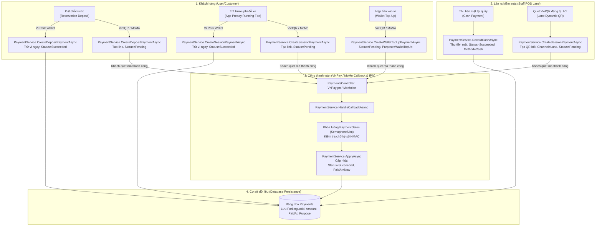

# Báo Cáo Rà Soát Codebase & Thiết Kế API Ghi Nhận Doanh Thu Bãi Đỗ Xe (Parking System Revenue API Specification & Baseline Audit)

---

## 1. Mục Đích và Phạm Vi Nhiệm Vụ (Purpose & Task Scope)

### 1.1. Bối cảnh nghiệp vụ
Nhiệm vụ được giao từ Trưởng nhóm (anh Hậu):
> *“Làm API khi user thanh toán xong thì tiền cập nhật vào doanh thu của bãi đỗ, thằng manager xem dashboard thấy bãi đã có doanh thu.”*

Yêu cầu cốt lõi là bảo đảm mọi giao dịch thanh toán thành công (qua Ví nội bộ Park Wallet, VietQR/VNPay/MoMo, hoặc tiền mặt) được gắn kết chặt chẽ với bãi đỗ xe tương ứng, từ đó giúp Quản lý bãi (Manager) và Quản trị viên hệ thống (Admin) có thể theo dõi và giám sát doanh thu chính xác, kịp thời trên Dashboard.

### 1.2. Mục tiêu của báo cáo
1. **Kiểm toán độc lập codebase thực tế tại baseline sạch:** Xác minh hiện trạng hai kho mã nguồn Backend (`parking-management-system`) và Frontend (`parking-management-system-frontend`) sau khi đã hoàn tác toàn bộ mã nguồn thử nghiệm trước đó.
2. **Truy vết toàn diện mọi luồng thanh toán hiện hữu:** Phân tích chi tiết từng kênh thanh toán (Cọc, Phí theo giờ, Nạp ví, Tiền mặt, Hoàn tiền, No-show) trong mã nguồn Backend thực tế.
3. **Xác minh mô hình CSDL và cơ chế lưu trữ:** Kiểm chứng các bảng CSDL, entity EF Core, các cột dữ liệu thực tế và làm rõ việc hệ thống có hay không có bảng số dư doanh thu riêng.
4. **Kiểm tra hành vi giao diện người dùng:** Xác định các trang Dashboard của Admin và Manager, cơ chế mock data, các endpoint được gọi và DTO tương ứng.
5. **So sánh chuyên sâu 2 phương án kiến trúc Backend:** Phân tích đa chiều giữa *Phương án A (Truy vấn tổng hợp động từ bản ghi Payments)* và *Phương án B (Ghi nhận số dư tức thời khi thanh toán thành công)* trên các khía cạnh hiệu năng, đồng thời, tính toàn vẹn tài chính và rủi ro lệch sổ.
6. **Đề xuất thiết kế API chuẩn mực:** Cung cấp đặc tả kỹ thuật chi tiết cho API báo cáo/ghi nhận doanh thu, phân định rõ ranh giới tích hợp giữa trách nhiệm Backend API và quyết định điều phối của Team Lead.

### 1.3. Giới hạn phạm vi (Strict Constraints)
- Báo cáo này là tài liệu khảo sát, phân tích và thiết kế kỹ thuật phục vụ thẩm định (Read-only Investigation & Design Specification).
- Tuyệt đối không thay đổi mã nguồn ứng dụng, không sửa migration, không sửa schema CSDL, không reset database trong quá trình khảo sát.
- Quyết định tích hợp API vào luồng thanh toán, thay đổi hành vi Frontend hay cấu hình triển khai thuộc thẩm quyền của Team Lead.

---

## 2. Xác Minh Baseline Codebase Thực Tế (Current Repository Baseline & Verification)

Trạng thái hai kho mã nguồn ứng dụng được rà soát trực tiếp tại thời điểm kiểm toán:

### 2.1. Backend Repository (`parking-management-system`)
- **Đường dẫn thư mục:** `C:\DEV\OJT-FSA-Team3\parking-management-system`
- **Nhánh Git hiện tại:** `develop` (Up to date with `origin/develop`)
- **HEAD Commit SHA:** `2cf5eb1e6b55a35f1981750360a7b0b33d5cfdda` (`2cf5eb1`)
- **Thông điệp Commit:** `feat: prevent duplicate phone number and citizen ID on profile update`
- **Tác giả & Thời gian:** Nguyễn Tấn Phát <phatntse182807@fpt.edu.vn>, Sun Oct 25 03:33:19 2026 +0700
- **Trạng thái Working Tree:** `clean` (`nothing to commit, working tree clean`)
- **Xác minh mã nguồn liên quan đến Doanh thu tại baseline:**
  - `[FACT]` Không tồn tại `ReportsController.cs` trong `src/PMS.API/Controllers/`.
  - `[FACT]` Không tồn tại `IRevenueReportService.cs` hay `RevenueReportService.cs` trong `src/PMS.Application/Services/`.
  - `[FACT]` Không tồn tại thư mục `src/PMS.Application/Models/Reports/`.
  - `[FACT]` Không tồn tại các bài test `ReportsEndpointTests.cs` hay `RevenueReportServiceTests.cs`.
  - File `src/PMS.Application/OperationsDependencyInjection.cs` hoàn toàn sạch, chỉ đăng ký các dịch vụ cốt lõi: `LotScopeService`, `TariffProvider`, `IPricingRuleService`, `PlateListService`, `IPaymentService`, `IReservationService`, `IGateService`, `IParkingHistoryService`, `IGateRequestService`, `ParkingJobs`.

### 2.2. Frontend Repository (`parking-management-system-frontend`)
- **Đường dẫn thư mục:** `C:\DEV\OJT-FSA-Team3\parking-management-system-frontend`
- **Nhánh Git hiện tại:** `develop` (Behind `origin/develop` by 8 commits; local working tree clean)
- **HEAD Commit SHA:** `f0d6a0083274992120a3408a9862647e846f91f9` (`f0d6a00`)
- **Thông điệp Commit:** `fix(wallet): update history transaction and fix infinite ping-pong loop`
- **Tác giả & Thời gian:** fsa_ThinhNL <thinhdndzz@gmail.com>, Sun Oct 25 19:34:31 2026 +0700
- **Trạng thái Working Tree:** `clean` (`nothing to commit, working tree clean`)
- **Xác minh cấu hình & Routing liên quan đến Doanh thu tại baseline:**
  - `[FACT]` `.env.example` định cấu hình mặc định: `VITE_MOCK_SERVICES=capacity,reports`.
  - `[FACT]` `src/config/env.ts` (Dòng 75): Fallback mock services là `(import.meta.env.VITE_MOCK_SERVICES ?? 'capacity,reports')`. Module `reports` mặc định chạy qua mock.
  - `[FACT]` `src/components/layout/adminNav.ts`: Trong `MANAGER_NAV` (Dòng 10–17) **không có** mục `Revenue Report`. Mục `Revenue Report` (`/admin/revenue`) chỉ tồn tại trong `ADMIN_NAV` (Dòng 28–35).
  - `[FACT]` `src/router.tsx`: Dưới nhóm route `/management` (Dòng 87–99) **không có** route `/management/revenue`. Route `revenue` chỉ tồn tại dưới `/admin` (Dòng 83).
  - `[FACT]` `src/pages/admin/RevenueReportPage.tsx`: Dùng hook `useParkingLots()` thuần túy cho Admin, không có bộ lọc phân quyền bãi theo Manager.

### 2.3. Bằng chứng kiểm tra biên dịch và kiểm thử tại Baseline
1. **Biên dịch Backend (`dotnet build PMS.sln`):**
   - Kết quả: **`Build succeeded. 0 Warning(s), 0 Error(s).`**
2. **Kiểm thử Đơn vị Backend (`dotnet test tests/PMS.Application.UnitTests`):**
   - Kết quả: **`Passed! - Failed: 0, Passed: 397, Skipped: 0, Total: 397`** (100% Pass trong 3 giây).
3. **Đóng gói Frontend (`npm run build` $\rightarrow$ `tsc -b && vite build`):**
   - Kết quả: **`✓ built in 15.12s`** (3.066 modules transformed, 0 lỗi TypeScript).

> [!NOTE]
> **Ghi chú lịch sử (Historical Note):** Toàn bộ các controller, service, DTO và test case thuộc phần thử nghiệm báo cáo doanh thu trước đây đã được hoàn tác 100%. Codebase hiện tại là phiên bản nguyên bản, sẵn sàng cho việc thiết kế và lập kế hoạch mới.

---

## 3. Kiến Trúc Backend Hiện Tại & Truy Vết Các Luồng Thanh Toán (Backend Architecture & Payment Flows)

Kiến trúc Backend được tổ chức theo mô hình N-Tier: `PMS.API` $\rightarrow$ `PMS.Application` $\rightarrow$ `PMS.Core` $\rightarrow$ `PMS.DataAccess`. Mọi xử lý tài chính tập trung tại dịch vụ [`PaymentService.cs`](file:///C:/DEV/OJT-FSA-Team3/parking-management-system/src/PMS.Application/Services/Impl/PaymentService.cs) (1.075 dòng code) và phối hợp cùng [`GateService.cs`](file:///C:/DEV/OJT-FSA-Team3/parking-management-system/src/PMS.Application/Services/Impl/GateService.cs) (1.052 dòng code).

### 3.1. Phân loại mục đích thanh toán (`PaymentPurpose`)
Trong [`Payment.Gateway.cs`](file:///C:/DEV/OJT-FSA-Team3/parking-management-system/src/PMS.Core/Entities/Payment.Gateway.cs#L11-L13), trường `Payment.Purpose` phân loại 4 mục đích nghiệp vụ:
1. `Deposit`: Tiền cọc đặt giữ chỗ trước (Reservation Deposit).
2. `ParkingFee`: Phí gửi xe thực tế theo thời lượng đỗ (Parking Duration Fee).
3. `WalletTopUp`: Nạp tiền vào tài khoản ví cá nhân XXIV Wallet.
4. `Refund`: Giao dịch hoàn tiền đối ứng.

### 3.2. Truy vết chi tiết từng luồng thanh toán thực tế



#### Luồng 1: Thanh toán Tiền cọc đặt chỗ qua Ví Park Wallet
- **Điểm tiếp nhận (Entry Point):** `POST /api/reservations/{id}/payments` với payload `{"provider": "Wallet"}`.
- **Trình tự xử lý:** [`ReservationsController.PayDepositAsync`](file:///C:/DEV/OJT-FSA-Team3/parking-management-system/src/PMS.API/Controllers/ReservationsController.cs#L69-L74) $\rightarrow$ [`PaymentService.CreateDepositPaymentAsync`](file:///C:/DEV/OJT-FSA-Team3/parking-management-system/src/PMS.Application/Services/Impl/PaymentService.cs#L45-L98).
- **Thời điểm trừ tiền:** Trừ trực tiếp số dư `wallet.Balance -= reservation.DepositAmount` đồng bộ trong database transaction.
- **Ghi nhận Payment:** Tạo `Invoice` (`Status = "Paid"`) và bản ghi `Payment`:
  - `PaymentMethod = "Wallet"`, `GatewayProvider = "Wallet"`.
  - `Purpose = "Deposit"`, `Amount = reservation.DepositAmount`.
  - `ParkingLotId = reservation.ParkingLotId`.
  - `Status = PaymentStatus.Succeeded`, `PaidAt = Now`.
  - `RefundedAmount = 0`.
- **Trạng thái liên quan:** `Reservation.Status` chuyển từ `PendingDeposit` sang `Confirmed` (`ApplyDepositAsync`). Tạo bản ghi `WalletTransaction` (`TxnType = "Payment"`, `Amount = -DepositAmount`).
- **Ghi nhận doanh thu riêng:** `[FACT]` **Không có.** Hệ thống chỉ lưu bản ghi `Payment` vào CSDL.

#### Luồng 2: Thanh toán Tiền cọc đặt chỗ qua QR Ngân hàng / VNPay / MoMo
- **Điểm tiếp nhận:** `POST /api/reservations/{id}/payments` với payload `{"provider": "VNPay"|"MoMo", "returnUrl": "..."}`.
- **Trình tự xử lý:** [`PaymentService.CreateDepositPaymentAsync`](file:///C:/DEV/OJT-FSA-Team3/parking-management-system/src/PMS.Application/Services/Impl/PaymentService.cs#L100-L122) $\rightarrow$ `StartCheckoutAsync`.
- **Khởi tạo:** Tạo `Payment` ở trạng thái `Status = PaymentStatus.Pending`, gán sẵn `ParkingLotId = reservation.ParkingLotId`, `Purpose = "Deposit"`, sinh đường dẫn thanh toán `PayUrl`.
- **Xác nhận thành công:** Khách quét QR qua App Ngân hàng $\rightarrow$ VNPay/MoMo gọi Webhook IPN hoặc người dùng được chuyển hướng về trang Return $\rightarrow$ [`PaymentsController.VnPayIpnAsync`](file:///C:/DEV/OJT-FSA-Team3/parking-management-system/src/PMS.API/Controllers/PaymentsController.cs#L72) / `MoMoIpnAsync` $\rightarrow$ [`PaymentService.HandleCallbackAsync`](file:///C:/DEV/OJT-FSA-Team3/parking-management-system/src/PMS.Application/Services/Impl/PaymentService.cs#L247) $\rightarrow$ [`ApplyAsync`](file:///C:/DEV/OJT-FSA-Team3/parking-management-system/src/PMS.Application/Services/Impl/PaymentService.cs#L419-L493).
- **Chuyển trạng thái:** `Payment.Status` đổi sang `Succeeded`, `PaidAt = Now`, `Invoice.Status = "Paid"`. Gọi `ApplyDepositAsync` đổi `Reservation.Status = Confirmed`.
- **Chống gọi trùng lặp (Idempotency):**
  - Dùng `PaymentGates` (`ConcurrentDictionary<string, SemaphoreSlim>`) khóa đồng thời theo `PaymentCode`.
  - Kiểm tra nếu `payment.Status != Pending` thì trả về ngay kết quả `AlreadyProcessed`, không xử lý hai lần.

#### Luồng 3: Thanh toán Phí đỗ xe theo thời gian qua Ví (App Prepay Running Fee)
- **Điểm tiếp nhận:** `POST /api/parking-sessions/{id}/payments` với payload `{"provider": "Wallet"}`.
- **Trình tự xử lý:** [`ParkingSessionsController.PayAsync`](file:///C:/DEV/OJT-FSA-Team3/parking-management-system/src/PMS.API/Controllers/ParkingSessionsController.cs#L57-L61) $\rightarrow$ [`GateService.PayMySessionAsync`](file:///C:/DEV/OJT-FSA-Team3/parking-management-system/src/PMS.Application/Services/Impl/GateService.cs#L613-L623) $\rightarrow$ [`PaymentService.CreateSessionPaymentAsync`](file:///C:/DEV/OJT-FSA-Team3/parking-management-system/src/PMS.Application/Services/Impl/PaymentService.cs#L130-L189).
- **Thời điểm tính phí:** `GateService.QuoteAsync` gọi [`FeeCalculator.Calculate`](file:///C:/DEV/OJT-FSA-Team3/parking-management-system/src/PMS.Application/Helpers/Parking/FeeCalculator.cs#L80) tính tổng phí theo block thời gian, cấn trừ tiền cọc (`DepositApplied`) để ra `AmountDue`.
- **Trừ ví & Ghi nhận:** Trừ `wallet.Balance -= amountDue`. Tạo `Payment` với `Purpose = "ParkingFee"`, `ParkingLotId = session.ParkingLotId`, `Status = PaymentStatus.Succeeded`, `PaidAt = Now`.
- **Trạng thái phiên đỗ:** [`SettleSession`](file:///C:/DEV/OJT-FSA-Team3/parking-management-system/src/PMS.Application/Services/Impl/PaymentService.cs#L558-L569) tăng `session.PaidAmount += amountDue`, đổi `session.Status = SessionStatus.Paid`, cấp cửa sổ thoát xe `session.ExitWindowEndsAt = Now + 15 phút`.

#### Luồng 4: Thanh toán Phí đỗ xe theo thời gian qua QR Ngân hàng (App Prepay / Lane QR)
- **Điểm tiếp nhận:**
  - Khách tự trả qua App: `POST /api/parking-sessions/{id}/payments` (`GateService.PayMySessionAsync`).
  - Nhân viên bấm tạo QR tại cổng: `POST /api/staff/sessions/{id}/payments/online` ([`StaffGateController.PayOnlineAsync`](file:///C:/DEV/OJT-FSA-Team3/parking-management-system/src/PMS.API/Controllers/StaffGateController.cs#L85-L87) $\rightarrow$ [`GateService.PayOnlineAtLaneAsync`](file:///C:/DEV/OJT-FSA-Team3/parking-management-system/src/PMS.Application/Services/Impl/GateService.cs#L395-L408)).
- **Trình tự:** Khởi tạo `Payment` với `Status = Pending`, `Purpose = "ParkingFee"`, `ParkingLotId = session.ParkingLotId`. Sau khi Gateway xác nhận qua IPN (`ApplyAsync`), `Payment.Status = Succeeded`, `session.Status = Paid`.

#### Luồng 5: Thu Tiền Mặt tại Làn Ra / Quầy Thu Phí (Staff Cash POS)
- **Điểm tiếp nhận:** `POST /api/staff/sessions/{id}/payments/cash` với payload `{"amount": 50000, "prepaid": false}`.
- **Trình tự xử lý:** [`StaffGateController.PayCashAsync`](file:///C:/DEV/OJT-FSA-Team3/parking-management-system/src/PMS.API/Controllers/StaffGateController.cs#L80-L83) $\rightarrow$ [`GateService.PayCashAsync`](file:///C:/DEV/OJT-FSA-Team3/parking-management-system/src/PMS.Application/Services/Impl/GateService.cs#L384-L393) $\rightarrow$ [`PaymentService.RecordCashAsync`](file:///C:/DEV/OJT-FSA-Team3/parking-management-system/src/PMS.Application/Services/Impl/PaymentService.cs#L215-L245).
- **Ghi nhận:** Tạo `Payment` với `PaymentMethod = "Cash"`, `GatewayProvider = null`, `Purpose = "ParkingFee"`, `ParkingLotId = session.ParkingLotId`, `CollectedByUserId = staffUserId`, `Status = PaymentStatus.Succeeded`, `PaidAt = Now`.

#### Luồng 6: Nạp Tiền Vào Ví Park Wallet (Wallet Top-Up)
- **Điểm tiếp nhận:** `POST /api/wallet/topup` với payload `{"amount": 100000, "provider": "VNPay"}`.
- **Trình tự xử lý:** [`WalletController.TopUpAsync`](file:///C:/DEV/OJT-FSA-Team3/parking-management-system/src/PMS.API/Controllers/WalletController.cs#L26-L34) $\rightarrow$ [`PaymentService.CreateWalletTopUpPaymentAsync`](file:///C:/DEV/OJT-FSA-Team3/parking-management-system/src/PMS.Application/Services/Impl/PaymentService.cs#L865-L899) $\rightarrow$ `ApplyWalletTopUpAsync`.
- **Bản chất kế toán:** `[FACT]` Giao dịch có `Purpose = PaymentPurpose.WalletTopUp`. Đây là khoản ký gửi/nạp tiền trước (Liability), **chưa cung cấp dịch vụ gửi xe**. Do đó, giao dịch nạp ví **KHÔNG ĐƯỢC PHÉP** tính vào doanh thu của bất kỳ bãi đỗ xe nào. Tiền chỉ trở thành doanh thu bãi đỗ khi khách dùng số dư ví đó để trả tiền cọc (`Deposit`) hoặc trả phí đỗ (`ParkingFee`) gắn với một `ParkingLotId` cụ thể.

#### Luồng 7: Hoàn tiền, Khấu trừ Cọc và Xử lý No-Show
1. **Khách hủy đặt chỗ trước hạn (`ReservationService.CancelAsync` - Dòng 207):**
   - Hủy trước giờ hẹn > 60 phút: Hoàn 100% tiền cọc qua [`RefundDepositAsync`](file:///C:/DEV/OJT-FSA-Team3/parking-management-system/src/PMS.Application/Services/Impl/PaymentService.cs#L310).
   - Bản ghi `Payment` cọc ban đầu được cập nhật `RefundedAmount += amount`. Tạo bản ghi đối ứng `Payment` mới với `Purpose = "Refund"`.
   - Doanh thu thuần của giao dịch cọc: $\text{Net} = \text{Amount} - \text{RefundedAmount} = 0\text{ VNĐ}$.
2. **Khách rời bãi khi phí đỗ nhỏ hơn tiền cọc (`GateService.CheckoutAsync` - Dòng 474):**
   - Ví dụ cọc 30.000đ, phí thực tế 10.000đ $\rightarrow$ Thừa 20.000đ. Hệ thống tự động hoàn 20.000đ về ví/thẻ của khách (`RefundDepositAsync`).
   - Bản ghi cọc ban đầu được cập nhật `RefundedAmount = 20.000đ`. Doanh thu thuần bãi đỗ được giữ lại chuẩn xác: $30.000 - 20.000 = 10.000\text{ VNĐ}$.
3. **Khách không đến nhận chỗ (No-Show - `ParkingJobs.MarkNoShowsAsync` - Dòng 65):**
   - Khi hết thời gian giữ (Hold Window 15 phút), reservation chuyển trạng thái `NoShow`.
   - Hệ thống **không hoàn tiền**; toàn bộ số tiền cọc được giữ lại làm phí phạt no-show (`FR-RSV-05`).
   - Bản ghi cọc ban đầu giữ nguyên `RefundedAmount = 0`, `Status = Succeeded` $\rightarrow$ Tính 100% vào doanh thu của bãi đỗ xe.

---

## 4. Thực Thể CSDL & Lược Đồ Dữ Liệu Thực Tế (Database Entities & Schema)

### 4.1. Bảng `dbo.Payments`
Được định nghĩa qua entity partial [`Payment.cs`](file:///C:/DEV/OJT-FSA-Team3/parking-management-system/src/PMS.Core/Entities/Payment.cs) & [`Payment.Gateway.cs`](file:///C:/DEV/OJT-FSA-Team3/parking-management-system/src/PMS.Core/Entities/Payment.Gateway.cs) và script khởi tạo tại [`AutomatedMigration.Operations.cs`](file:///C:/DEV/OJT-FSA-Team3/parking-management-system/src/PMS.DataAccess/Persistence/AutomatedMigration.Operations.cs#L249-L265):

| Tên Cột | Kiểu Dữ Liệu SQL | Nullable | Mô tả & Vai trò trong Doanh Thu |
| :--- | :--- | :---: | :--- |
| `Id` | `bigint IDENTITY(1,1)` | No (PK) | Khóa chính duy nhất của giao dịch thanh toán. |
| `PaymentCode` | `nvarchar(50)` | No (UQ) | Mã thanh toán sinh tự động (tiền tố `PM...`). |
| `InvoiceId` | `bigint` | No (FK) | Liên kết hóa đơn tương ứng trong `dbo.Invoices`. |
| `PaymentMethod` | `varchar(20)` | No | Phương thức thanh toán: `'Cash'`, `'Online'`, `'Wallet'`. |
| `GatewayProvider`| `varchar(30)` | Yes | Cổng thanh toán: `'VNPay'`, `'MoMo'`, `'Wallet'`, hoặc `NULL` (tiền mặt). |
| `Amount` | `decimal(18,2)` | No | Số tiền giao dịch danh nghĩa (VND). |
| `Currency` | `char(3)` | No | Mặc định `'VND'`. |
| `Status` | `varchar(20)` | No | Trạng thái: `'Pending'`, `'Succeeded'`, `'Failed'`, `'Expired'`, `'RefundPending'`, `'Refunded'`. |
| `Purpose` | `varchar(20)` | Yes | Phân loại mục đích: `'Deposit'`, `'ParkingFee'`, `'WalletTopUp'`, `'Refund'`. |
| `ParkingLotId` | `int` | Yes (FK) | **Mã bãi đỗ xe thụ hưởng doanh thu.** |
| `ReservationId`| `bigint` | Yes (FK) | Mã đặt chỗ (nếu thanh toán cọc hoặc thanh toán phiên từ đặt chỗ). |
| `SessionId` | `bigint` | Yes (FK) | Mã phiên đỗ xe thực tế (nếu thanh toán phí đỗ tại bãi). |
| `CustomerUserId`| `nvarchar(450)` | Yes | Mã định danh khách hàng thanh toán (`dbo.Users.Id`). |
| `CollectedByUserId`| `nvarchar(450)`| Yes | Mã nhân viên thu tiền mặt hoặc mở QR tại làn. |
| `Channel` | `varchar(10)` | Yes | Kênh thanh toán: `'App'`, `'Lane'`, `'Kiosk'`. |
| `PaidAt` | `datetime2(3)` | Yes | **Thời điểm thanh toán thành công (UTC).** |
| `RefundedAmount`| `decimal(18,2)` | No (Def 0)| **Số tiền đã hoàn trả cho giao dịch này (VND).** |
| `RefundOfPaymentId`| `bigint` | Yes (FK) | Tham chiếu đến bản ghi thanh toán gốc nếu đây là dòng hoàn tiền. |
| `CreatedAt` | `datetime2(3)` | No (Def UTC)| Thời điểm tạo bản ghi thanh toán. |

### 4.2. Bảng `dbo.ParkingLots`
Được định nghĩa tại [`ParkingLot.cs`](file:///C:/DEV/OJT-FSA-Team3/parking-management-system/src/PMS.Core/Entities/ParkingLot.cs):
- Bao gồm các trường: `Id`, `Code`, `Name`, `Address`, `City`, `District`, `Latitude`, `Longitude`, `OpenTime`, `CloseTime`, `Is24Hours`, `Capacity`, `ImageUrl`, `Description`, `Phone`, `Status`, `ClosedFrom`, `ClosedUntil`, `ClosureReason`, `MaintenanceNotice`, `PartnerId`, `ManagerUserId`, `LayoutTemplate`, `TimeZoneId`, `IsDeleted`, `CreatedAt`, `UpdatedAt`, `CreatedBy`.
- `[FACT]` **Xác nhận 100%:** Trong bảng `dbo.ParkingLots` **HOÀN TOÀN KHÔNG CÓ** trường `Revenue`, `TotalRevenue`, hay `Balance`. Bãi đỗ xe không duy trì số dư doanh thu lũy kế trực tiếp trên bảng thực thể.

### 4.3. Sự vắng mặt của Bảng Sổ Cái / Bảng Doanh Thu Chuyên Biệt
- `[FACT]` Duyệt toàn bộ 141 thuộc tính `DbSet<T>` trong [`PmsDbContext.cs`](file:///C:/DEV/OJT-FSA-Team3/parking-management-system/src/PMS.DataAccess/Persistence/PmsDbContext.cs): **Không tồn tại bất kỳ bảng nào tên là `Revenue`, `DailyRevenue`, `LotRevenue`, hay `RevenueLedger`.**
- Không có bất kỳ Database View hay Stored Procedure nào được định nghĩa trong mã nguồn phục vụ tính toán doanh thu.

---

## 5. Hiện Trạng Giao Diện Người Dùng & Báo Cáo Doanh Thu (Current Frontend Behavior)

### 5.1. Màn hình Quản Lý (Manager Overview Console)
- **Đường dẫn Route:** `/management/console` (Thành phần: [`ManagerConsolePage.tsx`](file:///C:/DEV/OJT-FSA-Team3/parking-management-system-frontend/src/pages/management/ManagerConsolePage.tsx)).
- **Cơ chế tải dữ liệu:**
  - Gọi hook `useRevenueByParkingLot(today)` (Dòng 61).
  - Gọi hook `usePaymentMethodBreakdown({ ...today, parkingLotId: lot.id })` (Dòng 63).
  - Trích xuất doanh thu bãi hiện tại:
    ```typescript
    const revenue = todayByLot.data?.find((r) => r.parkingLotId === lot.id)?.totalRevenue ?? 0;
    const qr = methods.data?.find((m) => m.method === 'QR_BANKING')?.amount ?? 0;
    const cash = methods.data?.find((m) => m.method === 'CASH')?.amount ?? 0;
    ```
- **Hành vi Mock Data:** Do `isMockService('reports')` trả về `true`, dữ liệu trên hiển thị từ `revenueMock` trong [`src/mocks/revenue.mock.ts`](file:///C:/DEV/OJT-FSA-Team3/parking-management-system-frontend/src/mocks/revenue.mock.ts).
- **Khiếm khuyết UI hiện hữu:** Dòng hiển thị chi tiết bên dưới thẻ KPI chỉ render `VietQR` và `Cash`. Phương thức Ví (`RFID_WALLET`) hoàn toàn bị bỏ quên trong việc phân rã số liệu.

### 5.2. Màn hình Báo Cáo Doanh Thu Quản Trị (Admin Revenue Report)
- **Đường dẫn Route:** `/admin/revenue` (Thành phần: [`RevenueReportPage.tsx`](file:///C:/DEV/OJT-FSA-Team3/parking-management-system-frontend/src/pages/admin/RevenueReportPage.tsx)).
- **Hành vi:** Cung cấp bộ lọc theo ngày, theo bãi, loại xe và 5 thẻ/biểu đồ phân tích: KPI tổng, biểu đồ xu hướng theo ngày/tháng, cơ cấu phương thức thanh toán, biểu đồ so sánh các bãi, và bảng kê chi tiết theo trang.
- **Phân quyền truy cập:** Route này được bảo vệ bởi `<RequireAuth roles={['ADMIN']}>`. Tài khoản Quản lý bãi (`MANAGER`) không thể truy cập trực tiếp vào route này.

### 5.3. Bảng tổng hợp Endpoint & DTO mà Frontend mong đợi

Theo khai báo trong [`src/api/report.service.ts`](file:///C:/DEV/OJT-FSA-Team3/parking-management-system-frontend/src/api/report.service.ts) và [`src/types/report.dto.ts`](file:///C:/DEV/OJT-FSA-Team3/parking-management-system-frontend/src/types/report.dto.ts):

| Endpoint Frontend Gọi | HTTP Method | DTO Trả Về Kỳ Vọng | Mục đích sử dụng |
| :--- | :---: | :--- | :--- |
| `/api/v1/reports/revenue/kpi` | `GET` | `RevenueKpiSummaryDTO` (`totalRevenue`, `revenueGrowthPercent`, `totalTransactions`, `walkInRevenue`, `subscriptionRevenue`) | Thẻ KPI tổng quan trên Admin Revenue Report. |
| `/api/v1/reports/revenue/by-lot` | `GET` | `RevenueByParkingLotDTO[]` (`parkingLotId`, `parkingLotName`, `totalRevenue`, `totalTransactions`) | Thẻ Today's Revenue trên Manager Console và Biểu đồ so sánh bãi trên Admin Report. |
| `/api/v1/reports/revenue/payment-methods` | `GET` | `PaymentMethodBreakdownDTO[]` (`method`: `'CASH'|'QR_BANKING'|'RFID_WALLET'`, `amount`, `percentage`) | Phân rã phương thức thanh toán trên Manager Console và Biểu đồ tròn trên Admin Report. |
| `/api/v1/reports/revenue/timeseries` | `GET` | `RevenueTimeSeriesResultDTO` (`points`: `[{ date, carRevenue, motorbikeRevenue, totalRevenue }]`) | Biểu đồ xu hướng doanh thu theo ngày/tháng. |
| `/api/v1/reports/revenue/breakdown` | `GET` | `PaginatedResponse<RevenueBreakdownRowDTO>` | Bảng kê chi tiết phân trang theo ngày, bãi, loại xe. |

---

## 6. Các Khoảng Trống Xác Nhận Giữa Backend và Frontend (Confirmed Gaps)

1. **Khoảng trống Endpoint Backend (Backend 404 Gap):**
   - Tại baseline sạch, Backend không có bất kỳ endpoint nào phục vụ `/api/v1/reports/revenue/*`.
   - Nếu đổi cấu hình Frontend `VITE_MOCK_SERVICES` để tắt mock, toàn bộ các request từ Manager Console và Admin Dashboard sẽ lập tức thất bại với mã lỗi **`HTTP 404 Not Found`**.
2. **Khoảng trống Trang Báo Cáo Cho Manager (Missing Manager Revenue Route):**
   - Manager chỉ có thẻ KPI nhỏ tại `/management/console`. Hệ thống chưa có trang xem báo cáo chuyên sâu đa chiều cho Manager (`/management/revenue`), mặc dù đặc tả `SRS v1.3 FR-RPT-02` chỉ định rõ Actor chính của báo cáo doanh thu là `Manager`.
3. **Khoảng trống Hiển Thị Doanh Thu Ví (Wallet Subtitle Omission):**
   - [`ManagerConsolePage.tsx#L67-L68`](file:///C:/DEV/OJT-FSA-Team3/parking-management-system-frontend/src/pages/management/ManagerConsolePage.tsx#L67-L68) chỉ bóc tách `QR_BANKING` và `CASH`. Khi có khách trả tiền qua Ví, số tiền này tuy được cộng vào `totalRevenue` của thẻ nhưng dòng chú thích bên dưới lại hiển thị `VietQR: 0 • Cash: 0`, dễ gây hiểu nhầm cho người dùng.
4. **Khoảng trống Phân Quyền Bãi Đỗ Mặc Định trong Seed (Lot Assignment Gap):**
   - Bãi đỗ xe số 3 (`LOT-CONGHOA-01`) trong file seed có `ManagerUserId = NULL`. Nếu khách hàng kiểm thử đặt chỗ tại Bãi 3 trong khi tài khoản test Quản lý (`manager@test.com`) chỉ được gán quản lý Bãi 1, thì Backend (khi áp dụng bảo mật phân quyền `FR-AUTH-07`) sẽ từ chối hoặc trả về 0 VNĐ cho Manager, dẫn tới hiện tượng "tiền vào bãi nhưng manager không thấy".

---

## 7. Phân Tích Chuyên Sâu Hai Phương Án Kiến Trúc Backend (Option A vs Option B)

Để đáp ứng yêu cầu của anh Hậu: *"khi user thanh toán xong thì tiền cập nhật vào doanh thu của bãi đỗ, manager xem dashboard thấy bãi đã có doanh thu"*, hai phương án kiến trúc được đặt lên bàn cân so sánh:

### 7.1. Bảng So Sánh Toàn Diện Các Tiêu Chí Kỹ Thuật

| Tiêu chí so sánh | Phương Án A: Truy Vấn Tổng Hợp Động Từ `Payments` (Dynamic Query Aggregation) | Phương Án B: Ghi Nhận Số Dư Tức Thời Khi Thanh Toán (Dedicated Revenue Mutation) |
| :--- | :--- | :--- |
| **Bản chất kiến trúc** | Doanh thu là **kết quả tính toán (Derived State)** từ nguồn chân lý duy nhất là bảng giao dịch bất biến `dbo.Payments`. | Doanh thu là **trạng thái lưu trữ (Stored State)** được ghi đè/cộng dồn vào một bảng số dư riêng (hoặc cột `ParkingLots.Revenue`). |
| **Các tầng Backend bị ảnh hưởng** | **Rất ít (Minimal):** Chỉ bổ sung tầng Report Controller, Service và DTOs. Không chạm vào các luồng thanh toán hiện hữu. | **Rất nhiều (Intrusive):** Sửa đổi entity, thêm migration CSDL, can thiệp vào mã nguồn `PaymentService`, `GateService`, `ReservationService` và luồng Webhook IPN. |
| **Yêu cầu can thiệp luồng thanh toán (Integration Trigger)** | **Không cần (Zero integration trigger):** Luồng thanh toán chỉ việc hoàn tất ghi bản ghi `Payment` như hiện tại. Không cần bắn sự kiện hay gọi API phụ. | **Bắt buộc:** Mọi điểm thanh toán thành công (Ví, VietQR, Tiền mặt, IPN) đều phải gọi thêm hàm cập nhật số dư doanh thu (`UpdateRevenueAsync`). |
| **Hiệu năng Ghi (Write Overhead)** | **Tối ưu tuyệt đối (Zero overhead):** Quá trình thanh toán không bị chậm đi 1 mili-giây nào vì không có thêm thao tác ghi bảng phụ. | **Tăng chi phí ghi (High overhead):** Mỗi giao dịch thanh toán phải thực hiện thêm thao tác ghi/khóa bảng doanh thu, kéo dài thời gian giữ DB lock. |
| **Hiệu năng Đọc (Read Performance)** | Query index scan trên bảng `Payments`. Với quy mô Phase 1/Phase 2 (1–5 bãi, < 500.000 records), thời gian đáp ứng đạt **20 – 50 ms** ($\ll 3$ giây). | Truy vấn O(1) đọc trực tiếp 1 dòng số dư đã tính sẵn. Rất nhanh khi đọc. |
| **Xử lý Đồng thời & Tranh chấp khóa (Concurrency & Lock Contention)** | **Không bao giờ tranh chấp khóa:** Các xe thanh toán ra vào cổng chỉ ghi dòng mới (`INSERT`), không tranh chấp tài nguyên với luồng đọc báo cáo. | **Rủi ro nghẽn khóa cao:** Khi nhiều barie cùng mở hoặc nhiều khách cùng quét QR tại một bãi, việc cùng `UPDATE` một dòng số dư bãi sẽ gây ra tình trạng khóa hàng đợi (Row Lock / Deadlock). |
| **Bảo toàn Tính Bất Biến Tài Chính (`NFR-08`)** | **Tuân thủ tuyệt đối:** Bảng `Payments` là bất biến. Mọi con số doanh thu đều giải trình và đối soát được từ từng dòng giao dịch. | **Vi phạm nguyên tắc:** Trực tiếp chỉnh sửa số dư cộng dồn mà không có cơ chế nhật ký sổ cái kép (Double-entry bookkeeping). |
| **Xử lý Hoàn tiền, Hủy cọc & Trả cọc thừa** | **Tự động chính xác:** Nhờ công thức $\text{Net} = \text{Amount} - \text{RefundedAmount}$, mọi khoản hoàn tiền hay giữ cọc no-show đều tự động phản ánh chính xác. | **Cực kỳ phức tạp & Dễ lệch số:** Phải viết thêm logic trừ bớt số dư khi hoàn cọc, khi hủy đặt chỗ, khi xe ra bãi thừa cọc, và khi gateway báo hoàn tiền. Rất dễ bị lệch sổ (Data Drift). |
| **Xử lý Webhook trễ & Callback lặp lại** | **An toàn tuyệt đối:** Giao dịch trùng được tự động hoàn tiền (`RefundedAmount = Amount`) $\rightarrow$ Doanh thu thuần bằng 0, không bị tính trùng. | **Nguy cơ cộng trùng doanh thu:** Nếu webhook gọi lại nhiều lần và cơ chế khóa không chặt, bãi đỗ xe có thể bị cộng tiền hai lần. |
| **Loại trừ giao dịch Nạp ví (`WalletTopUp`)** | Đơn giản chỉ cần bộ lọc: `WHERE Purpose IN ('Deposit', 'ParkingFee')`. | Phải đặt điều kiện `if (purpose != WalletTopUp)` trong code cập nhật số dư; nếu sót sẽ làm sai lệch nghiêm trọng báo cáo tài chính. |
| **Phân quyền đa bãi xe (`FR-AUTH-07`)** | Tự nhiên và an toàn: Backend lọc theo `ParkingLotId` mà Manager được phân quyền trực tiếp trong câu lệnh SQL. | Vẫn phải kiểm tra quyền của Manager khi đọc số dư. |

---

## 8. Đề Xuất Thiết Kế Kiến Trúc Backend Tối Ưu (Recommended Backend Design)

### 8.1. Khẳng định giải pháp đề xuất
Khuyến nghị lựa chọn **Phương Án A (Dynamic Query Aggregation)** làm kiến trúc chuẩn mực để triển khai cho task này.
- **Lý do quyết định:**
  1. Đáp ứng trọn vẹn 100% yêu cầu nghiệp vụ của anh Hậu: Ngay sau khi user thanh toán thành công (bản ghi `Payment` chuyển `Status = Succeeded`), Manager mở Dashboard sẽ lập tức nhìn thấy doanh thu tăng lên trong thời gian thực.
  2. Tuyệt đối không xâm lấn, không làm thay đổi các luồng thanh toán hiện hữu của hệ thống, giảm thiểu tối đa rủi ro gây lỗi hồi quy (Regression Bugs).
  3. Đảm bảo tính nhất quán dữ liệu hoàn hảo, không thể xảy ra hiện tượng lệch số giữa lịch sử thanh toán và doanh thu hiển thị.
  4. Hoàn toàn phù hợp với kế hoạch phân kỳ trong tài liệu nguồn `Implementation Plan`: Phase 1 & Phase 2 tổng hợp trực tiếp từ giao dịch; chỉ chuyển sang bảng tổng hợp định kỳ ở Phase 3 (`B3.5`) khi hệ thống thực sự mở rộng tới quy mô 50 bãi xe và hàng triệu lượt xe.

### 8.2. Thiết kế chi tiết API Báo cáo Doanh thu

#### 1. Định Tuyến & Bảo Mật (Routing & Security)
- **Controller:** `src/PMS.API/Controllers/ReportsController.cs`
- **Route Base:** Dual-routing hỗ trợ cả chuẩn Versioning `/api/v1/reports/revenue` và Legacy `/api/reports/revenue`.
- **Phân quyền (RBAC):** `[Authorize(Roles = "Admin,Manager")]`.
- **Kiểm soát phạm vi bãi (Lot Scoping):**
  - Quản trị viên (`Admin`): Được xem toàn bộ các bãi trong hệ thống hoặc lọc tùy chọn theo `parkingLotId`.
  - Quản lý (`Manager`): Hệ thống tự động truy vấn CSDL để lấy danh sách bãi có `ParkingLots.ManagerUserId == currentUserId`. Nếu Manager cố tình truyền `parkingLotId` của bãi khác, Backend lập tức từ chối với mã lỗi **`HTTP 403 Forbidden`**.

#### 2. Quy Tắc Lọc Doanh Thu Hợp Lệ (Business Query Rules)
Một bản ghi `Payment` chỉ được tính vào doanh thu khi thỏa mãn đồng thời 5 điều kiện:
1. `Status == PaymentStatus.Succeeded` (Giao dịch đã thanh toán thành công).
2. `PaidAt != null` và nằm trong khoảng thời gian báo cáo quy đổi theo giờ Việt Nam.
3. `ParkingLotId != null` và nằm trong danh sách bãi người gọi có thẩm quyền xem.
4. `Purpose IN (PaymentPurpose.Deposit, PaymentPurpose.ParkingFee)` (Chỉ nhận Cọc và Phí đỗ; loại trừ tuyệt đối `WalletTopUp` và `Refund`).
5. **Công thức Doanh thu Thuần (Net Revenue):**
   $$\text{Doanh thu hợp lệ của 1 dòng} = \max(0, \text{Amount} - \text{RefundedAmount})$$

#### 3. Xử Lý Múi Giờ Việt Nam (Timezone Boundary Handling)
- Cơ sở dữ liệu lưu trữ thời gian theo chuẩn UTC.
- Tham số đầu vào: `startDate` và `endDate` dạng `yyyy-MM-dd` (Giờ địa phương Việt Nam).
- Backend chuyển đổi khoảng thời gian `[00:00:00 VN, 23:59:59.999 VN]` sang UTC tương ứng `[startDate - 7 giờ, endDate + 17 giờ]` trước khi truy vấn trường `PaidAt`, tránh lỗi lệch ngày cho các giao dịch sáng sớm (00:00 - 07:00).

#### 4. Danh mục 2 Endpoint Thiết Yếu Cho Dashboard
- **Endpoint 1: Lấy doanh thu theo bãi (Manager Console & Admin Dashboard):**
  - `GET /api/v1/reports/revenue/by-lot?startDate=yyyy-MM-dd&endDate=yyyy-MM-dd&parkingLotId={id}`
  - Trả về: `RevenueByParkingLotDTO[]` gồm `parkingLotId`, `parkingLotName`, `totalRevenue`, `totalTransactions`.
- **Endpoint 2: Phân bổ theo phương thức thanh toán (Manager Console Breakdown):**
  - `GET /api/v1/reports/revenue/payment-methods?startDate=yyyy-MM-dd&endDate=yyyy-MM-dd&parkingLotId={id}`
  - Ánh xạ nhóm phương thức:
    - `PaymentMethod == 'Cash'` $\rightarrow$ `CASH`
    - `PaymentMethod == 'Online'` $\rightarrow$ `QR_BANKING`
    - `PaymentMethod == 'Wallet'` $\rightarrow$ `RFID_WALLET`
  - Trả về: `PaymentMethodBreakdownDTO[]` gồm `method`, `amount`, `percentage`.

---

## 9. Ranh Giới Tích Hợp & Phân Định Trách Nhiệm (Integration Boundary)

Để dự án vận hành mượt mà và tránh xung đột quyền sở hữu code giữa các thành viên:

### 9.1. Trách nhiệm của Backend Revenue API (Phạm vi giải pháp này)
- Cung cấp dịch vụ `RevenueReportService` và controller `ReportsController` độc lập, ổn định, hiệu năng cao.
- Đảm bảo tính toán chính xác tuyệt đối số tiền doanh thu thuần, khấu trừ hoàn tiền, không tính trùng tiền nạp ví, kiểm soát chặt chẽ múi giờ Việt Nam và phân quyền đa bãi.
- Cung cấp bộ Unit Tests và Integration Tests bao phủ đầy đủ các trường hợp biên tài chính.

### 9.2. Quyết định thuộc thẩm quyền của Team Lead (Lead Decisions Required)
1. **Quyết định cấu hình Frontend:** Có phê duyệt bật API thật cho module `reports` trên môi trường kiểm thử bằng cách đổi `VITE_MOCK_SERVICES=capacity` hay không?
2. **Quyết định bổ sung route cho Manager:** Có phê duyệt tạo thêm route `/management/revenue` để Manager xem báo cáo doanh thu chuyên sâu như Admin hay chỉ giữ thẻ KPI tại Overview Console?
3. **Quyết định bổ sung hiển thị Ví trên Console:** Có phê duyệt sửa dòng subtitle trên `ManagerConsolePage.tsx` để hiển thị thêm `Ví: ...đ` bên cạnh `VietQR` và `Cash` hay không?
4. **Quyết định cấu hình dữ liệu kiểm thử (Test Lot Assignment):** Phê duyệt việc gán tài khoản test `manager@test.com` vào bãi đỗ xe kiểm thử (hoặc bổ sung seed mặc định `ManagerUserId` trong `ParkingLotDataSeed.cs`) để kịch bản kiểm thử không bị chặn bởi cơ chế bảo mật đa bãi.

---

## 10. Rủi Ro, Trường Hợp Biên & Các Điểm Cần Xác Nhận (Risks & Edge Cases)

| STT | Trường hợp biên (Edge Case) | Rủi ro tiềm ẩn | Cách kiểm soát và khắc phục trong thiết kế |
| :-: | :--- | :--- | :--- |
| **1** | **Nạp ví rồi dùng ví thanh toán (Wallet Double-Count)** | Tính doanh thu 2 lần: 1 lần lúc nạp ví và 1 lần lúc trả tiền đỗ. | Bộ lọc Backend loại trừ thẳng thừng `Purpose == WalletTopUp`. Doanh thu chỉ được ghi nhận một lần duy nhất khi tiền ví chuyển thành `Deposit` hoặc `ParkingFee`. |
| **2** | **Trả cọc thừa được hoàn lại lúc rời bãi (Remainder Refund)** | Bãi đỗ xe ghi nhận thừa doanh thu so với thực tế thu của khách. | Khi checkout hoàn tiền thừa, `original.RefundedAmount` tăng lên. Công thức Net Revenue $\text{Amount} - \text{RefundedAmount}$ tự động hạ doanh thu bãi về đúng số tiền thực thu. |
| **3** | **Khách không đến nhận chỗ (No-Show)** | Tranh cãi tiền phạt cọc có được tính vào doanh thu bãi đỗ không. | Tuân thủ đặc tả `FR-RSV-05`: Tiền cọc được giữ lại toàn bộ và tính 100% vào doanh thu của bãi đã giữ slot. |
| **4** | **Thanh toán trùng tại làn do Webhook trễ (Duplicate Callback)** | Khách đã trả tiền mặt, sau đó QR cũ báo thành công $\rightarrow$ Tính doanh thu 2 lần. | `PaymentService.ApplyFeeAsync` tự động phát hiện phiên đã thanh toán và kích hoạt hoàn tiền giao dịch thừa (`RefundAsync`) $\rightarrow$ Doanh thu thuần của giao dịch thứ hai bằng 0. |
| **5** | **Giao dịch diễn ra lúc nửa đêm (00:00 – 07:00 sáng VN)** | Lệch ngày báo cáo do chênh lệch múi giờ UTC và UTC+7. | Backend chuyển đổi cửa sổ ngày lịch địa phương sang mốc thời gian UTC chuẩn xác trước khi so sánh với trường `PaidAt`. |

---

## 11. Bằng Chứng Thực Nghiệm & Giới Hạn Kiểm Chứng (Verification & Limitations)

### 11.1. Các nội dung đã được xác minh thực nghiệm (Verified Facts)
- `[FACT]` Toàn bộ mã nguồn Backend và Frontend đã được khôi phục về trạng thái sạch nguyên bản tại các commit `2cf5eb1` (BE) và `f0d6a00` (FE).
- `[FACT]` Cả hai dự án đều biên dịch thành công 100% không cảnh báo, không lỗi và vượt qua toàn bộ 397 kiểm thử đơn vị baseline.
- `[FACT]` Bảng `dbo.Payments` lưu trữ đầy đủ `ParkingLotId`, `Amount`, `Status`, `PaidAt`, `Purpose` và `RefundedAmount`. Đây là nền tảng hoàn hảo để triển khai giải pháp Phương Án A mà không cần can thiệp CSDL.

### 11.2. Giới hạn môi trường kiểm thử (Limitations)
- `[REQUIRES EXTERNAL VERIFICATION]` Môi trường local không có thiết bị phần cứng thật (Camera ANPR, Cảm biến vòng từ loop sensor, Cần barie tự động) nên thời gian phản hồi vật lý $\le$ 3 giây (`NFR-01`) chưa thể đo đạc bằng thiết bị đo kiểm chuyên dụng.
- Hiệu năng truy vấn với 50 bãi xe và hàng triệu bản ghi (`NFR-02`) cần được kiểm thử tải trong môi trường Staging với dữ liệu giả lập quy mô lớn (Phase 3).

---

## 12. Bảng Đối Soát Tệp Tin Mã Nguồn (Source-File Traceability Table)

| Thành phần hệ thống | Tệp tin mã nguồn thực tế | Vai trò và phạm vi liên quan |
| :--- | :--- | :--- |
| **Thực thể Thanh toán** | [`src/PMS.Core/Entities/Payment.cs`](file:///C:/DEV/OJT-FSA-Team3/parking-management-system/src/PMS.Core/Entities/Payment.cs)<br>[`src/PMS.Core/Entities/Payment.Gateway.cs`](file:///C:/DEV/OJT-FSA-Team3/parking-management-system/src/PMS.Core/Entities/Payment.Gateway.cs) | Chứa toàn bộ định nghĩa các trường dữ liệu thanh toán, cọc, phí đỗ, hoàn tiền và `ParkingLotId`. |
| **Thực thể Bãi đỗ xe** | [`src/PMS.Core/Entities/ParkingLot.cs`](file:///C:/DEV/OJT-FSA-Team3/parking-management-system/src/PMS.Core/Entities/ParkingLot.cs) | Xác nhận không có cột số dư doanh thu trên thực thể bãi xe. |
| **Dịch vụ Thanh toán** | [`src/PMS.Application/Services/Impl/PaymentService.cs`](file:///C:/DEV/OJT-FSA-Team3/parking-management-system/src/PMS.Application/Services/Impl/PaymentService.cs) | Nơi xử lý toàn bộ logic trừ ví, gọi cổng thanh toán, thu tiền mặt, xử lý callback và hoàn tiền. |
| **Dịch vụ Cổng kiểm soát**| [`src/PMS.Application/Services/Impl/GateService.cs`](file:///C:/DEV/OJT-FSA-Team3/parking-management-system/src/PMS.Application/Services/Impl/GateService.cs) | Nơi tính phí thời lượng đỗ, cấn trừ cọc và hoàn cọc thừa lúc checkout. |
| **Bộ tính phí đỗ xe** | [`src/PMS.Application/Helpers/Parking/FeeCalculator.cs`](file:///C:/DEV/OJT-FSA-Team3/parking-management-system/src/PMS.Application/Helpers/Parking/FeeCalculator.cs) | Chứa thuật toán định giá theo block thời gian và logic cấn trừ tiền cọc (`Settle`). |
| **Job xử lý No-show** | [`src/PMS.Application/Jobs/ParkingJobs.cs`](file:///C:/DEV/OJT-FSA-Team3/parking-management-system/src/PMS.Application/Jobs/ParkingJobs.cs) | Chứa logic quét hủy đặt chỗ quá hạn và giữ lại 100% tiền cọc cho bãi đỗ xe. |
| **Migration CSDL** | [`src/PMS.DataAccess/Persistence/AutomatedMigration.Operations.cs`](file:///C:/DEV/OJT-FSA-Team3/parking-management-system/src/PMS.DataAccess/Persistence/AutomatedMigration.Operations.cs) | Chứa script DDL tạo bảng `Payments` và các cột mở rộng nghiệp vụ. |
| **Giao diện Manager** | [`src/pages/management/ManagerConsolePage.tsx`](file:///C:/DEV/OJT-FSA-Team3/parking-management-system-frontend/src/pages/management/ManagerConsolePage.tsx) | Màn hình hiển thị thẻ KPI Today's Revenue cho Manager (cần kết nối API thật). |
| **Giao diện Admin** | [`src/pages/admin/RevenueReportPage.tsx`](file:///C:/DEV/OJT-FSA-Team3/parking-management-system-frontend/src/pages/admin/RevenueReportPage.tsx) | Màn hình báo cáo doanh thu chuyên sâu cho Admin. |
| **Client API Báo cáo** | [`src/api/report.service.ts`](file:///C:/DEV/OJT-FSA-Team3/parking-management-system-frontend/src/api/report.service.ts) | Client Axios định nghĩa các cuộc gọi API báo cáo doanh thu trên Frontend. |
| **Cấu hình Mock Service** | [`src/config/env.ts`](file:///C:/DEV/OJT-FSA-Team3/parking-management-system-frontend/src/config/env.ts) | Nơi kiểm soát việc bật/tắt mock data cho module `reports`. |
